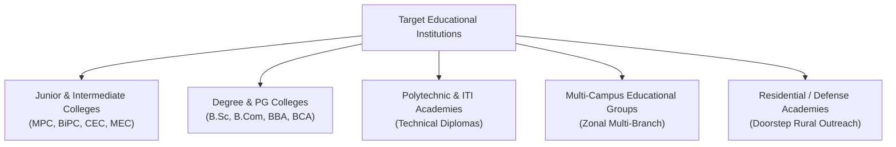
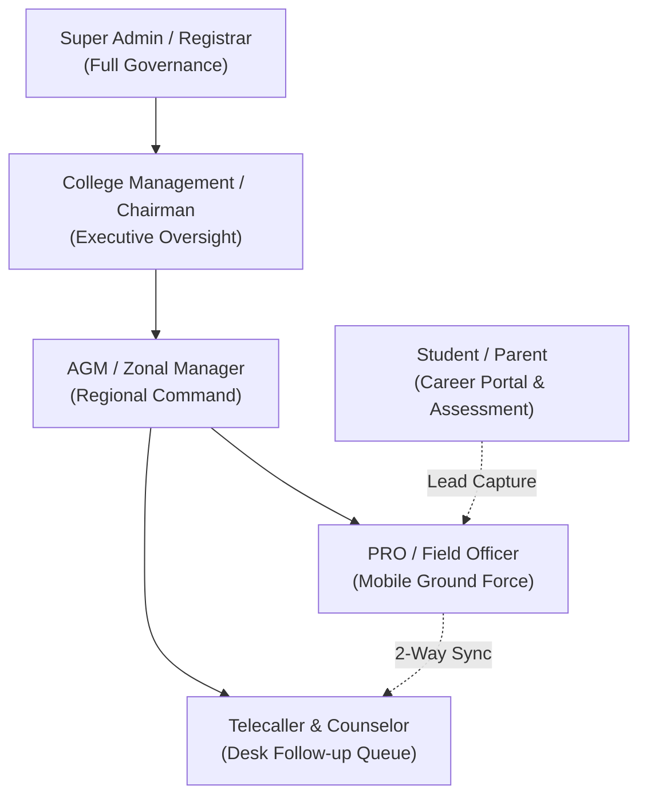
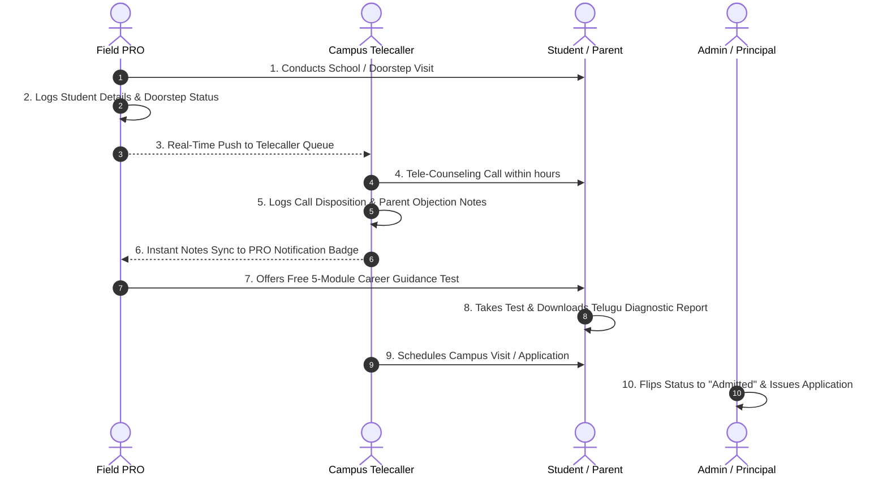
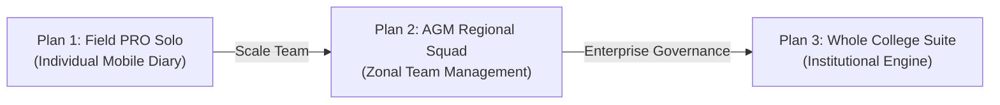

# College Admission Management & PRO Field Automation Platform
## Business & Product Overview Report

**Prepared for:** SriWeb Technologies  
**Product Reference Names in Codebase:** *Navanidhi Business*, *Sri Vaatsalya*, *Naaguru Lead Engine*, *PRO Day Report*  
**Document Type:** Business Analysis, Product Requirements & Go-to-Market Strategy Document  
**Target Output:** Content Foundation for SriWeb Technologies B2B SaaS Product Landing Page  
**Status:** 100% Verified against Active Codebase (Prisma Schema, App Router Routes, API Endpoints, UI Components)

---

## 1. Executive Summary

Educational institutions—particularly Junior Colleges, Intermediate Campuses, Degree Colleges, Engineering Institutes, and Poly-Technic Academies—face fierce annual competition to fill student seats. Traditional student recruitment relies on Public Relations Officers (PROs) and field counselors travelling across villages, visiting high schools, and recording student details on paper diaries, disconnected WhatsApp groups, and personal notebooks.

This legacy approach creates five crippling business vulnerabilities:
1. **Critical Lead Theft & Data Loss:** When an experienced PRO resigns or joins a competing college, they take student phone numbers, school headmaster contacts, and village influencer records with them.
2. **Cold Leads & Delayed Outreach:** Leads gathered in rural schools often take two to three weeks to reach campus telecallers, by which time competing colleges have already admitted the student.
3. **School Gatekeeper Resistance:** High school headmasters frequently refuse campus access to college sales reps who are perceived as purely commercial recruiters.
4. **Zero Field Accountability:** Management cannot verify whether PROs actually conducted village doorstep visits, met headmasters, or engaged families.
5. **Blind Administrative Oversight:** Chairmen and Principals only discover low student enrollment in late May or June, when the admission cycle has already peaked.

The application analyzed in this workspace (**PRO Day Report / Sri Vaatsalya / Navanidhi Business**) is a specialized **B2B Education SaaS Platform** engineered specifically to solve these challenges. It connects four critical stakeholders—**College Management, Regional Managers (AGMs), Field PROs, and Central Telecallers**—into one synchronized real-time admission pipeline, powered by a **5-Module Student Career Aptitude & Guidance Engine** that acts as an ethical, high-conversion student magnet.

### Verified Product Identity

| Attribute | Verified Value from Codebase |
| :--- | :--- |
| **Primary Codebase Name** | `student-day-report` / `pro-day-report` |
| **Existing Brand Identities Found** | **Navanidhi Business** *(Landing Page)*, **Sri Vaatsalya** *(PRO & Telecaller Portals)*, **Naaguru** *(Auth & Login Branding)* |
| **Recommended Public Brand Name** | **SriVaatsalya Admission Suite** (or **SriWeb EduPRO**) |
| **Recommended Tagline** | *"The Complete Closed-Loop Admission Conversion & PRO Fleet Automation Engine"* |
| **Deployment Targets** | Cloud Web Application (Next.js 16) + Native Android Mobile App (Capacitor `com.prodayreport.app`) + PWA |
| **Target Market** | Junior / Intermediate Colleges, Degree Colleges, Technical Academies, and Multi-Campus Educational Groups |

---

## 2. Product Overview

### What is this software?
It is a cloud-based B2B SaaS Admission Acceleration and Field Operations Management platform. Unlike generic generic ERPs that focus on classroom timetables and library fines, this software is hyper-focused on the **revenue engine of an educational institution: Student Enrolment, Lead Generation, Field Route Management, Telecalling Follow-up, and Admission Conversion.**

### What core problem does it solve?
It eliminates the disjointed "paper diary" workflow of college admission campaigns. It provides a single institutional repository where student leads, school headmaster contacts, village influencers, and family relationships are encrypted, owned by the college, and instantly shared between field representatives and office counselors.

### Why would a college or educational institution need it?
1. **Guaranteed Institutional Data Ownership:** Every phone number entered into the system belongs to the college vault. If an employee resigns, their access is revoked in one click, while their entire history of visits, notes, and contacts remains intact.
2. **High-Velocity Field-to-Desk Push:** The moment a PRO inputs a student lead in a rural school or village home, the campus telecalling desk receives an instant notification and can call the parents while the interaction is still warm.
3. **The "Career Guidance Magnet" (Ethical School Entry):** Instead of knocking on school doors to "sell seats," PROs offer high school headmasters and 10th-grade students a free, scientifically structured **5-Module Career Clarity & Aptitude Test**. Headmasters welcome the service, parents appreciate the insights, and the college ethically captures verified leads.
4. **Mandal & Village Coverage Heatmaps:** Principals and Area Managers can visually track every high school's total 10th strength, Grade rating (A+, A, B), and current lead collection progress to ensure zero unvisited territory.

### Who are its target customers?
- **Junior & Intermediate Colleges (Class 11 & 12):** Specifically institutes offering MPC (Maths, Physics, Chemistry), BiPC (Biology, Physics, Chemistry), CEC (Commerce, Economics, Civics), MEC (Maths, Economics, Commerce), and HEC streams.
- **Polytechnic & ITI Institutes:** Technical vocational colleges running rural awareness and enrollment drives.
- **Degree Colleges:** Higher education colleges managing multi-stream admissions across B.Sc, B.Com, BBA, and BCA.
- **Residential Academies & Defense Academies:** Campuses requiring intensive doorstep parent counseling across multiple districts.
- **Multi-Branch Educational Groups:** Educational societies operating campuses across multiple towns and districts.

---

## 3. Target Customers & Market Segments

### Detailed Customer Personas

| Institution Type | Primary Admission Challenge | How the Software Solves It |
| :--- | :--- | :--- |
| **Junior Colleges (10th to Inter)** | Intense seasonal competition during March–June; high school headmasters block marketing reps. | Free 5-Module Career Guidance test & Study Books unlock high school access; instant Telugu/English career reports win parent trust. |
| **Regional Multi-Campus Groups** | Managing 15–40 field officers across 4–8 districts without lead overlap or staff data theft. | Zonal hierarchy (Director ➔ AGM ➔ PRO ➔ Telecaller), mandal boundaries, and centralized Institutional Lead Vault. |
| **Degree & Vocational Colleges** | Difficulty tracking non-science stream leads (Commerce, Arts, Vocational) across rural towns. | Stream-specific quota filters (CEC, MEC, HEC, ITI), village influencer mapping, and occupation-based parent profiling. |
| **Residential & Day-Boarding Campuses** | PROs spend hours travelling to distant villages with no accountability on whether home visits occurred. | Doorstep verification tracking, village relative contact mapping, GPS/mobile logs, and one-click WhatsApp Day Report PDFs. |

---

## 4. Complete Feature Catalogue

Every feature below has been verified directly against active schema definitions, database models, frontend interfaces, and backend endpoints.

### Feature Status Legend:
- **[Implemented]**: Fully functional in database, backend API, and user interface.
- **[Partially Implemented]**: Functional in UI/model but lacks deep downstream automation or is simulated on the client.
- **[Not Present / ERP Out of Scope]**: Traditional academic ERP features deliberately omitted from this admission-centric product.

---

### Category A: Student Management & Lead Lifecycle

| Feature Name | Capability & User Experience | Problem Solved | Primary Beneficiary | Current Status |
| :--- | :--- | :--- | :--- | :--- |
| **Mobile-First Student Profile Capture** | Captures student name, father's name, gender, phone, WhatsApp number, parent occupation, village, mandal, district, school name, and 10th marks. | Clumsy paper intake forms and illegible handwriting. | PRO, Telecaller | **[Implemented]** |
| **Duplicate Phone Number Blocker** | Debounced real-time check (`/api/students/check-phone`) warns officers if a phone number already exists in the institution database. | Prevents duplicate records, wasted phone calls, and PRO commission disputes. | Telecaller, Admin | **[Implemented]** |
| **Student Pre-Registration Auto-Linking** | When a student registers on the student portal using their phone number, the system automatically detects if a PRO previously created their record, sets their password, and activates their profile without losing visit history. | Disconnected records between on-ground field outreach and online student test activity. | Student, PRO, Admin | **[Implemented]** |
| **Star Leads (Prime Prospect Filter)** | Algorithm isolates high-value prospects: Target stream (MPC/BiPC) + Target location (e.g., Vizag) + Parent fee bearable status ("Yes"). | Identifies hot leads with high admission probability and financial readiness. | PRO, Telecaller, Management | **[Implemented]** |
| **Doorstep Verification Tracking** | Boolean flag (`doorstepCompleted`) tracks whether an officer physically visited the student's residence and met parents. | Eliminates fake field claims; guarantees physical presence. | AGM, Principal | **[Implemented]** |
| **Complete Profile Meter** | Real-time completeness meter highlights missing critical data (father name, location, school, occupation). | Incomplete records that lead to failed follow-up calls. | PRO, Telecaller | **[Implemented]** |
| **Comprehensive Lead Statuses** | Multi-state tracking: `New`, `Interested`, `Follow-up Required`, `Campus Visit Scheduled`, `Joined Other College`, `Not Interested`, and `Admitted`. | Unclear lead pipeline stages. | Telecaller, Management | **[Implemented]** |

---

### Category B: Admission & Enrollment Management

| Feature Name | Capability & User Experience | Problem Solved | Primary Beneficiary | Current Status |
| :--- | :--- | :--- | :--- | :--- |
| **Direct Admission Confirmation (`/api/students/[id]/admit`)** | Flips student status to `Admitted`, logs admission date, and associates student with the specific campus branch (`joinedCollegeId`). | Manual admission registers and inaccurate intake counts. | College Registrar, Management | **[Implemented]** |
| **Spot Application Number Issuance** | Assigns official institution application number (`applicationNumber`) upon admission confirmation. | Missing receipt tracking between field deposits and office ledgers. | Admission Office | **[Implemented]** |
| **Branch / College Quota Isolation** | College accounts (`role: COLLEGE`) are restricted by `allowedGroups` (MPC, BiPC, CEC) and `allowedLocations` (Mandal/District boundaries). | Campus branches seeing or tampering with other campuses' students. | Multi-Campus Directors | **[Implemented]** |
| **Exam-Triggered Follow-up Queuing** | Follow-up schedules support dynamic milestones: `After Exams`, `After Results`, or exact calendar date. | Calling parents at the wrong time (e.g., during board exam week). | Telecaller, Parent | **[Implemented]** |

---

### Category C: Field Operations & PRO Fleet Automation

| Feature Name | Capability & User Experience | Problem Solved | Primary Beneficiary | Current Status |
| :--- | :--- | :--- | :--- | :--- |
| **Mobile Field Workspace (PWA & Android)** | Responsive mobile touch interface with quick-action tiles, floating action buttons, and bottom tab navigation. | Inability to use clunky desktop ERP software while walking village routes. | PRO | **[Implemented]** |
| **Village Visit Log & Photo Sync** | PROs log date-stamped visit notes, outcome, and target college branch directly in the field. | PROs forgetting who they met three days ago. | PRO, AGM | **[Implemented]** |
| **One-Click Native WhatsApp Share** | PROs can instantly share formatted student visit notes directly to institutional WhatsApp groups using Capacitor Native Share or Web Share API. | Slow daily reporting to managers via manual typing. | PRO, AGM | **[Implemented]** |
| **Village Relatives & Referral Directory** | Dedicated 78KB module tracking local relatives (`Uncle`, `Aunt`, `Brother`, `In-Law`, `Village Leader`) mapped to mandals, villages, and occupations. | PROs losing referral networks when visiting new villages. | PRO, Telecaller | **[Implemented]** |
| **Village Influencer / Key Persons Register** | Catalog of village sarpanches, local leaders, coaching tutors, and prominent figures with designations and contact numbers. | Entering unfamiliar villages without local credibility or trust. | PRO, Management | **[Implemented]** |
| **Daily Activity Report PDF (`/reports/generate`)** | Custom date-range PDF generator that compiles student visits, phone numbers, parent professions, and doorstep status with customizable columns. | Hours spent writing end-of-day physical paper summaries. | PRO, Principal | **[Implemented]** |

---

### Category D: Telecalling & Counseling Conversion Desk

| Feature Name | Capability & User Experience | Problem Solved | Primary Beneficiary | Current Status |
| :--- | :--- | :--- | :--- | :--- |
| **Dedicated Telecaller Workspace (`/telecaller`)** | Purpose-built desktop and mobile calling interface restricted to leads assigned by managers (`assignedEmployees`). | Telecallers distracted by administrative functions or unassigned leads. | Telecaller | **[Implemented]** |
| **Daily Call Volume Counter (`/api/telecaller/stats`)** | Live counter tracking calls logged today, scheduled follow-ups due today, and new leads pushed today. | Lack of visibility into telecaller productivity. | Telecaller, Supervisor | **[Implemented]** |
| **Scheduled Callback Queue** | Filters leads by exact callback date with overdue badges. | Missed callbacks to interested parents. | Telecaller | **[Implemented]** |
| **Direct School HM & Key Person Calling Desk** | Telecallers can switch from student queues to direct Headmaster and Key Person directories with telephone dialing shortcuts. | Telecallers lacking institutional contact information. | Telecaller, Principal | **[Implemented]** |
| **2-Way Field-Desk Notes Synchronization** | Updates made by telecallers immediately surface in the PRO's "Telecaller Updates" notification badge (`unreadUpdatesCount`), and PRO notes appear in telecaller views. | PRO walking into a student's home unaware that the parent already spoke with office staff. | PRO, Telecaller, Parent | **[Implemented]** |

---

### Category E: Student Magnet & Career Guidance Engine (USP)

| Feature Name | Capability & User Experience | Problem Solved | Primary Beneficiary | Current Status |
| :--- | :--- | :--- | :--- | :--- |
| **Student Self-Service Portal (`/student/dashboard`)** | Dedicated web portal with secure student login, dashboard metrics, career tools, and digital resources. | Students feeling pressured by commercial sales pitches. | Student, Parent | **[Implemented]** |
| **5-Module Career Clarity & Aptitude Test** | Evaluates students across 5 key dimensions: Module 1 (Group Clarity), Module 2 (Study Discipline), Module 3 (Screen Time & Habits), Module 4 (Family Attitude), and Module 5 (Career Readiness). | Students blindly selecting streams based on peer pressure without assessing aptitude. | Student, Parent, College | **[Implemented]** |
| **360° Career Diagnostic Report** | Calculates 10-point modular scores and identifies ideal streams (MPC, BiPC, CEC, MEC, HEC) and target professions (Doctor, Engineer, CA, Civil Services). | Parents confused about which group matches their child's strengths. | Parent, Student | **[Implemented]** |
| **Telugu & English Behavioral Action Plan** | Provides tailored advice, identified flaws (screen time addiction, procrastination), and daily improvement routines in bilingual Telugu and English text. | Generic English test reports that rural parents cannot read or relate to. | Telugu-speaking Families | **[Implemented]** |
| **Interactive Career Pathways Guide** | Visual pathway explorer breaking down degree requirements, competitive exams (JEE, NEET, EAMCET, CA Foundation), and job prospects across 6 streams. | Lack of career awareness among rural 10th-grade students. | Student | **[Implemented]** |
| **Digital Study Books Library** | Cloud repository of downloadable study materials and subject guides hosted on Google Drive. | Students needing supplementary study materials for board exams. | Student | **[Implemented]** |
| **Curated Video Guidance Library** | Video portal embedding educational guidance lessons, motivation sessions, and exam strategy videos. | Unstructured searching on public video platforms. | Student | **[Implemented]** |
| **Memory Secrets & Study Tips Module** | 76KB interactive component teaching scientific revision schedules, memory retention techniques, and exam stress management. | High exam anxiety and poor study habits among high schoolers. | Student | **[Implemented]** |
| **"Ask an Expert" Counseling Form** | Frontend question submission modal allowing students to submit career and scholarship queries. | Hesitation in calling admission officers directly. | Student | **[Partially Implemented]** *(UI & feedback functional; backend submission is client-simulated)* |

---

### Category F: Analytics, School Progress & Management Intelligence

| Feature Name | Capability & User Experience | Problem Solved | Primary Beneficiary | Current Status |
| :--- | :--- | :--- | :--- | :--- |
| **Mandal-by-Mandal School Progress Grid (`/analytics`)** | Drills down into individual mandals to inspect total schools, 10th-grade strength target, leads collected, and remaining quota. | Unvisited schools and blind marketing campaigns. | Principal, AGM | **[Implemented]** |
| **School Strength & Target PDF Generator** | One-click modal (`MandalSummaryReportModal.tsx`) exporting institution-wide school targets, collected count, grade breakdown, and completion percentages. | Preparing executive presentations for college board meetings. | Chairman, Principal | **[Implemented]** |
| **Real-time Enrollment Funnel** | Executive cards displaying total leads, admitted students, pending reviews, and today's new intake velocity. | Outdated weekly paper reports. | Management | **[Implemented]** |
| **Stream & Branch Distribution Breakdown** | Real-time intake meter tracking distribution across MPC, BiPC, CEC, MEC, and Polytechnic. | Imbalanced admissions (e.g., engineering full while biology is empty). | Principal | **[Implemented]** |

---

### Category G: Governance, Task Management & System Infrastructure

| Feature Name | Capability & User Experience | Problem Solved | Primary Beneficiary | Current Status |
| :--- | :--- | :--- | :--- | :--- |
| **Role-Based User Management (`/admin/users`)** | Granular user provisioning for Super Admins, College Managers, AGMs, PROs, and Telecallers with password resets and account toggles. | Unauthorized data access and security leaks. | Super Admin | **[Implemented]** |
| **Pending Student Approvals Queue (`/admin/pending-students`)** | Organic self-registered students are held in pending queue until approved by Admin and allocated to a specific PRO. | Stray unassigned leads slipping through the cracks. | Admin, PRO | **[Implemented]** |
| **Employee Task Manager (`/employee/tasks`)** | Managers assign categorized tasks (`SCHOOL_VISIT`, `DOCUMENT_VERIFICATION`, `OFFICE_WORK`, `COLLEGE_DUTY`) with deadlines, priority levels, and completion notes. | Lack of structured daily accountability for field teams. | AGM, PRO | **[Implemented]** |
| **Configurable Master Dictionaries (`/admin/config`)** | Admins customize dropdown masters: Districts, Mandals, Villages, Groups, Occupations, Study Interests, Fee Capacities, and Schools. | Hardcoded software requiring developer changes for new branches or streams. | Super Admin | **[Implemented]** |
| **Automated Google Drive Database Backups** | Scheduled script (`scripts/db-backup.ts`) dumping all Prisma tables, compressing into GZIP, and uploading to Google Drive via service account. | Devastating data loss from server crashes. | College Owner, IT Admin | **[Implemented]** |

---

### Category H: Capabilities NOT Present in this Codebase (Traditional ERP Features)

To maintain absolute commercial honesty, the following capabilities are **not implemented** in this application and should **not** be claimed on the marketing website:

| Capability | Status in Repository | Commercial Note |
| :--- | :---: | :--- |
| **Student Classroom Attendance & Biometrics** | **Not Present** | The software tracks field *doorstep visits*, not daily classroom lecture attendance. |
| **Academic Timetable & Syllabus Scheduling** | **Not Present** | The calendar tracks *telecaller follow-up alarms*, not lecture periods. |
| **Exam Hall Tickets & Semester Grading** | **Not Present** | The test engine is an *aptitude assessment test*, not university semester exams. |
| **Comprehensive Fee Accounting & Payment Gateway** | **Partially Implemented** | Qualifies parent fee capacity (`ableToBearFee`) and logs application numbers; does not process online payments or issue full fee receipts. |
| **Hostel & Transport Fleet Management** | **Not Present** | Not included in the repository. |

---

## 5. User Roles and Responsibilities

The application implements a rigorous **Role-Based Access Control (RBAC)** architecture in both its database schema (`prisma/schema.prisma`) and session validation layer (`lib/session.ts`).

### 1. Super Admin / System Registrar (`role: ADMIN`)
- **Primary Responsibility:** Complete administrative authority over system architecture, security, and institutional assets.
- **Accessible Information:** All student records across all zones, all staff accounts, questions bank, master configurations, and backup logs.
- **Key Activities:**
  - Create and manage user credentials for Principals, AGMs, PROs, and Telecallers.
  - Review and approve organic student self-signups in the **Pending Approvals Queue**.
  - Configure geographical mandals, high school directory, and stream lists.
  - Manage the 5-module career assessment question bank, weights, and scoring rules.
  - Upload digital study books (Google Drive PDF links) and guidance videos (YouTube links).
- **Contribution to Institution:** Guarantees centralized governance and data integrity across all admission seasons.

### 2. College Management / Chairman / Principal (`role: COLLEGE`)
- **Primary Responsibility:** High-level executive monitoring of admissions, seat intake, and regional productivity.
- **Accessible Information:** Filtered view restricted to `allowedGroups` (e.g., MPC, BiPC) and `allowedLocations` (specified districts/mandals).
- **Key Activities:**
  - Monitor total leads against confirmed admissions and target quotas.
  - Review today's and upcoming scheduled follow-ups across the institution.
  - Download board-ready school strength summaries and mandal progress reports.
- **Contribution to Institution:** Eliminates blind decision-making; provides continuous visibility into student enrollment velocity.

### 3. AGM / Zonal Team Leader (`role: TEAM_LEADER` / Area Manager)
- **Primary Responsibility:** Operational management of regional field clusters (typically 5 to 10 PROs covering a zonal cluster of mandals).
- **Accessible Information:** Field leads, visit records, and school coverage stats within their assigned territory.
- **Key Activities:**
  - Assign daily school visits and administrative tasks to field officers.
  - Monitor mandal-level school coverage heatmaps to prevent unvisited institutions.
  - Track PRO productivity, doorstep verification counts, and star lead generation.
- **Contribution to Institution:** Translates institutional admission targets into daily, accountable field execution.

### 4. PRO / Public Relations Officer (`role: EMPLOYEE` / Field Officer)
- **Primary Responsibility:** On-ground student outreach, high school visits, village home meetings, and influencer networking.
- **Accessible Information:** Leads, visits, tasks, relatives, and influencers created by or assigned to their employee ID.
- **Key Activities:**
  - Enter student leads directly on mobile while speaking with parents.
  - Toggle doorstep verification (`doorstepCompleted: true`) upon visiting student homes.
  - Catalog high school profiles (Headmaster contact, 10th student strength, Grade A+/A/B).
  - Map village influencers (sarpanches) and relative contacts.
  - Review updates and notes logged by telecallers before knocking on student doors.
  - Generate one-click PDF Day Reports and share via native WhatsApp integration.
- **Contribution to Institution:** Serves as the primary human touchpoint bringing verified student leads into the college funnel.

### 5. Telecaller & Counselor (`role: TELECALLER`)
- **Primary Responsibility:** Rapid lead qualification, phone counseling, campus visit scheduling, and objection handling.
- **Accessible Information:** Strictly restricted to leads assigned by managers (`assignedEmployees`).
- **Key Activities:**
  - Call newly captured field leads within minutes of PRO submission.
  - Update call dispositions (`Interested`, `Follow-up Required`, `Campus Visit Scheduled`, `Joined`, `Not Interested`).
  - Access prior PRO visit notes and parent fee bearable status during the call.
  - Schedule exact callback alarms and exam-specific triggers (`After Exams`, `After Results`).
  - Direct tele-counseling with High School Headmasters and village influencers.
- **Contribution to Institution:** Converts raw field leads into campus visits and confirmed admissions.

### 6. Student / Prospective Applicant (`Role: STUDENT`)
- **Primary Responsibility:** Completing the aptitude test, exploring streams, and accessing preparation materials.
- **Accessible Information:** Personal profile, career test questions, modular score report, Telugu action plan, study library, and career pathways.
- **Key Activities:**
  - Self-register or log in via phone number (auto-linked to field PRO records).
  - Complete the 25-question, 5-module digital career assessment.
  - Review personalized strengths, study discipline scores, and screen time habits.
  - Download digital study books and watch guidance videos.
  - Submit counseling queries via "Ask an Expert."
- **Contribution to Institution:** Serves as the self-qualifying prospect who transitions from an unknown high schooler into an enrolled student.

---

## 6. End-to-End Business Workflows

The software supports four interconnected, verified business workflows:

### Workflow 1: Closed-Loop Admission Conversion (Field + Telecaller)
1. **Initiation (Field):** The PRO meets a 10th-grade student at a school or home, captures their phone number, stream preference (MPC/BiPC), parent occupation, and fee bearable status, and saves it in the mobile app.
2. **Instant Push (Automated):** The lead immediately populates the assigned Telecaller's dashboard under "New Leads Today."
3. **Tele-Consultation (Desk):** The telecaller phones the parent while the PRO's interaction is fresh, answers fee queries, and schedules a campus visit.
4. **Bidirectional Sync (Automated):** The telecaller enters call notes. A red notification badge immediately alerts the PRO on their mobile dashboard (`/employee/telecaller-updates`).
5. **Re-visit & Verification (Field):** The PRO reviews the telecaller's notes and visits the family again to close the admission.
6. **Admission Locking (Office):** The student pays their deposit; the registrar enters the official application number and flips status to "Admitted," instantly updating the principal's quota dashboard.

### Workflow 2: The "Career Guidance Magnet" Lead Acquisition Loop
1. **School Engagement:** The PRO meets the High School Headmaster, offering a free digital aptitude assessment for 10th-grade students.
2. **Student Self-Signup:** Students visit the student portal (`/student/register`) and register with their phone numbers.
3. **Pre-Registration Link:** If the PRO already entered the student's phone number, the system instantly matches the records and grants instant access without administrative delay.
4. **Assessment & Diagnostic Generation:** The student answers 25 questions across the 5 modules. The engine generates an immediate 360° diagnostic report featuring Telugu action plans and ideal stream recommendations (e.g., BiPC + Medicine).
5. **Institutional Trust:** The college is viewed by parents as a supportive educational guide rather than an aggressive commercial seller, driving spontaneous admission inquiries.

### Workflow 3: Mandal & High School Outreach Management
1. **Territory Planning:** The AGM reviews the Mandal Coverage Grid (`/analytics`) to identify schools with high 10th-grade student strengths (e.g., Grade A+ schools with 150+ students).
2. **Task Dispatch:** The AGM creates a task (`category: SCHOOL_VISIT`) assigned to a specific PRO with a due date.
3. **Field Execution:** The PRO visits the school, records the Headmaster's name, phone number, and student strength, and logs collected student contacts.
4. **Executive Reporting:** The Principal clicks "Download Schools & Strength Summary PDF" to evaluate total collected leads against the school's total student capacity.

### Workflow 4: Village Key Person & Relative Networking
1. **Influencer Mapping:** During village visits, PROs identify local sarpanches, community elders, and coaching teachers, recording them under "Important Persons."
2. **Relative Network:** PROs record family connections (e.g., "Uncle - Agriculture", "Sister - Teacher") in the Relative Directory.
3. **Tele-Coordination:** Telecallers access the Key Persons directory to seek local endorsements for the college, building immense social proof in rural communities.

---

## 7. Customer Benefits & Commercial Value Proposition

| Stakeholder | Key Commercial Pain Points | Verified Practical Benefits Provided |
| :--- | :--- | :--- |
| **College Owners & Chairmen** | • Data theft when staff quit. • Late realization of seat shortfalls. • Lack of ROI on marketing spend. | • **100% Institutional Data Vault:** Encrypted cloud repository where data remains locked to the college. • **Real-Time Intake Funnel:** Live executive metrics for total inquiries, conversion rates, and stream capacity. • **Mandal & School ROI:** Clear visibility into which high schools generate actual paying admissions. |
| **Principals & Admission Deans** | • Managing paper admission registers. • Unbalanced stream allocations. • Disorganized multi-campus tracking. | • **Stream Quota Tracking:** Real-time visibility into MPC, BiPC, and CEC seat targets. • **Board-Ready PDF Reports:** 1-click export of mandal summaries, school progress, and daily logs. • **Strict Role Boundaries:** Campus-isolated views preventing unauthorized data access. |
| **Area Managers & AGMs** | • Inability to track field officers. • Unvisited rural schools. • Conflicting lead claims among reps. | • **Zonal Team Board:** Track daily leads and doorstep verifications across all assigned PROs. • **Mandal School Coverage:** Visual progress tracking against school capacity targets. • **Automated Task Dispatch:** Structured task assignment with priority levels and deadlines. |
| **Telecallers & Counselors** | • Excel sheet confusion. • Forgotten follow-ups. • Calling cold leads with zero context. | • **Live Pushed Leads:** Incoming leads ready for dialing within minutes of field entry. • **Scheduled Callback Alarms:** Never miss an appointment with interested parents. • **PRO Context in View:** See family occupation and fee bearable status before dialing. |
| **Field PROs & Counselors** | • Carrying bulky paper diaries. • Headmasters turning them away. • Hours spent typing daily reports. | • **Mobile Workspace:** Rapid lead entry, offline access, and mobile touch design. • **Ethical School Pass:** Offer free aptitude tests to gain immediate headmaster approval. • **1-Click WhatsApp PDF Report:** Generate and share official daily summaries in seconds. |
| **Students & Parents** | • Confusion over intermediate streams. • Annoying marketing calls. • Lack of exam preparation guidance. | • **Personalized Career Clarity:** Scientific evaluation of aptitude (MPC vs BiPC vs CEC). • **Telugu Action Plan:** Understandable guidance on screen time, study habits, and exam routines. • **Free Study Materials:** Free access to digital books, videos, and memory techniques. |

---

## 8. Top Product Highlights for Landing Page Showcase

When designing the premium product landing page for SriWeb Technologies, showcase these six verified high-impact features:

### 1. The Closed-Loop Field-to-Desk Push
- **Why it matters:** 70% of rural leads go cold when follow-ups are delayed by weeks. Instant 2-way sync connects on-ground PROs directly to office telecallers, alerting PROs via mobile notification badges as soon as phone calls are logged.
- **Recommended Landing Page Tag:** *"Zero Lead Decay: Instant Field-to-Desk Sync"*

### 2. The Institutional Lead Vault (Zero Data Leakage)
- **Why it matters:** Solves the #1 fear of college chairmen—PROs walking away with hundreds of student phone numbers upon resignation. Data is encrypted and locked to the college master account.
- **Recommended Landing Page Tag:** *"100% Institutional Data Protection"*

### 3. The 5-Module Career Guidance & Aptitude Engine (The "Trojan Horse")
- **Why it matters:** Transforms the college from an unwelcome commercial advertiser into a respected educational mentor. Provides students with instant diagnostic reports, Telugu behavioral advice, and career clarity.
- **Recommended Landing Page Tag:** *"Ethical School Access via Digital Career Guidance"*

### 4. Mandal & High School Coverage Heatmap
- **Why it matters:** Empowers directors and AGMs to monitor every high school in their district, displaying 10th-grade capacity, grade ratings (A+/A/B), and collected lead counts.
- **Recommended Landing Page Tag:** *"Territory Intelligence & High School Data Bank"*

### 5. Native Mobile PRO Experience (PWA & Android APK)
- **Why it matters:** Lightweight mobile app built for poor rural connectivity. Supports quick-add forms, doorstep verification toggles, and 1-click WhatsApp Day Report sharing.
- **Recommended Landing Page Tag:** *"Built for Ground Force Mobility"*

### 6. Automated Encrypted Cloud Backups (Google Drive API)
- **Why it matters:** Complete peace of mind for institutional management. Automated cron scripts dump database models, compress into GZIP, and upload to Google Drive.
- **Recommended Landing Page Tag:** *"Automated Cloud Resilience"*

---

## 9. Product Differentiators vs. Traditional Campus ERPs

| Capability / Factor | Generic College ERPs (CollPoll, MasterSoft, Fedena) | SriWeb Admission Suite (This Application) |
| :--- | :---: | :---: |
| **Primary Design Focus** | Post-admission campus admin (fees, library, timetable, exams). | **Pre-admission conversion, field marketing & student intake.** |
| **Field PRO Tracking** | ❌ None (assumes students walk into campus office). | ✔ **Complete mobile field log, doorstep verification & GPS notes.** |
| **High School Directory** | ❌ Basic text field in application form. | ✔ **Master school directory with HM contacts, 10th strengths & grades.** |
| **Telecalling Sync** | ❌ Disconnected from field outreach. | ✔ **2-way live push between field officers and phone counselors.** |
| **Student Magnet Feature** | ❌ None (pure application form). | ✔ **5-Module Aptitude Test Engine with Telugu action reports.** |
| **Data Theft Protection** | ⚠️ PROs keep offline diaries; data lost on exit. | ✔ **Encrypted Institutional Lead Vault with instant access revocation.** |
| **Daily Field Reporting** | ❌ Manual Excel sheet compilation. | ✔ **1-click PDF Day Report with native WhatsApp sharing.** |
| **Implementation Timeline** | 3 to 6 months (heavy, complex configuration). | **5 to 10 days (admission-season ready).** |

---

## 10. Suggested Subscription Plan Structure

*Note: As instructed, the tiers below are strategically derived from the application's actual architecture and codebase configurations. Final commercial prices and contract terms remain subject to business confirmation.*

### Proposed Subscription Packaging

| Plan Dimension | Plan 1: Field PRO Solo *(Starter)* | Plan 2: AGM Regional Squad *(Professional)* | Plan 3: Whole College Suite *(Enterprise)* ⭐ |
| :--- | :--- | :--- | :--- |
| **Target Customer** | Independent PRO / Field Officer | Regional Area Manager + 5–10 PROs | College Chairman, Principal, Multi-Campus Group |
| **Positioning Hook** | Personal digital route tracker & visit diary. | Regional target tracking & zonal coordination. | **End-to-End Admission Conversion & Data Vault.** |
| **User Access Included** | 1 Dedicated PRO Mobile Login | 1 AGM Manager + Up to 8 PRO Logins | **Unlimited PROs + Multi-AGM + Telecallers + Master Admin** |
| **Telecaller Desk** | ❌ Excluded | ❌ Excluded | ✔ **Full Central Telecalling Desk (2-Way Live Sync)** |
| **Career Test Engine** | ❌ Basic self-signup only | ❌ Basic self-signup only | ✔ **White-Labeled Career Aptitude Test & Diagnostic PDF** |
| **School Directory** | Personal Log only | Zonal Shared Log | ✔ **Master Institutional School Data Bank** |
| **Data Ownership** | PRO owns leads | Zonal scope | ✔ **100% Institutional Lead Vault (No data loss on exit)** |
| **Management Analytics**| Personal Daily PDF | Zonal Performance Leaderboard | ✔ **Full Admission Funnel, Mandal Heatmaps & Board PDFs** |
| **Cloud Backups** | ❌ None | Weekly Export | ✔ **Daily Automated Encrypted Google Drive Backups** |
| **Support SLA** | Standard Email (48h) | Priority WhatsApp Group (12h) | **Dedicated Relationship Manager & Live Phone Support** |
| **Indicative Pricing** *(Codebase Reference)* | **₹999 / mo** (or ₹9,999 / yr) | **₹4,999 / mo** (or ₹49,999 / yr) | **₹19,999 / mo** (or ₹1,89,000 / yr) |
| **Final Commercial Terms**| *Needs Business Decision* | *Needs Business Decision* | *Needs Business Decision* |

---

## 11. Recommended Product Landing Page Content

Below is the structured copywriting hierarchy designed for SriWeb Technologies to deploy on the product landing page:

### Hero Section
- **Pre-Header Badge:** `B2B Education SaaS Platform`
- **Main Heading:**
  > Streamline Your Admissions, Empower Your Field PROs & Stop Student Lead Theft
- **Sub-Heading:**
  > The all-in-one admission acceleration engine for Junior Colleges, Degree Campuses, and Educational Groups. Unify on-ground field officers, high-velocity telecallers, and executive leadership into one high-conversion pipeline.
- **Primary CTA:** `[Schedule a Live Institutional Demo]`
- **Secondary CTA:** `[Explore Feature Matrix]`

### Value Proposition Cards (The 3 Pillars)
1. **For Field PROs: "Zero Paperwork. Maximum Field Velocity."**
   *Log school visits, verify student doorsteps, and generate WhatsApp Day Reports directly from your mobile phone while travelling through villages.*
2. **For Telecallers: "Never Let a Warm Field Lead Go Cold."**
   *Receive real-time lead pushes within minutes of field submission. Manage scheduled callbacks, log call dispositions, and access parent context instantly.*
3. **For Chairmen & Principals: "100% Institutional Data Ownership."**
   *Every student phone number and school contact stays locked in your institutional vault forever—protecting your college from staff turnover and data theft.*

### Interactive Module Highlight: "The Student Magnet USP"
- **Header:** Turn Reluctant High Schools into Verified Student Lead Sources
- **Description:** Headmasters reject sales representatives, but welcome free career guidance. Equip your PROs with our **5-Module Career Aptitude & Guidance Assessment**. Offer high schools free aptitude testing for 10th-grade students, generate instant bilingual Telugu/English diagnostic reports for parents, and capture high-intent leads ethically.

---

## 12. Frequently Asked Questions (Verified Information)

#### Q1: What makes this software different from a general College ERP like Fedena or MasterSoft?
**Answer:** Traditional ERPs manage students *after* they are enrolled—handling classroom timetables, exam halls, and library books. This platform is engineered specifically for the *pre-admission revenue lifecycle*: field PRO tracking, high school headmaster outreach, closed-loop telecalling, and student enrollment conversions.

#### Q2: Does the application work smoothly on mobile phones for field officers?
**Answer:** Yes. The PRO interface is mobile-first, lightweight, and touch-optimized. Field representatives can log student doorsteps, view school headmaster contacts, and record visits directly from any smartphone browser or native Android APK.

#### Q3: What happens to our college's student data if a PRO resigns?
**Answer:** In the Institution Suite, all student phone numbers, visit logs, and school notes belong to your college's encrypted master vault. Individual PROs only have role-restricted access. When an employee leaves, their login is deactivated in one click, while all historical relationships stay completely intact.

#### Q4: How does the 2-way sync between PROs and Telecallers work?
**Answer:** The second an officer submits a student lead in a village, it surfaces in the telecaller's calling queue. When the telecaller logs call feedback (e.g., "Parent visiting campus Saturday"), a red notification badge immediately alerts the PRO on their mobile dashboard before they make a home visit.

#### Q5: Can we configure our college's specific streams and course groups?
**Answer:** Yes. The administrative panel features master configuration tools to customize your exact stream offerings—such as MPC, BiPC, CEC, MEC, HEC, and Polytechnic—along with district and mandal boundaries.

#### Q6: How does the Student Career Assessment generate diagnostic reports?
**Answer:** The assessment consists of 25 structured questions across 5 modules: Group Clarity, Study Discipline, Screen Time, Family Attitude, and Career Readiness. Upon submission, the engine calculates 10-point modular scores and produces an immediate personalized report with actionable guidance in both Telugu and English.

#### Q7: Does the system support automated database backups?
**Answer:** Yes. The platform includes an integrated backup utility that compresses Prisma database tables into encrypted GZIP archives and automatically uploads them to Google Drive via service accounts.

---

## 13. Business Decisions Still Required Before Commercial Launch

The following operational and commercial decisions cannot be determined from the repository source code and require executive business confirmation by SriWeb Technologies:

- [ ] **Final Launch Identity:** Choose whether the commercial market product is branded under **SriWeb EduPRO**, **Sri Vaatsalya Suite**, or **Navanidhi Business**.
- [ ] **Pricing Slab Finalization:** Confirm whether Plan 1 (₹999/mo), Plan 2 (₹4,999/mo), and Plan 3 (₹1,89,000/yr) will be adopted as standard public pricing or customized per campus size.
- [ ] **Student Volume Limits:** Determine whether user plans enforce a maximum cap on registered student leads (e.g., 2,500 leads vs. unlimited).
- [ ] **Data Migration Services:** Establish standard charges for migrating existing college Excel databases, school master lists, and employee directories.
- [ ] **Onboarding & Staff Training Fees:** Decide whether hands-on field orientation and telecaller workshops are included free in the annual contract or billed as a separate implementation fee.
- [ ] **SMS & WhatsApp Gateway Integration:** Confirm whether automated SMS notifications and official WhatsApp Business API alerts (currently manual/native share) will be added to the technical roadmap.
- [ ] **Payment Gateway Integration:** Decide whether online application fee processing (Razorpay/Cashfree) should be integrated into the student portal for spot seat reservations.
- [ ] **Sales Contact Channels:** Specify official sales inquiry telephone numbers, WhatsApp business desks, and demo scheduling calendars to be linked on the landing page.

---

## 14. Feature Status and Verification Summary

| System Module | Verified Features in Codebase | Implementation Status | Commercial Landing Page Recommendation |
| :--- | :--- | :---: | :--- |
| **Student Lead Management** | Quick Add, Duplicate Checker, Star Leads Filter, Doorstep Verification, Pre-registration Matching | **Implemented** | Highlight as primary on-ground field feature. |
| **Admission Pipeline** | Status Flipping (`Admitted`), Quota Association (`joinedCollegeId`), Application # Assignment | **Implemented** | Feature in Admission Operations section. |
| **Field PRO Mobility** | Mobile PWA, Android APK, Village Visit Log, 1-Click WhatsApp Share, Key Persons Directory | **Implemented** | Core showcase feature for field workforce. |
| **Telecalling Conversion Desk** | Assigned Calling Queue, Call Outcome Logging, Scheduled Callbacks, HM & Key Person Calling | **Implemented** | Core showcase feature for desk counselors. |
| **Field ⟷ Desk 2-Way Sync** | Bidirectional remarks sync, real-time unread update counter, mobile notification badge | **Implemented** | Emphasize as top differentiator against spreadsheets. |
| **Career Aptitude Engine** | 5-Module Test Engine, Scoring Algorithm, Stream Recommendation, Instant Telugu/English Report | **Implemented** | Primary "USP / Student Magnet" showcase. |
| **Study Resources Library** | Digital Study Books (Google Drive), Study Videos (YouTube), Memory Secrets Guide | **Implemented** | Feature as high-value student portal asset. |
| **Territory Intelligence** | Mandal School Progress, HM Directory, 10th Strength Targets, jsPDF Summary Reports | **Implemented** | Key feature for Directors & AGMs. |
| **User Roles & RBAC** | Admin, College, AGM/Team Leader, PRO, Telecaller, Student authentication boundaries | **Implemented** | Emphasize enterprise governance. |
| **Cloud Backups** | Automated Prisma dump, GZIP compression, Google Drive API upload via cron | **Implemented** | Feature in Data Security section. |
| **Ask an Expert Desk** | UI submission modal with student counseling form | **Partially Implemented** | Present as roadmap enhancement or call-in option. |
| **Fee Accounting / ERP** | Fee bearable qualification attribute (`ableToBearFee`), spot application fee logging | **Partially Implemented** | Market as "Fee Qualification", not complete billing ERP. |
| **Classroom Attendance** | Student daily lecture attendance & biometrics | **Not Present** | Omit from landing page; keep product scope focused on admissions. |
| **Academic Timetable** | Classroom lecture schedules & syllabus tracking | **Not Present** | Omit from landing page. |

---

*Report compiled by SaaS Product Strategy & Business Architecture Analysis for SriWeb Technologies.*
