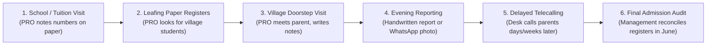
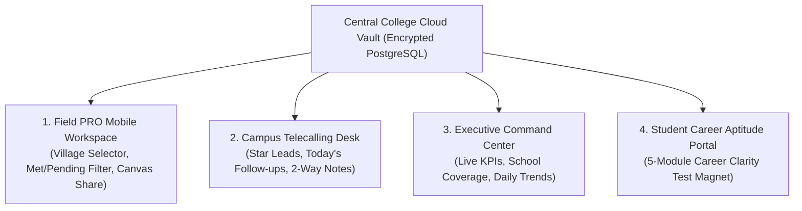
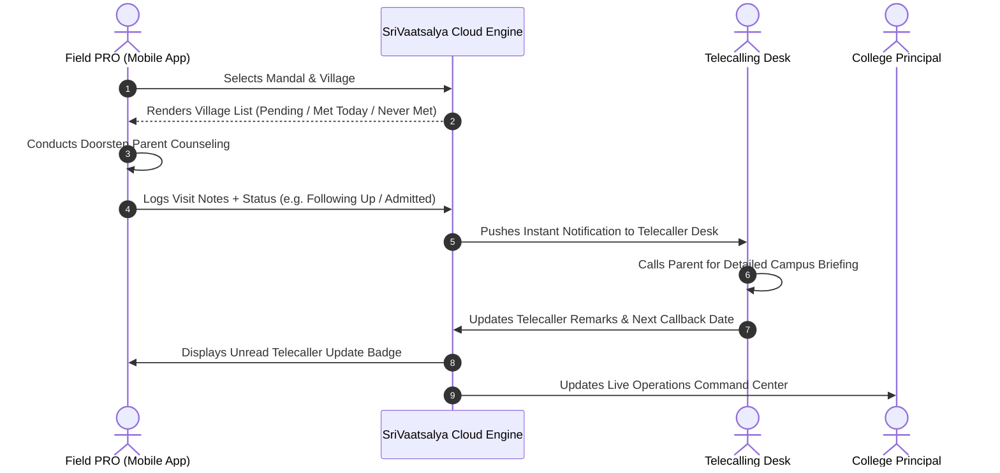

# Institutional Admissions Operations & Field Fleet Automation Suite
## Strategic Sales Proposal for Intermediate Colleges

**Document Type:** Institutional Sales Proposal & Strategic Partnership Document  
**Target Audience:** College Correspondent, Chairman, Principal, and Admissions Director  
**Application Target:** Junior & Intermediate Colleges (Class 11 & 12: MPC, BiPC, CEC, MEC, HEC)  
**Presented by:** SriWeb Technologies  
**Solution Reference:** SriVaatsalya Admissions Suite (`student-day-report`)  

---

## 1. Product Title & Positioning

### **SriVaatsalya Admissions Suite**
#### *The Complete Closed-Loop Admission Conversion & Field Operations Management Engine*

**Positioning Statement:**  
Unlike generic classroom ERPs that track lecture timetables and library fines after students arrive, **SriVaatsalya Admissions Suite** is an operational platform engineered specifically for the revenue engine of intermediate colleges: **Student Lead Generation, Village Route Management, Doorstep Verification, Closed-Loop Telecalling, and Institutional Data Protection.**

---

## 2. Executive Summary

Intermediate education in Andhra Pradesh and Telangana is characterized by an intensive 5-month admission window. Every year, colleges invest substantial capital into Public Relations Officers (PROs), field counselors, vehicle travel, and promotional materials to recruit 10th-grade students from surrounding rural mandals and high schools.

However, the vast majority of colleges manage this multi-lakh-rupee operation using physical paper registers, unindexed WhatsApp chats, and personal notebooks. This creates four systemic institutional vulnerabilities:
1. **Critical Lead Theft:** When an experienced PRO leaves the college, they take student phone numbers, school headmaster contacts, and village relationship books with them.
2. **Cold Leads & Lost Enrollments:** Field inquiries collected in rural high schools often take 10 to 14 days to reach office telecallers, by which time competing institutions have already contacted the family.
3. **Overlooked Students in Villages:** Field officers visiting a village rely on memory or disorganized notes, frequently missing prospective students who belong to that same village.
4. **Blind Administrative Oversight:** College management only discovers shortfalls in student enrollment in May or June, when the admission cycle has peaked and corrective action is impossible.

**SriVaatsalya Admissions Suite** resolves these challenges by uniting College Management, Regional Managers, Field PROs, and Campus Telecallers into a single, cloud-synchronized platform. It secures 100% institutional data ownership, prevents duplicate leads, ensures zero uncontacted students in visited villages, and accelerates the journey from the first village doorstep visit to confirmed admission.

---

## 3. Current Admissions Workflow in Intermediate Colleges

Based on industry observations across junior colleges in Andhra Pradesh and Telangana, the typical manual admissions workflow follows these steps:

1. **School & Field Data Collection:** PROs visit government and private high schools, coaching centers, and village tuitions to record names of students appearing for 10th-grade board exams.
2. **Manual Village Identification:** Before entering a village, the PRO must scan handwritten registers or notebooks to identify which students live in that village.
3. **Doorstep Parent Counseling:** The PRO travels to the village, meets parents, discusses academic streams (MPC, BiPC, CEC), and records notes in a personal diary.
4. **Evening Reporting via WhatsApp:** The PRO manually writes a daily summary or snaps photographs of diary pages to send to the college WhatsApp group.
5. **Office Telecalling:** In-office telecallers receive transcribes or sheets days later to conduct follow-up phone calls.
6. **Spot Admissions:** Parents visit the campus to confirm admissions and submit application fees.

---

## 4. Major Operational Challenges of the Manual Process

| Operational Bottleneck | Root Cause in Manual Setup | Business Impact on College |
| :--- | :--- | :--- |
| **Overlooked Village Leads** | PRO cannot quickly filter student registers by village while standing on the road. | Prospective students in the same village remain unvisited and enroll elsewhere. |
| **Repeated Travel Costs** | Overlooked students force the college to dispatch PROs back to the same village. | Unnecessary fuel and travel allowance (TA/DA) expenses. |
| **Duplicate Outreach & Staff Friction** | Multiple PROs record the same student; both claim credit. | Unprofessional image with parents; disputes over admission incentives. |
| **Unindexed WhatsApp Clutter** | Daily updates shared as casual WhatsApp text and blurry photos. | Management cannot search, sort, or audit employee productivity. |
| **Delayed Telecalling Synchronization** | Field leads take days to reach counselors; parents forget the interaction. | Lead conversion rates plummet on cold leads. |
| **Institutional Lead Loss on Staff Exit** | PROs store student leads and headmaster contacts on personal phones. | Departing PROs hand over student databases to competing institutions. |

---

## 5. The SriVaatsalya Digital Solution

SriVaatsalya provides a synchronized platform deployed as a responsive web command center and mobile field application:

- **Institutional Cloud Vault:** All student profiles, parent professions, phone numbers, and school headmaster contacts belong to the college, encrypted and centralized.
- **Village-Centric Mobile Workspace:** Allows PROs to select any mandal and village, instantly displaying all registered students classified as **Pending**, **Met Today**, or **Never Met**.
- **Real-Time 2-Way Sync:** When a PRO logs a doorstep visit, it immediately reflects on the telecalling desk. When a telecaller records parent feedback, an unread notification appears on the PRO's phone.
- **5-Module Career Guidance Engine (USP):** A student aptitude engine that acts as an ethical door-opener with high school headmasters, offering 10th-grade students free career clarity reports while capturing verified enrollment leads.

---

## 6. Comprehensive Feature Breakdown

### A. Field PRO Operations & Village Management
1. **Cascading Village Selector (`/employee/village-visits`):**
   - PRO selects District ➔ Mandal ➔ Village.
   - Instantly filters registered students residing in that specific hamlet.
2. **Real-time Status Tabs (All, Pending, Met Today, Never Met):**
   - Visual badges with live count meters guarantee the PRO never leaves a village without meeting every planned family.
3. **Verified Doorstep Tracking (`doorstepCompleted`):**
   - Eliminates ghost reporting by verifying physical presence, landmark address capture, and parent meeting confirmation.
4. **HTML5 Canvas Watermarked WhatsApp Sharing:**
   - In-app canvas engine overlays a professional verification band (Student Name, Father Name, Village, School, Phone, Remarks) on the visit photo, shared directly to official WhatsApp groups with one tap.
5. **Real-Time Duplicate Phone Blocker:**
   - Warns the PRO within 400 milliseconds if a mobile number is already registered in the institution's database.

### B. Campus Telecalling & Counseling Desk
1. **Prioritized Lead Queues (`/telecaller`):**
   - Automatically segregates new leads added today, scheduled follow-ups due today, and total assigned leads.
2. **"Star Leads" High-Probability Filter:**
   - Algorithm isolates prime prospects: Target Stream (MPC/BiPC) + Target Campus Location (e.g., Vizag / Vijayawada) + Parent Fee Capacity ("Bearable").
3. **Scheduled Callback Alarms:**
   - Dynamic scheduling: Exact calendar date, `After 10th Exams`, or `After 10th Results`.
4. **Direct HM & Influencer Directory:**
   - Telecallers can switch from student queues to direct Headmaster and Village Key Person directories with telephone dialing shortcuts.

### C. College Management Operations Command Center
1. **Real-time Institutional Funnel (`/college/dashboard`):**
   - Live counters: Total Leads, Doorstep Visits Completed, Today's Inflow, Admitted Students, and Pending Admissions.
2. **Catchment School Strength & Quota Tracking:**
   - Tracks total 10th-grade student strength across all feeder schools in the mandal, comparing total potential against collected leads.
3. **Daily Performance Trend Visualizer:**
   - SVG trend graphs comparing new lead collection vs doorstep completion day-by-day.
4. **Staff Performance League Tables:**
   - Inspect individual productivity across Field PROs, Telecallers, and Area Supervisors over 7 days, 14 days, 30 days, or entire season.

---

## 7. Manual vs. Digital Workflow Comparison

| Business Activity | Manual Process | Potential Limitation | SriVaatsalya Digital Process | Expected Business Benefit | Verification Status |
| :--- | :--- | :--- | :--- | :--- | :---: |
| **Student Data Collection** | Handwritten entries in paper registers or notebooks. | Illegible handwriting; missing fields; damaged papers. | Mobile-first digital capture with field validation and completeness meter. | Clean, standardized, searchable student records. | **IMPLEMENTED** |
| **Village-Wise Identification** | Flipping through pages to find students belonging to a village. | Time-consuming; easily overlooks students on other pages. | Cascading Mandal/Village selector displaying all village students instantly. | Zero time wasted searching; complete village target list ready before entry. | **IMPLEMENTED** |
| **Daily Visit Planning** | Mental recall or loose handwritten lists prepared previous night. | Unstructured travel; skipping distant hamlets. | Visual status tabs: Pending, Met Today, Never Met with live counters. | Systematic village coverage; unvisited students immediately visible. | **IMPLEMENTED** |
| **Visit Completion Tracking** | Tick marks in paper diaries; unverified verbal claims. | Management cannot verify if visits actually happened. | Explicit doorstep verification flag with date-stamped visit history. | Eliminates ghost reporting; guarantees genuine doorstep presence. | **IMPLEMENTED** |
| **Student Record Updates** | Margin notes written over old entries in notebooks. | Disorganized; past conversation notes are lost. | Relational visit history logging each interaction and next step. | Complete interaction history available before every call or visit. | **IMPLEMENTED** |
| **Follow-up Assignment** | Unindexed diary reminders or calendar notations. | Parents called late or forgotten during exam season. | Scheduled callback alarms (`Date`, `After Exams`, `After Results`). | Prompt, professional follow-up on the exact day promised to parents. | **IMPLEMENTED** |
| **Telecaller Operations** | Reading phone numbers from photocopied sheets or Excel dumps. | Siloed calling; duplicate calls; zero context on parent mindset. | Dedicated calling desk with 1-click dial, WhatsApp link, and full notes. | Higher call productivity; informed parent counseling. | **IMPLEMENTED** |
| **Lead Status Updates** | Verbal updates during weekly staff meetings. | Information is out of date by days or weeks. | Real-time multi-stage status (`New`, `Following Up`, `Campus Visit`, `Admitted`). | Immediate visibility into pipeline movement. | **IMPLEMENTED** |
| **Admission Pipeline Monitoring** | Manual reconciliation of fee receipts against paper registers in June. | Too late to rectify low admissions in weak mandals. | Real-time conversion counters and feeder school progress grids. | Early intervention in underperforming mandals while season is active. | **IMPLEMENTED** |
| **Employee Reporting** | Handwritten 2-page evening reports or WhatsApp photos. | 45–60 minutes wasted daily; difficult to compile. | 1-Click Automated Day Report PDF generator with custom columns. | Evening reporting reduced to 3 seconds; zero transcription effort. | **IMPLEMENTED** |
| **Management Review** | 3-hour Sunday meetings spent deciphering registers. | Inefficient, retrospective, and prone to disputes. | Live Executive Command Center accessible 24/7 on mobile and desktop. | Highly focused review meetings driven by verified data. | **IMPLEMENTED** |
| **Student Data Security** | PROs keep student phone numbers in personal phone books. | When a PRO leaves, the entire student database is stolen. | Role-Based Access Control and Central Lead Vault; instant account shutoff. | 100% college data ownership; zero lead leakage on staff resignation. | **IMPLEMENTED** |

---

## 8. Role-Specific Benefits

### For College Management & Principal
- **Complete Institutional Asset Ownership:** All student numbers, village influencer contacts, and school profiles belong strictly to the institution.
- **Real-Time Operational Clarity:** Check live field velocity, doorstep visit completion, and telecalling follow-ups anytime from your mobile device.
- **Targeted Resource Allocation:** Identify which mandals or schools are lagging in lead collection and redeploy field staff proactively.

### For Field PROs & Counselors
- **No More Flipping Paper Registers:** Select the village on your phone and see every student waiting to be visited.
- **Zero Evening Reporting Headaches:** No need to spend an hour writing paper summaries at night; generate an official PDF report in one tap.
- **Ethical High School Access:** Offer high school headmasters free career guidance and aptitude tests, opening school doors that were previously closed to sales pitches.

### For Campus Telecallers
- **Contextual Calling:** Review PRO doorstep visit notes, student 10th marks, and parent fee capacity before dialing.
- **Never Miss a Callback:** Overdue alarms highlight parents who asked to be called after board exams or result announcements.
- **Instant Two-Way Synchronization:** Telecaller remarks instantly alert the field PRO, ensuring a unified message to the family.

---

## 9. Village-Wise Student & Visit Management Workflow

---

## 10. Data Security & Institutional Protection

Student data is a critical strategic asset. SriVaatsalya implements multi-layered protections:
1. **Role-Based Access Control (RBAC):** Field PROs can only view students they have registered; telecallers only view their assigned staff queues; college administrators maintain campus-wide governance.
2. **Bulk Export Restrictions:** Field personnel cannot download or export raw databases to personal devices, preventing mass data theft.
3. **Instant Access Revocation:** If an employee resigns or is terminated, their account is deactivated in one click from `/admin/users`. Their historic leads, notes, and contact relationships remain fully intact in the college vault.
4. **Automated Cloud Backups:** Daily encrypted PostgreSQL database backups are automatically compressed and backed up to secure off-site cloud storage (`scripts/db-backup.ts`).

---

## 11. Implementation & Onboarding Approach

Our implementation methodology is structured for zero operational disruption during the peak admissions season:

| Phase | Duration | Activities & Deliverables | College Responsibility |
| :--- | :--- | :--- | :--- |
| **Phase 1: Master Setup** | Days 1–2 | Configure college tenant, feeder schools, mandals, villages, and academic groups (MPC, BiPC, CEC, MEC). | Provide list of feeder schools and catchment mandals. |
| **Phase 2: Staff Provisioning** | Day 3 | Create logins for Management, AGMs, PROs, and Telecallers; configure mobile application. | Designate participating staff members. |
| **Phase 3: Hands-on Training** | Day 4 | Conduct 45-minute interactive training session for field PROs and 30-minute session for telecallers. | Ensure staff attendance with Android smartphones. |
| **Phase 4: Live Assisted Deployment** | Days 5–14 | Field staff uses the application during live village visits with dedicated technical support on standby. | Monitor daily dashboard metrics and review staff adoption. |

---

## 12. Suggested Pilot Programme

To prove operational value before committing to a campus-wide license, we propose a low-risk, structured pilot:

- **Scope:** 1 Feeder Mandal | 1 Field PRO Squad (2–3 PROs) | 1 In-Office Telecaller.
- **Duration:** 14 Calendar Days.
- **Objective:** Compare manual register bookkeeping against SriVaatsalya in a live field environment.

### Pilot Success Metrics (Agreed Evaluation Criteria):
1. **Time Saved in Daily Reporting:** Reduction in PRO evening reporting time (from ~45 minutes to < 2 minutes).
2. **Zero Overlooked Leads:** 100% of registered students in the target village contacted during visits.
3. **Lead-to-Call Velocity:** Reduction in time from field lead entry to first telecaller outreach (from days to same-day).
4. **Duplicate Prevention:** 100% detection and prevention of duplicate student phone numbers.
5. **Staff Usability:** PROs successfully recording visits independently after 1 day of orientation.

---

## 13. Frequently Asked Questions (FAQ)

**Q1: Our PROs are not tech-savvy. Will they struggle to use this app?**  
*Answer:* The mobile interface is intentionally designed with large, clear touch targets, visual color codes (Green for Met, Amber for Pending), and intuitive dropdowns. In field trials, PROs master the village visit screen within 15 minutes of hands-on practice.

**Q2: What happens if there is poor mobile internet in rural villages?**  
*Answer:* The application caches its interface for fast loading. However, recording new visits currently requires an active mobile data connection (2G/3G/4G/Wi-Fi). If a specific hamlet has zero network coverage, officers complete entries upon returning to the main road or mandal center. An automatic offline sync mode is actively under development.

**Q3: Can our field staff copy or steal student phone numbers from the app?**  
*Answer:* No. Field PROs cannot export database files, Excel spreadsheets, or lead lists. If an officer leaves the college, their account is instantly deactivated, preserving all student contacts within the college's vault.

**Q4: Does this software guarantee an increase in admissions?**  
*Answer:* No software can guarantee student enrollments, as final admission depends on college reputation, faculty, fees, and counseling quality. What SriVaatsalya guarantees is operational discipline: eliminating overlooked students, ensuring fast telecaller outreach, preventing lead theft, and providing management with complete visibility.

**Q5: Who else is currently using this platform?**  
*Answer:* We are currently deploying our pilot program with select forward-thinking intermediate colleges across Andhra Pradesh and Telangana. We are offering your institution dedicated, hands-on onboarding as one of our premier institutional partners for this season.

---

## 14. Action Plan: Schedule a 10-Minute Product Demonstration

Experience the live system using real-world intermediate college workflows. In a 10-minute briefing, we will demonstrate:
1. How a PRO selects a village and sees all pending students in 2 clicks.
2. How a doorstep visit creates an instant notification for your telecaller.
3. How your management command center displays feeder school progress in real time.

**Contact Us to Arrange a Demonstration:**  
- **Representative:** SriWeb Technologies Educational Solutions  
- **Contact Channel:** `[Dedicated Phone Number Placeholder]`  
- **Email:** `[Official Business Email Placeholder]`  
- **Demo Mode:** In-Person at Your Campus or Live Virtual Walkthrough  
