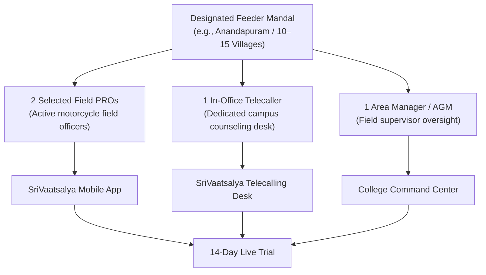
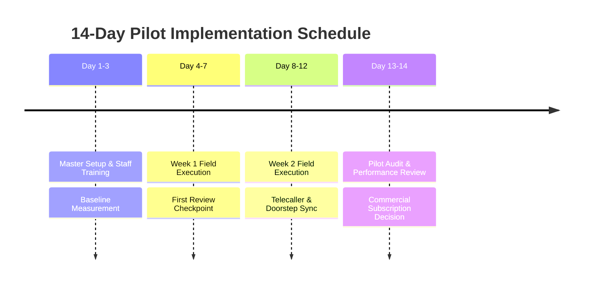

# Intermediate College Admissions SaaS: Institutional Pilot & Sales Validation Plan
## Low-Risk 14-Day Pilot Implementation, Baseline Metrics & Commercial Conversion Framework

**Document Reference:** `business-sales-kit/pilot-validation-plan.md`  
**Target Institutions:** Junior / Intermediate Colleges in Andhra Pradesh and Telangana  
**Objective:** Provide a low-risk, measurable, and structured framework for colleges to evaluate the software in a live operational environment, establishing concrete proof of value before executing an institutional subscription agreement.  

---

## 1. Pilot Program Philosophy

Intermediate colleges are naturally cautious about adopting new technology in the middle of a high-stakes admissions season. Field campaigns cannot afford disruption, and management cannot risk losing student records.

The **SriVaatsalya 14-Day Pilot Program** is designed as a low-friction, non-disruptive trial:
- **Zero Disruption to Existing Operations:** The pilot is confined to a single designated feeder mandal and a small, select group of field staff.
- **Side-by-Side Comparison:** The participating team uses SriVaatsalya alongside their standard routine for just two weeks, allowing management to directly contrast speed, accuracy, and visibility.
- **Clear, Objective Evaluation Criteria:** Both the college management and SriWeb Technologies agree in advance on specific operational metrics to be tracked and evaluated.

---

## 2. Recommended Pilot Scope & Participant Structure



### Ideal Participant Selection:
1. **Target Territory:** Exactly **1 Feeder Mandal** with approximately 10 to 15 villages and 4 to 8 high schools.
2. **Field Personnel:** **2 Field PROs** who are active, open-minded, and represent typical field staff capability.
3. **Desk Personnel:** **1 Campus Telecaller** responsible for calling prospects from the designated mandal.
4. **Supervisory Oversight:** **1 Admissions Director or AGM** to review daily metrics and participate in weekly checkpoints.

---

## 3. Initial Setup & Onboarding Roadmap (Days 1–3)

| Day | Milestone | Concrete Actions | Responsible Party |
| :---: | :--- | :--- | :--- |
| **Day 1** | **Master Data Import** | 1. Create College Tenant account (`College` record in database).<br>2. Upload target Mandal, Villages, and Feeder High Schools with 10th-grade strength into `ConfigValue` master tables.<br>3. Configure academic streams (MPC, BiPC, CEC, MEC). | SriWeb Tech + College Admin |
| **Day 2** | **Account Provisioning** | 1. Generate unique logins (`User` accounts) for 2 PROs, 1 Telecaller, and 1 Principal.<br>2. Restrict telecaller queue to the 2 pilot PROs (`assignedEmployees`).<br>3. Install Capacitor Android APK on PRO smartphones (or configure PWA home-screen shortcut). | SriWeb Tech Support |
| **Day 3** | **Interactive Staff Onboarding** | 1. Conduct a **35-minute hands-on training** for the 2 PROs (covering village filtering, adding visits, photo watermarking, and PDF generation).<br>2. Conduct a **20-minute training** for the telecaller (covering follow-up scheduling, Star Leads, and notes sync).<br>3. Provide laminated 1-page quick-reference field cards. | SriWeb Tech Trainer + College Staff |

---

## 4. Baseline Measurements & Evaluation Framework

To determine whether the application delivers a meaningful operational improvement, the college must record baseline figures during the first two days (or from previous manual records) and compare them during the pilot:

| Operational Metric | Manual Baseline Measurement Method | SriVaatsalya Tracking Method | Expected Directional Outcome |
| :--- | :--- | :--- | :--- |
| **Time to Locate Village Leads** | Measure time taken by PRO to manually scan paper registers to identify all students from a specific village. | Timed in app: Select Mandal ➔ Select Village ➔ Screen loads. | Significant reduction in search time; instant village listing. |
| **Time to Submit Daily Report** | Time spent by PRO writing 2-page handwritten daily diary report in the evening. | Time taken to generate and download/share Day Report PDF (`/reports/generate`). | Reduced from ~45 minutes of evening writing to under 2 minutes. |
| **Village Visit Completion Rate** | Number of registered students in a village actually visited during a trip vs students forgotten/overlooked. | Audited via status tabs: **Pending** vs **Met Today** in `/employee/village-visits`. | Reduction in overlooked students; higher percentage of village leads contacted. |
| **Lead-to-Telecaller Velocity** | Days elapsed between PRO collecting a number in the field and the telecaller making the first call. | Time delta between `Student.createdAt` / `Visit.visitDate` and `telecallerUpdateAt`. | Reduced from 7–14 days in manual batching to same-day or next-day outreach. |
| **Duplicate Lead Rate** | Number of redundant entries recorded across different PRO notebooks for the same student. | Real-time rejection count via duplicate phone detection (`/api/students/check-phone`). | Duplicate entries reduced to zero. |
| **Scheduled Callback Punctuality** | Number of parent requests ("call after exams") recorded on diary margins that were never executed. | Overdue callback count in Telecaller Dashboard (`/telecaller`). | High percentage of scheduled callbacks executed on the promised date. |
| **Executive Visibility Timeliness** | Days elapsed before Management reviews field activities and feeder school coverage. | Real-time live access to `/college/dashboard`. | Instant 24/7 visibility replacing retrospective weekly paper summaries. |
| **Staff Usability & Adoption** | Qualitative feedback from PROs regarding ease of mobile operation. | Daily active logins and visit submission consistency. | High staff engagement driven by elimination of evening paperwork. |

*Note: In accordance with professional sales standards, no specific percentage improvements are guaranteed in advance. All metrics are measured collaboratively with the college.*

---

## 5. Weekly Review Cadence (14-Day Timeline)



### Checkpoint 1: End of Week 1 (Day 7)
- **Duration:** 20 Minutes (Virtual or In-Person).
- **Attendees:** College Principal / Admissions In-Charge, Participating PROs, SriWeb Account Manager.
- **Agenda:**
  1. Review total leads entered and doorstep visits logged during the first 4 field days.
  2. Confirm whether PROs experienced any usability hurdles or mobile connectivity issues.
  3. Verify that the telecaller received field leads in real time and initiated outbound counseling.
  4. Address any configuration adjustments (e.g., adding missing feeder schools or villages).

### Checkpoint 2: End of Week 2 & Final Pilot Review (Day 14)
- **Duration:** 45 Minutes.
- **Attendees:** College Correspondent / Chairman, Principal, Admissions Director, SriWeb Account Manager.
- **Agenda:**
  1. Presentation of the **14-Day Pilot Performance Report**:
     - Total student profiles captured in the pilot mandal.
     - Total doorstep visits completed vs pending.
     - Feeder school coverage rate in the pilot mandal.
     - Zero duplicate entries achieved.
     - Reduction in daily evening reporting time.
  2. Direct feedback from participating PROs and telecaller on daily operational ease.
  3. Review of the Institutional Commercial Proposal for full campus rollout.

---

## 6. Pilot Success Criteria (Agreed Evaluation Standards)

The pilot is considered successful and ready for full commercial rollout if the following 5 operational milestones are achieved:

1. **Staff Adoption:** Both participating PROs use the application daily to record village visits without reverting to paper diaries.
2. **Reporting Efficiency:** Daily visit reports for the pilot mandal are generated digitally via PDF rather than handwritten notes.
3. **Zero Duplicate Inquiries:** The duplicate phone detection engine successfully identifies any repeated submissions.
4. **Active Telecaller Synchronization:** Over 85% of leads submitted by field PROs receive telecaller outreach within 24 hours.
5. **Management Satisfaction:** The Principal or Admissions Director confirms that the Command Center provided superior operational visibility compared to manual WhatsApp reporting.

---

## 7. Structured Conversion Process: Pilot to Paid Subscription

Upon meeting the agreed success criteria on Day 14, the transition to an institutional subscription proceeds smoothly:

### Conversion Step 1: Formal Pilot Review Presentation
SriWeb Technologies presents a concise, 4-page executive summary comparing Week 1 and Week 2 metrics against the college's previous manual benchmarks.

### Conversion Step 2: Selecting the Institutional Subscription Tier
The college selects the appropriate institutional tier based on total team size:
- **Whole College Institutional License:** Campus-wide deployment covering all mandals, unlimited PRO mobile access, multi-telecaller desk, and executive command center.
- **Subscription Billing:** Annual institutional agreement or seasonal 6-month admissions pass.

### Conversion Step 3: Expanding Master Configurations
Within 48 hours of agreement:
- Bulk import all remaining catchment mandals, villages, and feeder high schools across the college's entire operational footprint.
- Provision logins for all remaining field officers, AGMs, and campus telecallers.
- Conduct a 60-minute campus-wide orientation workshop for the entire admissions department.

---

## 8. Pilot Agreement Template (One-Page Commitment)

```markdown
================================================================================
                    SRIVAATSALYA ADMISSIONS SUITE
                   14-DAY FIELD PILOT MEMORANDUM
================================================================================

Institution Name:   [____________________________________________________]
Campus Location:    [____________________________________________________]
Authorized Officer: [________________________] Designation: [_____________]

1. PILOT PARAMETERS:
   - Designated Pilot Mandal:  [_______________________________________]
   - Participating Field PROs: (1) [_________________] (2) [_______________]
   - Participating Telecaller: [_______________________________________]
   - Pilot Duration:           14 Calendar Days (From [Date] to [Date])

2. COMMITMENT OF SRIWEB TECHNOLOGIES:
   - Provide complete software access, database configuration, and master data setup.
   - Conduct hands-on training for participating staff members on Day 3.
   - Provide dedicated phone and WhatsApp technical support throughout the trial.
   - Deliver a formal Pilot Performance Report at the end of the 14-day period.

3. COMMITMENT OF THE INSTITUTION:
   - Ensure designated staff actively utilize the mobile application in the pilot mandal.
   - Designate a point of contact for the Day 7 and Day 14 review checkpoints.
   - Evaluate the software based on agreed operational metrics (time saved, lead safety, 
     village coverage) at the conclusion of the trial.

Agreed and Signed on behalf of:

College Representative:                   SriWeb Technologies Representative:
Signature: __________________________     Signature: __________________________
Name:      __________________________     Name:      __________________________
Date:      __________________________     Date:      __________________________
================================================================================
```
