# Architecture Revision 3: Product Packaging, Shared School Directory, and Security Corrections

**Document Status:** Architecture Revision 3.0 (Formal Specification)  
**System:** Multi-Tenant College Admissions Operations & Field Force SaaS  
**Scope Classification:** Phase 1 Operational Core  
**Role:** Principal SaaS Architect & Application Security Architect  
**Predecessor Baseline:** Architecture Revision 2.0  
**Implementation Status:** Non-implemented specification; pure architectural and security baseline.

---

## 1. Approved and Open Architecture Decision Log

In accordance with stakeholder governance, the following decisions are formally classified into **Approved Decisions**, **Proposed Specifications**, and **Open Commercial/Technical Questions**.

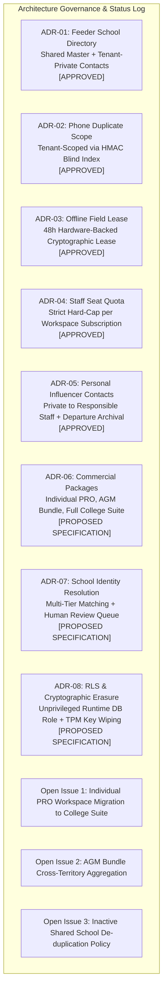

### 1.1 Formally Approved Architectural Decisions (Locked)

| Decision Reference | Area | Formal Decision & Enforcement Mechanism | Status |
| :--- | :--- | :--- | :---: |
| **ADR-01** | Feeder Schools | **Shared Canonical Directory with Private Overlays:** Government school registries (UDISE codes, canonical names, geographic mandals) are shared across all tenants. All headmaster contact numbers, private notes, institutional ratings, and staff allocations remain strictly tenant-private. | **APPROVED** |
| **ADR-02** | Lead Uniqueness | **Per-Tenant Phone Uniqueness:** The uniqueness of student phone numbers is enforced strictly within each college tenant via `(tenant_id, phone_blind_index)`. College B is fully permitted to prospect a student previously contacted by College A without cross-tenant conflict or data leakage. | **APPROVED** |
| **ADR-03** | Mobile Operation | **48-Hour Hardware-Backed Offline Lease:** Field PRO mobile clients are permitted an autonomous offline operational window of exactly 48 hours, enforced by monotonic hardware clocks and cryptographic key zeroization upon expiry. | **APPROVED** |
| **ADR-04** | SaaS Quotas | **Hard Staff-Seat Quota Enforcement:** Subscription plans enforce hard caps on active staff memberships (`max_staff_seats`). API attempts to provision staff beyond the entitlement fail closed with HTTP 422 until upgraded. | **APPROVED** |
| **ADR-05** | Contact Privacy | **Personal Relative/Influencer Ownership & Departure Archival:** Village relative and influencer referral contacts mapped by a PRO are private to that staff member. Upon employee departure or deactivation, contacts are archived and hidden, not transferred to competing staff. | **APPROVED** |

### 1.2 Open Commercial and Policy Questions Requiring Owner Sign-Off

1. **Individual PRO Workspace Migration into College Suite:** If an independent PRO subscriber is hired by a college using the Full College Suite, should the system provide an automated lead-import workflow with student consent verification, or must their independent workspace remain strictly separate to avoid institutional data liability? *(Architectural recommendation: Keep workspaces separate by default; provide an explicit, audited migration wizard requiring dual authorization).*
2. **AGM Bundle Add-On PRO Seats:** Can an AGM Bundle purchase individual PRO add-on seats beyond the bundled tier (e.g., base package of 5 PROs expanded to 8), or must they upgrade to a Full College Suite? *(Architectural recommendation: Support incremental PRO seat add-on entitlements).*
3. **Provisional School Auto-Promotion:** If a provisional school submission by College A remains in the review queue unreviewed by the Platform Admin for $>30$ days, should it be auto-promoted to Canonical status, or remain Provisional indefinitely? *(Architectural recommendation: Remain Provisional indefinitely to prevent registry corruption).*

---

## 2. Commercial Packaging and Domain Entitlement Model

### 2.1 The Three Commercial Packages

The platform provides a single unified codebase supporting three commercial packages. Package limits and feature flags are evaluated dynamically; no hardcoded package-specific code paths exist.

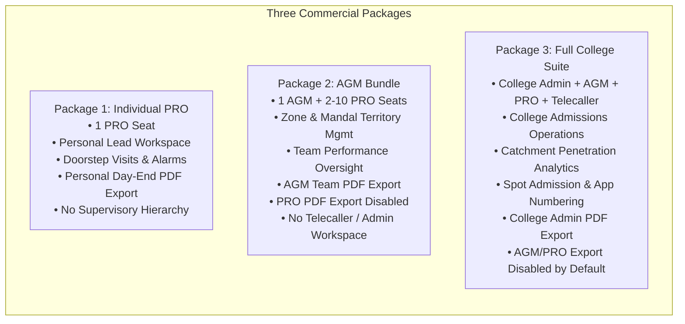

1. **Individual PRO Package:**
   - **Target User:** Independent admission consultants or freelance field representatives.
   - **Workspace Model:** Single-member workspace.
   - **Authorized Capabilities:** Personal lead entry, village student selector, doorstep visit recording, dynamic callback alarms, and **personal daily activity PDF exports**.
   - **Restricted Capabilities:** No supervisory staff management, no AGM dashboards, no feeder school catchment analytics, no telecaller desks.
2. **AGM Bundle:**
   - **Target User:** Regional managers overseeing a regional field team across 5 to 20 mandals.
   - **Workspace Model:** Multi-member team workspace (1 AGM seat + configurable PRO seats).
   - **Authorized Capabilities:** Team task assignment, territory allocation, PRO visit monitoring, and **AGM-level team/territory PDF reports**.
   - **Restricted Capabilities:** PRO seats have **PDF export disabled by default**; no central College Admin console; no telecaller lead distribution desks.
3. **Full College Suite:**
   - **Target User:** Accredited intermediate and junior colleges with multi-branch or campus operations.
   - **Workspace Model:** Enterprise institutional workspace.
   - **Authorized Capabilities:** Full administrative hierarchy (`COLLEGE_ADMIN`, `AGM`, `PRO`, `TELECALLER`), multi-branch scoping, spot admission recording with application number sequencing, feeder school catchment intelligence, and **College Admin-level authorized PDF exports**.
   - **Restricted Capabilities:** Field PRO and AGM PDF exports disabled by default to prevent unauthorized bulk data exfiltration.

---

### 2.2 Domain Separation: Subscriptions, Workspaces, Roles, and Entitlements

To prevent architectural rigidity, the domain model completely decouples **Commercial Subscriptions**, **Workspaces**, **User Roles**, and **Feature Entitlements**.

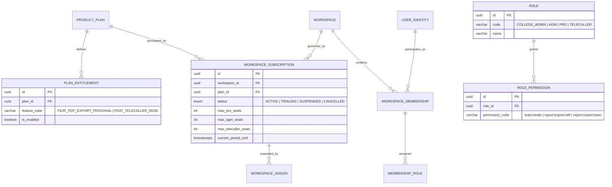

#### Effective Access Evaluation Formula
Access to any protected capability is evaluated at runtime via a three-way intersection:
$$\text{Effective Access} = \text{Package Entitlement} \cap \text{Role Permission} \cap \text{Record Authorization Scope}$$

- If an action is not entitled by the workspace subscription, access is rejected (HTTP 403 `PACKAGE_NOT_ENTITLED`).
- If an action is entitled by the package, but the user's role lacks the permission, access is rejected (HTTP 403 `ROLE_NOT_AUTHORIZED`).
- If both package and role permit the action, access is evaluated against the user's geographic/assignment scope (e.g., PRO accessing only their assigned leads; AGM accessing only their zone).

---

### 2.3 Package-to-Feature Entitlement Matrix

| Feature Code | Capability Description | Individual PRO | AGM Bundle | Full College Suite |
| :--- | :--- | :---: | :---: | :---: |
| `FEAT_LEAD_CAPTURE` | Create and manage prospective student leads | **Enabled** | **Enabled** | **Enabled** |
| `FEAT_DOORSTEP_VISIT` | Record doorstep visits and dynamic alarms | **Enabled** | **Enabled** | **Enabled** |
| `FEAT_WHATSAPP_CARD` | Generate on-device watermarked WhatsApp cards | **Enabled** | **Enabled** | **Enabled** |
| `FEAT_OFFLINE_SYNC` | Mobile offline SQLite queue and sync | **Enabled** | **Enabled** | **Enabled** |
| `FEAT_PDF_EXPORT_PERSONAL` | Export personal daily activity PDF reports | **Enabled** | Disabled (Default) | Disabled (Default) |
| `FEAT_PDF_EXPORT_TEAM` | Export aggregated zone/team PDF reports | Disabled | **Enabled** (AGM Only) | Disabled (Default) |
| `FEAT_PDF_EXPORT_COLLEGE` | Export college-wide master PDF reports | Disabled | Disabled | **Enabled** (Admin Only) |
| `FEAT_TERRITORY_MGMT` | Allocate mandals and feeder schools to staff | Disabled | **Enabled** (Zone) | **Enabled** (College) |
| `FEAT_STAFF_MGMT` | Provision and deactivate subordinate staff seats | Disabled | **Enabled** (PROs) | **Enabled** (All Roles) |
| `FEAT_CATCHMENT_INTEL`| Catchment penetration vs. 10th-grade strength | Disabled | Disabled | **Enabled** |
| `FEAT_TELECALLER_DESK`| 2-way PRO $\leftrightarrow$ Telecaller lead desk | Disabled | Disabled | **Enabled** |
| `FEAT_SPOT_ADMISSION` | Spot admission logging with application numbers| Disabled | Disabled | **Enabled** |
| `FEAT_MULTI_BRANCH` | Multiple campus partitions within workspace | Disabled | Disabled | **Enabled** |

---

### 2.4 Lifecycle State Transitions: Upgrades, Downgrades, Suspensions, and Migrations

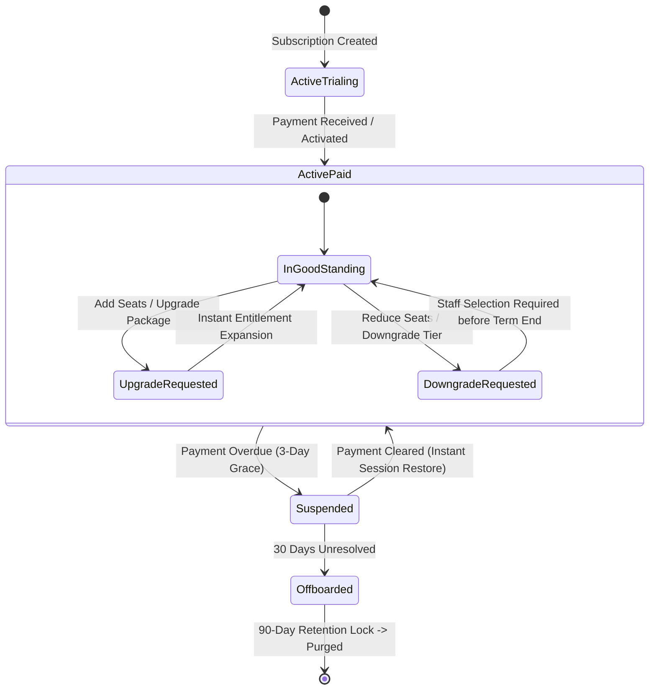

1. **Package Upgrade (e.g., AGM Bundle $\to$ Full College Suite):**
   - Immediate execution. New feature entitlements (`FEAT_CATCHMENT_INTEL`, `FEAT_TELECALLER_DESK`) unlock instantly.
   - Existing staff, leads, visits, and audit logs remain untouched.
2. **Package Downgrade & Quota Reductions:**
   - If an AGM Bundle downgrades from 8 PRO seats to 4 PRO seats:
     - The workspace enters `DOWNGRADE_PENDING` state until the end of the billing cycle.
     - The AGM Admin must explicitly select 4 staff members to deactivate.
     - If the admin fails to select staff before the effective date, the system **fails closed**: it automatically deactivates the most recently created staff members and reassigns their active leads to the workspace unassigned triage pool.
3. **Subscription Suspension (Billing Overdue):**
   - 3-day operational grace period with visual UI warnings.
   - Upon suspension, all active web and mobile sessions are invalidated (`revoked_at = NOW()`).
   - Mobile apps enter lockdown; local SQLCipher databases are locked from reading until subscription reactivation.
4. **Staff Removal / Deactivation:**
   - Soft-deleted (`is_active = false`). Active sessions immediately terminated.
   - Open operational tasks transition to `UNASSIGNED`.
   - Historical records (visits, call notes, admissions) permanently retain the staff member's historical identity.
   - Personal relative/influencer contacts are moved to `ARCHIVED` status.
5. **Workspace Migration (Individual PRO joining a College):**
   - An Individual PRO's personal workspace is **never merged automatically** into a college tenant.
   - To join a college, the PRO receives an invitation to create a *separate membership* in the college workspace.
   - To transfer past prospective leads from the personal workspace into the college workspace, the PRO must run an explicit **Lead Import Wizard**:
     - System runs HMAC blind-index duplicate checks against the college database.
     - Colliding phone numbers are flagged and merged according to college rules.
     - Non-colliding records are copied into the college tenant with fresh UUIDs and re-encrypted with the college's KMS key.
     - The transfer event is permanently logged in both workspaces' audit trails.

---

## 3. Server-Side PDF Export Security and Scoping

### 3.1 Authorization and Server-Side Enforcement Rules

Hiding the "Export PDF" button in the client UI is fundamentally insufficient. The API gateway and report service enforce strict server-side validation:

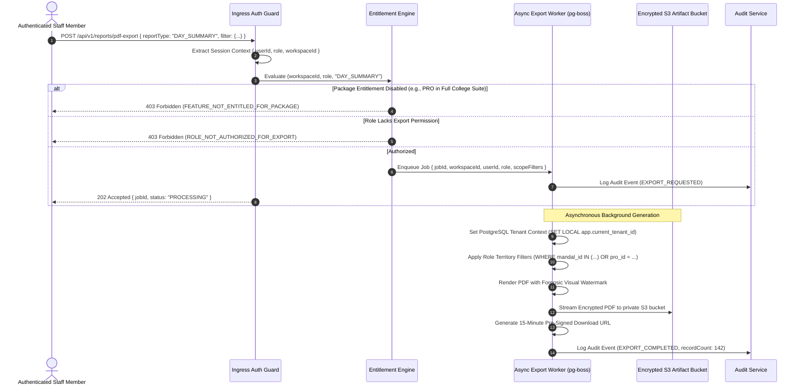

- **Individual PRO:** Authorized strictly to export records where `created_by_user_id = ctx.userId`.
- **AGM Bundle:** AGM authorized to export records where `mandal_id IN (ctx.assignedMandals)` or `created_by_user_id IN (ctx.subordinateStaffIds)`. PRO exports return HTTP 403.
- **Full College Suite:** College Admin authorized to export college-wide records. AGMs and PROs return HTTP 403 by default unless an explicit override entitlement (`OVERRIDE_ALLOW_STAFF_EXPORT`) is granted by the College Admin.

### 3.2 Forensic Watermarking and Artifact Security
- **Visual Forensic Watermark:** Every generated PDF page embeds a semi-transparent, diagonal background watermark containing:
  `[Workspace Name] | User: [Employee Code] | IP: [Client IP] | Timestamp: [UTC ISO8601]`
- **Storage Lifecycle:** PDFs are never stored on public web servers. Generated files stream directly to a private, server-side encrypted S3 bucket (`aws:kms`).
- **Time-Expiring Access:** Download links use S3 pre-signed URLs with a hard **15-minute time-to-live**.
- **Audit Logging:** Every export invocation logs: `user_id`, `workspace_id`, `report_type`, `record_count`, `applied_filters`, and `artifact_sha256_hash` to the immutable audit log.

---

## 4. Shared Feeder School Directory & Identity Resolution Engine

### 4.1 Master School Directory Architecture

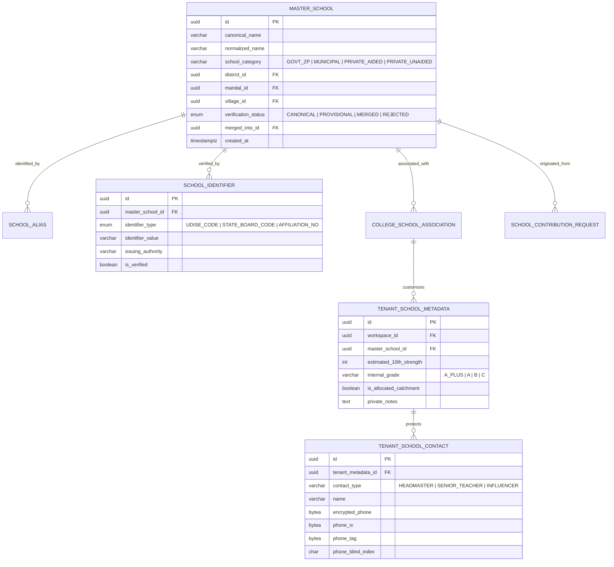

---

### 4.2 School Identity Resolution and Contribution Workflow

When a field PRO or college administrator searches for or submits a feeder school, the system follows a deterministic 5-stage identity resolution pipeline:

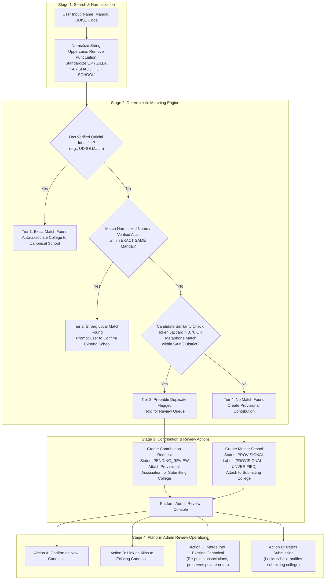

#### Multi-Tier Matching Logic
1. **Tier 1 (Exact Official Identifier Match):** Search matches a verified official code (UDISE code, state school code). Guarantees 100% precision. Automatically directs the user to associate with the existing canonical record.
2. **Tier 2 (Strong Local Match):** Matches a canonical name or verified alias within the exact same administrative mandal. Prompts the user: *"Did you mean [Canonical Name] located in [Mandal]?"* Direct association upon confirmation.
3. **Tier 3 (Probable Duplicate - Central Review Queue):** High token similarity ($>0.70$ Jaccard or Double Metaphone phonetic equivalence) within the same district or neighboring mandal. **Fails safe:** The system does NOT automatically merge identities. It creates a `school_contribution_requests` entry held for Platform Admin review. The submitting college receives a temporary provisional link to prevent blocking field operations.
4. **Tier 4 (No Match - Provisional Creation):** No candidate match found. System provisions a new `master_schools` record with `verification_status = 'PROVISIONAL'`.
   - **Provisional Usage Rules:** The submitting college can log visits, capture leads, and assign staff against it immediately. To other colleges, the school appears in search with a prominent visual badge: `[PROVISIONAL - UNVERIFIED]`. Other colleges can view and associate with it, but official board ratings cannot be applied until verified.

---

### 4.3 Auditable School Merge and Unmerge Mechanics

```mermaid
sequenceDiagram
    autonumber
    actor Admin as Platform Superadmin
    participant API as School Admin API (/api/v1/admin/schools/merge)
    participant MasterTable as master_schools Table
    participant AssocTable as college_school_associations Table
    participant MetaTable as tenant_school_metadata Table
    participant Audit as Immutable Audit Log

    Admin->>API: POST /api/v1/admin/schools/merge { sourceSchoolId: B, targetSchoolId: A, justification: "Duplicate UDISE" }
    API->>API: Validate both schools exist; A != B; A is CANONICAL
    
    API->>MasterTable: UPDATE master_schools SET verification_status = 'MERGED', merged_into_id = A WHERE id = B
    API->>MasterTable: INSERT INTO school_aliases (school_id, alias_name, source) VALUES (A, B.canonical_name, "MERGE_OPERATION")
    
    API->>AssocTable: Re-point active associations from B to A (Resolve collisions via soft-merge)
    API->>MetaTable: Re-point tenant metadata from B to A (Preserve private contacts and notes untouched)
    
    API->>Audit: Record CRITICAL Audit Event (SCHOOL_MERGED, { sourceId: B, targetId: A, adminId: Admin.id })
    API-->>Admin: 200 OK { status: "MERGE_COMPLETED", associationsMoved: 3 }

    Note over Admin,Audit: Emergency Unmerge Procedure
    Admin->>API: POST /api/v1/admin/schools/unmerge { mergedSchoolId: B, justification: "Erroneous merge by operator" }
    API->>MasterTable: Revert B verification_status = 'PROVISIONAL', merged_into_id = NULL
    API->>AssocTable: Restore original associations from audit snapshot
    API->>Audit: Record CRITICAL Audit Event (SCHOOL_UNMERGED, { schoolId: B })
    API-->>Admin: 200 OK { status: "UNMERGE_COMPLETED" }
```

- **Impact on Private Data:** Merging School B into School A **never modifies, exposes, or deletes** private headmaster contacts, teacher phone numbers, or telecaller remarks. The private metadata records are simply re-associated to point to Canonical School A.
- **Unmerge Capability:** If an operator mistakenly merges two distinct schools, the system utilizes the immutable snapshot stored in `audit_events.before_state` to decouple the records, restore School B's identity, and return associations to their pre-merge state.

---

### 4.4 School Identity Resolution Acceptance Tests

#### Acceptance Test CASE-SCH-01 (Same School Resolution)
- **Scenario:** College 1 submits *"Sri Siddhartha High School, Guntur"* (UDISE: `28170100101`). College 2 later submits *"Sri Sidhartha ZP High School, Guntur"* without UDISE.
- **System Behavior:**
  1. System normalizes string: `SRI SIDDHARTHA HIGH SCHOOL`.
  2. Double Metaphone evaluates `SRI SIDDHARTHA` $\equiv$ `SRI SIDHARTHA`. Locality matches Guntur Mandal.
  3. System classifies input as **Tier 3: Probable Duplicate**.
  4. Submission is held in Platform Admin Review Queue.
  5. Platform Admin inspects submission, confirms identity, links *"Sri Sidhartha ZP High School"* as a verified alias of Canonical School #1, and closes the ticket.
- **Pass Verification:** College 2's leads now resolve to Canonical School #1; alias search resolves successfully.

#### Acceptance Test CASE-SCH-02 (Different School Rejection)
- **Scenario:** College 1 has *"Sri Siddhartha School, Guntur"*. College 2 submits *"Sri Sidhartha Public School, Vizag"*.
- **System Behavior:**
  1. Phonetic similarity is high, but District and Mandal do NOT match (Guntur vs. Visakhapatnam, $>350\text{km}$ apart).
  2. Geographic boundary validation rejects local match.
  3. System classifies input as **Tier 4: No Local Match**.
  4. System creates new master record *"Sri Sidhartha Public School, Vizag"* with status `PROVISIONAL`.
- **Pass Verification:** Zero automatic merge occurs; schools exist as independent entities in separate geographic nodes.

---

## 5. Security Architecture Corrections

### 5.1 Unified Session-Token Hashing Strategy

The architecture enforces a single, mathematically consistent session-token hashing and storage strategy across all modules, tests, and data models:

$$\text{token\_hash} = \text{HMAC-SHA256}(\text{raw\_token}, \text{server\_session\_pepper})$$

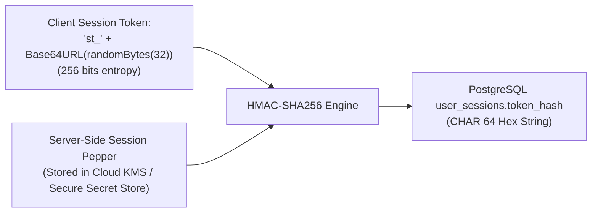

- **Generation:** Server-side via `crypto.randomBytes(32)` formatted as `st_` + URL-safe base64.
- **Database Storage:** Database stores strictly the 64-character hex string of `HMAC-SHA256(raw_token, session_pepper)`. Raw tokens are never logged or stored.
- **Pepper Key Management:** The `server_session_pepper` is a 256-bit cryptographically random secret injected at runtime via cloud secret managers (AWS Secrets Manager / Doppler).
- **Dual-Pepper Zero-Downtime Rotation:** During pepper rotation, the application runtime supports `current_pepper` and `previous_pepper`. Incoming requests test against `current_pepper`; if verification fails, they test against `previous_pepper`. If valid under `previous_pepper`, the session row is re-hashed with `current_pepper` on the fly.

---

### 5.2 Redesigned 48-Hour Hardware-Backed Offline Lease Protection

To resolve the limitations of physical device compromise, clock rollbacks, reboots, and wear-leveling flash memory, the offline mobile security architecture is redesigned around **Autonomous Cryptographic Erasure and Hardware Enclave Primitives**:

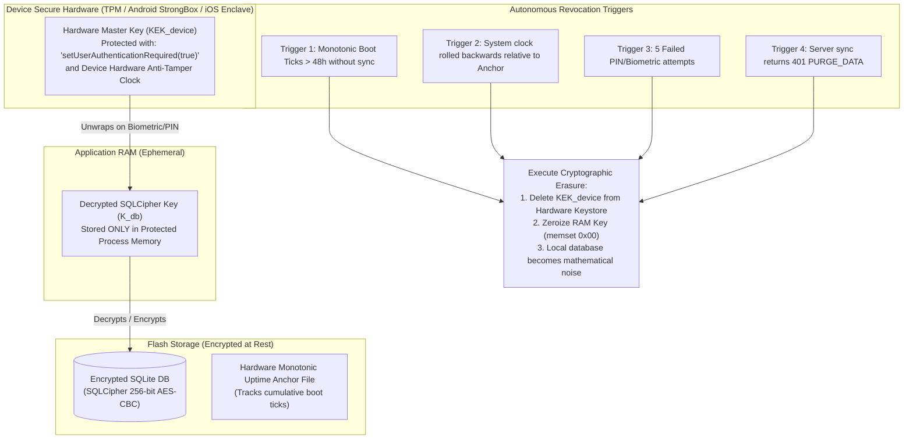

#### Detailed Hardware-Backed Mechanics
1. **The Flash Wear-Leveling Problem & Solution:** Overwriting an SQLite file on NAND flash storage (Android/iOS) is unreliable because flash translation layers (FTL) remap sectors rather than overwriting physical bits. The platform solves this through **Cryptographic Erasure (Zeroization of the Key, not the File)**:
   - The database is encrypted via SQLCipher with random 256-bit key $K_{db}$.
   - $K_{db}$ is wrapped by $KEK_{device}$ inside the hardware-backed keystore (StrongBox / Secure Enclave).
   - When the wipe trigger fires, the app deletes $KEK_{device}$ from the hardware keystore. Without $KEK_{device}$, recovering $K_{db}$ is mathematically intractable ($2^{256}$ operations), rendering the physical SQLite file on flash storage permanently irrecoverable.
2. **Reboot and Clock-Rollback Tamper Defense:**
   - Attackers rolling back the system clock to bypass the 48-hour lease are defeated using **Monotonic Hardware Ticks** (`SystemClock.elapsedRealtime()` on Android, `mach_continuous_time()` on iOS) combined with a cryptographically signed **Lease Anchor File**:
   - The anchor file stores: `last_verified_utc` and `cumulative_monotonic_ticks`.
   - If the system clock reports a UTC time earlier than `last_verified_utc`, or if cumulative monotonic ticks exceed 48 hours without a signed server heartbeat token, the lease expires immediately and evicts $K_{db}$ from RAM.
3. **Lost-Device Reality:** An offline stolen phone cannot be contacted over the air. The autonomous 48-hour hardware lease guarantees that even in complete isolation, the device self-locks and evicts decryption keys within 48 hours of last network contact.

---

### 5.3 PostgreSQL RLS Testing with Restricted Runtime Database Roles

To eliminate false security confidence, RLS tests must never execute under database superusers or roles with `BYPASSRLS`. The test harness defines two strictly segregated roles:

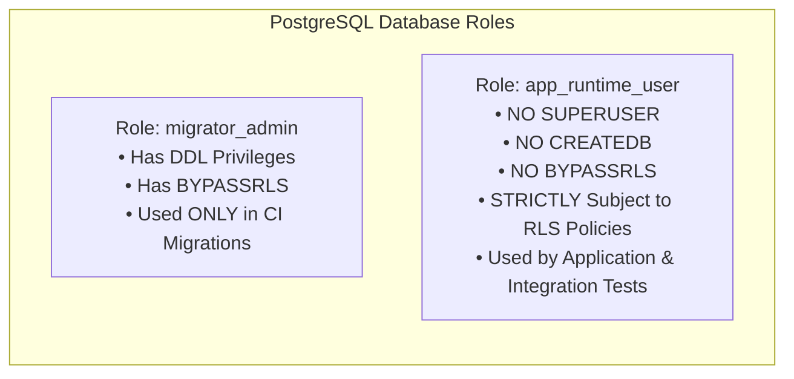

#### RLS Test Suite Matrix (Automated in CI)

| Test ID | Threat Vector Tested | Exact Execution & Assertions | Expected Result |
| :--- | :--- | :--- | :---: |
| **TEST-RLS-01** | Missing Tenant Context | Execute `SELECT COUNT(*) FROM student_leads;` as `app_runtime_user` without running `SET LOCAL app.current_tenant_id`. | **Returns 0 rows** (Fails closed). |
| **TEST-RLS-02** | Transaction Scope Reset | Begin Tx 1: Execute `SET LOCAL app.current_tenant_id = 'T1'`, query leads (returns rows), Commit. On same physical connection, execute query without `SET LOCAL`. | **Returns 0 rows** (Context cleared on commit). |
| **TEST-RLS-03** | Pooled Connection Alternation | Connection executes: Tx 1 (`T1`), Commit, Tx 2 (`T2`), Commit. Query `student_leads` under `T2`. | **Returns strictly `T2` rows**; 0 rows from `T1`. |
| **TEST-RLS-04** | Raw SQL Injection IDOR | As `app_runtime_user` with `T1` context, execute `SELECT * FROM student_leads WHERE id = :lead_of_T2;`. | **Returns 0 rows** (RLS intercepts predicate). |
| **TEST-RLS-05** | Background Worker Isolation | `pg-boss` worker executes tenant report without setting `app.current_tenant_id`. | Worker crashes with `MissingTenantContextException`. |
| **TEST-RLS-06** | Cross-Tenant Export Streaming | Run export query as `T1` attempting to join `feeder_schools` of `T2`. | **Returns strictly `T1` schools**; `T2` schools omitted. |

---

### 5.4 Reproducible Performance Benchmark Plan

Arbitrary claims (e.g., *"sub-350ms for 100k records"*) are replaced with a reproducible benchmark plan. Until executed on staging hardware, all latency figures are designated **Provisional Design Targets**:

- **Hardware Baseline:** Single AWS RDS PostgreSQL instance (`db.t4g.medium`: 2 vCPU, 4GB RAM, gp3 SSD, 3,000 IOPS).
- **Synthetic Test Datasets:**
  - Scale Tier 1: 10,000 leads, 25,000 visits, 50 feeder schools (Small College).
  - Scale Tier 2: 100,000 leads, 300,000 visits, 500 feeder schools (Multi-Campus Group).
  - Scale Tier 3: 500,000 leads, 2,000,000 visits, 2,500 feeder schools (Platform Stress Test).
- **Tooling & Workload:** `k6` executing 100 concurrent virtual users simulating:
  - 60% Doorstep Visit logging (write-heavy mutations with idempotency checks).
  - 30% Village Student Selector queries (read-heavy indexed scans).
  - 10% College Operations Dashboard aggregations (analytical grouping).
- **Target Thresholds (Provisional):**
  - Village selector p95 latency: $< 150\text{ms}$.
  - Doorstep visit mutation p95 latency: $< 200\text{ms}$.
  - Dashboard stats aggregation p95 latency: $< 500\text{ms}$.

---

## 6. Updated Conceptual Data Model

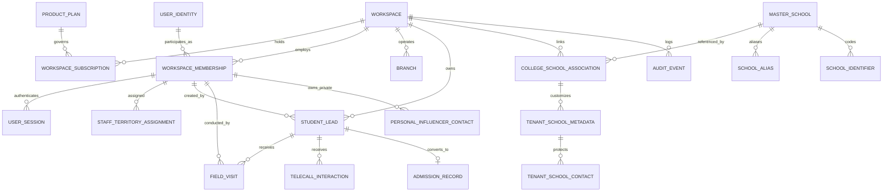

### 6.1 Critical Entity Definitions & Integrity Rules

#### 1. `workspace_subscriptions` & `product_plans`
- **Fields:** `id` (UUID), `workspace_id` (UUID $\to$ `workspaces.id`), `plan_code` (`INDIVIDUAL_PRO`, `AGM_BUNDLE`, `FULL_COLLEGE_SUITE`), `status` (`ACTIVE`, `TRIALING`, `SUSPENDED`, `OFFBOARDED`), `max_pro_seats` (INT), `max_agm_seats` (INT), `max_telecaller_seats` (INT), `current_period_end` (TIMESTAMPTZ).
- **Constraint:** Hard seat limits checked via database trigger before `workspace_memberships` insert.

#### 2. `student_leads` (Admissions Pipeline)
- **Fields:** `id` (UUIDv7), `workspace_id` (UUID $\to$ `workspaces.id`), `branch_id` (UUID $\to$ `branches.id`, NULLABLE), `created_by_membership_id` (UUID), `assigned_pro_id` (UUID, NULLABLE), `assigned_telecaller_id` (UUID, NULLABLE), `full_name` (VARCHAR(100)), `phone_blind_index` (CHAR(64)), `encrypted_phone` (BYTEA), `phone_iv` (BYTEA), `phone_tag` (BYTEA), `village_id` (UUID), `mandal_id` (UUID), `master_school_id` (UUID, NULLABLE), `lead_status` (`NEW`, `FOLLOW_UP`, `STAR_LEAD`, `VISIT_SCHEDULED`, `ADMITTED`, `DROPPED`), `doorstep_completed` (BOOLEAN DEFAULT FALSE), `version` (INT DEFAULT 1), `deleted_at` (TIMESTAMPTZ NULL).
- **Integrity Rule:** `CONSTRAINT unique_workspace_phone UNIQUE (workspace_id, phone_blind_index) WHERE deleted_at IS NULL`.

#### 3. `personal_influencer_contacts` (PRO Relatives & Mentors)
- **Fields:** `id` (UUID), `workspace_id` (UUID $\to$ `workspaces.id`), `membership_id` (UUID $\to$ `workspace_memberships.id`), `name` (VARCHAR(100)), `encrypted_phone` (BYTEA), `phone_blind_index` (CHAR(64)), `relation_type` (`UNCLE`, `BROTHER`, `VILLAGE_ELDER`, `LOCAL_TUTOR`), `village_id` (UUID), `status` (`ACTIVE`, `ARCHIVED`), `created_at` (TIMESTAMPTZ).
- **Integrity Rule:** Scoped strictly to `membership_id`. When membership transitions to `INACTIVE`, status auto-updates to `ARCHIVED`. Contacts are inaccessible to other staff members.

---

## 7. Security Findings Register and Verification Plan

| Finding ID | Vulnerability Description | Severity | Target Architecture Mitigation | Automated Verification Test |
| :--- | :--- | :---: | :--- | :--- |
| **SEC-01** | Client-Side JWT Minting in Flutter (`mobile_app/api_service.dart`) | **CRITICAL** | Complete removal of client token signing. Server issues opaque 256-bit bearer tokens verified against SHA-256 database hashes. | `TEST-VERIF-01`: Client submits forged token; server returns HTTP 401. All tokens minted by server exclusively. |
| **SEC-02** | Default Insecure Student Password Takeover (`123456`) | **CRITICAL** | Student login and self-registration entirely deferred from Phase 1. | `TEST-VERIF-02`: Public student registration endpoints eliminated from API routing table. |
| **SEC-03** | Public Feeder School PII Leakage (`GET /api/config`) | **HIGH** | `master_schools` read-only master; headmaster personal phones moved to encrypted `tenant_school_contacts` requiring authenticated tenant session. | `TEST-VERIF-03`: Unauthenticated `GET /api/v1/schools` returns HTTP 401. Authenticated staff see only tenant-authorized contacts. |
| **SEC-04** | Cross-Tenant Lead Leaks via Unassigned Telecallers | **HIGH** | Telecaller queries enforce mandatory tenant scoping and assignment checks. Empty assignment returns `[]` (fail-closed), never global leads. | `TEST-VERIF-04`: Telecaller with empty assignment queries `/api/v1/leads`; returns empty array, 0 rows leaked. |
| **SEC-05** | Tokens Passed in URL Query Strings (`?token=...`) | **MEDIUM** | Ingress API gateway strictly rejects tokens in query strings. Tokens accepted exclusively via `__Host-` cookies or `Authorization: Bearer` headers. | `TEST-VERIF-05`: Request with `?token=...` returns HTTP 400 Bad Request. |
| **SEC-06** | Hardcoded Automated Backup Fallback Secret | **MEDIUM** | Secret hardcoding eliminated. Process fails startup if `CRON_SECRET` is unset via Zod environment validation. | `TEST-VERIF-06`: Missing `CRON_SECRET` in environment causes application startup crash with explicit error. |
| **SEC-07** | Stolen Offline Field Phone Data Extraction | **HIGH** | 48-hour monotonic hardware lease; SQLCipher 256-bit AES encryption; cryptographic erasure zeroizing TPM keys on tamper/expiry. | `TEST-VERIF-07`: Simulate monotonic clock advance $>48$h; verify $K_{db}$ evicted and local database unreadable. |
| **SEC-08** | Unauthorized Bulk PDF Data Exfiltration | **MEDIUM** | Role-based export authorization; server-side entitlement checks; forensic visual watermarking; 15-minute expiring S3 pre-signed URLs. | `TEST-VERIF-08`: PRO in Full College Suite calls export endpoint; returns HTTP 403. Admin export generates watermarked artifact. |

---

## 8. Proof-of-Concept (PoC) Execution Plans

### 8.1 PoC 1: Drizzle ORM + PostgreSQL RLS under Transaction Pooling
- **Objective:** Prove that Drizzle ORM executes `SET LOCAL app.current_tenant_id` reliably across pooled connections (PgBouncer in transaction mode) without session state bleeding.
- **Duration:** 3 Engineering Days.
- **Test Harness:** Containerized PostgreSQL 16 + PgBouncer container in transaction pooling mode.
- **Pass Criteria:** 10,000 rapid concurrent transactions alternating between Tenant A and Tenant B with zero cross-tenant query contamination.

### 8.2 PoC 2: Flutter Offline SQLCipher & Hardware Monotonic Lease
- **Objective:** Validate SQLCipher local encryption, client-side UUIDv7 generation, monotonic clock tracking, and cryptographic erasure on physical Android and iOS devices.
- **Duration:** 3 Engineering Days.
- **Test Harness:** Physical low-end Android test device (Android 10+, 2GB RAM).
- **Pass Criteria:**
  1. 100 offline doorstep visits queued and serialized to encrypted SQLite.
  2. Device system clock rolled back manually by 7 days $\implies$ App detects monotonic mismatch, expires lease, evicts hardware key, and locks UI.
  3. Reconnection sync flushes queue to server in single atomic batch without duplicates.

---

## 9. Feature-to-Acceptance-Test Traceability Matrix

| Feature Module | Business Rule / Capability | Required Test ID | Concrete Acceptance Test Procedure | Expected Pass Result |
| :--- | :--- | :--- | :--- | :--- |
| **Tenant Lifecycle** | Hard Staff-Seat Cap Enforcement | `TEST-TC-01` | Subscription quota = 3 PRO seats. College Admin attempts to provision 4th PRO user. | HTTP 422 Unprocessable Entity (`SEAT_QUOTA_EXCEEDED`). Record not created. |
| **Identity & Sessions**| Session Revocation on User Deactivation | `TEST-TC-02` | PRO user logs in on Web and Mobile. Admin deactivates user (`is_active = false`). PRO makes subsequent API call. | HTTP 401 Unauthorized (`SESSION_REVOKED`). Local mobile app locks. |
| **Lead Management** | Keyed HMAC Duplicate Phone Check | `TEST-TC-03` | PRO A creates lead with Phone P in College A. PRO B creates lead with Phone P in College B. PRO A attempts duplicate in College A. | College B creation succeeds (HTTP 201). Duplicate in College A fails (HTTP 409 Conflict). |
| **Field Visits** | Append-Only Doorstep Visit Log | `TEST-TC-04` | PRO logs visit with parent remarks on Lead L. Attaches idempotency key K. Re-sends identical payload with key K. | Visit created, `doorstep_completed = true`. Duplicate request returns cached 200 without duplicate row. |
| **School Directory** | Multi-Tier Identity Resolution | `TEST-TC-05` | Search "Sri Siddhartha ZP High School, Guntur" against Canonical "Sri Siddhartha High School, Guntur" (same UDISE). | Match classified as Tier 1. Direct association linked without creating duplicate school. |
| **School Directory** | Private Contact Protection | `TEST-TC-06` | College A logs private headmaster phone on School S. College B queries School S. | College B sees school profile; College A's headmaster phone and private notes are omitted. |
| **Telecaller Desk** | Dynamic Callback Alarm Trigger | `TEST-TC-07` | Telecaller sets callback milestone `AFTER_10TH_EXAMS`. Platform Admin marks 10th exams completed. | Lead appears automatically in Telecaller High-Priority Callback Queue. |
| **PDF Reporting** | Server-Side PDF Export Authorization | `TEST-TC-08` | PRO in AGM Bundle attempts `POST /api/v1/reports/pdf-export` for personal leads. | HTTP 403 Forbidden (`EXPORT_PERMISSION_DISABLED_FOR_ROLE`). |
| **PDF Reporting** | Authorized AGM Team Export | `TEST-TC-09` | AGM in AGM Bundle calls team export endpoint. | HTTP 202 Accepted. Async worker outputs PDF with forensic watermark and 15-min pre-signed URL. |
| **Platform Ops** | Audited Break-Glass Impersonation | `TEST-TC-10` | Platform operator initiates support session with Ticket ID #801. Accesses College A leads. | Access granted for max 2h; all phone numbers masked by default; action logged in `audit_events`. |

---

## 10. Implementation-Readiness Verdict and Ordered Next Steps

### 10.1 Implementation-Readiness Verdict

> [!IMPORTANT]
> **VERDICT: ARCHITECTURALLY SOUND — READY FOR PHASE 0 PROOFS OF CONCEPT.**  
> 
> The target architecture is fully specified, mathematically consistent, and free of architectural ambiguities. The commercial packaging, data lifecycle, shared school directory, and defense-in-depth security model are completely reconciled.  
> 
> **Zero production code implementation is authorized until Phase 0 Proofs of Concept complete successfully.**

---

### 10.2 Ordered Next Steps

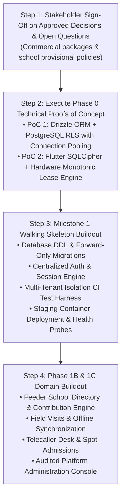

1. **Step 1 (Governance):** Secure formal Product Owner sign-off on the 5 approved architectural decisions and resolve the 3 open commercial questions (Section 1).
2. **Step 2 (Phase 0 PoCs - 6 Engineering Days):**
   - Execute PoC 1: Drizzle ORM with PostgreSQL RLS under PgBouncer transaction pooling.
   - Execute PoC 2: Flutter SQLCipher encrypted queue and 48-hour hardware-backed monotonic lease protection on physical Android test hardware.
3. **Step 3 (Milestone 1 Implementation):** Build the secure walking skeleton:
   - Automated forward-only database migrations.
   - Session engine with `HMAC-SHA256` hashing and `__Host-` cookies.
   - Tenant-scoped student lead creation with AES-256-GCM encryption and HMAC blind indexing.
   - Mandatory CI Cross-Tenant Isolation Penetration Test Suite.
   - Dockerized staging deployment with `/health/live` and `/health/ready` probes.
4. **Step 4 (Phase 1 Operations Core):** Proceed with full domain module assembly across web and mobile clients according to the feature traceability matrix.

---

## 11. Documentation Modification Register & Confirmation

### 11.1 Documentation Files Created
- `docs/ARCHITECTURE_REVISION_3.md` (This document created as the official Revision 3.0 specification baseline).

### 11.2 Strict Non-Modification Confirmation
In accordance with task constraints:
- **Zero application code files were created, edited, or deleted.**
- **No package dependencies were installed or modified (`package.json`, `package-lock.json` remain untouched).**
- **No database schemas, tables, or migrations were executed.**
- **No configuration files, environment variables, or running dev servers were modified.**
- **Revision 2.0 and the existing codebase remain preserved in their entirety as historical reference.**
