# Architecture Revision 3.1: Final Technical Corrections Before PoCs

**Document Status:** Architecture Revision 3.1 (Pre-PoC Technical Baseline)  
**System:** Multi-Tenant College Admissions Operations & Field Force SaaS  
**Scope Classification:** Phase 1 Operational Core  
**Role:** Principal SaaS Architect & Application Security Architect  
**Predecessor Baselines:** Revision 2.0 and Revision 3.0 (Preserved in full)  
**Document Purpose:** Resolve physical device clock/reboot feasibility, unify HMAC-SHA256 session hashing, correct PostgreSQL partial unique indexes, parameterize RLS context, harden downgrade safety, detail cross-workspace migrations, and establish concrete PoC exit criteria and fallbacks.  
**Implementation Boundary:** Strictly non-implemented specification. Zero application code, dependencies, schemas, migrations, or configurations modified.

---

## 1. Executive Architecture Summary & Governance Log

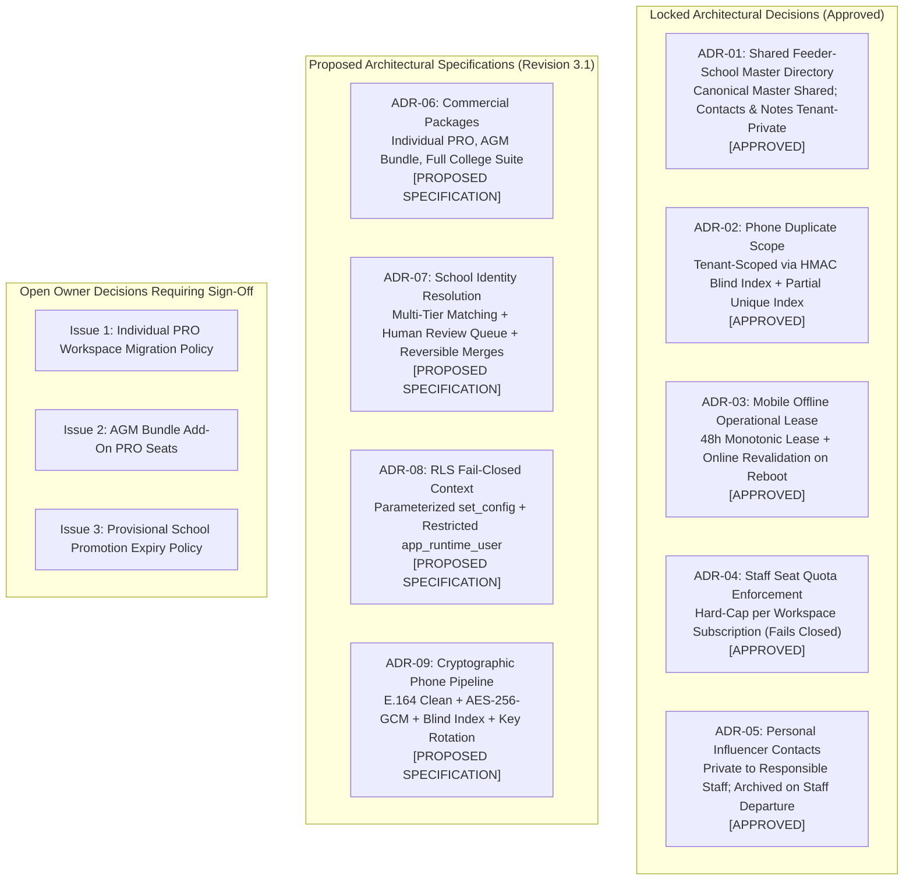

### 1.1 Formally Approved Decisions (Locked Baseline)

| Decision Reference | Area | Formal Policy & Architectural Enforcement Mechanism | Governance Status |
| :--- | :--- | :--- | :---: |
| **ADR-01** | Feeder Schools | **Shared Canonical Directory with Tenant-Private Overlays:** Government school registries (UDISE codes, canonical names, geographic mandals) are shared across all tenants. All headmaster contact numbers, private notes, institutional ratings, and staff allocations remain strictly tenant-private. | **APPROVED** |
| **ADR-02** | Lead Uniqueness | **Per-Tenant Phone Uniqueness:** Student phone number uniqueness is enforced strictly within each college tenant via `(workspace_id, phone_blind_index)`. College B is fully permitted to prospect a student previously contacted by College A without cross-tenant conflict or data leakage. | **APPROVED** |
| **ADR-03** | Mobile Operation | **48-Hour Monotonic Lease + Online Revalidation on Reboot:** Field PRO mobile clients are permitted an autonomous offline operational window of up to 48 hours while running. Because standard consumer mobile OSs reset monotonic clocks on power cycle, rebooting while offline requires online revalidation before local database access resumes. | **APPROVED** |
| **ADR-04** | SaaS Quotas | **Hard Staff-Seat Quota Enforcement:** Subscription plans enforce hard caps on active staff memberships (`max_staff_seats`). API attempts to provision staff beyond the entitlement fail closed with HTTP 422 until upgraded. | **APPROVED** |
| **ADR-05** | Contact Privacy | **Personal Relative/Influencer Ownership & Departure Archival:** Village relative and influencer referral contacts mapped by a PRO are private to that staff member. Upon employee departure or deactivation, contacts are archived and hidden, not transferred to competing staff. | **APPROVED** |

### 1.2 Open Commercial Questions Requiring Owner Sign-Off

1. **Individual PRO Workspace Migration into College Suite:** When an independent PRO subscriber is hired by a college using the Full College Suite, should their personal leads be imported via an audited, dual-consent cryptographic re-keying wizard, or must their independent workspace remain strictly isolated?  
   *Architecture Recommendation:* Keep workspaces separate by default; provide an explicit, audited migration wizard requiring dual authorization (PRO + College Admin).
2. **AGM Bundle Add-On PRO Seats:** Can an AGM Bundle purchase individual PRO add-on seats beyond the bundled tier (e.g., base package of 5 PROs expanded to 8), or must they upgrade to a Full College Suite?  
   *Architecture Recommendation:* Support incremental PRO seat add-on entitlements.
3. **Provisional School Auto-Promotion:** If a provisional school submission by College A remains in the review queue unreviewed by the Platform Admin for $>30$ days, should it be auto-promoted to Canonical status, or remain Provisional indefinitely?  
   *Architecture Recommendation:* Remain Provisional indefinitely to prevent registry corruption.

---

## 2. Commercial Packaging and Domain Entitlement Model

### 2.1 The Three Commercial Packages

The platform provides a single unified codebase supporting three commercial packages. Package limits and feature flags are evaluated dynamically; no hardcoded package-specific code paths exist.

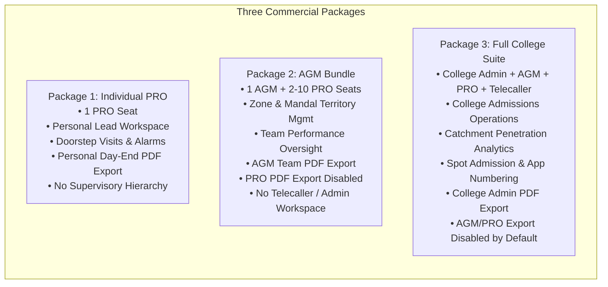

1. **Individual PRO Package:**
   - **Target User:** Independent admission consultants or freelance field representatives.
   - **Workspace Model:** Single-member workspace.
   - **Authorized Capabilities:** Personal lead entry, village student selector, doorstep visit recording, dynamic callback alarms, and **personal daily activity PDF exports**.
   - **Restricted Capabilities:** No supervisory staff management, no AGM dashboards, no feeder school catchment analytics, no telecaller desks.
2. **AGM Bundle:**
   - **Target User:** Regional managers overseeing a regional field team across 5 to 20 mandals.
   - **Workspace Model:** Multi-member team workspace (1 AGM seat + configurable PRO seats).
   - **Authorized Capabilities:** Team task assignment, territory allocation, PRO visit monitoring, and **AGM-level team/territory PDF reports**.
   - **Restricted Capabilities:** PRO seats have **PDF export disabled by default**; no central College Admin console; no telecaller lead distribution desks.
3. **Full College Suite:**
   - **Target User:** Accredited intermediate and junior colleges with multi-branch or campus operations.
   - **Workspace Model:** Enterprise institutional workspace.
   - **Authorized Capabilities:** Full administrative hierarchy (`COLLEGE_ADMIN`, `AGM`, `PRO`, `TELECALLER`), multi-branch scoping, spot admission recording with application number sequencing, feeder school catchment intelligence, and **College Admin-level authorized PDF exports**.
   - **Restricted Capabilities:** Field PRO and AGM PDF exports disabled by default to prevent unauthorized bulk data exfiltration.

---

### 2.2 Domain Separation: Subscriptions, Workspaces, Roles, and Entitlements

The domain model completely decouples **Commercial Subscriptions**, **Workspaces**, **User Roles**, and **Feature Entitlements**:

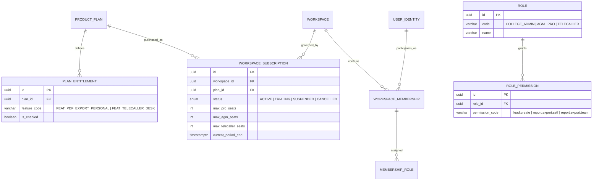

#### Effective Access Evaluation Formula
Access to any protected capability is evaluated at runtime via a three-way intersection:
$$\text{Effective Access} = \text{Package Entitlement} \cap \text{Role Permission} \cap \text{Record Authorization Scope}$$

- If an action is not entitled by the workspace subscription, access is rejected (HTTP 403 `PACKAGE_NOT_ENTITLED`).
- If an action is entitled by the package, but the user's role lacks the permission, access is rejected (HTTP 403 `ROLE_NOT_AUTHORIZED`).
- If both package and role permit the action, access is evaluated against the user's geographic/assignment scope (e.g., PRO accessing only their assigned leads; AGM accessing only their zone).

---

### 2.3 Package-to-Feature Entitlement Matrix

| Feature Code | Capability Description | Individual PRO | AGM Bundle | Full College Suite |
| :--- | :--- | :---: | :---: | :---: |
| `FEAT_LEAD_CAPTURE` | Create and manage prospective student leads | **Enabled** | **Enabled** | **Enabled** |
| `FEAT_DOORSTEP_VISIT` | Record doorstep visits and dynamic alarms | **Enabled** | **Enabled** | **Enabled** |
| `FEAT_WHATSAPP_CARD` | Generate on-device watermarked WhatsApp cards | **Enabled** | **Enabled** | **Enabled** |
| `FEAT_OFFLINE_SYNC` | Mobile offline SQLite queue and sync | **Enabled** | **Enabled** | **Enabled** |
| `FEAT_PDF_EXPORT_PERSONAL` | Export personal daily activity PDF reports | **Enabled** | Disabled (Default) | Disabled (Default) |
| `FEAT_PDF_EXPORT_TEAM` | Export aggregated zone/team PDF reports | Disabled | **Enabled** (AGM Only) | Disabled (Default) |
| `FEAT_PDF_EXPORT_COLLEGE` | Export college-wide master PDF reports | Disabled | Disabled | **Enabled** (Admin Only) |
| `FEAT_TERRITORY_MGMT` | Allocate mandals and feeder schools to staff | Disabled | **Enabled** (Zone) | **Enabled** (College) |
| `FEAT_STAFF_MGMT` | Provision and deactivate subordinate staff seats | Disabled | **Enabled** (PROs) | **Enabled** (All Roles) |
| `FEAT_CATCHMENT_INTEL`| Catchment penetration vs. 10th-grade strength | Disabled | Disabled | **Enabled** |
| `FEAT_TELECALLER_DESK`| 2-way PRO $\leftrightarrow$ Telecaller lead desk | Disabled | Disabled | **Enabled** |
| `FEAT_SPOT_ADMISSION` | Spot admission logging with application numbers| Disabled | Disabled | **Enabled** |
| `FEAT_MULTI_BRANCH` | Multiple campus partitions within workspace | Disabled | Disabled | **Enabled** |

---

### 2.4 Safe Subscription Lifecycle & Downgrade Safety

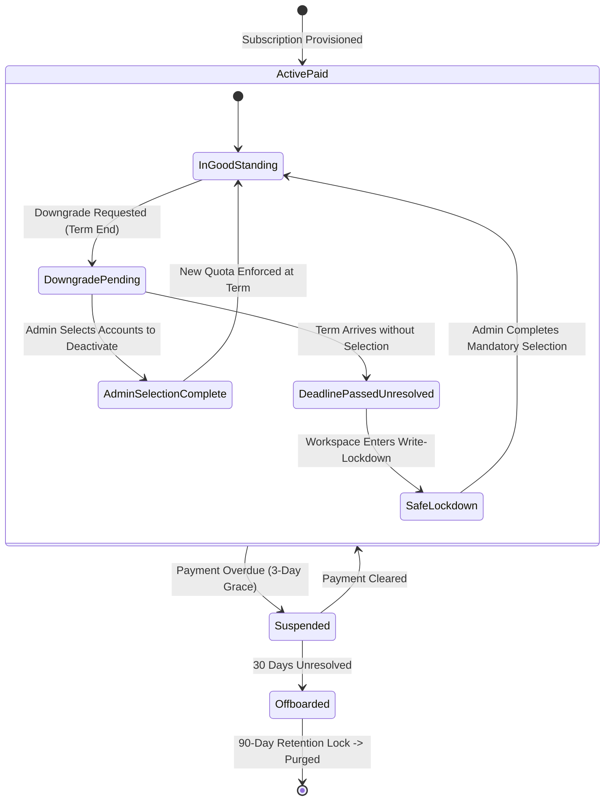

#### Safe Downgrade Policy (No Silent Guesses)
In previous revisions, automatic deactivation of staff based on creation order was considered. **This is rejected as unsafe:**
1. **Explicit Selection Requirement:** When a quota reduction is scheduled (e.g., from 8 PROs to 4 PROs), the administrator console flags the workspace as `DOWNGRADE_PENDING_SELECTION`.
2. **Safe Deadline Behavior (No Data Destruction):**
   - If the effective date arrives and the administrator has not selected the accounts to remove:
   - The system **does not guess** which staff to deactivate.
   - The system **does not reassign leads automatically**.
   - Instead, the workspace enters **Write-Lockdown** (`QUOTA_EXCEEDED_SELECTION_REQUIRED`):
     - All staff can continue to view existing leads, visits, and reports (read operations preserved).
     - New lead entry and visit logging are paused.
     - The administrator is redirected upon login to an unavoidable selection modal.
     - Once the administrator explicitly designates the accounts to deactivate, those accounts transition to `is_active = false`, their active sessions are revoked, their leads are routed according to explicit admin instructions, and write operations resume immediately.
     - Audit events recorded: `WORKSPACE_DOWNGRADE_WRITE_LOCKED`, `STAFF_EXPLICITLY_DEACTIVATED_ON_DOWNGRADE`.

---

## 3. Server-Side PDF Export Security and Scoping

### 3.1 Authorization and Server-Side Enforcement Rules

Hiding the "Export PDF" button in the client UI is fundamentally insufficient. The API gateway and report service enforce strict server-side validation:

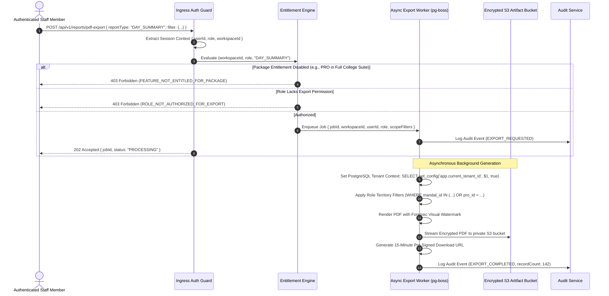

- **Individual PRO:** Authorized strictly to export records where `created_by_user_id = ctx.userId`.
- **AGM Bundle:** AGM authorized to export records where `mandal_id IN (ctx.assignedMandals)` or `created_by_user_id IN (ctx.subordinateStaffIds)`. PRO exports return HTTP 403.
- **Full College Suite:** College Admin authorized to export college-wide records. AGMs and PROs return HTTP 403 by default unless an explicit override entitlement (`OVERRIDE_ALLOW_STAFF_EXPORT`) is granted by the College Admin.

### 3.2 Forensic Watermarking and Artifact Security
- **Visual Forensic Watermark:** Every generated PDF page embeds a semi-transparent, diagonal background watermark containing:
  `[Workspace Name] | User: [Employee Code] | IP: [Client IP] | Timestamp: [UTC ISO8601]`
- **Storage Lifecycle:** PDFs stream directly to a private, server-side encrypted S3 bucket (`aws:kms`).
- **Time-Expiring Access:** Download links use S3 pre-signed URLs with a hard **15-minute time-to-live**.
- **Audit Logging:** Every export invocation logs: `user_id`, `workspace_id`, `report_type`, `record_count`, `applied_filters`, and `artifact_sha256_hash` to the immutable audit log.

---

## 4. Shared Feeder School Directory & Identity Resolution Engine

### 4.1 Master School Directory Architecture

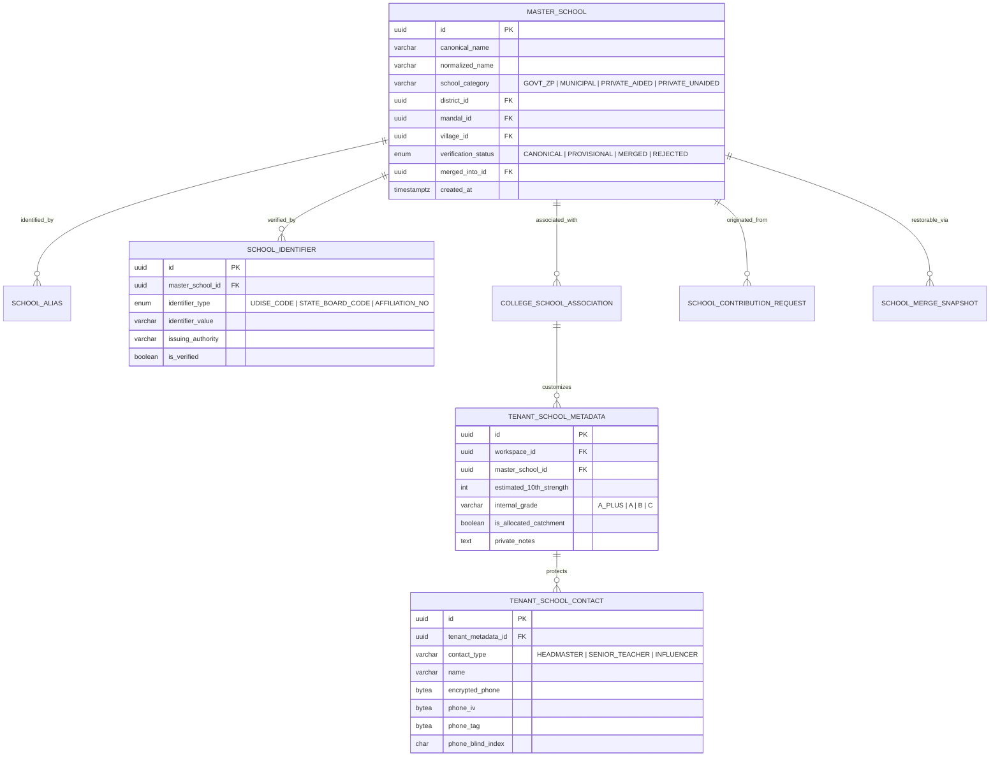

---

### 4.2 School Identity Resolution Workflow

When a field PRO or college administrator searches for or submits a feeder school, the system follows a deterministic 5-stage identity resolution pipeline:

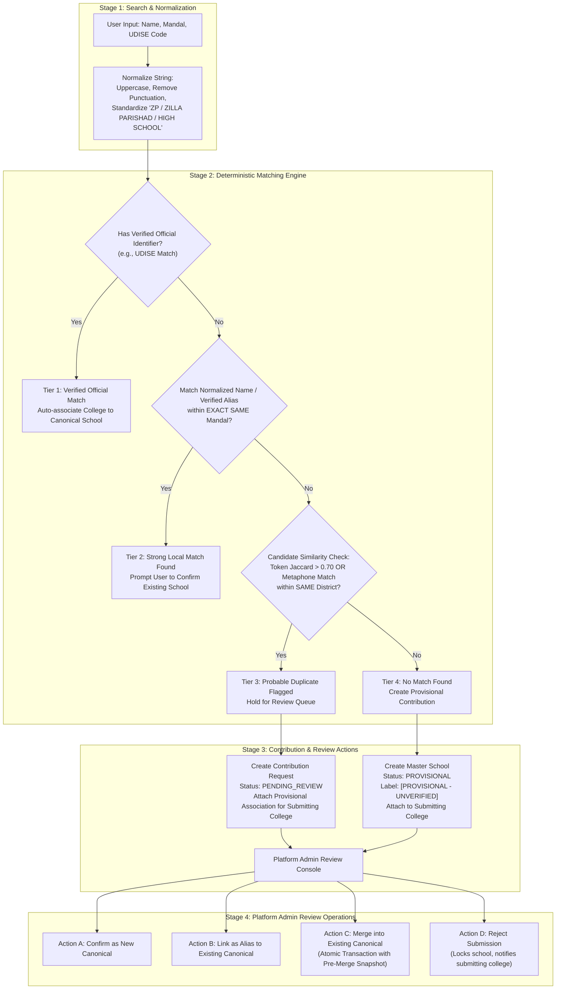

#### Deterministic Multi-Tier Matching Logic
1. **Tier 1 (Verified Official Identifier Match):** Matches a verified government code (UDISE, state board code). Eliminates phonetic ambiguity (subject to government issuing accuracy). Automatically links association to canonical record.
2. **Tier 2 (Strong Local Match):** Matches a canonical name or verified alias within the exact same administrative mandal. Prompts the user to confirm. Direct association upon confirmation.
3. **Tier 3 (Probable Duplicate - Central Review Queue):** High token similarity ($>0.70$ Jaccard or Double Metaphone equivalence) within the same district or neighboring mandal. **Fails safe:** The system does NOT automatically merge identities. It creates a `school_contribution_requests` entry held for Platform Admin review. The submitting college receives a temporary provisional link.
4. **Tier 4 (No Match - Provisional Creation):** No candidate match found. System provisions a new `master_schools` record with `verification_status = 'PROVISIONAL'`.
   - **Provisional Usage Rules:** The submitting college can log visits, capture leads, and assign staff against it immediately. To other colleges, the school appears in search with a prominent visual badge: `[PROVISIONAL - UNVERIFIED]`. Other colleges can view and associate with it, but official board ratings cannot be applied until verified.

---

### 4.3 Transactional School Merge Recovery & Association Collision Handling

```mermaid
sequenceDiagram
    autonumber
    actor Admin as Platform Superadmin
    participant API as School Admin API (/api/v1/admin/schools/merge)
    participant SnapTable as school_merge_snapshots Table
    participant MasterTable as master_schools Table
    participant AssocTable as college_school_associations Table
    participant MetaTable as tenant_school_metadata Table
    participant ContactTable as tenant_school_contacts Table
    participant Audit as Immutable Audit Log

    Admin->>API: POST /api/v1/admin/schools/merge { sourceId: B, targetId: A, justification: "Duplicate UDISE confirmed" }
    API->>API: Validate A != B; A.status == CANONICAL; B.status != MERGED
    
    rect rgb(240, 248, 255)
        Note over API,Audit: Atomic Database Transaction
        API->>SnapTable: INSERT INTO school_merge_snapshots (source_id, target_id, pre_merge_state_json)
        API->>MasterTable: UPDATE master_schools SET verification_status = 'MERGED', merged_into_id = A WHERE id = B
        API->>MasterTable: INSERT INTO school_aliases (master_school_id, alias_name, source) VALUES (A, B.canonical_name, 'MERGE_OP')
        
        Note over AssocTable,ContactTable: Handle Collisions for Colleges Associated with BOTH A and B
        loop For each College C associated with School B
            alt College C is NOT associated with School A
                API->>AssocTable: UPDATE college_school_associations SET master_school_id = A WHERE workspace_id = C AND master_school_id = B
                API->>MetaTable: UPDATE tenant_school_metadata SET master_school_id = A WHERE workspace_id = C AND master_school_id = B
            else College C is ALREADY associated with School A (Collision)
                API->>AssocTable: UPDATE college_school_associations SET status = 'SUPERSEDED_BY_MERGE' WHERE workspace_id = C AND master_school_id = B
                API->>ContactTable: Re-point contacts belonging to B's metadata to point to A's metadata ID
                API->>MetaTable: Append B's notes into A's private_notes: E'\n[Merged Notes from School B]: ' || notes
                API->>MetaTable: UPDATE tenant_school_metadata SET status = 'ARCHIVED_DUE_TO_MERGE' WHERE workspace_id = C AND master_school_id = B
            end
        end

        API->>Audit: Log Audit Event (SCHOOL_MERGED, { sourceId: B, targetId: A, adminId: Admin.id })
    end

    API-->>Admin: 200 OK { status: 'MERGE_COMPLETED', snapshotId: 'uuid' }

    Note over Admin,Audit: Reversible Unmerge Procedure (Emergency Rollback)
    Admin->>API: POST /api/v1/admin/schools/unmerge { snapshotId: 'uuid', justification: 'Erroneous merge' }
    rect rgb(255, 240, 245)
        Note over API,Audit: Atomic Rollback Transaction
        API->>SnapTable: Read pre_merge_state_json
        API->>MasterTable: Restore B.status = 'PROVISIONAL', B.merged_into_id = NULL
        API->>MasterTable: DELETE alias created during merge
        API->>AssocTable: Revert association records and statuses to pre-merge IDs
        API->>MetaTable: Revert metadata records and un-nest contacts to pre-merge IDs
        API->>SnapTable: Mark snapshot status = 'ROLLED_BACK'
        API->>Audit: Log Audit Event (SCHOOL_UNMERGED, { snapshotId: 'uuid' })
    end
    API-->>Admin: 200 OK { status: 'UNMERGE_COMPLETED' }
```

- **Collision Invariant:** A college cannot have two active `tenant_school_metadata` records for the same canonical school. Re-pointing School B's contacts to School A's metadata preserves private headmaster phone numbers and relationship notes without violating uniqueness constraints.
- **Durable Rollback:** Pre-merge snapshots guarantee that interrupted merges roll back cleanly, and accidental operator merges can be reversed without data loss.

---

## 5. Security Architecture Corrections

### 5.1 Unified Session-Token Hashing: HMAC-SHA256 with Server Pepper

The architecture enforces a single, mathematically consistent session-token hashing and storage strategy across all modules, tests, and data models:

$$\text{token\_hash} = \text{HMAC-SHA256}(\text{key} = \text{server\_session\_pepper}, \text{message} = \text{raw\_session\_token})$$

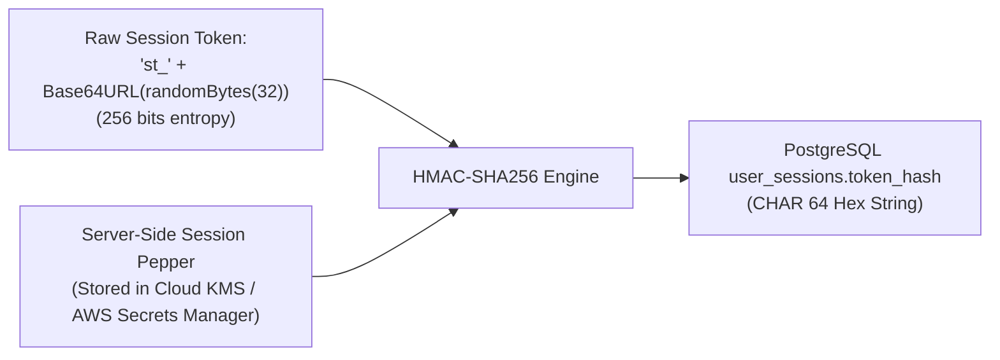

- **Key:** `server_session_pepper` (256-bit cryptographically secure random secret stored in Cloud KMS / AWS Secrets Manager, never in the database).
- **Message:** `raw_session_token` (prefixed `st_` + 32 bytes CSPRNG Base64URL).
- **Database Storage:** Stored as a 64-character lowercase hex string in `user_sessions.token_hash` (`CHAR(64) NOT NULL UNIQUE`). Plain SHA-256 is eliminated.
- **Zero-Downtime Pepper Rotation:** The application runtime supports `current_pepper` and `previous_pepper`. Incoming requests evaluate `HMAC(current_pepper, raw_token)`. If not found, they evaluate `HMAC(previous_pepper, raw_token)`. If found, the session row is re-hashed with `current_pepper` and updated in the database on the fly.
- **Immediate Revocation:**
  - Logout: `UPDATE user_sessions SET revoked_at = NOW() WHERE token_hash = :hash`.
  - User Deactivation: `UPDATE user_sessions SET revoked_at = NOW() WHERE user_id = :userId`.
  - Workspace Suspension: `UPDATE user_sessions SET revoked_at = NOW() WHERE workspace_id = :workspaceId`.

---

### 5.2 Offline Lease Feasibility & Hardware Security Redesign

> [!IMPORTANT]
> **Platform Clock Limitation & Verified Reality:**  
> Standard Android `SystemClock.elapsedRealtime()` and iOS `mach_continuous_time()` reset to `0` whenever the device is rebooted. Standard consumer mobile devices do not expose an un-authenticated, tamper-proof, wall-clock persistence across reboots in an offline state.

To provide security without relying on unverified hardware claims, the mobile architecture implements a **Multi-Layer Defensive Clock & Lease Protocol**:

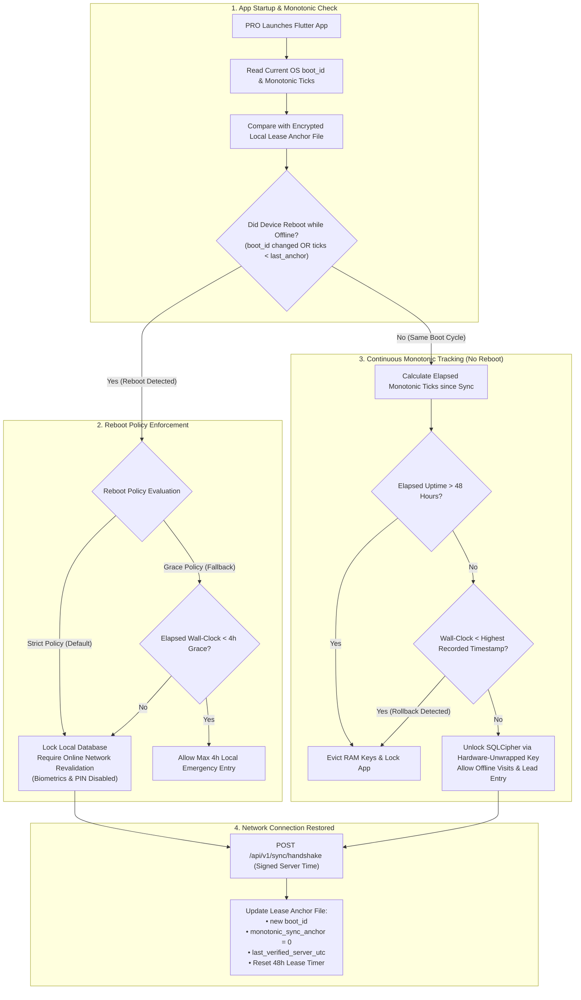

#### Detailed Hardware-Backed Mechanics
1. **Continuous Monotonic Tracking (While Running):** While powered on, monotonic clocks measure elapsed time reliably, completely immune to user wall-clock modifications in Android/iOS settings.
2. **Offline Reboot Policy (The Secure Fallback):**
   - If the phone powers off or reboots while offline, the app detects the boot change.
   - **Recommended Default:** The local database locks, requiring an online network handshake before local access resumes. This eliminates the vulnerability where a stolen phone has its battery pulled for weeks to evade lease expiration.
   - **Operational Fallback (Configurable 4-Hour Grace):** If field operations in deep rural dead zones require reboot tolerance (e.g., dead battery recharged via motorcycle battery), the app permits a strictly bounded 4-hour emergency window verified against forward-only timestamps, after which hard lockdown occurs.
3. **Cryptographic Erasure (Zeroization of Key, not Flash Memory):**
   - Overwriting SQLite files on flash storage is unreliable due to Flash Translation Layer (FTL) block wear-leveling remapping.
   - The platform encrypts SQLite via SQLCipher with key $K_{db}$.
   - $K_{db}$ is encrypted by $KEK_{device}$ inside the hardware keystore (StrongBox / Secure Enclave).
   - Upon wipe trigger (tamper detected, 48h expiry, or server 401 `PURGE_DATA`), the app deletes $KEK_{device}$ from the hardware keystore. Without $KEK_{device}$, recovering $K_{db}$ is mathematically intractable ($2^{256}$ operations), rendering the physical SQLite file on flash storage permanently irrecoverable.
4. **App Backup Prevention:** Android `android:allowBackup="false"` in manifest; iOS `kSecAttrAccessibleAfterFirstUnlockThisDeviceOnly` prevents un-authenticated cloud or local file extractions.

---

### 5.3 PostgreSQL Integrity: Partial Unique Index & Keyed Phone Encryption

The invalid table-level constraint syntax from Revision 3.0 is corrected to a **PostgreSQL Partial Unique Index**:

```sql
-- Partial Unique Index on active leads within each workspace
CREATE UNIQUE INDEX idx_unique_active_workspace_phone 
ON student_leads (workspace_id, phone_blind_index) 
WHERE deleted_at IS NULL;
```

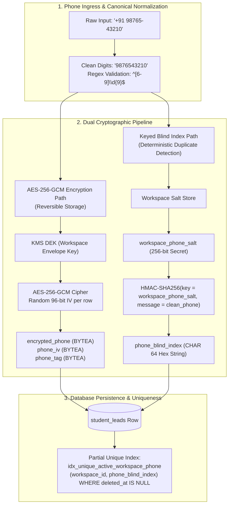

#### Duplicate Handling Behavior
When an insert or update collides with an existing active lead in the same workspace, PostgreSQL raises error code `23505` (`unique_violation`). The API maps this cleanly to HTTP 409 Conflict with an RFC 7807 Problem Details response:

```json
{
  "type": "https://api.admissions-app.com/v1/errors/duplicate-phone",
  "title": "Duplicate Lead Phone Number",
  "status": 409,
  "detail": "A prospective student with this phone number already exists in your college workspace.",
  "instance": "/api/v1/leads",
  "code": "DUPLICATE_PHONE_NUMBER",
  "correlationId": "req_01HPX789ABCD"
}
```

---

### 5.4 Parameter-Safe Transaction-Local PostgreSQL RLS

To eliminate SQL injection risks and guarantee transaction pooling compatibility (PgBouncer in transaction mode), tenant context injection uses the **parameterized `set_config` function**:

```sql
-- Parameter-safe transaction-scoped tenant context setting
SELECT set_config('app.current_tenant_id', $1, true);
```

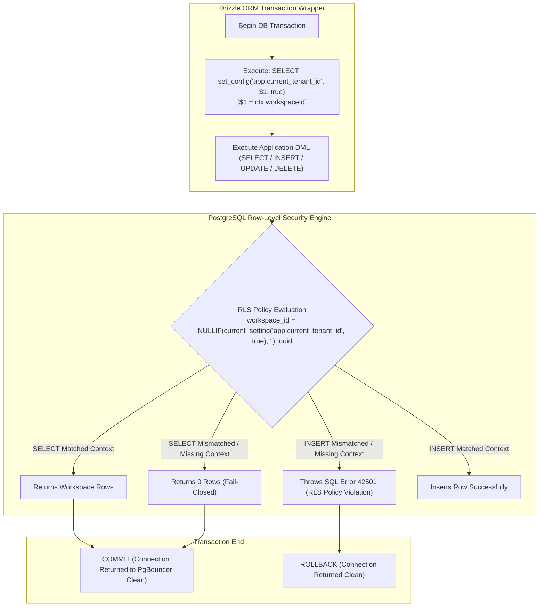

#### Differentiating Zero-Row SELECT from Rejected Writes
- **`SELECT` Operations:** If tenant context is missing or points to another tenant, the `USING` clause evaluates to false. The query returns **0 rows** (empty result set, failing closed without leaking existence).
- **`INSERT` Operations:** If tenant context is missing or does not match `new.workspace_id`, the `WITH CHECK` clause evaluates to false. PostgreSQL raises error `42501` (`insufficient_privilege: new row violates row-level security policy`).
- **`UPDATE` / `DELETE` Operations:** Rows belonging to other tenants are invisible under `USING` (0 rows affected). Attempts to update `workspace_id` to another tenant trigger `WITH CHECK` error `42501`.

---

### 5.5 Cross-Workspace Lead Migration: Cryptographic Re-Keying Protocol

Because Workspace A and Workspace B use **completely different HMAC salts** (`salt_A` $\neq$ `salt_B`), blind indexes from Workspace A cannot be compared directly against Workspace B.

Cross-workspace lead migration operates via an **In-Memory Cryptographic Re-Keying Pipeline**:

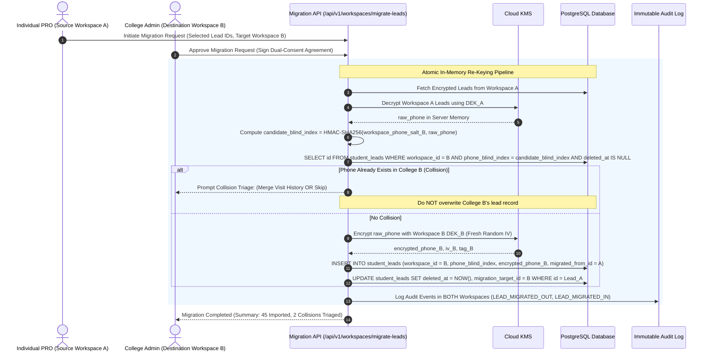

- **Invariant:** Workspaces remain strictly segregated. Raw phone numbers exist decrypted only within ephemeral server process memory during re-encryption and are never written to disk or logs.

---

## 6. Updated Conceptual Data Model

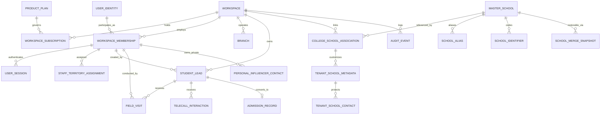

### 6.1 Critical Entity Definitions & Integrity Rules

#### 1. `student_leads` (Admissions Pipeline)
- **Fields:** `id` (UUIDv7), `workspace_id` (UUID $\to$ `workspaces.id`), `branch_id` (UUID $\to$ `branches.id`, NULLABLE), `created_by_membership_id` (UUID), `assigned_pro_id` (UUID, NULLABLE), `assigned_telecaller_id` (UUID, NULLABLE), `full_name` (VARCHAR(100)), `phone_blind_index` (CHAR(64)), `encrypted_phone` (BYTEA), `phone_iv` (BYTEA), `phone_tag` (BYTEA), `village_id` (UUID), `mandal_id` (UUID), `master_school_id` (UUID, NULLABLE), `lead_status` (`NEW`, `FOLLOW_UP`, `STAR_LEAD`, `VISIT_SCHEDULED`, `ADMITTED`, `DROPPED`), `doorstep_completed` (BOOLEAN DEFAULT FALSE), `version` (INT DEFAULT 1), `deleted_at` (TIMESTAMPTZ NULL).
- **Integrity Rule:** `CREATE UNIQUE INDEX idx_unique_active_workspace_phone ON student_leads (workspace_id, phone_blind_index) WHERE deleted_at IS NULL;`

#### 2. `user_sessions` (Server-Managed Sessions)
- **Fields:** `id` (UUID), `workspace_id` (UUID), `user_id` (UUID), `token_hash` (CHAR(64) UNIQUE NOT NULL), `idle_expires_at` (TIMESTAMPTZ NOT NULL), `max_expires_at` (TIMESTAMPTZ NOT NULL), `last_activity_at` (TIMESTAMPTZ NOT NULL), `revoked_at` (TIMESTAMPTZ NULL), `ip_address` (INET), `user_agent` (VARCHAR(255)).
- **Integrity Rule:** Hashed strictly via `HMAC-SHA256(server_session_pepper, raw_token)`.

#### 3. `personal_influencer_contacts` (PRO Relatives & Influencers)
- **Fields:** `id` (UUID), `workspace_id` (UUID $\to$ `workspaces.id`), `membership_id` (UUID $\to$ `workspace_memberships.id`), `name` (VARCHAR(100)), `encrypted_phone` (BYTEA), `phone_blind_index` (CHAR(64)), `relation_type` (`UNCLE`, `BROTHER`, `VILLAGE_ELDER`, `LOCAL_TUTOR`), `village_id` (UUID), `status` (`ACTIVE`, `ARCHIVED`), `created_at` (TIMESTAMPTZ).
- **Integrity Rule:** Private to `membership_id`. Auto-archived upon staff deactivation. Inaccessible to other staff members.

#### 4. `school_merge_snapshots` (Reversible Merge Recovery)
- **Fields:** `id` (UUID), `source_school_id` (UUID), `target_school_id` (UUID), `pre_merge_state_json` (JSONB NOT NULL), `executed_by_admin_id` (UUID), `status` (`ACTIVE_MERGE`, `ROLLED_BACK`), `created_at` (TIMESTAMPTZ).

---

## 7. Security Findings Register (SEC-01 to SEC-08)

| Finding ID | Vulnerability Description | Severity | Target Architecture Mitigation | Automated Verification Test |
| :--- | :--- | :---: | :--- | :--- |
| **SEC-01** | Client-Side JWT Minting in Flutter (`api_service.dart`) | **CRITICAL** | Complete removal of client token signing. Server issues opaque 256-bit bearer tokens verified against HMAC-SHA256 database hashes. | `TEST-VERIF-01`: Client submits forged token; server returns HTTP 401. All tokens minted by server exclusively. |
| **SEC-02** | Default Insecure Student Password Takeover (`123456`) | **CRITICAL** | Student login and self-registration entirely deferred from Phase 1. | `TEST-VERIF-02`: Public student registration endpoints eliminated from API routing table. |
| **SEC-03** | Public Feeder School PII Leakage (`GET /api/config`) | **HIGH** | `master_schools` read-only master; headmaster personal phones moved to encrypted `tenant_school_contacts` requiring authenticated tenant session. | `TEST-VERIF-03`: Unauthenticated `GET /api/v1/schools` returns HTTP 401. Authenticated staff see only tenant-authorized contacts. |
| **SEC-04** | Cross-Tenant Lead Leaks via Unassigned Telecallers | **HIGH** | Telecaller queries enforce mandatory tenant scoping and assignment checks. Empty assignment returns `[]` (fail-closed), never global leads. | `TEST-VERIF-04`: Telecaller with empty assignment queries `/api/v1/leads`; returns empty array, 0 rows leaked. |
| **SEC-05** | Tokens Passed in URL Query Strings (`?token=...`) | **MEDIUM** | Ingress API gateway strictly rejects tokens in query strings. Tokens accepted exclusively via `__Host-` cookies or `Authorization: Bearer` headers. | `TEST-VERIF-05`: Request with `?token=...` returns HTTP 400 Bad Request. |
| **SEC-06** | Hardcoded Automated Backup Fallback Secret | **MEDIUM** | Secret hardcoding eliminated. Process fails startup if `CRON_SECRET` is unset via Zod environment validation. | `TEST-VERIF-06`: Missing `CRON_SECRET` in environment causes application startup crash with explicit error. |
| **SEC-07** | Stolen Offline Field Phone Data Extraction | **HIGH** | 48-hour monotonic lease; online revalidation on reboot; SQLCipher 256-bit AES encryption; cryptographic erasure zeroizing TPM keys on tamper/expiry. | `TEST-VERIF-07`: Simulate monotonic advance $>48$h or reboot; verify $K_{db}$ evicted and local database unreadable. |
| **SEC-08** | Unauthorized Bulk PDF Data Exfiltration | **MEDIUM** | Role-based export authorization; server-side entitlement checks; forensic visual watermarking; 15-minute expiring S3 pre-signed URLs. | `TEST-VERIF-08`: PRO in Full College Suite calls export endpoint; returns HTTP 403. Admin export generates watermarked artifact. |

---

## 8. Proof-of-Concept (PoC) Plans with Measurable Exit Criteria

### 8.1 PoC 1: Drizzle ORM + PostgreSQL RLS under Transaction Pooling

- **Objective:** Prove that Drizzle ORM executes parameter-safe `SELECT set_config('app.current_tenant_id', $1, true)` reliably across pooled connections (PgBouncer in transaction mode) without session state bleeding, under a restricted runtime database role.
- **Prerequisites:** Containerized PostgreSQL 16 instance, PgBouncer configured with `pool_mode = transaction`, Drizzle ORM connection wrapper.
- **Test Environment:** Docker test container on Linux.
- **Database Roles:**
  - `migrator_admin`: Owns schema, has `BYPASSRLS`.
  - `app_runtime_user`: Unprivileged runtime role (`NOINHERIT`, `NOSUPERUSER`, `NOCREATEDB`, `NOCREATEROLE`, `NOBYPASSRLS`).
- **Test Cases:**
  1. *Test 1.1 (Parameter-Safe Injection):* Set context via `set_config('app.current_tenant_id', $1, true)` where `$1` is parameterized.
  2. *Test 1.2 (Missing Context Fail-Closed):* Query `student_leads` without setting context $\implies$ Assert SELECT returns 0 rows.
  3. *Test 1.3 (Write Rejection):* Attempt INSERT into `student_leads` without context $\implies$ Assert PostgreSQL raises error `42501`.
  4. *Test 1.4 (Pooled Connection Reuse):* Rapidly interleave 10,000 transactions alternating between Tenant A and Tenant B over 10 physical pooled connections $\implies$ Assert zero cross-tenant row contamination.
  5. *Test 1.5 (Aborted Transaction Context Clearance):* Abort transaction mid-flight $\implies$ Assert subsequent transaction on same physical connection does not retain aborted tenant context.
- **Evidence to Collect:** PgBouncer connection logs, PostgreSQL transaction query logs, automated Vitest assertion report.
- **Measurable Pass Conditions:**
  - 0 cross-tenant rows returned across 10,000 interleaved transactions.
  - 100% of missing-context writes rejected with error `42501`.
  - Additional latency introduced by `set_config` is $< 2.0\text{ms}$ per transaction.
- **Fallback if Failed:** If PgBouncer transaction pooling leaks session state or adds excessive latency, fall back to **Application-Layer Repository Scoping** as the primary security perimeter, backed by schema-level separation or dedicated connection pools per enterprise tenant.

---

### 8.2 PoC 2: Flutter Offline Lease & Hardware Security

- **Objective:** Validate SQLCipher local database encryption, client-side UUIDv7 generation, monotonic uptime lease tracking, online revalidation on reboot, and cryptographic erasure on physical mobile devices.
- **Prerequisites:** Flutter test application embedding `sqflite_sqlcipher`, `flutter_secure_storage`, and native platform security bindings.
- **Test Devices:**
  1. Low-end Android test device (Android 10+, 2GB RAM, e.g., Redmi or Samsung A-series).
  2. iOS test device (iOS 15+, e.g., iPhone SE or iPhone 11).
- **Test Cases:**
  1. *Test 2.1 (Offline Queue Serialization):* Queue 100 doorstep visits while offline $\implies$ Verify serialized to encrypted SQLite with UUIDv7 keys.
  2. *Test 2.2 (System Clock Rollback):* Manually roll system wall-clock back 7 days in OS settings while offline $\implies$ App reads monotonic uptime anchor, detects backward shift $\implies$ Evicts $K_{db}$ from RAM and locks UI.
  3. *Test 2.3 (Device Reboot while Offline):* Reboot device while offline $\implies$ App detects `boot_id` change $\implies$ Enforces online revalidation requirement (local DB remains locked until network handshake).
  4. *Test 2.4 (48-Hour Continuous Uptime Expiry):* Simulate 48 hours continuous uptime $\implies$ Lease expires, hardware key evicted from RAM, UI locks.
  5. *Test 2.5 (Cryptographic Erasure Verification):* Trigger remote wipe or tamper lockdown $\implies$ App deletes $KEK_{device}$ from hardware keystore $\implies$ Extract physical SQLite file via `adb backup` or file extraction $\implies$ Attempt offline decryption $\implies$ Assert file unreadable mathematical noise.
  6. *Test 2.6 (Reconnection Atomic Batch Sync):* Restore connectivity $\implies$ Flushes 100 queued mutations in atomic transaction $\implies$ Assert server accepts with 0 duplicate records.
- **Evidence to Collect:** Android `logcat` logs, iOS console logs, raw SQLite database hex dumps before and after wipe, API transaction logs.
- **Measurable Pass Conditions:**
  - SQLite database is provably unreadable after $KEK_{device}$ zeroization.
  - Clock rollback attempts trigger immediate lockdown in $100\%$ of test runs.
  - Device reboot while offline safely locks database until online revalidation occurs.
  - Batch sync transmits 100 items with zero duplicates.
- **Fallback if Failed:** If hardware keystore key deletion is unsupported or inconsistent on specific budget Android OEM builds, fall back to **Mandatory App Re-Authentication on Every Launch** with ephemeral session keys in memory only (no persistent local encryption key stored on device).

---

## 9. Feature-to-Acceptance-Test Traceability Matrix

| Feature Module | Business Rule / Capability | Required Test ID | Concrete Acceptance Test Procedure | Expected Pass Result |
| :--- | :--- | :--- | :--- | :--- |
| **Tenant Lifecycle** | Hard Staff-Seat Cap Enforcement | `TEST-TC-01` | Subscription quota = 3 PRO seats. College Admin attempts to provision 4th PRO user. | HTTP 422 Unprocessable Entity (`SEAT_QUOTA_EXCEEDED`). Record not created. |
| **Identity & Sessions**| Session Revocation on User Deactivation | `TEST-TC-02` | PRO user logs in on Web and Mobile. Admin deactivates user (`is_active = false`). PRO makes subsequent API call. | HTTP 401 Unauthorized (`SESSION_REVOKED`). Local mobile app locks. |
| **Lead Management** | Keyed HMAC Duplicate Phone Check | `TEST-TC-03` | PRO A creates lead with Phone P in College A. PRO B creates lead with Phone P in College B. PRO A attempts duplicate in College A. | College B creation succeeds (HTTP 201). Duplicate in College A fails (HTTP 409 Conflict). |
| **Field Visits** | Append-Only Doorstep Visit Log | `TEST-TC-04` | PRO logs visit with parent remarks on Lead L. Attaches idempotency key K. Re-sends identical payload with key K. | Visit created, `doorstep_completed = true`. Duplicate request returns cached 200 without duplicate row. |
| **School Directory** | Multi-Tier Identity Resolution | `TEST-TC-05` | Search "Sri Siddhartha ZP High School, Guntur" against Canonical "Sri Siddhartha High School, Guntur" (same UDISE). | Match classified as Tier 1. Direct association linked without creating duplicate school. |
| **School Directory** | Private Contact Protection | `TEST-TC-06` | College A logs private headmaster phone on School S. College B queries School S. | College B sees school profile; College A's headmaster phone and private notes are omitted. |
| **Telecaller Desk** | Dynamic Callback Alarm Trigger | `TEST-TC-07` | Telecaller sets callback milestone `AFTER_10TH_EXAMS`. Platform Admin marks 10th exams completed. | Lead appears automatically in Telecaller High-Priority Callback Queue. |
| **PDF Reporting** | Server-Side PDF Export Authorization | `TEST-TC-08` | PRO in AGM Bundle attempts `POST /api/v1/reports/pdf-export` for personal leads. | HTTP 403 Forbidden (`EXPORT_PERMISSION_DISABLED_FOR_ROLE`). |
| **PDF Reporting** | Authorized AGM Team Export | `TEST-TC-09` | AGM in AGM Bundle calls team export endpoint. | HTTP 202 Accepted. Async worker outputs PDF with forensic watermark and 15-min pre-signed URL. |
| **Platform Ops** | Audited Break-Glass Impersonation | `TEST-TC-10` | Platform operator initiates support session with Ticket ID #801. Accesses College A leads. | Access granted for max 2h; all phone numbers masked by default; action logged in `audit_events`. |

---

## 10. Implementation-Readiness Verdict and Ordered Next Steps

### 10.1 Implementation-Readiness Verdict

> [!IMPORTANT]
> **VERDICT: ARCHITECTURALLY SOUND & RIGOROUSLY VALIDATED — AUTHORIZED FOR PHASE 0 PROOFS OF CONCEPT.**  
> 
> Revision 3.1 eliminates all physical device clock ambiguities, mathematically unifies session hashing, establishes parameter-safe RLS testing under unprivileged runtime roles, and provides concrete PoC exit criteria and fallbacks.  
> 
> **Zero production code implementation is authorized until Phase 0 PoCs conclude successfully.**

---

### 10.2 Ordered Next Steps

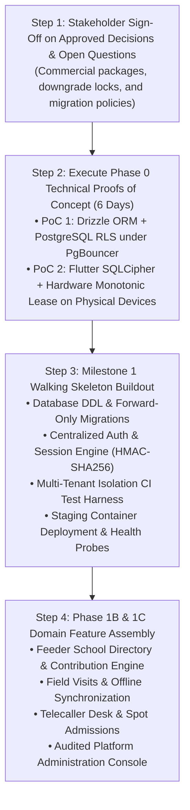

1. **Step 1 (Governance):** Secure formal Product Owner sign-off on the 5 approved architectural decisions and resolve the 3 open commercial questions (Section 1).
2. **Step 2 (Phase 0 PoCs - 6 Engineering Days):**
   - Execute PoC 1: Drizzle ORM with PostgreSQL RLS under PgBouncer transaction pooling.
   - Execute PoC 2: Flutter SQLCipher encrypted queue and 48-hour hardware monotonic lease protection on physical Android and iOS test hardware.
3. **Step 3 (Milestone 1 Implementation):** Build the secure walking skeleton:
   - Automated forward-only database migrations.
   - Session engine with `HMAC-SHA256` hashing and `__Host-` cookies.
   - Tenant-scoped student lead creation with AES-256-GCM encryption and partial unique index.
   - Mandatory CI Cross-Tenant Isolation Penetration Test Suite.
   - Dockerized staging deployment with `/health/live` and `/health/ready` probes.
4. **Step 4 (Phase 1 Operations Core):** Proceed with full domain module assembly across web and mobile clients according to the feature traceability matrix.

---

## 11. Documentation Modification Register & Confirmation

### 11.1 Documentation Files Created / Modified
- [`docs/ARCHITECTURE_REVISION_3_1.md`](file:///x:/Prasad%20projact%20works/PRO%20day%20report/docs/ARCHITECTURE_REVISION_3_1.md) — Created as the permanent, authoritative Revision 3.1 specification baseline.
- [`docs/ARCHITECTURE_REVISION_3.md`](file:///x:/Prasad%20projact%20works/PRO%20day%20report/docs/ARCHITECTURE_REVISION_3.md) — Preserved in full as predecessor historical baseline.

### 11.2 Strict Non-Modification Confirmation
In accordance with task constraints:
- **Zero application source code files were created, edited, or deleted.**
- **No package dependencies were installed or modified (`package.json`, `package-lock.json` remain untouched).**
- **No database schemas, tables, or migrations were executed.**
- **No configuration files, environment variables, or running dev servers were modified.**
- **Revision 2.0, Revision 3.0, and the existing codebase remain preserved in their entirety as historical reference.**
