# Architecture Revision 3.1.1: Pre-PoC Technical Hardening and Governance Baseline

**Document Status:** Architecture Revision 3.1.1 (Pre-PoC Technical Hardening Baseline)  
**System:** Multi-Tenant College Admissions Operations & Field Force SaaS  
**Scope Classification:** Phase 1 Operational Core  
**Role:** Principal SaaS Architect & Application Security Architect  
**Predecessor Baselines:** Revision 2.0, Revision 3.0, and Revision 3.1 (Preserved in full)  
**Document Purpose:** Correct offline clock/lease feasibility, establish safe phone blind-index key rotation, detail RLS failure recovery and overhead benchmarking, separate shared school directory from tenant-private data, formalize cryptographic erasure with hardware keystores, define atomic cross-workspace lead migrations, and establish strict PoC governance with observable evidence artifacts.  
**Implementation Boundary:** Strictly non-implemented specification. Zero application code, dependencies, schemas, migrations, or configurations modified.

---

## 1. Governance Classification and Decision Log

Every statement in this architecture is classified into one of five governance tiers:
1. `[OWNER-APPROVED DECISION]`: Formally locked by the product owner; non-negotiable architectural baseline.
2. `[PROPOSED SPECIFICATION]`: Technical design submitted for review and pre-implementation proof of concept.
3. `[ASSUMPTION]`: Explicit engineering or operational assumption subject to field validation.
4. `[RECOMMENDATION]`: Architect's technical guidance where business trade-offs exist.
5. `[UNRESOLVED OWNER DECISION]`: Explicit commercial or policy choice requiring owner sign-off before production.

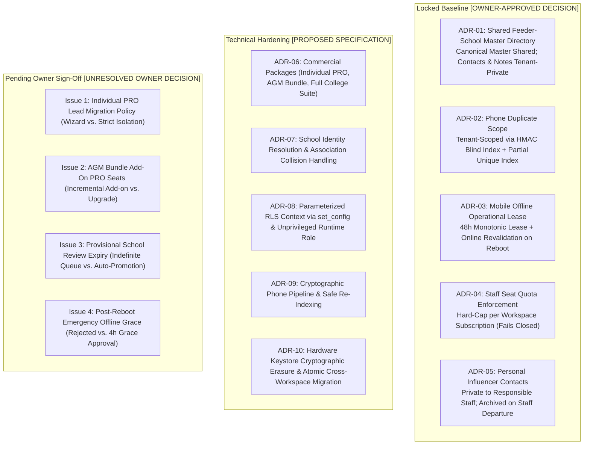

### 1.1 Formally Approved Decisions (Locked Baseline)

| Reference | Area | Formal Policy & Architectural Enforcement Mechanism | Governance Tier |
| :--- | :--- | :--- | :---: |
| **ADR-01** | Feeder Schools | **Shared Canonical Directory with Tenant-Private Overlays:** Government school registries (UDISE codes, canonical names, geographic mandals) are shared across all tenants. All headmaster contact numbers, private notes, institutional ratings, and staff allocations remain strictly tenant-private. | `[OWNER-APPROVED DECISION]` |
| **ADR-02** | Lead Uniqueness | **Per-Tenant Phone Uniqueness:** Student phone number uniqueness is enforced strictly within each college tenant via `(workspace_id, phone_blind_index)`. College B is fully permitted to prospect a student previously contacted by College A without cross-tenant conflict or data leakage. | `[OWNER-APPROVED DECISION]` |
| **ADR-03** | Mobile Operation | **48-Hour Monotonic Lease + Online Revalidation on Reboot:** Field PRO mobile clients are permitted an autonomous offline operational window of up to 48 hours during continuous device uptime. Rebooting while offline requires online network revalidation before local database access resumes. | `[OWNER-APPROVED DECISION]` |
| **ADR-04** | SaaS Quotas | **Hard Staff-Seat Quota Enforcement:** Subscription plans enforce hard caps on active staff memberships (`max_staff_seats`). API attempts to provision staff beyond the entitlement fail closed with HTTP 422 until upgraded. | `[OWNER-APPROVED DECISION]` |
| **ADR-05** | Contact Privacy | **Personal Relative/Influencer Ownership & Departure Archival:** Village relative and influencer referral contacts mapped by a PRO are private to that staff member. Upon employee departure or deactivation, contacts are archived and hidden, not transferred to competing staff. | `[OWNER-APPROVED DECISION]` |

### 1.2 Open Commercial and Policy Questions Requiring Owner Sign-Off

1. **Individual PRO Workspace Migration into College Suite:**  
   - *Status:* `[UNRESOLVED OWNER DECISION]`  
   - *Policy Choices:* (A) Provide an explicit, audited migration wizard with dual authorization; (B) Mandate complete isolation with zero record transfers.  
   - *Architectural Recommendation:* Option A. `[RECOMMENDATION]`
2. **AGM Bundle Add-On PRO Seats:**  
   - *Status:* `[UNRESOLVED OWNER DECISION]`  
   - *Policy Choices:* (A) Support incremental PRO seat add-ons (e.g., base package of 5 PROs expanded to 8); (B) Require upgrading to Full College Suite.  
   - *Architectural Recommendation:* Option A. `[RECOMMENDATION]`
3. **Provisional School Review Expiry:**  
   - *Status:* `[UNRESOLVED OWNER DECISION]`  
   - *Policy Choices:* (A) Keep unreviewed submissions in `PROVISIONAL` status indefinitely; (B) Auto-promote to `CANONICAL` after 30 days without review.  
   - *Architectural Recommendation:* Option A to prevent directory corruption. `[RECOMMENDATION]`
4. **Offline Reboot Emergency Grace Window:**  
   - *Status:* `[UNRESOLVED OWNER DECISION]`  
   - *Policy Choices:* (A) Strict policy: require online revalidation immediately on offline reboot; (B) Permit a strictly bounded 4-hour emergency operational grace window.  
   - *Security Analysis:* Option B allows an attacker with physical possession to reboot the device repeatedly to obtain perpetual 4-hour windows.  
   - *Architectural Recommendation:* Option A (Strict online revalidation). Option B is marked unapproved. `[RECOMMENDATION]`

---

## 2. Commercial Packaging and Domain Entitlement Model

### 2.1 The Three Commercial Packages

The platform provides a single unified codebase supporting three commercial packages. Package limits and feature flags are evaluated dynamically; no hardcoded package-specific code paths exist.

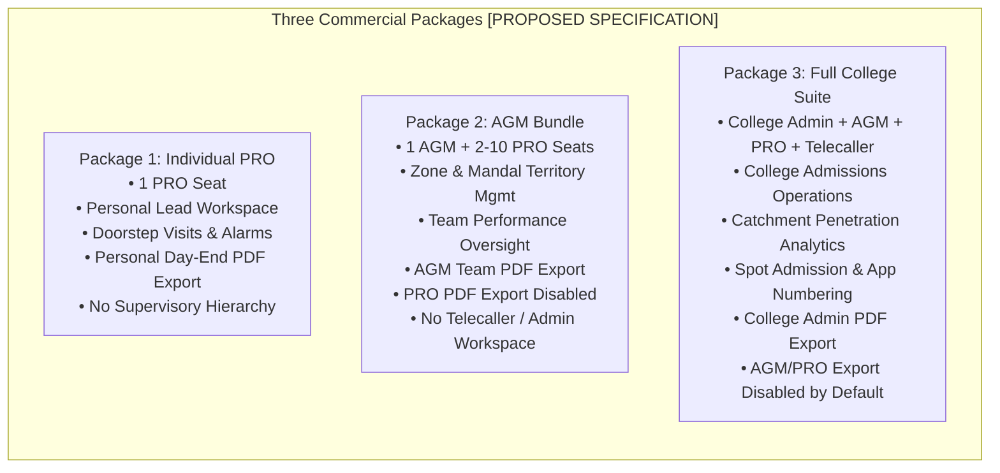

1. **Individual PRO Package:** Single-member workspace for independent field agents. Authorized for personal lead entry, doorstep visits, dynamic alarms, and **personal daily activity PDF exports**.
2. **AGM Bundle:** Multi-member regional workspace (1 AGM seat + configurable PRO seats). Authorized for team task management, territory allocation, and **AGM-level team/territory PDF reports**. PRO seats have **PDF export disabled by default**.
3. **Full College Suite:** Institutional enterprise workspace with complete administrative hierarchy (`COLLEGE_ADMIN`, `AGM`, `PRO`, `TELECALLER`), multi-branch partitioning, spot admissions with application numbering, catchment intelligence, and **College Admin-level authorized PDF exports**.

---

### 2.2 Effective Access Evaluation & Subscription Downgrade Safety

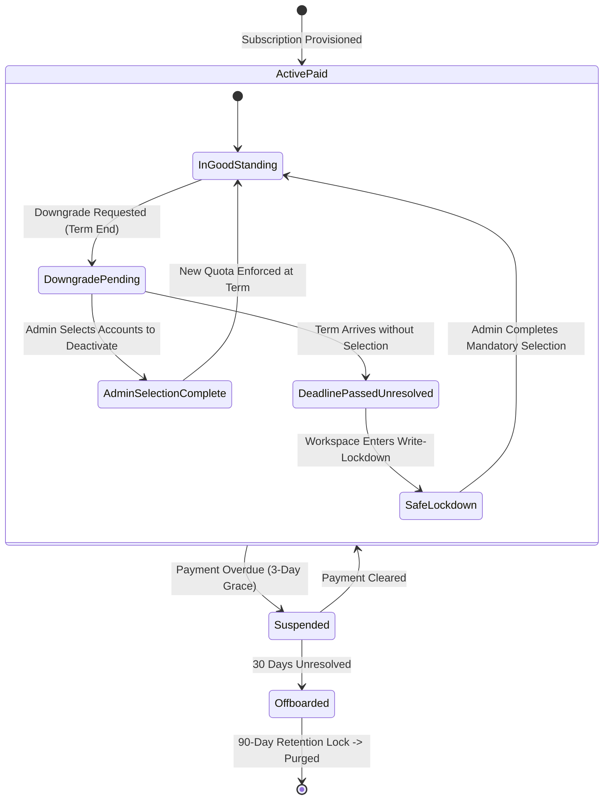

#### Effective Access Formula
Access to any protected capability is evaluated at runtime via a three-way intersection:
$$\text{Effective Access} = \text{Package Entitlement} \cap \text{Role Permission} \cap \text{Record Authorization Scope}$$

#### Downgrade Safety Specification
Automatic deactivation of staff based on creation order is rejected as unsafe:
1. **Explicit Selection Requirement:** When a quota reduction is requested (e.g., from 8 PROs to 4 PROs), the workspace enters `DOWNGRADE_PENDING_SELECTION`.
2. **Safe Deadline Lockdown (No Guessing, No Data Loss):**
   - If the effective date arrives without administrator selection, the system enters **Write-Lockdown** (`QUOTA_EXCEEDED_SELECTION_REQUIRED`).
   - Read access is preserved; all staff can view existing leads, visits, and reports.
   - New lead creation and visit mutations are rejected with HTTP 422.
   - The administrator is redirected upon login to a mandatory selection screen.
   - Selected accounts transition to `is_active = false`, sessions revoke, and leads route per explicit admin choice.
   - Audit events logged: `WORKSPACE_DOWNGRADE_WRITE_LOCKED`, `STAFF_EXPLICITLY_DEACTIVATED_ON_DOWNGRADE`.

---

## 3. Server-Side PDF Export Security and Scoping

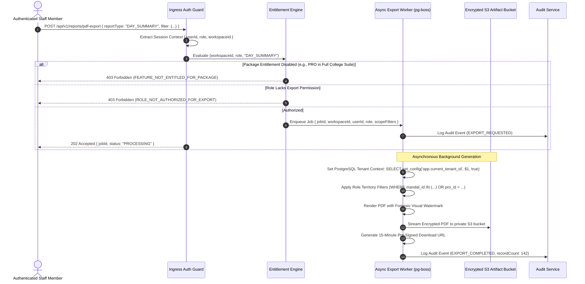

- **Individual PRO:** Authorized strictly to export records where `created_by_user_id = ctx.userId`.
- **AGM Bundle:** AGM authorized to export records where `mandal_id IN (ctx.assignedMandals)` or `created_by_user_id IN (ctx.subordinateStaffIds)`. PRO exports return HTTP 403.
- **Full College Suite:** College Admin authorized to export college-wide records. AGMs and PROs return HTTP 403 by default unless an explicit override entitlement (`OVERRIDE_ALLOW_STAFF_EXPORT`) is granted by the College Admin.
- **Forensic Watermarking:** Diagonal background watermark embeds `[Workspace Name] | User: [Employee Code] | IP: [Client IP] | Timestamp: [UTC ISO8601]`.
- **Artifact Access:** Stored in private S3 bucket encrypted with AWS KMS; pre-signed URLs expire in **15 minutes**.

---

## 4. Shared Feeder School Directory & Identity Resolution Engine

### 4.1 Strict Separation of Canonical Shared Data and College-Private Overlays

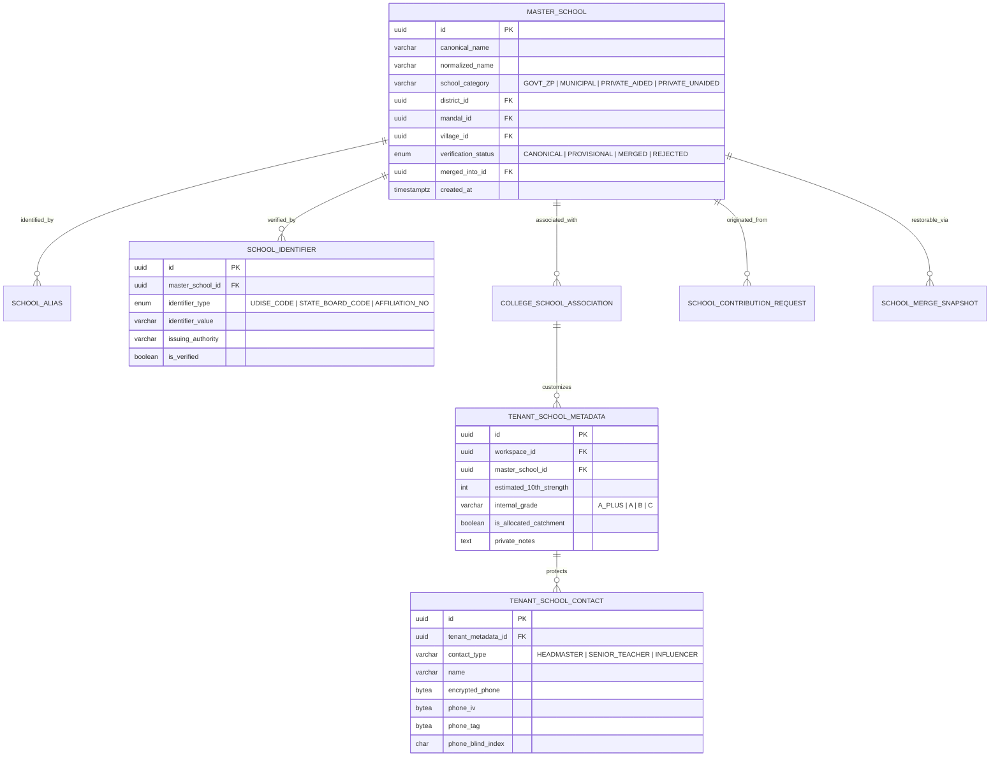

- **Canonical Shared Directory Fields (Global, No PII):**
  - `master_schools`: `canonical_name`, `normalized_name`, `school_category`, `district_id`, `mandal_id`, `village_id`, `verification_status`.
  - `school_identifiers`: `identifier_type` (UDISE, State Board Code), `identifier_value`, `issuing_authority`.
  - `school_aliases`: Alternate spellings and phonetic variations.
- **Tenant-Private Metadata & Contacts (Strictly Scoped by Workspace ID):**
  - `tenant_school_metadata`: `estimated_10th_strength`, `internal_grade`, `is_allocated_catchment`, `private_notes`.
  - `tenant_school_contacts`: Headmaster and key contact names, AES-256-GCM encrypted phone numbers, IVs, tags, blind indexes. **Inaccessible to competing colleges.**

---

### 4.2 School Identity Resolution Workflow

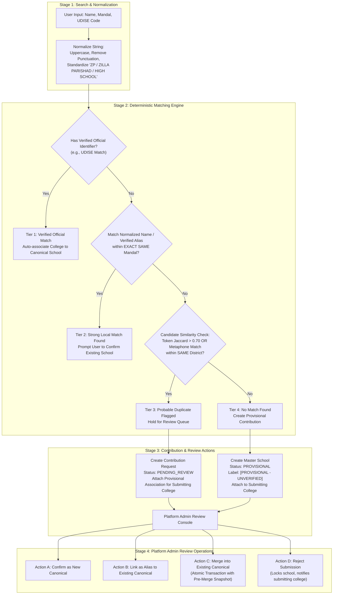

#### Deterministic Multi-Tier Matching Logic
1. **Tier 1 (Verified Official Match):** Matches verified government code (UDISE). Eliminates phonetic ambiguity subject to government accuracy.
2. **Tier 2 (Strong Local Match):** Matches canonical name or verified alias within the exact same mandal. Prompts user confirmation.
3. **Tier 3 (Probable Duplicate - Review Queue):** High token similarity ($>0.70$ Jaccard or Double Metaphone) within same district. **Never merged automatically.** Creates `school_contribution_requests` entry held for human review.
4. **Tier 4 (No Match - Provisional Creation):** Provisions new `master_schools` record with `verification_status = 'PROVISIONAL'`. Tagged with prominent visual badge: `[PROVISIONAL - UNVERIFIED]`. Usable immediately by submitting college; visible to other colleges with warning badge.

---

### 4.3 Transactional Merge Recovery & Association Collision Handling

```mermaid
sequenceDiagram
    autonumber
    actor Admin as Platform Superadmin
    participant API as School Admin API (/api/v1/admin/schools/merge)
    participant SnapTable as school_merge_snapshots Table
    participant MasterTable as master_schools Table
    participant AssocTable as college_school_associations Table
    participant MetaTable as tenant_school_metadata Table
    participant ContactTable as tenant_school_contacts Table
    participant Audit as Immutable Audit Log

    Admin->>API: POST /api/v1/admin/schools/merge { sourceId: B, targetId: A, justification: "Duplicate confirmed" }
    API->>API: Validate A != B; A.status == CANONICAL; B.status != MERGED
    
    rect rgb(240, 248, 255)
        Note over API,Audit: Atomic Database Transaction
        API->>SnapTable: INSERT INTO school_merge_snapshots (source_id, target_id, pre_merge_state_json)
        API->>MasterTable: UPDATE master_schools SET verification_status = 'MERGED', merged_into_id = A WHERE id = B
        API->>MasterTable: INSERT INTO school_aliases (master_school_id, alias_name, source) VALUES (A, B.canonical_name, 'MERGE_OP')
        
        Note over AssocTable,ContactTable: Handle Collisions Without Cross-Tenant Disclosure
        loop For each College C associated with School B
            alt College C is NOT associated with School A
                API->>AssocTable: UPDATE college_school_associations SET master_school_id = A WHERE workspace_id = C AND master_school_id = B
                API->>MetaTable: UPDATE tenant_school_metadata SET master_school_id = A WHERE workspace_id = C AND master_school_id = B
            else College C is ALREADY associated with School A (Collision)
                API->>AssocTable: UPDATE college_school_associations SET status = 'SUPERSEDED_BY_MERGE' WHERE workspace_id = C AND master_school_id = B
                API->>ContactTable: Re-point contacts belonging to B's metadata to point to A's metadata ID (Workspace C only)
                API->>MetaTable: Append B's notes into A's private_notes: E'\n[Merged Notes from School B]: ' || notes
                API->>MetaTable: UPDATE tenant_school_metadata SET status = 'ARCHIVED_DUE_TO_MERGE' WHERE workspace_id = C AND master_school_id = B
            end
        end

        API->>Audit: Log Audit Event (SCHOOL_MERGED, { sourceId: B, targetId: A, adminId: Admin.id })
    end

    API-->>Admin: 200 OK { status: 'MERGE_COMPLETED', snapshotId: 'uuid' }

    Note over Admin,Audit: Reversible Unmerge Procedure (Emergency Rollback)
    Admin->>API: POST /api/v1/admin/schools/unmerge { snapshotId: 'uuid', justification: 'Erroneous merge' }
    rect rgb(255, 240, 245)
        Note over API,Audit: Atomic Rollback Transaction
        API->>SnapTable: Read pre_merge_state_json
        API->>MasterTable: Restore B.status = 'PROVISIONAL', B.merged_into_id = NULL
        API->>MasterTable: DELETE alias created during merge
        API->>AssocTable: Revert association records and statuses to pre-merge IDs
        API->>MetaTable: Revert metadata records and un-nest contacts to pre-merge IDs
        API->>SnapTable: Mark snapshot status = 'ROLLED_BACK'
        API->>Audit: Log Audit Event (SCHOOL_UNMERGED, { snapshotId: 'uuid' })
    end
    API-->>Admin: 200 OK { status: 'UNMERGE_COMPLETED' }
```

- **Zero Cross-Tenant Leakage During Merges:** College 1's private notes and contacts for School B are merged strictly into College 1's records for School A. Private contacts from different colleges are never merged or disclosed across workspace boundaries.
- **Atomic Failure Recovery & Retry Idempotency:** The entire merge operation executes in a single database transaction. Failure rolls back completely. The request requires an `idempotency_key = UUIDv7`; retrying returns the snapshot result without re-executing.
- **Reversible Unmerge:** Durable pre-merge snapshots in `school_merge_snapshots` allow reversing accidental merges without data loss.

---

## 5. Security Architecture Corrections

### 5.1 Unified Session-Token Hashing: HMAC-SHA256 with Server Pepper

The architecture enforces a single, mathematically consistent session-token hashing and storage strategy across all modules, tests, and data models:

$$\text{token\_hash} = \text{HMAC-SHA256}(\text{key} = \text{server\_session\_pepper}, \text{message} = \text{raw\_session\_token})$$

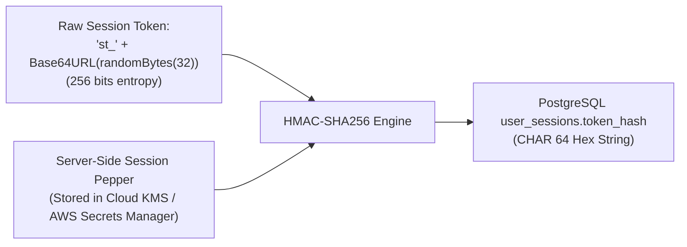

- **Key:** `server_session_pepper` (256-bit cryptographically random secret injected via cloud secret managers).
- **Message:** `raw_session_token` (prefixed `st_` + 32 bytes CSPRNG Base64URL).
- **Database Storage:** Stored as a 64-character lowercase hex string in `user_sessions.token_hash` (`CHAR(64) NOT NULL UNIQUE`). Plain SHA-256 is eliminated.
- **Dual-Pepper Zero-Downtime Rotation:** Runtime evaluates `HMAC(current_pepper, raw_token)`. If not found, evaluates `HMAC(previous_pepper, raw_token)`. If matched under `previous_pepper`, the session row is re-hashed with `current_pepper` and updated on the fly.
- **Immediate Revocation:** Logout, user deactivation, and workspace suspension immediately execute `UPDATE user_sessions SET revoked_at = NOW()`.

---

### 5.2 Offline Clock and Lease Feasibility

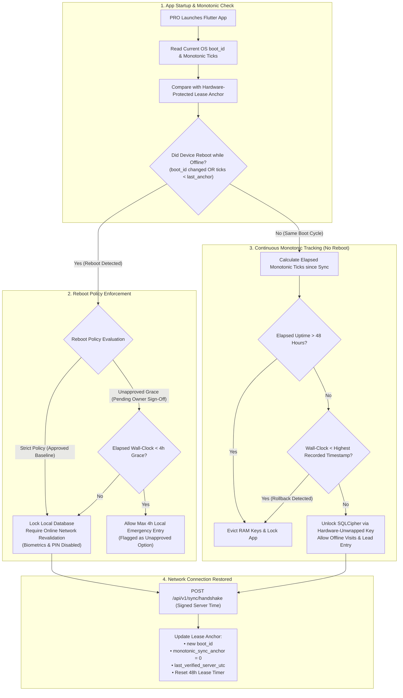

#### Distinguishing Secure Storage from Trusted Timers
- **Critical Architectural Clarification:** `flutter_secure_storage` is an encryption-at-rest wrapper around OS keychains. It is **not** a trusted hardware timer or monotonic clock. Storing a UTC timestamp in secure storage does **not** protect against clock rollback if the device time is altered prior to writing or across power cycles.
- **Verified Capabilities during Continuous Uptime:** Android `SystemClock.elapsedRealtime()` and iOS `mach_continuous_time()` measure real elapsed time since boot including deep sleep. User wall-clock modifications in system settings do not affect these counters while the device remains powered on.
- **Behavior After Reboot:** Monotonic counters reset to `0`. The device cannot verify elapsed time across a reboot without a network time source.
- **Impossible Offline Guarantees:** On commodity consumer hardware, it is impossible to cryptographically verify whether an offline rebooted device was powered off for 5 seconds or 5 months.
- **Default Policy:** **Online revalidation after offline reboot.** Local database remains locked until network handshake succeeds.
- **Emergency Grace Status:** The 4-hour emergency grace window is marked `[UNRESOLVED OWNER DECISION]` and unapproved due to the replay risk of repeated reboots.

---

### 5.3 Hardware Keystores and Cryptographic Erasure

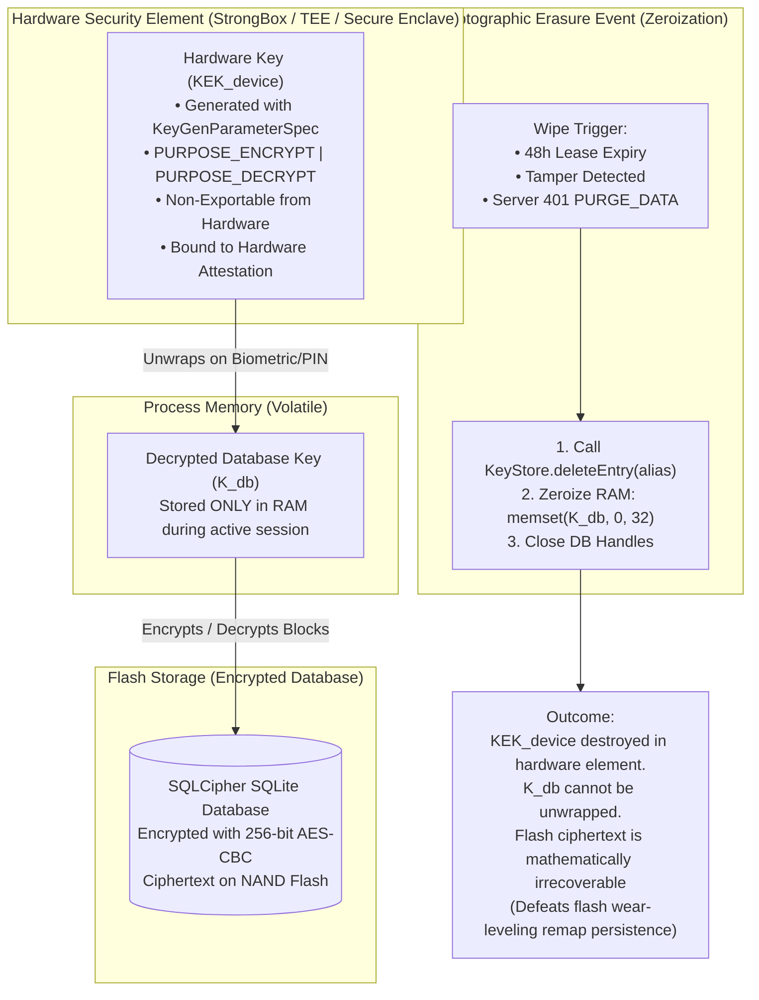

#### Hardware-Backed vs. Software-Stored Keys
- A **hardware-backed key** is generated inside hardware security modules (Android StrongBox/TEE, Apple Secure Enclave). The private key material never leaves the secure chip, even under a compromised OS kernel.
- A **secure-storage key** is merely encrypted data stored in software preferences.
- **Device-Level Evidence Required to Validate Erasure in PoC:**
  1. Extract SQLCipher file via `adb pull` before wipe; verify database opens with $K_{db}$.
  2. Execute cryptographic erasure (`KeyStore.deleteEntry(alias)` + RAM zeroization).
  3. Extract SQLCipher file after wipe; attempt decryption using SQLCipher CLI $\implies$ assert output is `file is not a database` (`SQLITE_NOTADB`).
  4. Attempt to unwrap key via hardware API $\implies$ assert `KeyStoreException: Key not found`.
- **Consequences of Ephemeral-Key Fallback (If Hardware Keystore Fails in PoC):**
  If hardware keystore APIs prove unsupported on budget Android OEM builds, the fallback is **Ephemeral In-Memory Key Only**:
  - *App Kill/Restart Consequence:* Closing the app destroys $K_{db}$ from RAM. The app cannot reopen the local database offline without an authenticated server handshake.
  - *Data Loss Risk:* Any queued visits recorded offline become inaccessible if the app process restarts before network sync occurs.

---

### 5.4 Phone Blind-Index Safe Key Rotation

```mermaid
sequenceDiagram
    autonumber
    actor Admin as Platform Security Admin
    participant KMS as Cloud KMS
    participant Worker as Re-Indexing Background Worker
    participant DB as PostgreSQL 16 Primary
    participant Audit as Immutable Audit Log

    Admin->>KMS: Generate New Phone Blind Index Salt (salt_v2)
    Admin->>Worker: Trigger Phone Re-Indexing Job (workspace_id)
    
    rect rgb(240, 248, 255)
        Note over Worker,DB: Phase 1: Dual-Index Re-Indexing Window
        Worker->>DB: ALTER TABLE student_leads ADD COLUMN phone_blind_index_v2 CHAR(64);
        
        loop Batch Processing (500 leads per chunk)
            Worker->>DB: SELECT id, encrypted_phone, phone_iv, phone_tag FROM student_leads WHERE phone_blind_index_v2 IS NULL LIMIT 500 FOR UPDATE
            Worker->>KMS: Decrypt encrypted_phone using DEK -> raw_phone
            Worker->>Worker: Compute new_index = HMAC-SHA256(salt_v2, raw_phone)
            Worker->>DB: UPDATE student_leads SET phone_blind_index_v2 = new_index WHERE id = chunk.id
        end
    end

    rect rgb(255, 240, 245)
        Note over Worker,DB: Phase 2: Atomic Cutover Transaction
        Worker->>DB: BEGIN TRANSACTION;
        Worker->>DB: CREATE UNIQUE INDEX CONCURRENTLY idx_unique_active_workspace_phone_v2 ON student_leads (workspace_id, phone_blind_index_v2) WHERE deleted_at IS NULL;
        Worker->>DB: DROP INDEX idx_unique_active_workspace_phone;
        Worker->>DB: ALTER TABLE student_leads DROP COLUMN phone_blind_index;
        Worker->>DB: ALTER TABLE student_leads RENAME COLUMN phone_blind_index_v2 TO phone_blind_index;
        Worker->>DB: COMMIT;
    end

    Worker->>KMS: Deprecate salt_v1; Set Active Salt = salt_v2
    Worker->>Audit: Log Audit Event (PHONE_BLIND_INDEX_ROTATED, { workspaceId, totalRotated: 4500 })
```

#### Safe Rotation & Uniqueness Preservation
1. **Uniqueness Invariant:** Duplicate detection is never disabled or weakened during rotation. New writes compute both `HMAC(salt_v1, phone)` and `HMAC(salt_v2, phone)`, verifying uniqueness across both indices.
2. **Chunked Execution:** Leads are re-indexed in small batches of 500 within isolated transactions, preventing long table locks.
3. **Collision Triage:** If two records produce identical blind indexes under `salt_v2` (revealing an existing duplicate in soft-deleted records), the worker flags the collision in an admin review table without blocking migration.
4. **Rollback Safety:** If re-indexing fails mid-process, the column `phone_blind_index_v2` is dropped. The active index `phone_blind_index` under `salt_v1` remains 100% operational.

---

### 5.5 Parameter-Safe PostgreSQL RLS & Root-Cause Failure Protocol

```sql
-- Parameter-safe transaction-local tenant context
SELECT set_config('app.current_tenant_id', $1, true);

-- Partial Unique Index on active leads
CREATE UNIQUE INDEX idx_unique_active_workspace_phone 
ON student_leads (workspace_id, phone_blind_index) 
WHERE deleted_at IS NULL;
```

#### Behavioral Distinction: 0-Row SELECT vs. Rejected Writes
- **`SELECT`:** Missing context or mismatched context evaluates `USING` to false $\implies$ returns **0 rows** (empty result set, failing closed without leaking existence).
- **`INSERT`:** Missing context or mismatched context evaluates `WITH CHECK` to false $\implies$ raises PostgreSQL error `42501` (`insufficient_privilege`).
- **`UPDATE` / `DELETE`:** Rows of other tenants are invisible under `USING` (0 rows affected). Attempts to mutate `workspace_id` trigger error `42501`.

#### RLS PoC Failure Protocol (No Bare-Application Fallback)
If the Drizzle ORM + RLS PoC fails under PgBouncer transaction pooling (due to context leakage, pooler bugs, or latency overhead $>2.0\text{ms}$):
1. **Root-Cause Analysis (RCA):** The team must stop and produce a formal RCA document detailing why transaction-scoped context bled or failed.
2. **Demonstrated Alternative Boundary Required:** Falling back to application-layer repository filtering alone is **strictly rejected**. Before proceeding to implementation, an alternative structural database isolation boundary must be demonstrated:
   - *Alternative A: Schema-per-Tenant Separation* (`search_path` routing with separate PostgreSQL schemas per tenant).
   - *Alternative B: Dedicated Connection Pools per Tenant* (PgBouncer routing connections to dedicated tenant databases).

---

### 5.6 Cross-Workspace Lead Migration Protocol

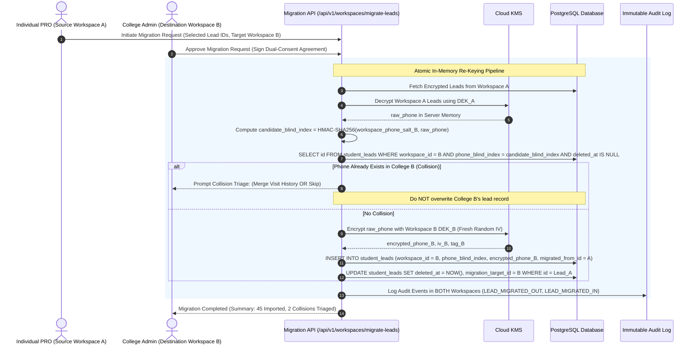

- **Idempotency & Atomicity:** Request requires `idempotency_key = UUIDv7`. Insert into Workspace B and soft-delete in Workspace A occur in a **single database transaction**. Partial failure rolls back completely, ensuring no lead is lost or duplicated.

---

## 6. Updated Conceptual Data Model

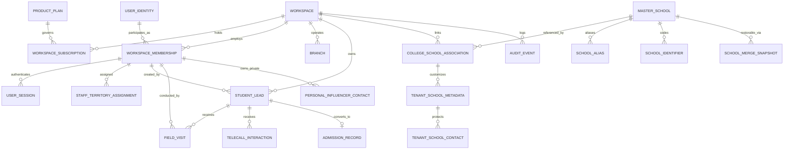

---

## 7. Security Findings Register (SEC-01 to SEC-08)

| Finding ID | Vulnerability Description | Severity | Target Architecture Mitigation | Automated Verification Test |
| :--- | :--- | :---: | :--- | :--- |
| **SEC-01** | Client-Side JWT Minting in Flutter (`api_service.dart`) | **CRITICAL** | Complete removal of client token signing. Server issues opaque 256-bit bearer tokens verified against HMAC-SHA256 database hashes. | `TEST-VERIF-01`: Client submits forged token; server returns HTTP 401. All tokens minted by server exclusively. |
| **SEC-02** | Default Insecure Student Password Takeover (`123456`) | **CRITICAL** | Student login and self-registration entirely deferred from Phase 1. | `TEST-VERIF-02`: Public student registration endpoints eliminated from API routing table. |
| **SEC-03** | Public Feeder School PII Leakage (`GET /api/config`) | **HIGH** | `master_schools` read-only master; headmaster personal phones moved to encrypted `tenant_school_contacts` requiring authenticated tenant session. | `TEST-VERIF-03`: Unauthenticated `GET /api/v1/schools` returns HTTP 401. Authenticated staff see only tenant-authorized contacts. |
| **SEC-04** | Cross-Tenant Lead Leaks via Unassigned Telecallers | **HIGH** | Telecaller queries enforce mandatory tenant scoping and assignment checks. Empty assignment returns `[]` (fail-closed), never global leads. | `TEST-VERIF-04`: Telecaller with empty assignment queries `/api/v1/leads`; returns empty array, 0 rows leaked. |
| **SEC-05** | Tokens Passed in URL Query Strings (`?token=...`) | **MEDIUM** | Ingress API gateway strictly rejects tokens in query strings. Tokens accepted exclusively via `__Host-` cookies or `Authorization: Bearer` headers. | `TEST-VERIF-05`: Request with `?token=...` returns HTTP 400 Bad Request. |
| **SEC-06** | Hardcoded Automated Backup Fallback Secret | **MEDIUM** | Secret hardcoding eliminated. Process fails startup if `CRON_SECRET` is unset via Zod environment validation. | `TEST-VERIF-06`: Missing `CRON_SECRET` in environment causes application startup crash with explicit error. |
| **SEC-07** | Stolen Offline Field Phone Data Extraction | **HIGH** | 48-hour monotonic lease; online revalidation on reboot; SQLCipher 256-bit AES encryption; cryptographic erasure zeroizing TPM keys on tamper/expiry. | `TEST-VERIF-07`: Simulate monotonic advance $>48$h or reboot; verify $K_{db}$ evicted and local database unreadable. |
| **SEC-08** | Unauthorized Bulk PDF Data Exfiltration | **MEDIUM** | Role-based export authorization; server-side entitlement checks; forensic visual watermarking; 15-minute expiring S3 pre-signed URLs. | `TEST-VERIF-08`: PRO in Full College Suite calls export endpoint; returns HTTP 403. Admin export generates watermarked artifact. |

---

## 8. Proof-of-Concept (PoC) Plans with Observable Evidence Artifacts

> [!CAUTION]
> **PoC Status Clarification:** Zero PoCs have been executed. No test has passed. The architecture is ready for PoC execution only after test prerequisites and physical test hardware are available.

### 8.1 PoC 1: Drizzle ORM + PostgreSQL RLS under Transaction Pooling

- **Objective:** Prove parameter-safe `set_config('app.current_tenant_id', $1, true)` under PgBouncer transaction pooling using unprivileged role `app_runtime_user`.
- **Prerequisites:** PostgreSQL 16 container, PgBouncer (`pool_mode = transaction`), Drizzle ORM wrapper.
- **Restricted Database Role:** `app_runtime_user` (`NOINHERIT`, `NOSUPERUSER`, `NOCREATEDB`, `NOCREATEROLE`, `NOBYPASSRLS`).
- **Test Cases, Observable Results & Evidence Artifacts:**

| Test ID | Operation & Condition | Expected Observable Result | Required Evidence Artifact |
| :--- | :--- | :--- | :--- |
| **P1-T1** | SELECT with missing context | Returns 0 rows | SQL query log showing empty result set |
| **P1-T2** | INSERT with missing context | Throws SQL error `42501` | PostgreSQL server error log capturing error `42501` |
| **P1-T3** | INSERT with mismatched `workspace_id` | Throws SQL error `42501` | Assertion log capturing `42501` rejection |
| **P1-T4** | UPDATE other tenant row | Updates 0 rows | Query result showing `rowCount: 0` |
| **P1-T5** | UPDATE mutating `workspace_id` to Tenant B | Throws SQL error `42501` | Server error log capturing `WITH CHECK` violation |
| **P1-T6** | DELETE other tenant row | Deletes 0 rows | Query result showing `rowCount: 0` |
| **P1-T7** | Transaction abort context cleanup | Aborted Tx leaves next Tx clean | PgBouncer query sequence log |
| **P1-T8** | 10,000 rapid interleaved transactions | Exactly 0 cross-tenant leaks | Vitest test report with 10,000 assertions passing |
| **P1-T9** | Performance latency overhead | Overhead $\Delta T \le 2.0\text{ms}$ on p95 | Benchmark comparison report (Baseline vs. RLS) |

- **Overhead Calculation Methodology:**
  $$\Delta T = \overline{T}_{\text{p95}}(\text{RLS + set\_config}) - \overline{T}_{\text{p95}}(\text{Baseline})$$
- **Measurable Pass Criteria:** 0 cross-tenant leaks; 100% of illegal writes rejected; $\Delta T \le 2.0\text{ms}$ on p95.
- **Failure Fallback:** Halt implementation $\implies$ Perform RCA $\implies$ Demonstrate Schema-per-Tenant or Dedicated Tenant Pools before proceeding.

---

### 8.2 PoC 2: Flutter Offline Lease & Hardware Security

- **Objective:** Validate SQLCipher encryption, monotonic uptime tracking, reboot detection, and cryptographic erasure on physical test hardware.
- **Prerequisites:** Flutter test app embedding `sqflite_sqlcipher`, `flutter_secure_storage`, and native hardware Keystore/Secure Enclave bindings.
- **Physical Test Devices:** (1) Budget Android phone (Android 10+, 2GB RAM); (2) iPhone (iOS 15+).
- **Test Cases, Observable Results & Evidence Artifacts:**

| Test ID | Procedure & Condition | Expected Observable Result | Required Evidence Artifact |
| :--- | :--- | :--- | :--- |
| **P2-T1** | Queue 100 visits offline | Encrypted SQLite records created | Hex dump of local `.db` showing ciphertext |
| **P2-T2** | System wall-clock rollback by 7 days | Tamper detected; UI locked | Device `logcat` capturing clock-tamper lock |
| **P2-T3** | Device reboot while offline | Database locked; online reval required | App logs capturing `boot_id` mismatch lock |
| **P2-T4** | Continuous uptime $>48$ hours | Lease expires; keys evicted from RAM | App logs capturing monotonic lease expiry |
| **P2-T5** | Cryptographic erasure execution | $KEK_{device}$ deleted from Keystore | SQLCipher CLI output: `Error: file is not a database` |
| **P2-T6** | Reconnection atomic batch sync | 100 items synced; 0 duplicates | Server transaction log showing 100 commits, 0 dups |

- **Measurable Pass Criteria:** SQLite file is provably unreadable after key zeroization; offline reboot locks database; batch sync produces zero duplicates.
- **Failure Fallback:** Ephemeral in-memory session keys only (requires user to remain online to re-authenticate if app restarts).

---

## 9. Feature-to-Acceptance-Test Traceability Matrix

| Feature Module | Business Rule / Capability | Required Test ID | Concrete Acceptance Test Procedure | Expected Pass Result |
| :--- | :--- | :--- | :--- | :--- |
| **Tenant Lifecycle** | Hard Staff-Seat Cap Enforcement | `TEST-TC-01` | Subscription quota = 3 PRO seats. College Admin attempts to provision 4th PRO user. | HTTP 422 Unprocessable Entity (`SEAT_QUOTA_EXCEEDED`). Record not created. |
| **Identity & Sessions**| Session Revocation on User Deactivation | `TEST-TC-02` | PRO user logs in on Web and Mobile. Admin deactivates user (`is_active = false`). PRO makes subsequent API call. | HTTP 401 Unauthorized (`SESSION_REVOKED`). Local mobile app locks. |
| **Lead Management** | Keyed HMAC Duplicate Phone Check | `TEST-TC-03` | PRO A creates lead with Phone P in College A. PRO B creates lead with Phone P in College B. PRO A attempts duplicate in College A. | College B creation succeeds (HTTP 201). Duplicate in College A fails (HTTP 409 Conflict). |
| **Field Visits** | Append-Only Doorstep Visit Log | `TEST-TC-04` | PRO logs visit with parent remarks on Lead L. Attaches idempotency key K. Re-sends identical payload with key K. | Visit created, `doorstep_completed = true`. Duplicate request returns cached 200 without duplicate row. |
| **School Directory** | Multi-Tier Identity Resolution | `TEST-TC-05` | Search "Sri Siddhartha ZP High School, Guntur" against Canonical "Sri Siddhartha High School, Guntur" (same UDISE). | Match classified as Tier 1. Direct association linked without creating duplicate school. |
| **School Directory** | Private Contact Protection | `TEST-TC-06` | College A logs private headmaster phone on School S. College B queries School S. | College B sees school profile; College A's headmaster phone and private notes are omitted. |
| **Telecaller Desk** | Dynamic Callback Alarm Trigger | `TEST-TC-07` | Telecaller sets callback milestone `AFTER_10TH_EXAMS`. Platform Admin marks 10th exams completed. | Lead appears automatically in Telecaller High-Priority Callback Queue. |
| **PDF Reporting** | Server-Side PDF Export Authorization | `TEST-TC-08` | PRO in AGM Bundle attempts `POST /api/v1/reports/pdf-export` for personal leads. | HTTP 403 Forbidden (`EXPORT_PERMISSION_DISABLED_FOR_ROLE`). |
| **PDF Reporting** | Authorized AGM Team Export | `TEST-TC-09` | AGM in AGM Bundle calls team export endpoint. | HTTP 202 Accepted. Async worker outputs PDF with forensic watermark and 15-min pre-signed URL. |
| **Platform Ops** | Audited Break-Glass Impersonation | `TEST-TC-10` | Platform operator initiates support session with Ticket ID #801. Accesses College A leads. | Access granted for max 2h; all phone numbers masked by default; action logged in `audit_events`. |

---

## 10. Implementation-Readiness Verdict and Ordered Next Steps

### 10.1 Implementation-Readiness Verdict

> [!IMPORTANT]
> **VERDICT: ARCHITECTURALLY SPECIFIED — READY FOR PHASE 0 PROOF-OF-CONCEPT EXECUTION ONLY AFTER PREREQUISITES ARE AVAILABLE.**  
> 
> The architecture is not yet declared fully validated. It is strictly ready for Phase 0 technical proof-of-concept execution. Zero production application code implementation is authorized until PoC 1 and PoC 2 conclude with verified, documented evidence artifacts.

### 10.2 Ordered Next Steps
1. **Step 1 (Governance):** Owner sign-off on the 4 unresolved decisions in Section 1.2.
2. **Step 2 (Prerequisites):** Provision test environments:
   - PostgreSQL 16 + PgBouncer container on Linux.
   - Physical Android 10+ and iOS test hardware.
3. **Step 3 (PoC Execution):** Execute PoC 1 and PoC 2; record evidence artifacts.
4. **Step 4 (Milestone 1 Buildout):** Upon verified PoC pass, build the walking skeleton.

---

## 11. Change Log: Revision 3.1 $\to$ Revision 3.1.1 & Confirmation

### 11.1 Change Log

| Item | Revision 3.1 | Revision 3.1.1 (Current) | Rationale |
| :--- | :--- | :--- | :--- |
| **Offline Clock / Storage** | Implied `flutter_secure_storage` protects timestamps against clock rollback. | Explicitly separates secure storage (data-at-rest encryption) from trusted monotonic timers. | Secure storage libraries do not provide tamper-proof hardware clocks. |
| **Reboot Policy** | Presented 4h emergency grace as an operational fallback. | Kept **Online Revalidation on Reboot** as approved baseline; marked 4h grace unapproved `[UNRESOLVED OWNER DECISION]`. | 4-hour grace can be exploited via repeated reboots. |
| **Blind Index Rotation** | Stated re-indexing occurs in background. | Detailed **versioned columns, dual-index verification, chunked transactions, atomic cutover, and rollback**. | Prevents duplicate detection bypass during active rotation. |
| **RLS PoC Failure** | Allowed falling back to application-layer repository scoping alone. | **Strictly rejects bare app-layer fallback.** Requires formal RCA and demonstrated structural database boundary (Schema-per-tenant or Dedicated Pools). | App-layer filtering alone lacks multi-tenant defense-in-depth. |
| **RLS Operations** | Outlined general test cases. | Detailed exact behavior for **SELECT, INSERT, UPDATE, DELETE** with missing, incorrect, and mutating contexts. | Provides precise specifications for automated test assertions. |
| **School Directory** | Outlined private overlays. | Formally separated **canonical shared fields** from **tenant-private metadata/contacts**, and detailed collision handling without cross-tenant disclosure. | Prevents accidental PII leakage during canonical school merges. |
| **Cryptographic Erasure** | Generalized hardware-backed key deletion. | Defined **device-level observable evidence (SQLCipher `SQLITE_NOTADB` error)** and documented severe usability impacts of ephemeral fallback. | Eliminates unverified assumptions about mobile flash memory. |
| **Cross-Workspace Migration** | Outlined re-keying pipeline. | Specified **idempotency keys, atomic transfer transactions, and exact point of source lead disposition**. | Prevents data loss or duplicate lead creation on partial network failure. |
| **PoC Governance** | General pass/fail descriptions. | Added **observable results, required evidence artifacts, and measurable threshold formulas**; explicitly stated zero PoCs have yet passed. | Eliminates false confidence; enforces rigorous pre-implementation verification. |

### 11.2 Strict Non-Modification Confirmation
In accordance with task constraints:
- **Zero application source code files were created, edited, or deleted.**
- **No package dependencies were installed or modified (`package.json`, `package-lock.json` remain untouched).**
- **No database schemas, tables, or migrations were executed.**
- **No configuration files, environment variables, or running dev servers were modified.**
- **All previous revisions (Revision 2.0, Revision 3.0, and Revision 3.1) remain preserved in their entirety.**
