# Architecture Revision 3.1.2: Pre-PoC Technical Hardening and Governance Baseline

**Document Status:** Architecture Revision 3.1.2 (Definitive Pre-PoC Specification Baseline)  
**System:** Multi-Tenant College Admissions Operations & Field Force SaaS  
**Scope Classification:** Phase 1 Operational Core  
**Role:** Principal SaaS Architect & Application Security Architect  
**Predecessor Baselines:** Revision 2.0, Revision 3.0, Revision 3.1, and Revision 3.1.1 (Preserved in full)  
**Document Purpose:** Correct PostgreSQL concurrent index rotation outside transaction blocks, detail platform-specific mobile reboot detection (Android vs. iOS), formalize hardware-keystore unwrap evidence for cryptographic erasure, define server-time anchored monotonic clock rollback detection, enforce transactional audit consistency for lead migrations, align commercial package governance, specify observable PoC evidence, define a comprehensive database indexing and query-performance strategy, and specify cost-optimised academic-year archival with cold-storage tiering and live-database cleanup.  
**Implementation Boundary:** Strictly non-implemented specification. Zero application code, dependencies, schemas, migrations, or configurations modified.

---

## 1. Governance Classification and Decision Log

Every statement in this architecture is classified into one of five governance tiers:
1. `[OWNER-APPROVED DECISION]`: Formally locked by the product owner; non-negotiable architectural baseline.
2. `[PROPOSED SPECIFICATION]`: Technical design submitted for review and pre-implementation proof of concept.
3. `[ASSUMPTION]`: Explicit engineering or operational assumption subject to field validation.
4. `[RECOMMENDATION]`: Architect's technical guidance where business trade-offs exist.
5. `[UNRESOLVED OWNER DECISION]`: Explicit commercial or policy choice requiring owner sign-off before production.

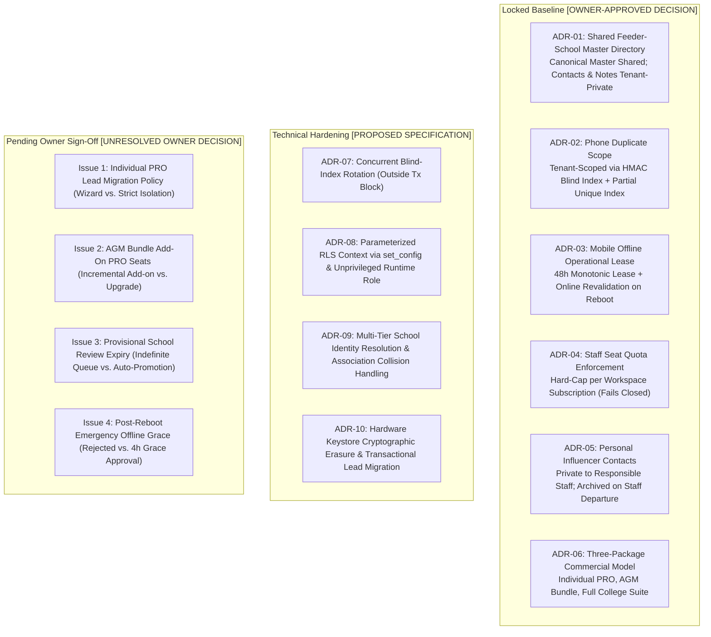

### 1.1 Formally Approved Decisions (Locked Baseline)

| Reference | Area | Formal Policy & Architectural Enforcement Mechanism | Governance Tier |
| :--- | :--- | :--- | :---: |
| **ADR-01** | Feeder Schools | **Shared Canonical Directory with Tenant-Private Overlays:** Government school registries (UDISE codes, canonical names, geographic mandals) are shared across all tenants. All headmaster contact numbers, private notes, institutional ratings, and staff allocations remain strictly tenant-private. | `[OWNER-APPROVED DECISION]` |
| **ADR-02** | Lead Uniqueness | **Per-Tenant Phone Uniqueness:** Student phone number uniqueness is enforced strictly within each college tenant via `(workspace_id, phone_blind_index)`. College B is fully permitted to prospect a student previously contacted by College A without cross-tenant conflict or data leakage. | `[OWNER-APPROVED DECISION]` |
| **ADR-03** | Mobile Operation | **48-Hour Monotonic Lease + Online Revalidation on Reboot:** Field PRO mobile clients are permitted an autonomous offline operational window of up to 48 hours during continuous device uptime. Rebooting while offline requires online network revalidation before local database access resumes. | `[OWNER-APPROVED DECISION]` |
| **ADR-04** | SaaS Quotas | **Hard Staff-Seat Quota Enforcement:** Subscription plans enforce hard caps on active staff memberships (`max_staff_seats`). API attempts to provision staff beyond the entitlement fail closed with HTTP 422 until upgraded. | `[OWNER-APPROVED DECISION]` |
| **ADR-05** | Contact Privacy | **Personal Relative/Influencer Ownership & Departure Archival:** Village relative and influencer referral contacts mapped by a PRO are private to that staff member. Upon employee departure or deactivation, contacts are archived and hidden, not transferred to competing staff. | `[OWNER-APPROVED DECISION]` |
| **ADR-06** | Product Packaging | **Three Commercial Packages:** The system supports three commercial tiers in a single codebase: Individual PRO, AGM Bundle, and Full College Suite. | `[OWNER-APPROVED DECISION]` |

### 1.2 Open Commercial and Policy Questions Requiring Owner Sign-Off

1. **Individual PRO Workspace Migration into College Suite:**  
   - *Status:* `[UNRESOLVED OWNER DECISION]`  
   - *Policy Choices:* (A) Provide an explicit, audited migration wizard with dual authorization; (B) Mandate complete isolation with zero record transfers.  
   - *Architectural Recommendation:* Option A. `[RECOMMENDATION]`
2. **AGM Bundle Add-On PRO Seats:**  
   - *Status:* `[UNRESOLVED OWNER DECISION]`  
   - *Policy Choices:* (A) Support incremental PRO seat add-ons (e.g., base package of 5 PROs expanded to 8); (B) Require upgrading to Full College Suite.  
   - *Architectural Recommendation:* Option A. `[RECOMMENDATION]`
3. **Provisional School Review Expiry:**  
   - *Status:* `[UNRESOLVED OWNER DECISION]`  
   - *Policy Choices:* (A) Keep unreviewed submissions in `PROVISIONAL` status indefinitely; (B) Auto-promote to `CANONICAL` after 30 days without review.  
   - *Architectural Recommendation:* Option A to prevent directory corruption. `[RECOMMENDATION]`
4. **Offline Reboot Emergency Grace Window:**  
   - *Status:* `[UNRESOLVED OWNER DECISION]`  
   - *Policy Choices:* (A) Strict policy: require online revalidation immediately on offline reboot; (B) Permit a strictly bounded 4-hour emergency operational grace window.  
   - *Security Analysis:* Option B allows an attacker with physical possession to reboot the device repeatedly to obtain perpetual 4-hour windows.  
   - *Architectural Recommendation:* Option A (Strict online revalidation). Option B is marked unapproved. `[RECOMMENDATION]`

---

## 2. Commercial Packaging and Domain Entitlement Model

### 2.1 The Three Commercial Packages

The platform provides a single unified codebase supporting three commercial packages. Package limits and feature flags are evaluated dynamically; no hardcoded package-specific code paths exist.

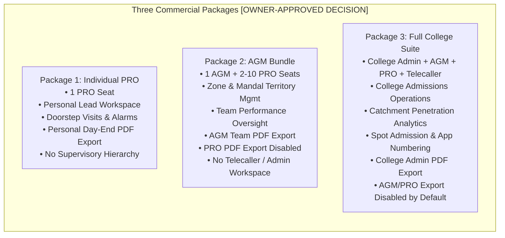

1. **Individual PRO Package:** Single-member workspace for independent field agents. Authorized for personal lead entry, doorstep visits, dynamic alarms, and **personal daily activity PDF exports**.
2. **AGM Bundle:** Multi-member regional workspace (1 AGM seat + configurable PRO seats). Authorized for team task management, territory allocation, and **AGM-level team/territory PDF reports**. PRO seats have **PDF export disabled by default**.
3. **Full College Suite:** Institutional enterprise workspace with complete administrative hierarchy (`COLLEGE_ADMIN`, `AGM`, `PRO`, `TELECALLER`), multi-branch partitioning, spot admissions with application numbering, catchment intelligence, and **College Admin-level authorized PDF exports**.

---

### 2.2 Effective Access Evaluation & Subscription Downgrade Safety

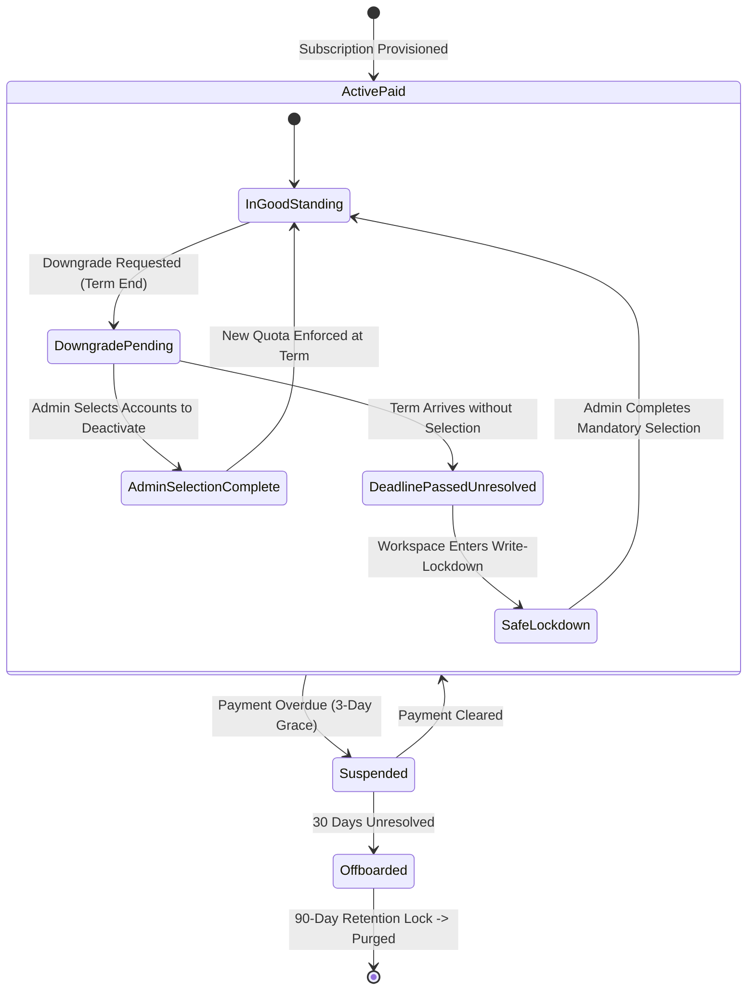

#### Effective Access Formula
Access to any protected capability is evaluated at runtime via a three-way intersection:
$$\text{Effective Access} = \text{Package Entitlement} \cap \text{Role Permission} \cap \text{Record Authorization Scope}$$

#### Downgrade Safety Specification
Automatic deactivation of staff based on creation order is rejected as unsafe:
1. **Explicit Selection Requirement:** When a quota reduction is requested (e.g., from 8 PROs to 4 PROs), the workspace enters `DOWNGRADE_PENDING_SELECTION`.
2. **Safe Deadline Lockdown (No Guessing, No Data Loss):**
   - If the effective date arrives without administrator selection, the system enters **Write-Lockdown** (`QUOTA_EXCEEDED_SELECTION_REQUIRED`).
   - Read access is preserved; all staff can view existing leads, visits, and reports.
   - New lead creation and visit mutations are rejected with HTTP 422.
   - The administrator is redirected upon login to a mandatory selection screen.
   - Selected accounts transition to `is_active = false`, sessions revoke, and leads route per explicit admin choice.
   - Audit events logged: `WORKSPACE_DOWNGRADE_WRITE_LOCKED`, `STAFF_EXPLICITLY_DEACTIVATED_ON_DOWNGRADE`.

---

## 3. Server-Side PDF Export Security and Scoping

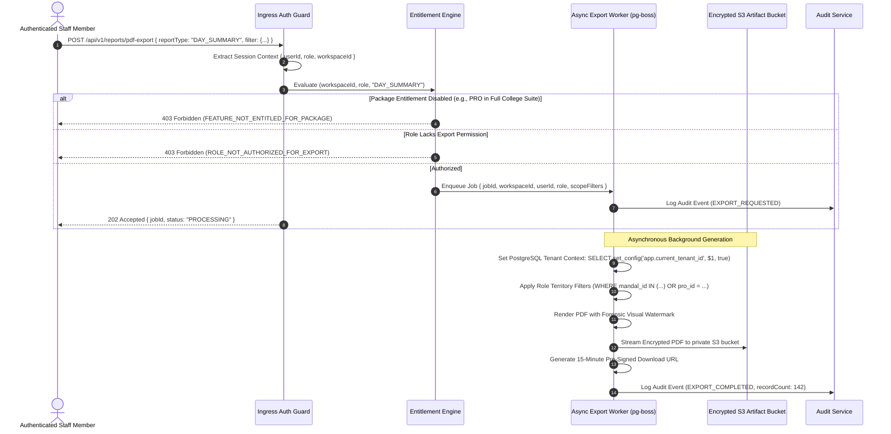

- **Individual PRO:** Authorized strictly to export records where `created_by_user_id = ctx.userId`.
- **AGM Bundle:** AGM authorized to export records where `mandal_id IN (ctx.assignedMandals)` or `created_by_user_id IN (ctx.subordinateStaffIds)`. PRO exports return HTTP 403.
- **Full College Suite:** College Admin authorized to export college-wide records. AGMs and PROs return HTTP 403 by default unless an explicit override entitlement (`OVERRIDE_ALLOW_STAFF_EXPORT`) is granted by the College Admin.
- **Forensic Watermarking:** Diagonal background watermark embeds `[Workspace Name] | User: [Employee Code] | IP: [Client IP] | Timestamp: [UTC ISO8601]`.
- **Artifact Access:** Stored in private S3 bucket encrypted with AWS KMS; pre-signed URLs expire in **15 minutes**.

---

## 4. Shared Feeder School Directory & Identity Resolution Engine

### 4.1 Strict Separation of Canonical Shared Data and College-Private Overlays

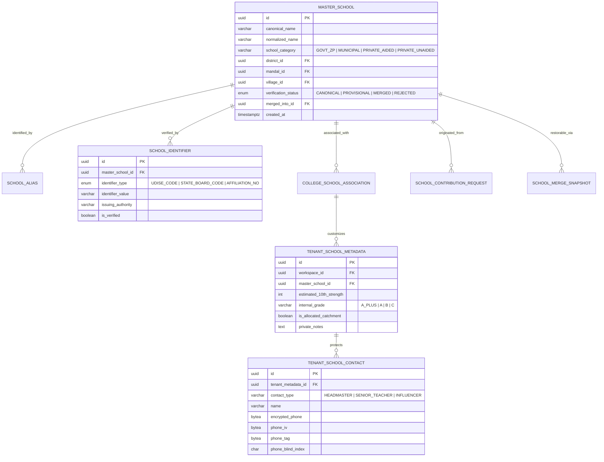

- **Canonical Shared Directory Fields (Global, No PII):**
  - `master_schools`: `canonical_name`, `normalized_name`, `school_category`, `district_id`, `mandal_id`, `village_id`, `verification_status`.
  - `school_identifiers`: `identifier_type` (UDISE, State Board Code), `identifier_value`, `issuing_authority`.
  - `school_aliases`: Alternate spellings and phonetic variations.
- **Tenant-Private Metadata & Contacts (Strictly Scoped by Workspace ID):**
  - `tenant_school_metadata`: `estimated_10th_strength`, `internal_grade`, `is_allocated_catchment`, `private_notes`.
  - `tenant_school_contacts`: Headmaster and key contact names, AES-256-GCM encrypted phone numbers, IVs, tags, blind indexes. **Inaccessible to competing colleges.**

---

### 4.2 School Identity Resolution Workflow

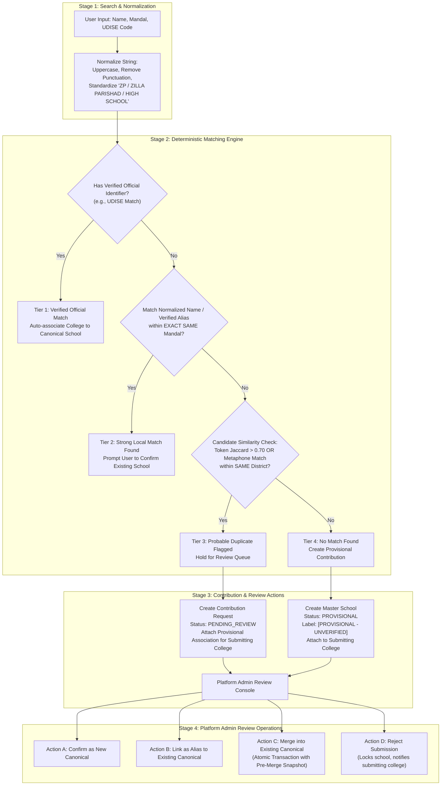

#### Deterministic Multi-Tier Matching Logic
1. **Tier 1 (Verified Official Match):** Matches verified government code (UDISE). Eliminates phonetic ambiguity subject to government accuracy.
2. **Tier 2 (Strong Local Match):** Matches canonical name or verified alias within the exact same mandal. Prompts user confirmation.
3. **Tier 3 (Probable Duplicate - Review Queue):** High token similarity ($>0.70$ Jaccard or Double Metaphone) within same district. **Never merged automatically.** Creates `school_contribution_requests` entry held for human review.
4. **Tier 4 (No Match - Provisional Creation):** Provisions new `master_schools` record with `verification_status = 'PROVISIONAL'`. Tagged with prominent visual badge: `[PROVISIONAL - UNVERIFIED]`. Usable immediately by submitting college; visible to other colleges with warning badge.

---

### 4.3 Transactional Merge Recovery & Association Collision Handling

```mermaid
sequenceDiagram
    autonumber
    actor Admin as Platform Superadmin
    participant API as School Admin API (/api/v1/admin/schools/merge)
    participant SnapTable as school_merge_snapshots Table
    participant MasterTable as master_schools Table
    participant AssocTable as college_school_associations Table
    participant MetaTable as tenant_school_metadata Table
    participant ContactTable as tenant_school_contacts Table
    participant Audit as Immutable Audit Log

    Admin->>API: POST /api/v1/admin/schools/merge { sourceId: B, targetId: A, justification: "Duplicate confirmed" }
    API->>API: Validate A != B; A.status == CANONICAL; B.status != MERGED
    
    rect rgb(240, 248, 255)
        Note over API,Audit: Atomic Database Transaction
        API->>SnapTable: INSERT INTO school_merge_snapshots (source_id, target_id, pre_merge_state_json)
        API->>MasterTable: UPDATE master_schools SET verification_status = 'MERGED', merged_into_id = A WHERE id = B
        API->>MasterTable: INSERT INTO school_aliases (master_school_id, alias_name, source) VALUES (A, B.canonical_name, 'MERGE_OP')
        
        Note over AssocTable,ContactTable: Handle Collisions Without Cross-Tenant Disclosure
        loop For each College C associated with School B
            alt College C is NOT associated with School A
                API->>AssocTable: UPDATE college_school_associations SET master_school_id = A WHERE workspace_id = C AND master_school_id = B
                API->>MetaTable: UPDATE tenant_school_metadata SET master_school_id = A WHERE workspace_id = C AND master_school_id = B
            else College C is ALREADY associated with School A (Collision)
                API->>AssocTable: UPDATE college_school_associations SET status = 'SUPERSEDED_BY_MERGE' WHERE workspace_id = C AND master_school_id = B
                API->>ContactTable: Re-point contacts belonging to B's metadata to point to A's metadata ID (Workspace C only)
                API->>MetaTable: Append B's notes into A's private_notes: E'\n[Merged Notes from School B]: ' || notes
                API->>MetaTable: UPDATE tenant_school_metadata SET status = 'ARCHIVED_DUE_TO_MERGE' WHERE workspace_id = C AND master_school_id = B
            end
        end

        API->>Audit: Log Audit Event (SCHOOL_MERGED, { sourceId: B, targetId: A, adminId: Admin.id })
    end

    API-->>Admin: 200 OK { status: 'MERGE_COMPLETED', snapshotId: 'uuid' }

    Note over Admin,Audit: Reversible Unmerge Procedure (Emergency Rollback)
    Admin->>API: POST /api/v1/admin/schools/unmerge { snapshotId: 'uuid', justification: 'Erroneous merge' }
    rect rgb(255, 240, 245)
        Note over API,Audit: Atomic Rollback Transaction
        API->>SnapTable: Read pre_merge_state_json
        API->>MasterTable: Restore B.status = 'PROVISIONAL', B.merged_into_id = NULL
        API->>MasterTable: DELETE alias created during merge
        API->>AssocTable: Revert association records and statuses to pre-merge IDs
        API->>MetaTable: Revert metadata records and un-nest contacts to pre-merge IDs
        API->>SnapTable: Mark snapshot status = 'ROLLED_BACK'
        API->>Audit: Log Audit Event (SCHOOL_UNMERGED, { snapshotId: 'uuid' })
    end
    API-->>Admin: 200 OK { status: 'UNMERGE_COMPLETED' }
```

- **Zero Cross-Tenant Leakage During Merges:** College 1's private notes and contacts for School B are merged strictly into College 1's records for School A. Private contacts from different colleges are never merged or disclosed across workspace boundaries.
- **Atomic Failure Recovery & Retry Idempotency:** The entire merge operation executes in a single database transaction. Failure rolls back completely. The request requires an `idempotency_key = UUIDv7`; retrying returns the snapshot result without re-executing.
- **Reversible Unmerge:** Durable pre-merge snapshots in `school_merge_snapshots` allow reversing accidental merges without data loss.

---

## 5. Security Architecture Corrections

### 5.1 Unified Session-Token Hashing: HMAC-SHA256 with Server Pepper

The architecture enforces a single, mathematically consistent session-token hashing and storage strategy across all modules, tests, and data models:

$$\text{token\_hash} = \text{HMAC-SHA256}(\text{key} = \text{server\_session\_pepper}, \text{message} = \text{raw\_session\_token})$$

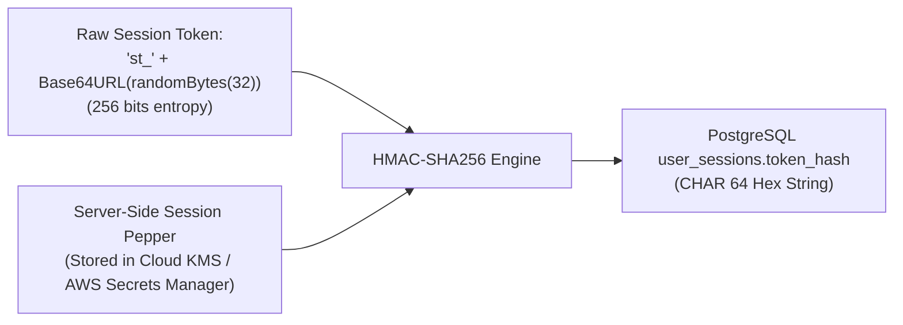

- **Key:** `server_session_pepper` (256-bit cryptographically random secret injected via cloud secret managers).
- **Message:** `raw_session_token` (prefixed `st_` + 32 bytes CSPRNG Base64URL).
- **Database Storage:** Stored as a 64-character lowercase hex string in `user_sessions.token_hash` (`CHAR(64) NOT NULL UNIQUE`). Plain SHA-256 is eliminated.
- **Dual-Pepper Zero-Downtime Rotation:** Runtime evaluates `HMAC(current_pepper, raw_token)`. If not found, evaluates `HMAC(previous_pepper, raw_token)`. If matched under `previous_pepper`, the session row is re-hashed with `current_pepper` and updated on the fly.
- **Immediate Revocation:** Logout, user deactivation, and workspace suspension immediately execute `UPDATE user_sessions SET revoked_at = NOW()`.

---

### 5.2 Offline Monotonic Clock Rollback Detection Algorithm

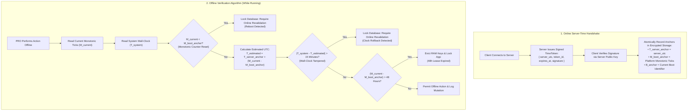

#### Detailed Verification Algorithm
1. **Server-Time Anchor Token:** While online, the server returns an authenticated time token containing:
   $$\text{TimeToken} = \{\text{server\_utc}, \text{token\_id}, \text{expires\_at}, \text{sig} = \text{HMAC}(\text{server\_key}, \text{payload})\}$$
   The client verifies the signature and stores:
   - $T_{\text{server\_anchor}} = \text{server\_utc}$
   - $M_{\text{boot\_anchor}} = \text{current monotonic elapsed ticks}$
   - $B_{\text{anchor}} = \text{current boot session baseline}$
2. **Continuous Monotonic Tracking:** While running, the application estimates current time:
   $$T_{\text{estimated}} = T_{\text{server\_anchor}} + (M_{\text{current}} - M_{\text{boot\_anchor}})$$
3. **Drift & Rollback Detection:**
   - If $M_{\text{current}} < M_{\text{boot\_anchor}}$, a counter reset has occurred $\implies$ Lock database, require online revalidation.
   - If $|T_{\text{system}} - T_{\text{estimated}}| > 15\text{ minutes}$, system wall-clock tampering is detected $\implies$ Lock database, require online revalidation.
   - If $(M_{\text{current}} - M_{\text{boot\_anchor}}) > 48\text{ hours}$, lease has expired $\implies$ Evict RAM keys, lock app, require online sync.
4. **Failure Behavior:** Fails closed. Any counter reset, detected rollback, or lease expiration immediately locks database access until an online handshake restores signed server anchors.

---

### 5.3 Platform-Specific Reboot Detection (Android vs. iOS)

| Dimension | Android Implementation | iOS Implementation |
| :--- | :--- | :--- |
| **Monotonic Uptime API** | `android.os.SystemClock.elapsedRealtime()` (measures milliseconds since boot including deep sleep). | `clock_gettime(CLOCK_MONOTONIC_RAW, ...)` or `mach_continuous_time()` (nanoseconds since boot). |
| **Reboot Detection Mechanism** | 1. Compare current `elapsedRealtime()` against `M_boot_anchor`. If current $<$ anchor, a reboot has occurred.<br>2. Listen for `android.intent.action.BOOT_COMPLETED` (requires `RECEIVE_BOOT_COMPLETED` permission). | 1. Compare current `mach_continuous_time()` against `M_boot_anchor`. If current $<$ anchor, a reboot has occurred.<br>2. Inspect `sysctl` with `KERN_BOOTTIME` (returns boot timeval struct). |
| **Limitation Concerning `/proc`** | `/proc/sys/kernel/random/boot_id` is restricted by modern SELinux on Android 11+ for untrusted app sandboxes. It must **not** be assumed accessible. | iOS has no `/proc` filesystem and does not expose a hardware boot UUID to third-party app sandboxes. |
| **Shared Offline Limitation** | If a device reboots while offline, monotonic counters reset to 0. It is impossible on consumer hardware to prove whether the device was powered off for 5 seconds or 5 months without network time. | Same limitation. Monotonic counter resets to 0. Wall-clock can be altered in settings. |
| **Safest Achievable Policy** | **Online Revalidation on Reboot (Default Baseline):** If counter reset indicates reboot, local database remains locked until network handshake succeeds. | Same policy. Local database locked until network handshake succeeds. |

---

### 5.4 Hardware Keystores, Cryptographic Erasure & Observable Evidence

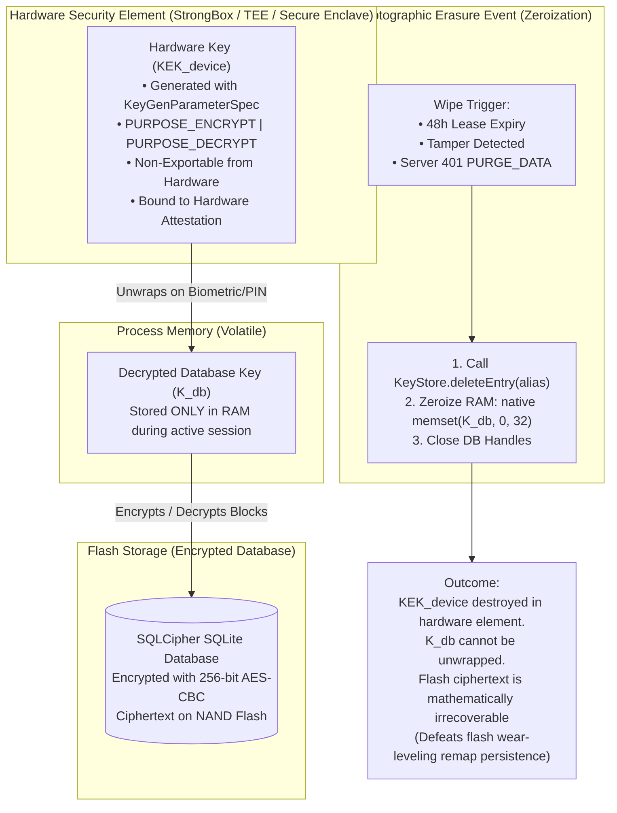

#### Hardware-Backed vs. Software-Stored Keys
- A **hardware-backed key** is generated inside hardware security modules (Android StrongBox/TEE, Apple Secure Enclave). The private key material never leaves the secure chip, even under a compromised OS kernel.
- A **secure-storage key** is merely encrypted data stored in software preferences.

#### Exact Pre- and Post-Deletion Testing Sequence
1. **Pre-Deletion Baseline Test:**
   - App calls hardware API: unwrap $K_{db}$ using $KEK_{device}$.
   - Open SQLCipher with $K_{db}$. Query `SELECT count(*) FROM student_leads;` $\implies$ Assert query returns $>0$.
2. **Cryptographic Erasure Execution:**
   - Call native platform deletion: `keyStore.deleteEntry(alias)` on Android, `SecItemDelete` on iOS.
   - Call native memory zeroization on $K_{db}$ buffer.
3. **Post-Deletion Keystore Verification:**
   - Attempt to access key entry: `keyStore.containsAlias(alias)` $\implies$ Assert returns `false`.
   - Attempt hardware unwrap $\implies$ Assert throws `KeyStoreException` / `errSecItemNotFound`.
4. **Post-Deletion Decryption Test:**
   - Attempt to open local database using standard app workflow $\implies$ Fails at unwrap step before touching SQLite.
5. **Key Protection Rule:** The raw 256-bit database key $K_{db}$ is **never exported, logged, or saved to flash storage** for testing.
6. **Limitations Concerning Extracted Keys & Memory Copies:**
   - Erasure of $KEK_{device}$ invalidates flash storage ciphertext prospectively.
   - It **cannot** revoke or invalidate copies of $K_{db}$ or plaintext data if an attacker had already dumped volatile process RAM prior to erasure (e.g., via hardware memory bus snooping on a compromised rooted device).
   - In managed runtimes (Dart/Flutter VM), garbage-collected string copies cannot be guaranteed zeroized unless key unwrapping and memory zeroization (`memset 0x00`) are handled in native C/C++ FFI buffers.

---

### 5.5 PostgreSQL Concurrent Blind-Index Rotation (Outside Transaction Block)

In PostgreSQL, `CREATE INDEX CONCURRENTLY` and `CREATE UNIQUE INDEX CONCURRENTLY` **cannot execute inside a transaction block** (`ERROR: 25001`). The safe rotation sequence is redesigned into decoupled, non-blocking phases:

```mermaid
sequenceDiagram
    autonumber
    actor Admin as Platform Security Admin
    participant Worker as Re-Indexing Background Worker
    participant DB as PostgreSQL 16 Primary
    participant Audit as Immutable Audit Log

    Admin->>Worker: Trigger Phone Re-Indexing Job (workspace_id, new_salt_v2)
    
    rect rgb(240, 248, 255)
        Note over Worker,DB: Phase 1: Add Column & Enable Dual Writes (Short Tx)
        Worker->>DB: ALTER TABLE student_leads ADD COLUMN phone_blind_index_v2 CHAR(64);
        Note over Worker,DB: Application now computes both indices on INSERT/UPDATE
    end

    rect rgb(255, 255, 240)
        Note over Worker,DB: Phase 2: Chunked Backfill (Multiple Small Txs)
        loop In Batches of 500 Leads
            Worker->>DB: BEGIN; SELECT ... FOR UPDATE; UPDATE student_leads SET phone_blind_index_v2 = HMAC(salt_v2, raw_phone); COMMIT;
        end
    end

    rect rgb(245, 245, 255)
        Note over Worker,DB: Phase 3: Duplicate Triage Check (Read Only)
        Worker->>DB: SELECT workspace_id, phone_blind_index_v2, count(*) FROM student_leads WHERE deleted_at IS NULL GROUP BY 1, 2 HAVING count(*) > 1;
        Note over Worker,DB: If duplicates found: ABORT and alert Admin (v1 index remains intact)
    end

    rect rgb(230, 255, 230)
        Note over Worker,DB: Phase 4: Concurrent Unique Index Creation (OUTSIDE TX BLOCK)
        Worker->>DB: CREATE UNIQUE INDEX CONCURRENTLY idx_unique_active_workspace_phone_v2 ON student_leads (workspace_id, phone_blind_index_v2) WHERE deleted_at IS NULL;
        Worker->>DB: SELECT indisvalid FROM pg_index WHERE indexrelid = 'idx_unique_active_workspace_phone_v2'::regclass;
        Note over Worker,DB: Assert indisvalid == true before proceeding
    end

    rect rgb(255, 240, 245)
        Note over Worker,DB: Phase 5: Atomic Cutover (Short DDL Tx)
        Worker->>DB: BEGIN;
        Worker->>DB: Set Application Query Pointer to v2;
        Worker->>DB: COMMIT;
    end

    rect rgb(240, 240, 240)
        Note over Worker,DB: Phase 6: Cleanup Phase (OUTSIDE TX BLOCK - Only after Cutover Verified)
        Worker->>DB: DROP INDEX CONCURRENTLY idx_unique_active_workspace_phone;
        Worker->>DB: ALTER TABLE student_leads DROP COLUMN phone_blind_index;
        Worker->>DB: ALTER TABLE student_leads RENAME COLUMN phone_blind_index_v2 TO phone_blind_index;
        Worker->>DB: ALTER INDEX idx_unique_active_workspace_phone_v2 RENAME TO idx_unique_active_workspace_phone;
    end

    Worker->>Audit: Log Audit Event (PHONE_BLIND_INDEX_ROTATED, { workspaceId, totalRotated: 4500 })
```

#### Handling Concurrent Writes & Rollback Safety
- **Concurrent Writes:** While backfill runs, new inserts and updates compute both `HMAC(salt_v1, phone)` and `HMAC(salt_v2, phone)`. Uniqueness is enforced on write by the existing unique index on `phone_blind_index`.
- **Validation Before Cutover:** The new index is queried in `pg_index`. Cutover is aborted if `indisvalid` is false.
- **Rollback Safety:** If backfill or index creation fails, the worker executes `DROP INDEX CONCURRENTLY idx_unique_active_workspace_phone_v2` and drops column `phone_blind_index_v2`. The existing index on `phone_blind_index` was never touched or dropped, ensuring zero downtime and zero loss of duplicate protection.

---

### 5.6 Parameter-Safe PostgreSQL RLS & Root-Cause Failure Protocol

```sql
-- Parameter-safe transaction-local tenant context
SELECT set_config('app.current_tenant_id', $1, true);

-- Partial Unique Index on active leads
CREATE UNIQUE INDEX idx_unique_active_workspace_phone 
ON student_leads (workspace_id, phone_blind_index) 
WHERE deleted_at IS NULL;
```

#### Behavioral Distinction: 0-Row SELECT vs. Rejected Writes
- **`SELECT`:** Missing context or mismatched context evaluates `USING` to false $\implies$ returns **0 rows** (empty result set, failing closed without leaking existence).
- **`INSERT`:** Missing context or mismatched context evaluates `WITH CHECK` to false $\implies$ raises PostgreSQL error `42501` (`insufficient_privilege`).
- **`UPDATE` / `DELETE`:** Rows of other tenants are invisible under `USING` (0 rows affected). Attempts to mutate `workspace_id` trigger error `42501`.

#### RLS PoC Failure Protocol (No Bare-Application Fallback)
If the Drizzle ORM + RLS PoC fails under PgBouncer transaction pooling (due to context leakage, pooler bugs, or latency overhead $>2.0\text{ms}$):
1. **Root-Cause Analysis (RCA):** The team must stop and produce a formal RCA document detailing why transaction-scoped context bled or failed.
2. **Demonstrated Alternative Boundary Required:** Falling back to application-layer repository filtering alone is **strictly rejected**. Before proceeding to implementation, an alternative structural database isolation boundary must be demonstrated:
   - *Alternative A: Schema-per-Tenant Separation* (`search_path` routing with separate PostgreSQL schemas per tenant).
   - *Alternative B: Dedicated Connection Pools per Tenant* (PgBouncer routing connections to dedicated tenant databases).

---

### 5.7 Cross-Workspace Lead Migration: Transactional Audit Consistency

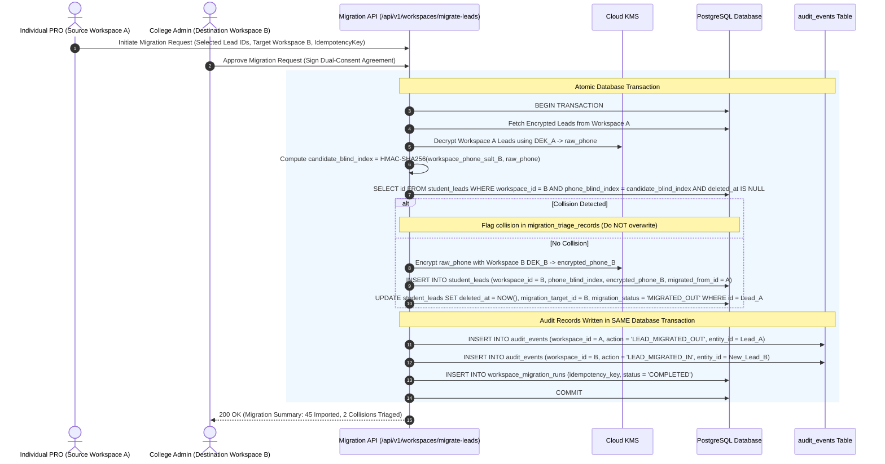

- **Transactional Audit Invariant:** The audit records are written **transactionally within the exact same database transaction** as the lead insertion in Workspace B and soft-deletion in Workspace A.
- **Idempotency & Partial Failure Recovery:**
  - If a transaction aborts or the network drops before commit, the entire migration rolls back: source lead is not soft-deleted, destination lead is not inserted, and no audit event is created.
  - Client retries with the same `idempotency_key`. The server checks `workspace_migration_runs`: if `COMPLETED`, returns the stored migration receipt without re-executing.
  - Migration state and audit evidence cannot silently diverge.

---

## 6. Updated Conceptual Data Model

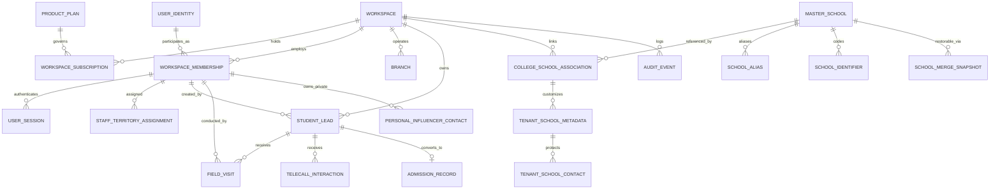

---

## 7. Database Indexing and Query Performance Strategy

> [!NOTE]
> This section is a `[PROPOSED SPECIFICATION]`. Index definitions are design artefacts only. No DDL has been executed.

### 7.1 Index Philosophy and Classification

Every index in the system must belong to one of three functional classes:

| Class | Purpose | Examples |
| :--- | :--- | :--- |
| **Uniqueness** | Enforce data-integrity constraints at the database layer | Tenant-scoped phone blind index; workspace membership unique per user |
| **Lookup / Selectivity** | Narrow large result sets when a column's cardinality makes a sequential scan expensive | `workspace_id` on every tenant table; `assigned_staff_id` on leads |
| **Sort / Range** | Accelerate `ORDER BY`, `BETWEEN`, and `date_trunc` queries on time-series data | `created_at` on `field_visits`, `audit_events` |

General rules:
- Every foreign-key column that is queried in a `WHERE` or `JOIN` must have an index.
- Every tenant table's first filter is always `workspace_id`. Composite indexes place `workspace_id` as the leading column.
- Partial indexes (`WHERE deleted_at IS NULL`) are preferred over full-table indexes on soft-delete tables to exclude archived rows from live query paths.
- Covering indexes (including non-key columns via `INCLUDE`) are used only when a high-frequency query is provably index-only scannable in the benchmark suite.

### 7.2 Critical Index Catalogue

```sql
-- UNIQUENESS INDEXES
-- Tenant-scoped phone blind index (partial; active leads only)
CREATE UNIQUE INDEX idx_unique_active_workspace_phone
  ON student_leads (workspace_id, phone_blind_index)
  WHERE deleted_at IS NULL;

-- One active membership per user per workspace
CREATE UNIQUE INDEX idx_unique_active_membership
  ON workspace_memberships (workspace_id, user_identity_id)
  WHERE is_active = TRUE;

-- One live session token per hash (constant-time lookup)
CREATE UNIQUE INDEX idx_unique_session_token_hash
  ON user_sessions (token_hash);

-- LOOKUP INDEXES (tenant-first composite)
-- Lead queries by workspace + status + assigned staff
CREATE INDEX idx_leads_ws_status_staff
  ON student_leads (workspace_id, status, assigned_staff_id)
  WHERE deleted_at IS NULL;

-- Field visits by lead (most common drill-down)
CREATE INDEX idx_visits_lead_id
  ON field_visits (lead_id, visited_at DESC);

-- Telecall interactions by lead
CREATE INDEX idx_telecall_lead_id
  ON telecall_interactions (lead_id, called_at DESC);

-- Staff territory by workspace + mandal
CREATE INDEX idx_territory_ws_mandal
  ON staff_territory_assignments (workspace_id, mandal_id);

-- Audit events by workspace + entity (for audit trail queries)
CREATE INDEX idx_audit_ws_entity
  ON audit_events (workspace_id, entity_type, entity_id, occurred_at DESC);

-- School contacts by blind index (per-tenant lookup)
CREATE INDEX idx_school_contact_blind
  ON tenant_school_contacts (phone_blind_index);

-- SORT / RANGE INDEXES
-- Day-report queries (PRO daily activity by date)
CREATE INDEX idx_visits_ws_staff_date
  ON field_visits (workspace_id, staff_id, visited_at DESC)
  WHERE deleted_at IS NULL;

-- Admission records by academic year + workspace
CREATE INDEX idx_admission_ws_year
  ON admission_records (workspace_id, academic_year_id, admitted_at DESC);

-- Subscription expiry lookups (background renewal jobs)
CREATE INDEX idx_subscription_expiry
  ON workspace_subscriptions (current_period_end)
  WHERE status = 'ACTIVE';
```

### 7.3 Query Performance Targets and Measurement Protocol

| Query Pattern | p95 Target | Measurement Method |
| :--- | :---: | :--- |
| Lead list for a PRO (paginated, 50 rows, `workspace_id + status`) | ≤ 10 ms | `EXPLAIN (ANALYZE, BUFFERS)` on production-size seeded dataset |
| Session token lookup by hash | ≤ 2 ms | Dedicated Vitest benchmark via pg driver |
| AGM team daily visit count (by mandal, date range) | ≤ 25 ms | `EXPLAIN (ANALYZE, BUFFERS)` |
| School search within mandal (normalized name) | ≤ 15 ms | `EXPLAIN (ANALYZE, BUFFERS)` |
| Admission count by academic year (College Admin dashboard) | ≤ 30 ms | `EXPLAIN (ANALYZE, BUFFERS)` |
| Audit trail for a single lead (all events, ordered) | ≤ 20 ms | `EXPLAIN (ANALYZE, BUFFERS)` |

All benchmarks must be run against a dataset seeded with at minimum:
- 10 tenant workspaces × 5,000 student leads each (50,000 total leads)
- 200,000 field visit rows
- 500,000 audit event rows

Targets that fail during the PoC benchmark phase block implementation until the slow query is either resolved via an index change or a target is revised with architectural justification.

### 7.4 Query Execution Plan Governance

- `EXPLAIN (ANALYZE, BUFFERS)` output is recorded for every query plan introduced during PoC or implementation phases.
- Sequential scans (`Seq Scan`) on tables larger than 10,000 rows are treated as defects requiring an index justification review.
- RLS policy overhead is measured separately (see Section 5.6 — PoC 1, test `P1-T9`) so that RLS `set_config` latency is isolated from ORM overhead.
- Index usage is verified using `pg_stat_user_indexes.idx_scan`. Any index with zero scans after one full academic-year cycle of simulated load is evaluated for removal.

### 7.5 Multi-Tenant Index Isolation Note

Because Row-Level Security (RLS) enforces tenant isolation at query time, all indexes are **shared physical structures across tenants**. This is safe because:
1. PostgreSQL evaluates the RLS `USING` predicate before returning any row, regardless of the index scan path chosen.
2. Every composite index leads with `workspace_id`, which gives the planner an optimal scan range per tenant without exposing cross-tenant data.
3. The unprivileged `app_runtime_user` role cannot bypass RLS (`NOBYPASSRLS`), ensuring index-only scans do not leak cross-tenant key values.

---

## 8. Academic-Year Data Lifecycle, Cold Storage, and Cost Optimization

> [!NOTE]
> This section is a `[PROPOSED SPECIFICATION]`. No archival jobs, partitions, or storage tier changes have been implemented.

### 8.1 Academic-Year Lifecycle Concept

College admissions operations are inherently annual. Each academic year generates a bounded, finite dataset (leads, visits, telecalls, admissions, reports). After the intake cycle closes, this data transitions from **hot operational** to **warm analytical** to **cold compliance** access patterns:

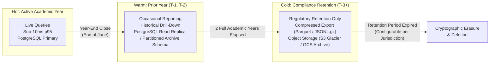

### 8.2 Archival Eligibility Criteria

A record qualifies for warm/cold archival only when **all** of the following conditions are met:

| Condition | Check |
| :--- | :--- |
| Academic year status is `CLOSED` | `academic_years.status = 'CLOSED'` |
| At least 12 months have elapsed since `academic_years.closed_at` | `NOW() - closed_at > INTERVAL '12 months'` |
| No open compliance hold on the workspace | `workspace_compliance_holds` table shows no active hold |
| No pending lead migrations referencing the cohort | `workspace_migration_runs` shows no `PENDING` row for the year |

### 8.3 Year-End Archival Procedure

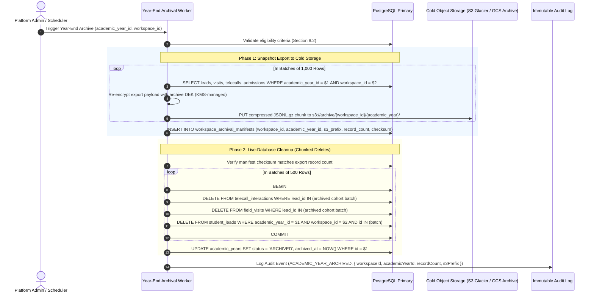

#### Critical Safety Rules for Live-Database Cleanup

1. **Manifest Verification Before Any Delete:** The archival worker verifies that the exported manifest checksum matches the actual row count queried before executing a single `DELETE`. If the checksum fails, the cleanup phase aborts entirely and an alert is raised. No live rows are deleted.
2. **Chunked Deletes, Not Bulk Truncation:** Deletes are issued in batches of 500 rows within individual short transactions to prevent table-level lock escalation and reduce replication lag on read replicas.
3. **Admission Records Exempt from Deletion:** `admission_records` (spot admission events with application numbers) are **never purged from the live database**. They are included in the cold archive export but remain in the live database for legal/regulatory traceability.
4. **Idempotent Re-Run:** If the archival job is interrupted after export but before cleanup completes, re-running the job detects the existing manifest, skips the export phase, and resumes cleanup from the last successfully deleted batch.

### 8.4 Historical Data Retrieval API

Archived cohorts are not accessible via live operational APIs. Historical retrieval is a separate, explicitly authorized operation:

```mermaid
sequenceDiagram
    autonumber
    actor CollegeAdmin as College Admin
    participant API as Historical Retrieval API
    participant S3 as Cold Object Storage
    participant Audit as Immutable Audit Log

    CollegeAdmin->>API: GET /api/v1/archive/leads?academic_year_id=AY2023&format=json
    API->>API: Verify College Admin role + workspace entitlement for historical access
    API->>S3: Fetch manifest from workspace_archival_manifests
    API->>S3: Stream JSONL.gz chunks from s3://archive/{workspace_id}/{academic_year}/
    API->>API: Decrypt with archive DEK; re-encrypt phone fields inline for response
    API->>Audit: Log Audit Event (HISTORICAL_DATA_ACCESSED, { workspaceId, academicYearId, requestedBy })
    API-->>CollegeAdmin: 200 OK — Paginated JSON (phones masked by default; unmasked only with explicit override entitlement)
```

- **Default Masking:** Retrieved phone numbers are masked (`+91-XXXX-XX5678`) in all historical responses. An explicit platform-granted override entitlement (`ALLOW_HISTORICAL_PHONE_UNMASKED`) is required for full values.
- **Rate Limiting:** Historical retrieval endpoints are rate-limited to 10 requests per workspace per day to prevent bulk exfiltration via repeated archive downloads.
- **Audit Mandatory:** Every historical access request is recorded in `audit_events` regardless of whether data was found.

### 8.5 Storage Cost Optimization Summary

| Tier | Storage Location | Access Pattern | Estimated Monthly Cost Basis | Retention Policy |
| :--- | :--- | :--- | :--- | :--- |
| **Hot** | PostgreSQL Primary + Read Replica | Real-time, sub-10ms | Highest (RDS/Cloud SQL compute + SSD IOPS) | Current academic year only |
| **Warm** | PostgreSQL Read Replica / Archived Schema | Weekly–monthly | Moderate (reduced replica count) | T-1 and T-2 years (configurable) |
| **Cold** | S3 Glacier / GCS Archive (compressed JSONL.gz) | On-demand retrieval (minutes–hours) | Very low (~$0.004/GB/month on Glacier) | Minimum 7 years (jurisdictional requirement) |
| **Purge** | N/A (cryptographic erasure) | N/A | Zero | After retention period expires |

**Compression Expectation:** JSONL.gz compression of structured admissions data typically achieves 85–92% reduction in stored bytes vs. uncompressed JSON. A 50,000-lead cohort with associated visits and telecall records is estimated at under 500 MB compressed per workspace per academic year.

### 8.6 Cryptographic Erasure at Retention Expiry

When the configured retention period expires for a cold archive cohort:
1. The workspace's archive Data Encryption Key (`archive_DEK`) for that academic year is deleted from KMS.
2. The compressed S3 objects remain on disk but are permanently mathematically irrecoverable without the DEK.
3. An audit event `COLD_ARCHIVE_DEK_EXPIRED` is written to the immutable audit log as proof of erasure.
4. The physical S3 objects are deleted via a scheduled lifecycle rule 30 days after DEK expiry (allowing any deferred retrieval requests to fail gracefully with a `410 Gone` response).

---

## 9. Security Findings Register (SEC-01 to SEC-08)

| Finding ID | Vulnerability Description | Severity | Target Architecture Mitigation | Automated Verification Test |
| :--- | :--- | :---: | :--- | :--- |
| **SEC-01** | Client-Side JWT Minting in Flutter (`api_service.dart`) | **CRITICAL** | Complete removal of client token signing. Server issues opaque 256-bit bearer tokens verified against HMAC-SHA256 database hashes. | `TEST-VERIF-01`: Client submits forged token; server returns HTTP 401. All tokens minted by server exclusively. |
| **SEC-02** | Default Insecure Student Password Takeover (`123456`) | **CRITICAL** | Student login and self-registration entirely deferred from Phase 1. | `TEST-VERIF-02`: Public student registration endpoints eliminated from API routing table. |
| **SEC-03** | Public Feeder School PII Leakage (`GET /api/config`) | **HIGH** | `master_schools` read-only master; headmaster personal phones moved to encrypted `tenant_school_contacts` requiring authenticated tenant session. | `TEST-VERIF-03`: Unauthenticated `GET /api/v1/schools` returns HTTP 401. Authenticated staff see only tenant-authorized contacts. |
| **SEC-04** | Cross-Tenant Lead Leaks via Unassigned Telecallers | **HIGH** | Telecaller queries enforce mandatory tenant scoping and assignment checks. Empty assignment returns `[]` (fail-closed), never global leads. | `TEST-VERIF-04`: Telecaller with empty assignment queries `/api/v1/leads`; returns empty array, 0 rows leaked. |
| **SEC-05** | Tokens Passed in URL Query Strings (`?token=...`) | **MEDIUM** | Ingress API gateway strictly rejects tokens in query strings. Tokens accepted exclusively via `__Host-` cookies or `Authorization: Bearer` headers. | `TEST-VERIF-05`: Request with `?token=...` returns HTTP 400 Bad Request. |
| **SEC-06** | Hardcoded Automated Backup Fallback Secret | **MEDIUM** | Secret hardcoding eliminated. Process fails startup if `CRON_SECRET` is unset via Zod environment validation. | `TEST-VERIF-06`: Missing `CRON_SECRET` in environment causes application startup crash with explicit error. |
| **SEC-07** | Stolen Offline Field Phone Data Extraction | **HIGH** | 48-hour monotonic lease; online revalidation on reboot; SQLCipher 256-bit AES encryption; cryptographic erasure zeroizing TPM keys on tamper/expiry. | `TEST-VERIF-07`: Simulate monotonic advance $>48$h or reboot; verify $K_{db}$ evicted and local database unreadable. |
| **SEC-08** | Unauthorized Bulk PDF Data Exfiltration | **MEDIUM** | Role-based export authorization; server-side entitlement checks; forensic visual watermarking; 15-minute expiring S3 pre-signed URLs. | `TEST-VERIF-08`: PRO in Full College Suite calls export endpoint; returns HTTP 403. Admin export generates watermarked artifact. |

---

## 10. Proof-of-Concept (PoC) Plans with Observable Evidence Artifacts

> [!CAUTION]
> **PoC Status Clarification:** Zero PoCs have been executed. No test has passed. The architecture is ready for PoC execution only after test prerequisites and physical test hardware are available.

### 8.1 PoC 1: Drizzle ORM + PostgreSQL RLS under Transaction Pooling

- **Objective:** Prove parameter-safe `set_config('app.current_tenant_id', $1, true)` under PgBouncer transaction pooling using unprivileged role `app_runtime_user`.
- **Prerequisites:** PostgreSQL 16 container, PgBouncer (`pool_mode = transaction`), Drizzle ORM wrapper.
- **Restricted Database Role:** `app_runtime_user` (`NOINHERIT`, `NOSUPERUSER`, `NOCREATEDB`, `NOCREATEROLE`, `NOBYPASSRLS`).
- **Test Cases, Observable Results & Evidence Artifacts:**

| Test ID | Operation & Condition | Expected Observable Result | Required Evidence Artifact |
| :--- | :--- | :--- | :--- |
| **P1-T1** | SELECT with missing context | Returns 0 rows | SQL query log showing empty result set |
| **P1-T2** | INSERT with missing context | Throws SQL error `42501` | PostgreSQL server error log capturing error `42501` |
| **P1-T3** | INSERT with mismatched `workspace_id` | Throws SQL error `42501` | Assertion log capturing `42501` rejection |
| **P1-T4** | UPDATE other tenant row | Updates 0 rows | Query result showing `rowCount: 0` |
| **P1-T5** | UPDATE mutating `workspace_id` to Tenant B | Throws SQL error `42501` | Server error log capturing `WITH CHECK` violation |
| **P1-T6** | DELETE other tenant row | Deletes 0 rows | Query result showing `rowCount: 0` |
| **P1-T7** | Transaction abort context cleanup | Aborted Tx leaves next Tx clean | PgBouncer query sequence log |
| **P1-T8** | 10,000 rapid interleaved transactions | Exactly 0 cross-tenant leaks | Vitest test report with 10,000 assertions passing |
| **P1-T9** | Performance latency overhead | Overhead $\Delta T \le 2.0\text{ms}$ on p95 | Benchmark comparison report (Baseline vs. RLS) |

- **Overhead Calculation Methodology:**
  $$\Delta T = \overline{T}_{\text{p95}}(\text{RLS + set\_config}) - \overline{T}_{\text{p95}}(\text{Baseline})$$
- **Measurable Pass Criteria:** 0 cross-tenant leaks; 100% of illegal writes rejected; $\Delta T \le 2.0\text{ms}$ on p95.
- **Failure Fallback:** Halt implementation $\implies$ Perform RCA $\implies$ Demonstrate Schema-per-Tenant or Dedicated Tenant Pools before proceeding.

---

### 8.2 PoC 2: Flutter Offline Lease & Hardware Security

- **Objective:** Validate SQLCipher encryption, monotonic uptime tracking, reboot detection, and cryptographic erasure on physical test hardware.
- **Prerequisites:** Flutter test app embedding `sqflite_sqlcipher`, `flutter_secure_storage`, and native hardware Keystore/Secure Enclave bindings.
- **Physical Test Devices:** (1) Budget Android phone (Android 10+, 2GB RAM); (2) iPhone (iOS 15+).
- **Test Cases, Observable Results & Evidence Artifacts:**

| Test ID | Procedure & Condition | Expected Observable Result | Required Evidence Artifact |
| :--- | :--- | :--- | :--- |
| **P2-T1** | Queue 100 visits offline | Encrypted SQLite records created | Hex dump of local `.db` showing ciphertext |
| **P2-T2** | System wall-clock rollback by 7 days | Tamper detected; UI locked | Device `logcat` capturing clock-tamper lock |
| **P2-T3** | Device reboot while offline | Database locked; online reval required | App logs capturing `elapsedRealtime` / `mach_continuous_time` reset lock |
| **P2-T4** | Continuous uptime $>48$ hours | Lease expires; keys evicted from RAM | App logs capturing monotonic lease expiry |
| **P2-T5** | Cryptographic erasure execution | $KEK_{device}$ deleted from Keystore | Pre- and post-test keystore logs; `KeyStoreException` / `errSecItemNotFound` |
| **P2-T6** | Reconnection atomic batch sync | 100 items synced; 0 duplicates | Server transaction log showing 100 commits, 0 dups |

- **Measurable Pass Criteria:** Keystore unwrap throws `KeyStoreException` after deletion; offline reboot locks database; batch sync produces zero duplicates.
- **Failure Fallback:** Ephemeral in-memory session keys only (requires user to remain online to re-authenticate if app restarts).

---

## 11. Feature-to-Acceptance-Test Traceability Matrix

| Feature Module | Business Rule / Capability | Required Test ID | Concrete Acceptance Test Procedure | Expected Pass Result |
| :--- | :--- | :--- | :--- | :--- |
| **Tenant Lifecycle** | Hard Staff-Seat Cap Enforcement | `TEST-TC-01` | Subscription quota = 3 PRO seats. College Admin attempts to provision 4th PRO user. | HTTP 422 Unprocessable Entity (`SEAT_QUOTA_EXCEEDED`). Record not created. |
| **Identity & Sessions**| Session Revocation on User Deactivation | `TEST-TC-02` | PRO user logs in on Web and Mobile. Admin deactivates user (`is_active = false`). PRO makes subsequent API call. | HTTP 401 Unauthorized (`SESSION_REVOKED`). Local mobile app locks. |
| **Lead Management** | Keyed HMAC Duplicate Phone Check | `TEST-TC-03` | PRO A creates lead with Phone P in College A. PRO B creates lead with Phone P in College B. PRO A attempts duplicate in College A. | College B creation succeeds (HTTP 201). Duplicate in College A fails (HTTP 409 Conflict). |
| **Field Visits** | Append-Only Doorstep Visit Log | `TEST-TC-04` | PRO logs visit with parent remarks on Lead L. Attaches idempotency key K. Re-sends identical payload with key K. | Visit created, `doorstep_completed = true`. Duplicate request returns cached 200 without duplicate row. |
| **School Directory** | Multi-Tier Identity Resolution | `TEST-TC-05` | Search "Sri Siddhartha ZP High School, Guntur" against Canonical "Sri Siddhartha High School, Guntur" (same UDISE). | Match classified as Tier 1. Direct association linked without creating duplicate school. |
| **School Directory** | Private Contact Protection | `TEST-TC-06` | College A logs private headmaster phone on School S. College B queries School S. | College B sees school profile; College A's headmaster phone and private notes are omitted. |
| **Telecaller Desk** | Dynamic Callback Alarm Trigger | `TEST-TC-07` | Telecaller sets callback milestone `AFTER_10TH_EXAMS`. Platform Admin marks 10th exams completed. | Lead appears automatically in Telecaller High-Priority Callback Queue. |
| **PDF Reporting** | Server-Side PDF Export Authorization | `TEST-TC-08` | PRO in AGM Bundle attempts `POST /api/v1/reports/pdf-export` for personal leads. | HTTP 403 Forbidden (`EXPORT_PERMISSION_DISABLED_FOR_ROLE`). |
| **PDF Reporting** | Authorized AGM Team Export | `TEST-TC-09` | AGM in AGM Bundle calls team export endpoint. | HTTP 202 Accepted. Async worker outputs PDF with forensic watermark and 15-min pre-signed URL. |
| **Platform Ops** | Audited Break-Glass Impersonation | `TEST-TC-10` | Platform operator initiates support session with Ticket ID #801. Accesses College A leads. | Access granted for max 2h; all phone numbers masked by default; action logged in `audit_events`. |

---

## 12. Implementation-Readiness Verdict and Next Actions

### 12.1 Implementation-Readiness Verdict

> [!IMPORTANT]
> **VERDICT: ARCHITECTURALLY SPECIFIED — READY FOR PHASE 0 PROOF-OF-CONCEPT EXECUTION ONLY AFTER PREREQUISITES ARE AVAILABLE.**  
> 
> Sections 7 (Indexing) and 8 (Archival) are additional non-blocking specifications that must be reviewed before Milestone 1 buildout but do not gate PoC 1 or PoC 2 execution.
> 
> The architecture is not yet declared fully validated. It is strictly ready for Phase 0 technical proof-of-concept execution. Zero production application code implementation is authorized until PoC 1 and PoC 2 conclude with verified, documented evidence artifacts.

### 12.2 Next Actions
1. **Action 1 (Governance):** Owner sign-off on the 4 unresolved decisions in Section 1.2.
2. **Action 2 (Prerequisites):** Provision test environments:
   - PostgreSQL 16 + PgBouncer container on Linux.
   - Physical Android 10+ and iOS test hardware.
3. **Action 3 (PoC Execution):** **Proceed to PoC execution rather than creating further architecture revisions unless a new material issue is discovered.**
4. **Action 4 (Milestone 1 Buildout):** Upon verified PoC pass, build the walking skeleton.
5. **Action 5 (Indexing Benchmark):** During PoC 1, execute the query benchmark suite defined in Section 7.3 against the seeded 50,000-lead dataset and record all `EXPLAIN (ANALYZE, BUFFERS)` outputs.
6. **Action 6 (Archival Design Review):** Present Section 8 archival lifecycle design to product owner and legal for jurisdictional retention-period confirmation before the archival worker is scheduled.

---

## 13. Change Log: Revision 3.1.1 $\to$ Revision 3.1.2 & Confirmation

### 13.1 Change Log

| Item | Revision 3.1.1 | Revision 3.1.2 (Current) | Rationale |
| :--- | :--- | :--- | :--- |
| **PostgreSQL Index Rotation** | Attempted `CREATE UNIQUE INDEX CONCURRENTLY` inside a transaction block. | Redesigned into decoupled phases: dual writes, chunked backfill, duplicate check, **concurrent index creation outside tx block**, atomic cutover, and deferred cleanup. | PostgreSQL raises `ERROR: 25001` if concurrent index creation is run inside a transaction block. |
| **Mobile Reboot Detection** | Assumed `/proc/sys/kernel/random/boot_id` was uniformly accessible. | Documented that Android 11+ SELinux restricts `/proc` and iOS lacks it. Detailed supported platform APIs (`elapsedRealtime()` / `mach_continuous_time()` reset tracking). | Eliminates unverified platform assumptions on modern mobile OSs. |
| **Cryptographic Erasure Proof** | Relied on SQLCipher file unreadability without a key as proof of deletion. | Added **pre- and post-deletion hardware keystore unwrap tests**, prohibited exporting $K_{db}$, and documented in-memory RAM limitations. | Encrypted files always reject wrong keys; proving key deletion requires testing the hardware keystore API. |
| **Clock Rollback Detection** | Generalized drift checks. | Formulated exact algorithm using signed server-time anchor tokens, monotonic ticks, drift tolerance ($\pm 15$ min), and fail-closed lockdown. | Provides mathematically verifiable clock protection during continuous uptime. |
| **Migration Audit Reliability** | Assumed audit records were written alongside leads. | Enforced that audit records are written **transactionally in the exact same database transaction** as the lead transfer, with UUIDv7 idempotency keys. | Guarantees migration state and audit evidence cannot silently diverge on partial network failure. |
| **Governance Alignment** | Had mixed packaging statuses. | Reconciled packaging with the approved three-package structure (`[OWNER-APPROVED DECISION]`) and retained AGM add-on seats as `[UNRESOLVED OWNER DECISION]`. | Maintains strict fidelity to owner decisions. |
| **PoC Roadmap** | General test lists. | Formalized observable results, required artifacts, and directed team to **proceed to PoC execution rather than further revisions**. | Prevents endless specification churn; transitions to empirical verification. |
| **Database Indexing Strategy** | *(New in 3.1.2)* Not present. | Added Section 7: index catalogue (uniqueness, lookup, sort/range), p95 query performance targets, seeded benchmark dataset requirements, execution plan governance, and RLS isolation note. | Ensures query performance is specified before implementation, not discovered post-launch. |
| **Academic-Year Archival** | *(New in 3.1.2)* Not present. | Added Section 8: hot/warm/cold tiering model, eligibility criteria, archival worker procedure with manifest checksum verification, chunked live-database cleanup, historical retrieval API with phone masking, cost table, and KMS-backed cryptographic erasure at retention expiry. | Prevents unbounded live-database growth and defines a compliant, cost-optimised data lifecycle before the first academic year closes. |

### 13.2 Strict Non-Modification Confirmation
In accordance with task constraints:
- **Zero application source code files were created, edited, or deleted.**
- **No package dependencies were installed or modified (`package.json`, `package-lock.json` remain untouched).**
- **No database schemas, tables, or migrations were executed.**
- **No configuration files, environment variables, or running dev servers were modified.**
- **All previous revisions (Revision 2.0, Revision 3.0, Revision 3.1, and Revision 3.1.1) remain preserved in their entirety.**
