# Architecture Revision 3.1.3: Targeted Architecture Corrections & Implementation-Ready Baseline

**Document Status:** Architecture Revision 3.1.3 (Targeted Corrective Baseline)  
**System:** Multi-Tenant College Admissions Operations & Field Force SaaS  
**Scope Classification:** Phase 1 Operational Core  
**Role:** Principal SaaS Architect & Application Security Architect  
**Predecessor Baselines:** Revision 2.0, Revision 3.0, Revision 3.1, Revision 3.1.1, and Revision 3.1.2 (Preserved in full)  
**Document Purpose:** Provide targeted, surgical architectural corrections over Revision 3.1.2:
1. **Academic-Year Archival Safety:** Eliminate unverified policy assertions (warm-tier duration, retention horizon, close triggers); formalize snapshot-isolated cohort export (`REPEATABLE READ`); require independent verification of both record counts and cryptographic payload checksums; establish an explicit two-step deletion authorization protocol; document a comprehensive foreign-key dependency deletion order with permanent exemption for admission records and audit events; specify an asynchronous restoration workflow for cold storage tiers; and introduce regulatory compliance holds.
2. **Cryptographic Corrections (Offline Lease & Monotonic Clock):** Resolve the symmetric HMAC vs. public-key verification contradiction by specifying Ed25519 asymmetric signatures for offline time tokens; reframe monotonic counter tracking to recognize that counter resets indicate lost continuity rather than proving reboot; define local seen-token replay prevention using `token_id`; enforce `expires_at` with strict ±60-second drift tolerance; and specify unambiguous fail-closed behavior on secure storage read failure.
3. **Database Indexing & Query Governance:** Standardize `phone_blind_index` on `CHAR(64)` across all tables, DDL, and specifications; augment lead and activity lookup indexes with `created_at DESC, id DESC` to guarantee deterministic keyset pagination; refine sequential-scan governance to require documented justification and `EXPLAIN (ANALYZE, BUFFERS)` review rather than blanket defect classification; and explicitly qualify the 50,000-lead benchmark as a minimal synthetic baseline rather than a full production simulation.
4. **Blind-Index Rotation Deployment Sequencing:** Re-sequence the online blind-index rotation into an 8-phase deployment process that cleanly separates rolling application code deployments from non-blocking concurrent database DDL operations.
**Implementation Boundary:** Strictly non-implemented specification. Zero application code, dependencies, schemas, migrations, or configurations modified.

---

## 1. Governance Classification and Decision Log

Every statement in this architecture is classified into one of five governance tiers:
1. `[OWNER-APPROVED DECISION]`: Formally locked by the product owner; non-negotiable architectural baseline.
2. `[PROPOSED SPECIFICATION]`: Technical design submitted for review and pre-implementation proof of concept.
3. `[ASSUMPTION]`: Explicit engineering or operational assumption subject to field validation.
4. `[RECOMMENDATION]`: Architect's technical guidance where business trade-offs exist.
5. `[UNRESOLVED OWNER DECISION]`: Explicit commercial or policy choice requiring owner sign-off before production.

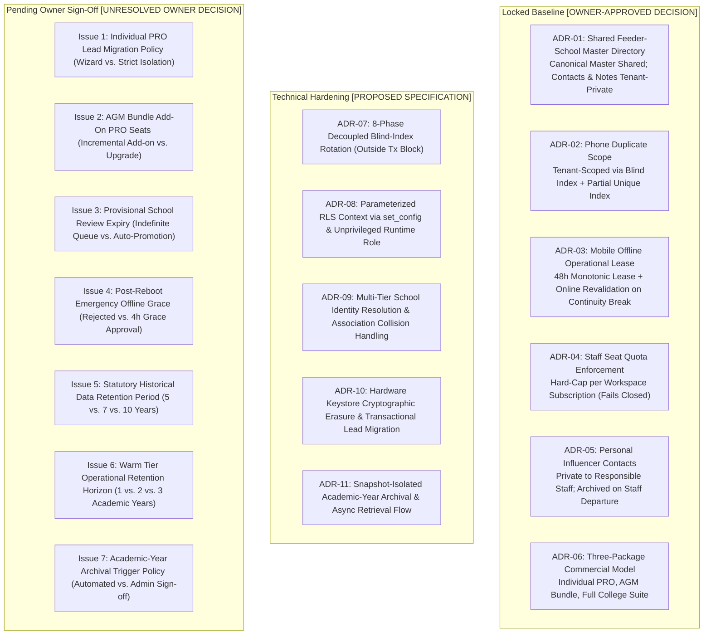

### 1.1 Formally Approved Decisions (Locked Baseline)

| Reference | Area | Formal Policy & Architectural Enforcement Mechanism | Governance Tier |
| :--- | :--- | :--- | :---: |
| **ADR-01** | Feeder Schools | **Shared Canonical Directory with Tenant-Private Overlays:** Government school registries (UDISE codes, canonical names, geographic mandals) are shared across all tenants. All headmaster contact numbers, private notes, institutional ratings, and staff allocations remain strictly tenant-private. | `[OWNER-APPROVED DECISION]` |
| **ADR-02** | Lead Uniqueness | **Per-Tenant Phone Uniqueness:** Student phone number uniqueness is enforced strictly within each college tenant via `(workspace_id, phone_blind_index)` (`CHAR(64)`). College B is fully permitted to prospect a student previously contacted by College A without cross-tenant conflict or data leakage. | `[OWNER-APPROVED DECISION]` |
| **ADR-03** | Mobile Operation | **48-Hour Monotonic Lease + Online Revalidation on Continuity Break:** Field PRO mobile clients are permitted an autonomous offline operational window of up to 48 hours during continuous device uptime. Any break in hardware timing continuity (such as counter reset indicating reboot) requires online network revalidation before local database access resumes. | `[OWNER-APPROVED DECISION]` |
| **ADR-04** | SaaS Quotas | **Hard Staff-Seat Quota Enforcement:** Subscription plans enforce hard caps on active staff memberships (`max_staff_seats`). API attempts to provision staff beyond the entitlement fail closed with HTTP 422 until upgraded. | `[OWNER-APPROVED DECISION]` |
| **ADR-05** | Contact Privacy | **Personal Relative/Influencer Ownership & Departure Archival:** Village relative and influencer referral contacts mapped by a PRO are private to that staff member. Upon employee departure or deactivation, contacts are archived and hidden, not transferred to competing staff. | `[OWNER-APPROVED DECISION]` |
| **ADR-06** | Product Packaging | **Three Commercial Packages:** The system supports three commercial tiers in a single codebase: Individual PRO, AGM Bundle, and Full College Suite. | `[OWNER-APPROVED DECISION]` |

### 1.2 Open Commercial and Policy Questions Requiring Owner Sign-Off

1. **Individual PRO Workspace Migration into College Suite:**  
   - *Status:* `[UNRESOLVED OWNER DECISION]`  
   - *Policy Choices:* (A) Provide an explicit, audited migration wizard with dual authorization; (B) Mandate complete isolation with zero record transfers.  
   - *Architectural Recommendation:* Option A. `[RECOMMENDATION]`
2. **AGM Bundle Add-On PRO Seats:**  
   - *Status:* `[UNRESOLVED OWNER DECISION]`  
   - *Policy Choices:* (A) Support incremental PRO seat add-ons (e.g., base package of 5 PROs expanded to 8); (B) Require upgrading to Full College Suite.  
   - *Architectural Recommendation:* Option A. `[RECOMMENDATION]`
3. **Provisional School Review Expiry:**  
   - *Status:* `[UNRESOLVED OWNER DECISION]`  
   - *Policy Choices:* (A) Keep unreviewed submissions in `PROVISIONAL` status indefinitely; (B) Auto-promote to `CANONICAL` after 30 days without review.  
   - *Architectural Recommendation:* Option A to prevent directory corruption. `[RECOMMENDATION]`
4. **Offline Reboot Emergency Grace Window:**  
   - *Status:* `[UNRESOLVED OWNER DECISION]`  
   - *Policy Choices:* (A) Strict policy: require online revalidation immediately on offline reboot; (B) Permit a strictly bounded 4-hour emergency operational grace window.  
   - *Security Analysis:* Option B allows an attacker with physical possession to reboot the device repeatedly to obtain perpetual 4-hour windows.  
   - *Architectural Recommendation:* Option A (Strict online revalidation). Option B is marked unapproved. `[RECOMMENDATION]`
5. **Historical Data Retention Horizon:**  
   - *Status:* `[UNRESOLVED OWNER DECISION]`  
   - *Policy Choices:* (A) 5-year regulatory compliance retention; (B) 7-year statutory financial/educational record retention; (C) 10-year institutional archive.  
   - *Architectural Recommendation:* Configure retention period per jurisdiction and institutional SLA. Do not hardcode a single timeline. `[RECOMMENDATION]`
6. **Warm Tier Operational Duration in PostgreSQL:**  
   - *Status:* `[UNRESOLVED OWNER DECISION]`  
   - *Policy Choices:* (A) 1 prior academic year retained in PostgreSQL read replica / partitioned schema; (B) 2 prior academic years retained; (C) Immediate cold-storage migration upon academic-year close.  
   - *Architectural Recommendation:* Option B (2 prior academic years) provides optimal balance between historical reporting and primary DB cost, but remains a commercial/infrastructure sizing decision. `[RECOMMENDATION]`
7. **Academic-Year Archival Trigger Policy:**  
   - *Status:* `[UNRESOLVED OWNER DECISION]`  
   - *Policy Choices:* (A) Fully automated cron-job trigger after a fixed elapsed window post-closure; (B) Mandatory two-key administrative signoff (College Admin formal close request + Platform Admin execution approval).  
   - *Architectural Recommendation:* Option B. Unilateral automated deletion poses severe operational risk if an intake cycle runs late. `[RECOMMENDATION]`

---

## 2. Commercial Packaging and Domain Entitlement Model

### 2.1 The Three Commercial Packages

The platform provides a single unified codebase supporting three commercial packages. Package limits and feature flags are evaluated dynamically; no hardcoded package-specific code paths exist.

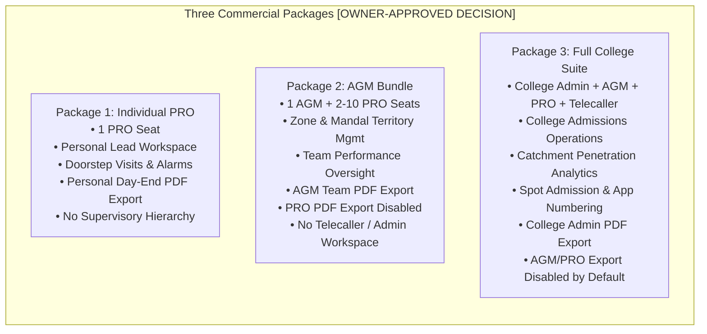

1. **Individual PRO Package:** Single-member workspace for independent field agents. Authorized for personal lead entry, doorstep visits, dynamic alarms, and **personal daily activity PDF exports**.
2. **AGM Bundle:** Multi-member regional workspace (1 AGM seat + configurable PRO seats). Authorized for team task management, territory allocation, and **AGM-level team/territory PDF reports**. PRO seats have **PDF export disabled by default**.
3. **Full College Suite:** Institutional enterprise workspace with complete administrative hierarchy (`COLLEGE_ADMIN`, `AGM`, `PRO`, `TELECALLER`), multi-branch partitioning, spot admissions with application numbering, catchment intelligence, and **College Admin-level authorized PDF exports**.

---

## 3. PDF Export Security and Forensic Watermarking Architecture

### 3.1 Threat Model for Document Exports

Exported operational summaries, PRO day reports, and catchment analyses represent high-value exfiltration targets. The PDF generation and delivery architecture enforces defense-in-depth:

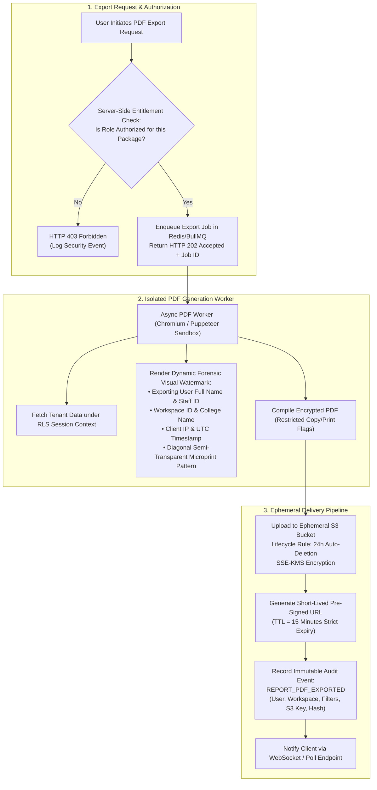

### 3.2 Key Export Security Invariants

1. **Role-Based Entitlement Gates:** In the AGM Bundle, PRO seats have export buttons disabled in the UI and blocked with HTTP 403 at the API gateway. In the Full College Suite, only `COLLEGE_ADMIN` (or explicitly delegated supervisory roles) may export bulk lead summaries.
2. **Dynamic Forensic Watermarking:** Every generated page embeds a multi-layered watermark containing:
   - Requesting user's full name, email, and internal staff ID.
   - College tenant name and UUID.
   - IP address of the client and exact UTC export timestamp.
   - Micro-print tracking pattern across the background making photographic leaks attributable.
3. **Short-Lived Signed URLs:** PDFs are never stored in public buckets. Downloads use AWS S3 / Cloud Storage pre-signed URLs with a 15-minute expiration window.
4. **Ephemeral S3 Lifecycle:** Export artifacts are stored in a dedicated temporary bucket configured with a 24-hour expiration lifecycle rule.

---

## 4. Feeder-School Master Directory & Identity Resolution

### 4.1 Schema Partitioning: Shared Directory vs. Tenant Private Overlays

Feeder school master data combines government-verified canonical reference data with college-private relationship metadata:

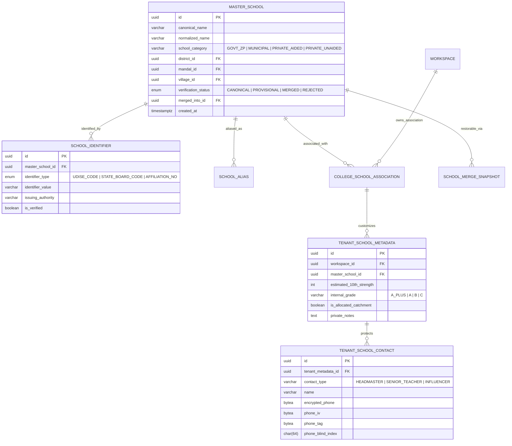

- **Canonical Shared Directory Fields (Global, No PII):**
  - `master_schools`: `canonical_name`, `normalized_name`, `school_category`, `district_id`, `mandal_id`, `village_id`, `verification_status`.
  - `school_identifiers`: `identifier_type` (UDISE, State Board Code), `identifier_value`, `issuing_authority`.
  - `school_aliases`: Alternate spellings and phonetic variations.
- **Tenant-Private Metadata & Contacts (Strictly Scoped by Workspace ID):**
  - `tenant_school_metadata`: `estimated_10th_strength`, `internal_grade`, `is_allocated_catchment`, `private_notes`.
  - `tenant_school_contacts`: Headmaster and key contact names, AES-256-GCM encrypted phone numbers, IVs, tags, and `CHAR(64)` blind indexes. **Strictly inaccessible to competing colleges.**

---

### 4.2 School Identity Resolution Workflow

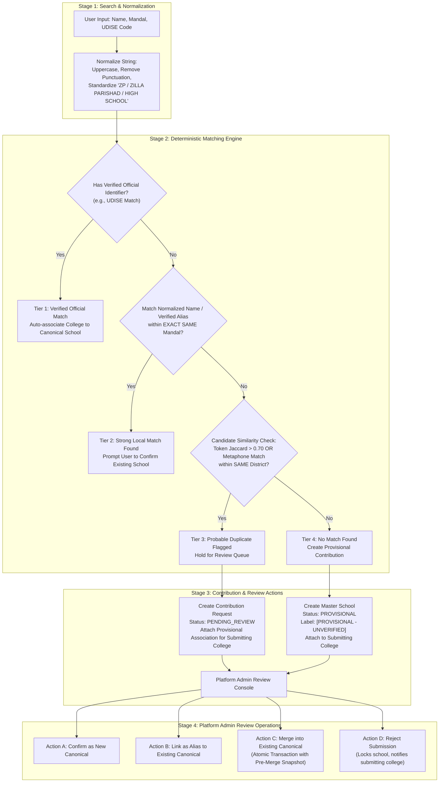

#### Deterministic Multi-Tier Matching Logic
1. **Tier 1 (Verified Official Match):** Matches verified government code (UDISE). Eliminates phonetic ambiguity subject to government accuracy.
2. **Tier 2 (Strong Local Match):** Matches canonical name or verified alias within the exact same mandal. Prompts user confirmation.
3. **Tier 3 (Probable Duplicate - Review Queue):** High token similarity ($>0.70$ Jaccard or Double Metaphone) within same district. **Never merged automatically.** Creates `school_contribution_requests` entry held for human review.
4. **Tier 4 (No Match - Provisional Creation):** Provisions new `master_schools` record with `verification_status = 'PROVISIONAL'`. Tagged with prominent visual badge: `[PROVISIONAL - UNVERIFIED]`. Usable immediately by submitting college; visible to other colleges with warning badge.

---

### 4.3 Transactional Merge Recovery & Association Collision Handling

```mermaid
sequenceDiagram
    autonumber
    actor Admin as Platform Superadmin
    participant API as School Admin API (/api/v1/admin/schools/merge)
    participant SnapTable as school_merge_snapshots Table
    participant MasterTable as master_schools Table
    participant AssocTable as college_school_associations Table
    participant MetaTable as tenant_school_metadata Table
    participant ContactTable as tenant_school_contacts Table
    participant Audit as Immutable Audit Log

    Admin->>API: POST /api/v1/admin/schools/merge { sourceId: B, targetId: A, justification: "Duplicate confirmed" }
    API->>API: Validate A != B; A.status == CANONICAL; B.status != MERGED
    
    rect rgb(240, 248, 255)
        Note over API,Audit: Atomic Database Transaction
        API->>SnapTable: INSERT INTO school_merge_snapshots (source_id, target_id, pre_merge_state_json)
        API->>MasterTable: UPDATE master_schools SET verification_status = 'MERGED', merged_into_id = A WHERE id = B
        API->>MasterTable: INSERT INTO school_aliases (master_school_id, alias_name, source) VALUES (A, B.canonical_name, 'MERGE_OP')
        
        Note over AssocTable,ContactTable: Handle Collisions Without Cross-Tenant Disclosure
        loop For each College C associated with School B
            alt College C is NOT associated with School A
                API->>AssocTable: UPDATE college_school_associations SET master_school_id = A WHERE workspace_id = C AND master_school_id = B
                API->>MetaTable: UPDATE tenant_school_metadata SET master_school_id = A WHERE workspace_id = C AND master_school_id = B
            else College C is ALREADY associated with School A (Collision)
                API->>AssocTable: UPDATE college_school_associations SET status = 'SUPERSEDED_BY_MERGE' WHERE workspace_id = C AND master_school_id = B
                API->>ContactTable: Re-point contacts belonging to B's metadata to point to A's metadata ID (Workspace C only)
                API->>MetaTable: Append B's notes into A's private_notes: E'\n[Merged Notes from School B]: ' || notes
                API->>MetaTable: UPDATE tenant_school_metadata SET status = 'ARCHIVED_DUE_TO_MERGE' WHERE workspace_id = C AND master_school_id = B
            end
        end

        API->>Audit: Log Audit Event (SCHOOL_MERGED, { sourceId: B, targetId: A, adminId: Admin.id })
    end

    API-->>Admin: 200 OK { status: 'MERGE_COMPLETED', snapshotId: 'uuid' }

    Note over Admin,Audit: Reversible Unmerge Procedure (Emergency Rollback)
    Admin->>API: POST /api/v1/admin/schools/unmerge { snapshotId: 'uuid', justification: 'Erroneous merge' }
    rect rgb(255, 240, 245)
        Note over API,Audit: Atomic Rollback Transaction
        API->>SnapTable: Read pre_merge_state_json
        API->>MasterTable: Restore B.status = 'PROVISIONAL', B.merged_into_id = NULL
        API->>MasterTable: DELETE alias created during merge
        API->>AssocTable: Revert association records and statuses to pre-merge IDs
        API->>MetaTable: Revert metadata records and un-nest contacts to pre-merge IDs
        API->>SnapTable: Mark snapshot status = 'ROLLED_BACK'
        API->>Audit: Log Audit Event (SCHOOL_UNMERGED, { snapshotId: 'uuid' })
    end
    API-->>Admin: 200 OK { status: 'UNMERGE_COMPLETED' }
```

- **Zero Cross-Tenant Leakage During Merges:** College 1's private notes and contacts for School B are merged strictly into College 1's records for School A. Private contacts from different colleges are never merged or disclosed across workspace boundaries.
- **Atomic Failure Recovery & Retry Idempotency:** The entire merge operation executes in a single database transaction. Failure rolls back completely. The request requires an `idempotency_key = UUIDv7`; retrying returns the snapshot result without re-executing.
- **Reversible Unmerge:** Durable pre-merge snapshots in `school_merge_snapshots` allow reversing accidental merges without data loss.

---

## 5. Security Architecture Corrections

### 5.1 Unified Session-Token Hashing: HMAC-SHA256 with Server Pepper

The architecture enforces a single, mathematically consistent session-token hashing and storage strategy across all modules, tests, and data models:

$$\text{token\_hash} = \text{HMAC-SHA256}(\text{key} = \text{server\_session\_pepper}, \text{message} = \text{raw\_session\_token})$$

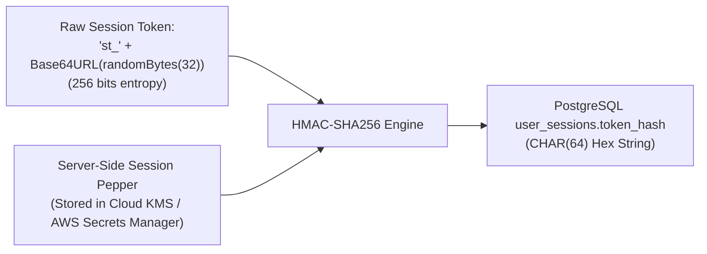

- **Key:** `server_session_pepper` (256-bit cryptographically random secret injected via cloud secret managers).
- **Message:** `raw_session_token` (prefixed `st_` + 32 bytes CSPRNG Base64URL).
- **Database Storage:** Stored as a 64-character lowercase hex string in `user_sessions.token_hash` (`CHAR(64) NOT NULL UNIQUE`). Plain unkeyed SHA-256 is eliminated.
- **Dual-Pepper Zero-Downtime Rotation:** Runtime evaluates `HMAC(current_pepper, raw_token)`. If not found, evaluates `HMAC(previous_pepper, raw_token)`. If matched under `previous_pepper`, the session row is re-hashed with `current_pepper` and updated on the fly.
- **Immediate Revocation:** Logout, user deactivation, and workspace suspension immediately execute `UPDATE user_sessions SET revoked_at = NOW()`.

---

### 5.2 Offline Monotonic Clock Rollback Detection Algorithm & Ed25519 Asymmetric Time Tokens

#### 5.2.1 Cryptographic Correction: Ed25519 Asymmetric Signatures

Revision 3.1.2 contained an internal cryptographic contradiction by defining a symmetric HMAC signature (`sig = HMAC(server_key, payload)`) while asserting that the client verifies it using a "Server Public Key". Symmetric HMAC keys cannot be distributed to untrusted mobile clients without compromising the minting secret.

Revision 3.1.3 resolves this contradiction by specifying **Ed25519 asymmetric digital signatures** for all server-issued time tokens. The server retains the private signing key in Cloud KMS / Hardware Security Module (`server_ed25519_sk`), while the mobile application embeds or pins the server's public verification key (`server_ed25519_pk`).

$$\text{TimeTokenPayload} = \text{CanonicalJSON}(\{\text{token\_id}, \text{server\_utc}, \text{expires\_at}, \text{workspace\_id}, \text{user\_id}\})$$
$$\text{sig} = \text{Ed25519Sign}(\text{key} = \text{server\_ed25519\_sk}, \text{message} = \text{TimeTokenPayload})$$

```mermaid
flowchart TD
    subgraph Server_Handshake ["1. Online Server-Time Handshake"]
        Connect["Client Authenticates Online"] --> IssueToken["Server Mints Ed25519-Signed TimeToken:\n{ token_id, server_utc, expires_at, workspace_id, user_id, sig }"]
        IssueToken --> ClientVerify["Client Verifies Signature with Pinned Server Public Key:\nEd25519Verify(server_ed25519_pk, payload, sig)"]
        ClientVerify --> CheckReplay{"token_id in seen_tokens Set OR\nexpires_at < Current Estimated Time?"}
        CheckReplay -- Yes --> RejectToken["Reject Token (Replay / Expired Attack)\nLock Session"]
        CheckReplay -- No --> StoreAnchors["Atomically Store in Hardware-Backed Storage:\n• T_server_anchor = server_utc\n• M_boot_anchor = Platform Monotonic Ticks\n• Record token_id in seen_token_ids"]
    end

    subgraph Offline_Evaluation ["2. Offline Verification Algorithm (While Running)"]
        Tick["PRO Performs Action Offline"] --> ReadStorage["Read Anchors from Secure Storage"]
        ReadStorage -- Storage Read Error --> FailClosedStorage["Fail Closed Immediately:\nZeroize RAM Keys, Lock Database"]
        ReadStorage -- Success --> ReadMono["Read Current Monotonic Ticks (M_current)"]
        ReadMono --> ReadSystem["Read System Wall-Clock (T_system)"]
        ReadSystem --> CheckReset{"M_current < M_boot_anchor?\n(Monotonic Counter Reset)"}
        CheckReset -- Yes --> LockReboot["Lock Database: Require Online Revalidation\n(Timing Continuity Lost / Reboot Detected)"]
        CheckReset -- No --> CalcEst["Calculate Estimated UTC:\nT_estimated = T_server_anchor + (M_current - M_boot_anchor)"]
        CalcEst --> CheckDrift{"|T_system - T_estimated| > 15 Minutes?\n(Wall-Clock Tampered)"}
        CheckDrift -- Yes --> LockRollback["Lock Database: Require Online Revalidation\n(Clock Rollback Detected)"]
        CheckDrift -- No --> CheckLease{"(M_current - M_boot_anchor) > 48 Hours OR\nT_estimated > expires_at (±60s skew)?"}
        CheckLease -- Yes --> LockExpire["Evict RAM Keys & Lock App:\n(48h Lease Expired)"]
        CheckLease -- No --> PermitAction["Permit Offline Action & Log Mutation"]
    end
```

#### 5.2.2 Reframing Reboot Detection: Monotonic Counter Reset vs. Continuity Proof

Prior drafts claimed that $M_{\text{current}} < M_{\text{boot\_anchor}}$ proved a reboot had occurred. Architecturally, monotonic timers (`android.os.SystemClock.elapsedRealtime()` on Android, `mach_continuous_time()` on iOS) count elapsed ticks since device boot. Comparing $M_{\text{current}} < M_{\text{boot\_anchor}}$ detects that the monotonic counter has reset or wrapped. 

While a counter reset is a sufficient indicator that system continuity has broken, it does not mathematically prove a reboot (a hardware clock wrap or low-level kernel counter reset produces the same symptom). Crucially, consumer operating systems provide no offline mechanism to prove how much physical time elapsed while the device was powered down or rebooted. 

Therefore, the architectural rule is reframed: **if hardware timing continuity cannot be proven, the application must assume compromise and require online network revalidation.**

#### 5.2.3 Token Security Specification & Fail-Closed Storage

1. **Replay Prevention:** The mobile client maintains an append-only set of consumed `token_id` values (UUIDv7) in SQLCipher encrypted storage (`seen_token_ids`). If an attacker intercepts or attempts to replay a previously valid time token, the client checks the token against `seen_token_ids` and rejects it.
2. **Clock Skew & Expiration Enforcement:** The client verifies that $\text{server\_utc} \le \text{expires\_at}$. When validating lease expiration offline, the client enforces $\text{expires\_at}$ against $T_{\text{estimated}}$ with a strict tolerance of $\pm 60$ seconds to accommodate minor oscillator drift.
3. **Fail-Closed on Secure Storage Failure:** If a call to read or update `flutter_secure_storage` or the native platform Keychain/Keystore throws an exception (e.g., daemon crash, storage corruption, key invalidation), the application **must fail closed immediately**. It zeroes out $K_{\text{db}}$ in memory (`memset 0x00`), invalidates SQLite connection handles, and transitions to a locked screen requiring online re-authentication.

---

### 5.3 Platform-Specific Reboot Detection (Android vs. iOS)

| Dimension | Android Implementation | iOS Implementation |
| :--- | :--- | :--- |
| **Monotonic Uptime API** | `android.os.SystemClock.elapsedRealtime()` (measures milliseconds since boot including deep sleep). | `clock_gettime(CLOCK_MONOTONIC_RAW, ...)` or `mach_continuous_time()` (nanoseconds since boot). |
| **Reset Detection Mechanism** | 1. Compare current `elapsedRealtime()` against `M_boot_anchor`. If current $<$ anchor, a counter reset occurred.<br>2. Listen for `android.intent.action.BOOT_COMPLETED` (requires `RECEIVE_BOOT_COMPLETED` permission). | 1. Compare current `mach_continuous_time()` against `M_boot_anchor`. If current $<$ anchor, a counter reset occurred.<br>2. Inspect `sysctl` with `KERN_BOOTTIME` (returns boot timeval struct). |
| **Limitation Concerning `/proc`** | `/proc/sys/kernel/random/boot_id` is restricted by modern SELinux on Android 11+ for untrusted app sandboxes. It must **not** be assumed accessible. | iOS has no `/proc` filesystem and does not expose a hardware boot UUID to third-party app sandboxes. |
| **Shared Offline Limitation** | If a device reboots while offline, monotonic counters reset to 0. It is impossible on consumer hardware to prove whether the device was powered off for 5 seconds or 5 months without network time. | Same limitation. Monotonic counter resets to 0. Wall-clock can be altered in settings. |
| **Safest Achievable Policy** | **Online Revalidation on Reboot (Default Baseline):** If counter reset indicates lost continuity, local database remains locked until network handshake succeeds. | Same policy. Local database locked until network handshake succeeds. |

---

### 5.4 Hardware Keystores, Cryptographic Erasure & Observable Evidence

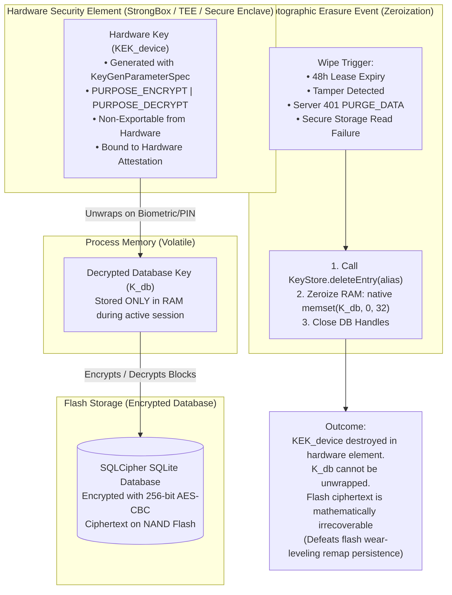

#### Exact Pre- and Post-Deletion Testing Sequence
1. **Pre-Deletion Baseline Test:**
   - App calls hardware API: unwrap $K_{\text{db}}$ using $KEK_{\text{device}}$.
   - Open SQLCipher with $K_{\text{db}}$. Query `SELECT count(*) FROM student_leads;` $\implies$ Assert query returns $>0$.
2. **Cryptographic Erasure Execution:**
   - Call native platform deletion: `keyStore.deleteEntry(alias)` on Android, `SecItemDelete` on iOS.
   - Call native memory zeroization on $K_{\text{db}}$ buffer (`memset 0x00`).
3. **Post-Deletion Keystore Verification:**
   - Attempt to access key entry: `keyStore.containsAlias(alias)` $\implies$ Assert returns `false`.
   - Attempt hardware unwrap $\implies$ Assert throws `KeyStoreException` / `errSecItemNotFound`.
4. **Post-Deletion Decryption Test:**
   - Attempt to open local database using standard app workflow $\implies$ Fails at unwrap step before touching SQLite.
5. **Key Protection Rule:** The raw 256-bit database key $K_{\text{db}}$ is **never exported, logged, or saved to flash storage** for testing.

---

### 5.5 PostgreSQL Concurrent Blind-Index Rotation: Decoupled 8-Phase Deployment

In PostgreSQL, `CREATE INDEX CONCURRENTLY` and `CREATE UNIQUE INDEX CONCURRENTLY` **cannot execute inside a transaction block** (`ERROR: 25001: CREATE INDEX CONCURRENTLY cannot run inside a transaction block`). Furthermore, attempting to combine application code deployment with DDL execution in a single step causes schema mismatch failures during rolling updates.

The rotation sequence is structured into **8 decoupled phases** separating rolling application releases from database migrations:

```mermaid
sequenceDiagram
    autonumber
    actor Admin as Platform Security Admin
    participant App as Application Service (ECS / K8s Rolling Pods)
    participant Worker as Re-Indexing Background Worker
    participant DB as PostgreSQL 16 Primary
    participant Audit as Immutable Audit Log

    Admin->>Worker: Trigger Blind-Index Rotation (workspace_id, new_salt_v2)
    Worker->>DB: Phase 1: Validate Pre-Conditions (v1 index valid, no duplicates)
    
    Note over App,DB: Phase 2: Deploy Dual-Write Application Version (v_dual)
    Admin->>App: Deploy App v_dual (Computes v1 + v2 on write; queries via v1)
    
    rect rgb(240, 248, 255)
        Note over Worker,DB: Phase 3: Add Column (Short DDL Tx, Nullable, No Index)
        Worker->>DB: ALTER TABLE student_leads ADD COLUMN phone_blind_index_v2 CHAR(64);
    end

    rect rgb(255, 255, 240)
        Note over Worker,DB: Phase 4: Online Chunked Backfill (Batches of 500 Rows)
        loop In Batches of 500 Leads
            Worker->>DB: BEGIN; SELECT id, encrypted_phone FROM student_leads WHERE phone_blind_index_v2 IS NULL LIMIT 500 FOR UPDATE SKIP LOCKED;
            Worker->>Worker: Decrypt phone via KMS DEK, compute HMAC(salt_v2, phone)
            Worker->>DB: UPDATE student_leads SET phone_blind_index_v2 = computed_v2 WHERE id = batch_ids; COMMIT;
        end
    end

    rect rgb(245, 245, 255)
        Note over Worker,DB: Phase 5: Concurrent Index Creation (OUTSIDE TX BLOCK)
        Worker->>DB: CREATE UNIQUE INDEX CONCURRENTLY idx_unique_active_workspace_phone_v2 ON student_leads (workspace_id, phone_blind_index_v2) WHERE deleted_at IS NULL;
        Worker->>DB: SELECT indisvalid FROM pg_index WHERE indexrelid = 'idx_unique_active_workspace_phone_v2'::regclass;
        Note over Worker,DB: Assert indisvalid == true. If false: DROP INDEX CONCURRENTLY and abort.
    end

    Note over App,DB: Phase 6: Deploy Read-V2 Application Version (v_read_v2)
    Admin->>App: Deploy App v_read_v2 (Writes v1 + v2; queries & uniqueness checks via v2)

    rect rgb(230, 255, 230)
        Note over Worker,DB: Phase 7: Deprecate Old Column & Index (OUTSIDE TX BLOCK)
        Worker->>DB: DROP INDEX CONCURRENTLY idx_unique_active_workspace_phone;
        Admin->>App: Deploy App v_final (Writes only v2; queries only v2)
    end

    rect rgb(255, 240, 245)
        Note over Worker,DB: Phase 8: Final DDL Cleanup (Short DDL Tx)
        Worker->>DB: ALTER TABLE student_leads DROP COLUMN phone_blind_index;
        Worker->>DB: ALTER TABLE student_leads RENAME COLUMN phone_blind_index_v2 TO phone_blind_index;
        Worker->>DB: ALTER INDEX idx_unique_active_workspace_phone_v2 RENAME TO idx_unique_active_workspace_phone;
        Worker->>Audit: Log Audit Event (PHONE_BLIND_INDEX_ROTATED, { workspaceId, totalRotated })
    end
```

#### Detailed Phase Descriptions & Safety Guarantees

1. **Phase 1: Pre-Migration Validation:** Verify database health, ensure `pg_stat_activity` has no long-running blocking transactions, confirm target KMS salt is securely provisioned, and verify zero active duplicates under `v1`.
2. **Phase 2: Deploy Dual-Write Application ($v_{\text{dual}}$):** Application code is deployed across the fleet. It computes both `v1 = HMAC(salt_v1, phone)` and `v2 = HMAC(salt_v2, phone)` on all `INSERT` and `UPDATE` operations. Reads and conflict resolution continue targeting `v1`.
3. **Phase 3: Add Nullable Column:** Execute short DDL transaction: `ALTER TABLE student_leads ADD COLUMN phone_blind_index_v2 CHAR(64);`. This requires an `ACCESS EXCLUSIVE` lock held only for milliseconds since the column is unindexed and nullable.
4. **Phase 4: Online Chunked Backfill:** Background worker backfills historical rows in bounded transactions of 500 rows (`SELECT ... FOR UPDATE SKIP LOCKED`). Because application $v_{\text{dual}}$ writes both columns for any new or modified rows, concurrent writes do not cause race conditions. Uniqueness is actively protected by the existing `v1` index.
5. **Phase 5: Concurrent Index Creation (Outside Transaction Block):** Execute `CREATE UNIQUE INDEX CONCURRENTLY idx_unique_active_workspace_phone_v2 ON student_leads (workspace_id, phone_blind_index_v2) WHERE deleted_at IS NULL;` in autocommit mode. Once completed, query `pg_index.indisvalid`. If `indisvalid` is false (due to a transient deadlock or duplicate), execute `DROP INDEX CONCURRENTLY` and alert security admins; the active `v1` index is entirely untouched.
6. **Phase 6: Deploy Read-V2 Application ($v_{\text{read\_v2}}$):** Deploy application version that redirects all lookups, searches, and uniqueness conflict handling to `phone_blind_index_v2`. Writes continue writing both `v1` and `v2`.
7. **Phase 7: Deprecate Old Column & Drop Old Index:** Drop the old unique index concurrently outside a transaction block: `DROP INDEX CONCURRENTLY idx_unique_active_workspace_phone;`. Deploy application $v_{\text{final}}$ which stops computing or writing `v1`.
8. **Phase 8: Final DDL Cleanup:** Execute atomic schema cleanup: drop old column `phone_blind_index`, rename `phone_blind_index_v2` to `phone_blind_index`, and rename `idx_unique_active_workspace_phone_v2` to `idx_unique_active_workspace_phone`. Write immutable audit log entry.

---

### 5.6 Parameter-Safe PostgreSQL RLS & Root-Cause Failure Protocol

```sql
-- Parameter-safe transaction-local tenant context
SELECT set_config('app.current_tenant_id', $1, true);

-- Partial Unique Index on active leads (CHAR(64))
CREATE UNIQUE INDEX idx_unique_active_workspace_phone 
ON student_leads (workspace_id, phone_blind_index) 
WHERE deleted_at IS NULL;
```

#### Behavioral Distinction: 0-Row SELECT vs. Rejected Writes
- **`SELECT`:** Missing context or mismatched context evaluates `USING` to false $\implies$ returns **0 rows** (empty result set, failing closed without leaking existence).
- **`INSERT`:** Missing context or mismatched context evaluates `WITH CHECK` to false $\implies$ raises PostgreSQL error `42501` (`insufficient_privilege`).
- **`UPDATE` / `DELETE`:** Rows of other tenants are invisible under `USING` (0 rows affected). Attempts to mutate `workspace_id` trigger error `42501`.

#### RLS PoC Failure Protocol (No Bare-Application Fallback)
If the Drizzle ORM + RLS PoC fails under PgBouncer transaction pooling (due to context leakage, pooler bugs, or latency overhead $>2.0\text{ms}$):
1. **Root-Cause Analysis (RCA):** The team must stop and produce a formal RCA document detailing why transaction-scoped context bled or failed.
2. **Demonstrated Alternative Boundary Required:** Falling back to application-layer repository filtering alone is **strictly rejected**. Before proceeding to implementation, an alternative structural database isolation boundary must be demonstrated:
   - *Alternative A: Schema-per-Tenant Separation* (`search_path` routing with separate PostgreSQL schemas per tenant).
   - *Alternative B: Dedicated Connection Pools per Tenant* (PgBouncer routing connections to dedicated tenant databases).

---

### 5.7 Cross-Workspace Lead Migration: Transactional Audit Consistency

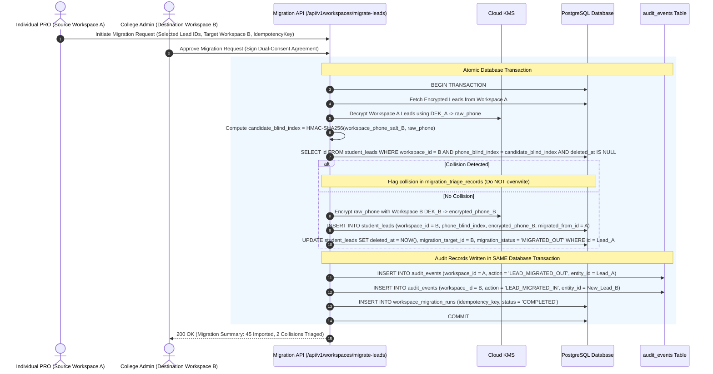

- **Transactional Audit Invariant:** The audit records are written **transactionally within the exact same database transaction** as the lead insertion in Workspace B and soft-deletion in Workspace A.
- **Idempotency & Partial Failure Recovery:**
  - If a transaction aborts or the network drops before commit, the entire migration rolls back: source lead is not soft-deleted, destination lead is not inserted, and no audit event is created.
  - Client retries with the same `idempotency_key`. The server checks `workspace_migration_runs`: if `COMPLETED`, returns the stored migration receipt without re-executing.
  - Migration state and audit evidence cannot silently diverge.

---

## 6. Updated Conceptual Data Model

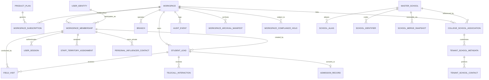

### Core Schema Entity Specifications (Highlighting Standardized Blind Indexes)

- **`STUDENT_LEAD`:**
  - `id`: `UUID PK`
  - `workspace_id`: `UUID FK NOT NULL`
  - `academic_year_id`: `UUID FK NOT NULL`
  - `student_name`: `VARCHAR(150) NOT NULL`
  - `encrypted_phone`: `BYTEA NOT NULL` (AES-256-GCM ciphertext)
  - `phone_iv`: `BYTEA NOT NULL` (12 bytes)
  - `phone_tag`: `BYTEA NOT NULL` (16 bytes)
  - `phone_blind_index`: `CHAR(64) NOT NULL` (HMAC-SHA256 lowercase hex string; standardized across all schemas)
  - `status`: `VARCHAR(50) NOT NULL` (`NEW_PROSPECT | CONTACTED | VISITED | APPLIED | ADMITTED | LOST`)
  - `assigned_staff_id`: `UUID FK`
  - `created_at`: `TIMESTAMPTZ NOT NULL DEFAULT NOW()`
  - `deleted_at`: `TIMESTAMPTZ` (Soft delete for operational tombstoning)
- **`WORKSPACE_ARCHIVAL_MANIFEST`:**
  - `id`: `UUID PK`
  - `workspace_id`: `UUID FK NOT NULL`
  - `academic_year_id`: `UUID FK NOT NULL`
  - `s3_prefix`: `VARCHAR(500) NOT NULL`
  - `record_count`: `INTEGER NOT NULL`
  - `payload_sha256`: `CHAR(64) NOT NULL` (Aggregate cryptographic checksum of all exported chunks)
  - `chunk_manifest_json`: `JSONB NOT NULL` (List of chunk files, per-chunk row counts, and individual chunk SHA-256 hashes)
  - `status`: `VARCHAR(50) NOT NULL` (`EXPORTED | VERIFIED | RESTORING | PURGED`)
  - `created_at`: `TIMESTAMPTZ NOT NULL DEFAULT NOW()`
  - `verified_at`: `TIMESTAMPTZ`
- **`WORKSPACE_COMPLIANCE_HOLD`:**
  - `id`: `UUID PK`
  - `workspace_id`: `UUID FK NOT NULL`
  - `academic_year_id`: `UUID FK` (Nullable: if NULL, hold applies to entire workspace)
  - `hold_reason`: `VARCHAR(255) NOT NULL` (`LITIGATION_PENDING | STATUTORY_AUDIT | REGULATORY_INVESTIGATION`)
  - `authorized_by`: `UUID FK NOT NULL`
  - `is_active`: `BOOLEAN NOT NULL DEFAULT TRUE`
  - `placed_at`: `TIMESTAMPTZ NOT NULL DEFAULT NOW()`
  - `released_at`: `TIMESTAMPTZ`

---

## 7. Database Indexing and Query Performance Strategy

> [!NOTE]
> This section is a `[PROPOSED SPECIFICATION]`. Index definitions are design artefacts only. No DDL has been executed.

### 7.1 Index Philosophy and Classification

Every index in the system belongs to one of three functional classes:

| Class | Purpose | Examples |
| :--- | :--- | :--- |
| **Uniqueness** | Enforce data-integrity constraints at the database layer | Tenant-scoped phone blind index (`CHAR(64)`); active workspace membership |
| **Lookup / Keyset Selectivity** | Accelerate filtered multi-tenant queries with deterministic pagination | Composite `(workspace_id, status, assigned_staff_id, created_at DESC, id DESC)` on leads |
| **Sort / Range** | Accelerate time-series ordering, daily activity rollup, and date filtering | `(workspace_id, staff_id, visited_at DESC, id DESC)` on `field_visits` |

#### Architectural Invariants for Index Design
1. **Leading Tenant Column:** Every tenant-scoped index places `workspace_id` as the leading column, ensuring optimal scan boundaries under PostgreSQL Row-Level Security.
2. **Deterministic Keyset Pagination Ordering:** B-Tree lookup indexes that serve paginated UI lists must append `(..., created_at DESC, id DESC)` or `(..., timestamp DESC, id DESC)`. This guarantees stable, deterministic keyset (cursor-based) pagination (`WHERE (created_at, id) < ($cursor_time, $cursor_id) ORDER BY created_at DESC, id DESC LIMIT 50`) without the catastrophic performance degradation of offset pagination.
3. **Type Consistency:** All phone blind index columns are strictly defined as `CHAR(64)` across all tables (`student_leads.phone_blind_index`, `tenant_school_contacts.phone_blind_index`), matching the output length of HMAC-SHA256 hex encoding.
4. **Partial Indexing for Active Data:** Partial indexes (`WHERE deleted_at IS NULL`) exclude soft-deleted operational rows and completed historical records from hot query paths.

---

### 7.2 Critical Index Catalogue

```sql
-- =========================================================================
-- 1. UNIQUENESS CONSTRAINTS & BLIND INDEXES
-- =========================================================================

-- Tenant-scoped phone blind index (CHAR(64), partial; active leads only)
CREATE UNIQUE INDEX idx_unique_active_workspace_phone
  ON student_leads (workspace_id, phone_blind_index)
  WHERE deleted_at IS NULL;

-- One active membership per user per workspace
CREATE UNIQUE INDEX idx_unique_active_membership
  ON workspace_memberships (workspace_id, user_identity_id)
  WHERE is_active = TRUE;

-- One live session token per hash (CHAR(64) constant-time lookup)
CREATE UNIQUE INDEX idx_unique_session_token_hash
  ON user_sessions (token_hash);

-- Active compliance hold uniqueness per workspace and academic year
CREATE UNIQUE INDEX idx_unique_active_compliance_hold
  ON workspace_compliance_holds (workspace_id, academic_year_id)
  WHERE is_active = TRUE;

-- =========================================================================
-- 2. LOOKUP INDEXES WITH DETERMINISTIC KEYSET PAGINATION
-- =========================================================================

-- Lead list filtered by workspace + status + assigned staff (Keyset ordered)
CREATE INDEX idx_leads_ws_status_staff_created
  ON student_leads (workspace_id, status, assigned_staff_id, created_at DESC, id DESC)
  WHERE deleted_at IS NULL;

-- Default lead list by workspace with keyset cursor pagination
CREATE INDEX idx_leads_ws_created_id
  ON student_leads (workspace_id, created_at DESC, id DESC)
  WHERE deleted_at IS NULL;

-- Field visits by lead (most common parent/student interaction drill-down)
CREATE INDEX idx_visits_lead_visited_id
  ON field_visits (lead_id, visited_at DESC, id DESC);

-- Telecall interactions by lead
CREATE INDEX idx_telecall_lead_called_id
  ON telecall_interactions (lead_id, called_at DESC, id DESC);

-- Staff territory assignments by workspace + mandal
CREATE INDEX idx_territory_ws_mandal
  ON staff_territory_assignments (workspace_id, mandal_id);

-- School contacts by blind index (per-tenant lookup, CHAR(64))
CREATE INDEX idx_school_contact_blind
  ON tenant_school_contacts (phone_blind_index);

-- =========================================================================
-- 3. SORT, RANGE & AUDIT TRAIL INDEXES
-- =========================================================================

-- Day-report queries (PRO daily activity rollup ordered with tie-breaker)
CREATE INDEX idx_visits_ws_staff_date_id
  ON field_visits (workspace_id, staff_id, visited_at DESC, id DESC)
  WHERE deleted_at IS NULL;

-- Telecalls by workspace and staff with keyset cursor
CREATE INDEX idx_telecall_ws_called_id
  ON telecall_interactions (workspace_id, called_at DESC, id DESC);

-- Audit events by workspace + entity (deterministic historical audit trail)
CREATE INDEX idx_audit_ws_entity_occurred_id
  ON audit_events (workspace_id, entity_type, entity_id, occurred_at DESC, id DESC);

-- Global workspace audit events for administrative stream
CREATE INDEX idx_audit_ws_occurred_id
  ON audit_events (workspace_id, occurred_at DESC, id DESC);

-- Admission records by academic year + workspace
CREATE INDEX idx_admission_ws_year_admitted
  ON admission_records (workspace_id, academic_year_id, admitted_at DESC, id DESC);

-- Subscription expiry lookups (background billing/renewal workers)
CREATE INDEX idx_subscription_expiry
  ON workspace_subscriptions (current_period_end)
  WHERE status = 'ACTIVE';
```

---

### 7.3 Query Performance Targets & Seeded Benchmark Protocol

| Query Pattern | p95 Latency Target | Measurement Protocol |
| :--- | :---: | :--- |
| Lead list for a PRO (keyset paginated, 50 rows, `workspace_id + status`) | ≤ 10 ms | `EXPLAIN (ANALYZE, BUFFERS)` on seeded multi-tenant dataset |
| Session token lookup by hash (`CHAR(64)` exact match) | ≤ 2 ms | Dedicated Vitest driver benchmark via direct pg client |
| AGM team daily visit count (by mandal and date range) | ≤ 25 ms | `EXPLAIN (ANALYZE, BUFFERS)` |
| Feeder school search within mandal (normalized name) | ≤ 15 ms | `EXPLAIN (ANALYZE, BUFFERS)` |
| Admission count by academic year (College Admin dashboard) | ≤ 30 ms | `EXPLAIN (ANALYZE, BUFFERS)` |
| Audit trail for a single lead (all events, keyset ordered) | ≤ 20 ms | `EXPLAIN (ANALYZE, BUFFERS)` |

#### Benchmark Scale Qualification: Minimal Synthetic Baseline vs. Full Production Simulation

The benchmark dataset specified below constitutes a **minimal synthetic baseline** intended strictly to verify index selectivity, index-only scan choices, and query planning behaviors in Phase 0:
- 10 tenant workspaces × 5,000 student leads each (50,000 total leads).
- 200,000 field visit records.
- 500,000 audit event records.

**Production Scale Benchmark Requirements:** A 50,000-lead synthetic dataset does **not** demonstrate production scale for a multi-tenant SaaS serving enterprise college networks. Prior to production launch, full-scale load testing must simulate:
1. **Concurrent Mixed Workloads:** 250 concurrent PRO mobile sync operations writing field visits while 25 College Admins query analytical dashboards.
2. **Tenant Data Skew:** A power-law distribution where Tier-1 enterprise colleges hold 100,000+ leads and millions of audit rows alongside small single-PRO workspaces.
3. **RLS & Pooler Overhead:** 10,000 rapid transactions through PgBouncer measuring context switching overhead with `set_config`.
4. **Archival I/O Contention:** Sustained live read/write performance while a background archival worker streams chunks under `REPEATABLE READ` snapshot isolation.

---

### 7.4 Query Execution Plan Governance

- **Execution Plan Capture:** `EXPLAIN (ANALYZE, BUFFERS)` output must be captured and committed to the performance test suite for every query introduced.
- **Refined Sequential Scan Governance:** A sequential scan (`Seq Scan`) on a table exceeding 10,000 rows is **not** automatically classified as an architectural defect if:
  1. The query executes a full-cohort archival export under snapshot isolation where streaming all rows sequentially is significantly more I/O-efficient than traversing B-Tree leaves.
  2. The query performs a legitimate whole-cohort statistical aggregation where optimizer selectivity estimates exceed 20% of the physical table pages.
  For all other OLTP application queries, a sequential scan on $>10,000$ rows is treated as an index defect requiring resolution or formal architectural review.
- **Index Scan Verification:** Index usage is continuously verified in staging via `pg_stat_user_indexes.idx_scan`. Any index demonstrating zero scans across a full test cycle is evaluated for removal to eliminate write-amplification overhead.

---

## 8. Academic-Year Data Lifecycle, Cold Storage, and Cost Optimization

> [!NOTE]
> This section is a `[PROPOSED SPECIFICATION]`. No archival workers, schema partitioning, or cloud object lifecycles have been implemented.

### 8.1 Academic-Year Lifecycle Concept & Owner Preference Alignment

College admissions operations follow discrete annual cycles. In accordance with product-owner preferences:
1. **Live Operational Data:** Current academic-year leads, field visits, telecaller queues, alarms, and daily reports remain fully live in the primary PostgreSQL database for high-concurrency, sub-10ms transactional operations.
2. **Permanent Core Data in PostgreSQL:** Approved operational statistics, institutional aggregates, **all admitted-student records (`admission_records`)**, and **all audit logs (`audit_events`)** remain permanently stored in PostgreSQL for immediate institutional reporting and regulatory traceability.
3. **Eligible Historical Data Archival:** Older operational interaction data (unconverted prospect leads, historical field visit details, telecalling voice logs, and transient task notes) is migrated to encrypted, compressed object storage once the intake cycle closes.
4. **Policy Decision Boundaries:** Rather than imposing arbitrary engineering defaults, parameters such as the post-closure waiting window, warm-tier retention horizon, and compliance retention periods are formally categorized as `[UNRESOLVED OWNER DECISION]` items (Section 1.2, Items 5–7).

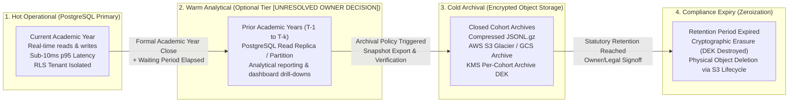

---

### 8.2 Archival Eligibility Criteria & Compliance Holds

A cohort qualifies for archival and subsequent live cleanup only when **all five** of the following prerequisites evaluate to true:

| Condition | Verification Check |
| :--- | :--- |
| **1. Academic Year Closed** | `academic_years.status = 'CLOSED'` with formal administrative close timestamp. |
| **2. Configured Elapsed Window** | The configured post-closure waiting interval ($T_{\text{archive\_wait}}$, e.g. 6 to 12 months, per owner policy) has elapsed since `closed_at`. |
| **3. No Active Compliance Hold** | The workspace and cohort are clear of legal or regulatory holds: `SELECT count(*) FROM workspace_compliance_holds WHERE workspace_id = $1 AND (academic_year_id = $2 OR academic_year_id IS NULL) AND is_active = TRUE;` returns exactly 0. |
| **4. No Pending Migrations** | `workspace_migration_runs` shows zero `PENDING` or `IN_PROGRESS` records referencing the cohort. |
| **5. Unconverted Leads Only** | Admitted student records (`status = 'ADMITTED'` with an associated `admission_records` row) are marked for permanent PostgreSQL retention and excluded from live deletion. |

---

### 8.3 Snapshot-Consistent Export, Verification Protocol & Safe Deletion

Archival is structured into three discrete phases: **Snapshot-Isolated Export**, **Independent Multi-Factor Verification**, and **Explicitly Authorized Live Cleanup**:

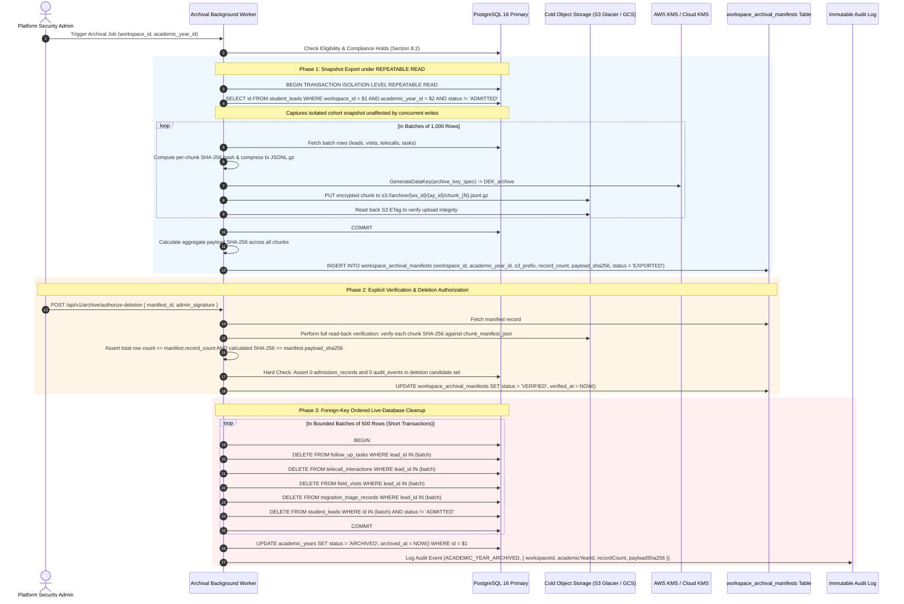

#### Detailed Verification & Deletion Protocol Rules

1. **Snapshot Isolation During Export:** Streaming rows under standard read committed isolation allows concurrent inserts or updates to cause dirty reads, missing child records, or orphaned rows. Phase 1 exports under `BEGIN TRANSACTION ISOLATION LEVEL REPEATABLE READ;`, capturing a consistent point-in-time snapshot across all related tables.
2. **Independent Dual Verification (Count AND Hash):** Record count equality alone does not prove data integrity (e.g., bit flips, truncated JSON lines, or silent network dropouts). The worker verifies:
   - **Per-chunk SHA-256:** Calculated during export and verified against S3 read-back.
   - **Aggregate Payload SHA-256:** Formed by hashing the concatenated chunk digests:
     $$\text{payload\_sha256} = \text{SHA-256}(\text{hash}_{\text{chunk\_1}} \parallel \text{hash}_{\text{chunk\_2}} \parallel \dots \parallel \text{hash}_{\text{chunk\_n}})$$
   - **Row Count:** Verified independently against the snapshot total.
3. **Explicit Deletion Authorization Protocol:** **Export completion alone NEVER triggers live database cleanup.** Live deletion requires an explicit API call to `/api/v1/archive/authorize-deletion` signed by both the College Admin and Platform Security Admin. If the verification check fails on a single byte or count discrepancy, cleanup is aborted and the cohort remains fully live.
4. **Foreign-Key Dependency Inventory & Deletion Order:** Deletes must proceed in strict dependency order to prevent foreign-key constraint violations and table lock escalation:
   1. `follow_up_tasks` (FK `lead_id`)
   2. `telecall_interactions` (FK `lead_id`)
   3. `field_visits` (FK `lead_id`)
   4. `migration_triage_records` (FK `lead_id`)
   5. `lead_attachments` (Object files deleted from S3 hot bucket via bulk API, then metadata rows deleted)
   6. `student_leads` (Cohort root leads deleted where `status != 'ADMITTED'`)
5. **Absolute Exemption from Deletion:**
   - **`admission_records` (Spot admissions, assigned application numbers, enrolled fee receipts) are NEVER deleted.**
   - **`audit_events` (Immutable operational logs) are NEVER deleted.**
   Attempts to include these tables in cleanup batches trigger immediate database transaction abort.

---

### 8.4 Asynchronous Historical Data Retrieval Workflow

Cold storage services (AWS S3 Glacier, GCS Archive) are inherently asynchronous. Restoring an archived cohort requires minutes to hours depending on retrieval tier (Expedited vs. Standard). Historical data retrieval is specified as an **asynchronous, audited, access-controlled restore workflow**, not a synchronous request-response query:

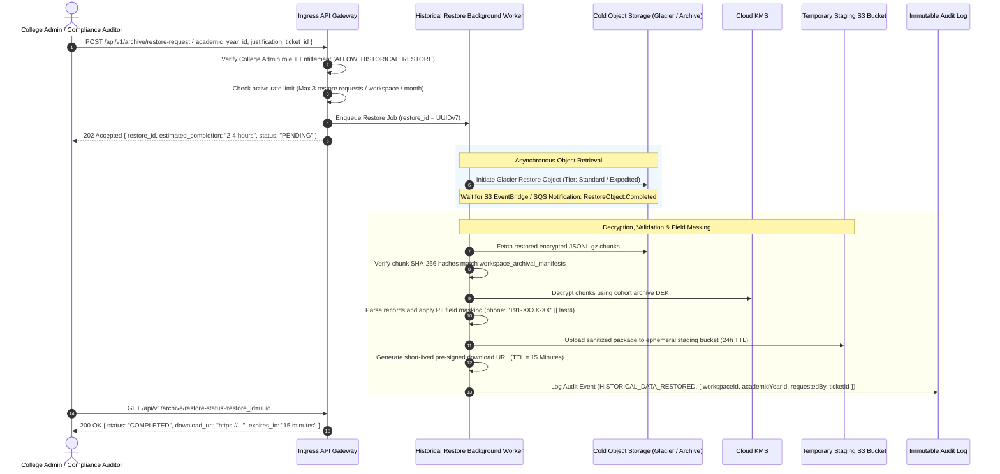

- **Default PII Masking:** All historical lead records exported via the retrieval API have student and guardian phone numbers masked (`+91-XXXX-XX5678`) by default. Unmasked access requires a dedicated platform superadmin override entitlement (`HISTORICAL_PII_UNMASK_PRIVILEGE`) and mandatory legal justification.
- **Strict Rate Limiting & Audit Mandate:** Historical restorations are strictly capped (default: max 3 requests per tenant per month) to prevent bulk unauthorized database scraping. Every restore operation is permanently logged in `audit_events`.

---

### 8.5 Storage Cost Optimization Model

| Tier | Storage Technology | Latency Profile | Target Data Cohort | Policy / Retention Horizon |
| :--- | :--- | :--- | :--- | :--- |
| **Hot** | PostgreSQL 16 (Primary + Replica) | Sub-10ms (SSD IOPS) | Active academic-year operational leads, visits, telecalls, admitted students, and system logs. | Current academic intake cycle. |
| **Warm** | PostgreSQL Read Replica / Partitioned Schema | 10–50ms | Admitted student records, year-end admissions summaries, and essential analytical cohorts. | `[UNRESOLVED OWNER DECISION]` (1 to 2 prior academic years). |
| **Cold** | AWS S3 Glacier Flexible / GCS Archive | Minutes to Hours | Full detailed interaction records of closed intake cycles (compressed JSONL.gz with KMS DEK). | `[UNRESOLVED OWNER DECISION]` (5, 7, or 10 years per jurisdictional requirements). |
| **Purge** | Cryptographic Erasure + S3 Expiration | N/A | Cohorts exceeding legal retention horizon. | Permanent destruction of KMS DEK and physical file deletion. |

---

### 8.6 Legal & Regulatory Compliance Holds

To prevent accidental destruction or automated archival of records subject to litigation, audit, or government investigation:
1. **Administrative Hold API:** Authorized platform operators can place a compliance hold via `POST /api/v1/admin/compliance-holds`.
2. **Archival & Deletion Freeze:** Any active record in `workspace_compliance_holds` for a tenant workspace or specific academic year **strictly freezes all archival exports and live-database cleanup workers**.
3. **Audit Immutability:** Placements and releases of compliance holds are written to `audit_events` and cannot be modified or deleted.

---

### 8.7 Cryptographic Erasure at Retention Expiry

When the configured statutory retention period elapses for a cold archive cohort:
1. **KMS Key Zeroization:** The dedicated KMS Data Encryption Key (`archive_DEK_{workspace_id}_{ay_id}`) is scheduled for deletion and revoked. Once revoked, the ciphertext objects in object storage become permanently mathematically unrecoverable.
2. **Physical Object Lifecycle:** S3 bucket lifecycle rules trigger physical object deletion 30 days following key zeroization.
3. **Audit Proof:** An immutable audit event `COLD_ARCHIVE_DEK_DESTROYED` is recorded with the KMS key ARN and manifest digest as legal proof of data destruction.

---

## 9. Security Findings Register (SEC-01 to SEC-08)

| Finding ID | Vulnerability Description | Severity | Target Architecture Mitigation | Automated Verification Test |
| :--- | :--- | :---: | :--- | :--- |
| **SEC-01** | Client-Side JWT Minting in Flutter (`api_service.dart`) | **CRITICAL** | Complete removal of client token signing. Server issues opaque 256-bit bearer tokens verified against HMAC-SHA256 database hashes. | `TEST-VERIF-01`: Client submits forged token; server returns HTTP 401. All tokens minted by server exclusively. |
| **SEC-02** | Default Insecure Student Password Takeover (`123456`) | **CRITICAL** | Student login and self-registration entirely deferred from Phase 1. | `TEST-VERIF-02`: Public student registration endpoints eliminated from API routing table. |
| **SEC-03** | Public Feeder School PII Leakage (`GET /api/config`) | **HIGH** | `master_schools` read-only master; headmaster personal phones moved to encrypted `tenant_school_contacts` requiring authenticated tenant session. | `TEST-VERIF-03`: Unauthenticated `GET /api/v1/schools` returns HTTP 401. Authenticated staff see only tenant-authorized contacts. |
| **SEC-04** | Cross-Tenant Lead Leaks via Unassigned Telecallers | **HIGH** | Telecaller queries enforce mandatory tenant scoping and assignment checks. Empty assignment returns `[]` (fail-closed), never global leads. | `TEST-VERIF-04`: Telecaller with empty assignment queries `/api/v1/leads`; returns empty array, 0 rows leaked. |
| **SEC-05** | Tokens Passed in URL Query Strings (`?token=...`) | **MEDIUM** | Ingress API gateway strictly rejects tokens in query strings. Tokens accepted exclusively via `__Host-` cookies or `Authorization: Bearer` headers. | `TEST-VERIF-05`: Request with `?token=...` returns HTTP 400 Bad Request. |
| **SEC-06** | Hardcoded Automated Backup Fallback Secret | **MEDIUM** | Secret hardcoding eliminated. Process fails startup if `CRON_SECRET` is unset via Zod environment validation. | `TEST-VERIF-06`: Missing `CRON_SECRET` in environment causes application startup crash with explicit error. |
| **SEC-07** | Stolen Offline Field Phone Data Extraction | **HIGH** | 48-hour monotonic lease; online revalidation on continuity break; SQLCipher 256-bit AES encryption; cryptographic erasure zeroizing TPM keys on tamper/expiry. | `TEST-VERIF-07`: Simulate monotonic advance $>48$h or reboot; verify $K_{\text{db}}$ evicted and local database unreadable. |
| **SEC-08** | Unauthorized Bulk PDF Data Exfiltration | **MEDIUM** | Role-based export authorization; server-side entitlement checks; forensic visual watermarking; 15-minute expiring S3 pre-signed URLs. | `TEST-VERIF-08`: PRO in Full College Suite calls export endpoint; returns HTTP 403. Admin export generates watermarked artifact. |

---

## 10. Proof-of-Concept (PoC) Plans with Observable Evidence Artifacts

> [!CAUTION]
> **PoC Status Clarification:** Zero PoCs have been executed. No test has passed. The architecture is ready for PoC execution only after test prerequisites and physical test hardware are available.

### 10.1 PoC 1: Drizzle ORM + PostgreSQL RLS under Transaction Pooling & Index Performance

- **Objective:** Prove parameter-safe `set_config('app.current_tenant_id', $1, true)` under PgBouncer transaction pooling using unprivileged role `app_runtime_user`, and validate keyset pagination index plans.
- **Prerequisites:** PostgreSQL 16 container, PgBouncer (`pool_mode = transaction`), Drizzle ORM wrapper.
- **Restricted Database Role:** `app_runtime_user` (`NOINHERIT`, `NOSUPERUSER`, `NOCREATEDB`, `NOCREATEROLE`, `NOBYPASSRLS`).
- **Test Cases, Observable Results & Evidence Artifacts:**

| Test ID | Operation & Condition | Expected Observable Result | Required Evidence Artifact |
| :--- | :--- | :--- | :--- |
| **P1-T1** | SELECT with missing context | Returns 0 rows | SQL query log showing empty result set |
| **P1-T2** | INSERT with missing context | Throws SQL error `42501` | PostgreSQL server error log capturing error `42501` |
| **P1-T3** | INSERT with mismatched `workspace_id` | Throws SQL error `42501` | Assertion log capturing `42501` rejection |
| **P1-T4** | UPDATE other tenant row | Updates 0 rows | Query result showing `rowCount: 0` |
| **P1-T5** | UPDATE mutating `workspace_id` to Tenant B | Throws SQL error `42501` | Server error log capturing `WITH CHECK` violation |
| **P1-T6** | DELETE other tenant row | Deletes 0 rows | Query result showing `rowCount: 0` |
| **P1-T7** | Transaction abort context cleanup | Aborted Tx leaves next Tx clean | PgBouncer query sequence log |
| **P1-T8** | 10,000 rapid interleaved transactions | Exactly 0 cross-tenant leaks | Vitest test report with 10,000 assertions passing |
| **P1-T9** | Performance latency overhead | Overhead $\Delta T \le 2.0\text{ms}$ on p95 | Benchmark comparison report (Baseline vs. RLS) |
| **P1-T10** | Keyset pagination index scan execution | `Index Scan` on `idx_leads_ws_status_staff_created`; zero `Seq Scan`; latency $\le 10\text{ms}$ | `EXPLAIN (ANALYZE, BUFFERS)` execution plan logs on 50,000-lead seeded dataset |

- **Overhead Calculation Methodology:**
  $$\Delta T = \overline{T}_{\text{p95}}(\text{RLS + set\_config}) - \overline{T}_{\text{p95}}(\text{Baseline})$$
- **Measurable Pass Criteria:** 0 cross-tenant leaks; 100% of illegal writes rejected; $\Delta T \le 2.0\text{ms}$ on p95; keyset pagination executes with sub-10ms index scans.
- **Failure Fallback:** Halt implementation $\implies$ Perform RCA $\implies$ Demonstrate Schema-per-Tenant or Dedicated Tenant Pools before proceeding.

---

### 10.2 PoC 2: Flutter Offline Lease, Hardware Keystore & Ed25519 Verification

- **Objective:** Validate SQLCipher encryption, monotonic uptime tracking, Ed25519 token verification, reboot continuity break detection, and cryptographic erasure on physical test hardware.
- **Prerequisites:** Flutter test app embedding `sqflite_sqlcipher`, `flutter_secure_storage`, and native hardware Keystore/Secure Enclave bindings.
- **Physical Test Devices:** (1) Budget Android phone (Android 10+, 2GB RAM); (2) iPhone (iOS 15+).
- **Test Cases, Observable Results & Evidence Artifacts:**

| Test ID | Procedure & Condition | Expected Observable Result | Required Evidence Artifact |
| :--- | :--- | :--- | :--- |
| **P2-T1** | Queue 100 visits offline | Encrypted SQLite records created | Hex dump of local `.db` showing ciphertext |
| **P2-T2** | System wall-clock rollback by 7 days | Tamper detected; UI locked | Device `logcat` capturing clock-tamper lock |
| **P2-T3** | Device reboot while offline | Continuity reset detected; local DB locked; online reval required | App logs capturing `elapsedRealtime` / `mach_continuous_time` reset lock |
| **P2-T4** | Ed25519 Time-Token Verification | Pinned public key validates authentic token; forged token rejected with error | Client crypto test log asserting signature verification result |
| **P2-T5** | Continuous uptime $>48$ hours | Lease expires; keys evicted from RAM | App logs capturing monotonic lease expiry |
| **P2-T6** | Replay of previously seen `token_id` | Client rejects token; marks session locked | App security logs asserting `seen_token_ids` rejection |
| **P2-T7** | Secure storage read failure simulation | Storage exception triggers fail-closed zeroization and lock | Memory dump assertion and crash/lock event log |
| **P2-T8** | Cryptographic erasure execution | $KEK_{\text{device}}$ deleted from Keystore | Pre- and post-test keystore logs; `KeyStoreException` / `errSecItemNotFound` |
| **P2-T9** | Reconnection atomic batch sync | 100 items synced; 0 duplicates | Server transaction log showing 100 commits, 0 dups |

- **Measurable Pass Criteria:** Keystore unwrap throws `KeyStoreException` after deletion; offline counter reset locks database; Ed25519 forged tokens rejected; batch sync produces zero duplicates.
- **Failure Fallback:** Ephemeral in-memory session keys only (requires user to remain online to re-authenticate if app restarts).

---

## 11. Feature-to-Acceptance-Test Traceability Matrix

| Feature Module | Business Rule / Capability | Required Test ID | Concrete Acceptance Test Procedure | Expected Pass Result |
| :--- | :--- | :--- | :--- | :--- |
| **Tenant Lifecycle** | Hard Staff-Seat Cap Enforcement | `TEST-TC-01` | Subscription quota = 3 PRO seats. College Admin attempts to provision 4th PRO user. | HTTP 422 Unprocessable Entity (`SEAT_QUOTA_EXCEEDED`). Record not created. |
| **Identity & Sessions**| Session Revocation on User Deactivation | `TEST-TC-02` | PRO user logs in on Web and Mobile. Admin deactivates user (`is_active = false`). PRO makes subsequent API call. | HTTP 401 Unauthorized (`SESSION_REVOKED`). Local mobile app locks. |
| **Lead Management** | Keyed HMAC Duplicate Phone Check | `TEST-TC-03` | PRO A creates lead with Phone P in College A. PRO B creates lead with Phone P in College B. PRO A attempts duplicate in College A. | College B creation succeeds (HTTP 201). Duplicate in College A fails (HTTP 409 Conflict). |
| **Field Visits** | Append-Only Doorstep Visit Log | `TEST-TC-04` | PRO logs visit with parent remarks on Lead L. Attaches idempotency key K. Re-sends identical payload with key K. | Visit created, `doorstep_completed = true`. Duplicate request returns cached 200 without duplicate row. |
| **School Directory** | Multi-Tier Identity Resolution | `TEST-TC-05` | Search "Sri Siddhartha ZP High School, Guntur" against Canonical "Sri Siddhartha High School, Guntur" (same UDISE). | Match classified as Tier 1. Direct association linked without creating duplicate school. |
| **School Directory** | Private Contact Protection | `TEST-TC-06` | College A logs private headmaster phone on School S. College B queries School S. | College B sees school profile; College A's headmaster phone and private notes are omitted. |
| **Telecaller Desk** | Dynamic Callback Alarm Trigger | `TEST-TC-07` | Telecaller sets callback milestone `AFTER_10TH_EXAMS`. Platform Admin marks 10th exams completed. | Lead appears automatically in Telecaller High-Priority Callback Queue. |
| **PDF Reporting** | Server-Side PDF Export Authorization | `TEST-TC-08` | PRO in AGM Bundle attempts `POST /api/v1/reports/pdf-export` for personal leads. | HTTP 403 Forbidden (`EXPORT_PERMISSION_DISABLED_FOR_ROLE`). |
| **PDF Reporting** | Authorized AGM Team Export | `TEST-TC-09` | AGM in AGM Bundle calls team export endpoint. | HTTP 202 Accepted. Async worker outputs PDF with forensic watermark and 15-min pre-signed URL. |
| **Platform Ops** | Audited Break-Glass Impersonation | `TEST-TC-10` | Platform operator initiates support session with Ticket ID #801. Accesses College A leads. | Access granted for max 2h; all phone numbers masked by default; action logged in `audit_events`. |
| **Query Engine** | Deterministic Keyset Cursor Pagination | `TEST-TC-11` | Query 50 leads with cursor `(created_at, id)`. Add concurrent insert. Fetch next 50. | Exact next page returned without missing or duplicated rows; execution plan utilizes B-Tree index scan. |
| **Archival Safety** | Snapshot-Isolated Archival Export | `TEST-TC-12` | Initiate archival export on closed cohort while running concurrent update queries. | Exported JSONL.gz matches `REPEATABLE READ` snapshot; read-back SHA-256 equals manifest hash. |
| **Archival Safety** | Deletion Authorization & Exemption Guard | `TEST-TC-13` | Attempt live-database cleanup without calling `/authorize-deletion`. Trigger authorized cleanup containing admitted leads. | Unauthorized cleanup rejected; authorized cleanup deletes unconverted leads while preserving `admission_records`. |
| **Mobile Security** | Ed25519 Token Verification & Replay Reject | `TEST-TC-14` | Client validates genuine Ed25519 token, records `token_id`, and receives duplicate `token_id`. | First token accepted and anchors set; replayed token rejected and session locked. |

---

## 12. Implementation-Readiness Verdict and Next Actions

### 12.1 Implementation-Readiness Verdict

> [!IMPORTANT]
> **VERDICT: ARCHITECTURALLY SPECIFIED AND HARDENED — READY FOR PHASE 0 PROOF-OF-CONCEPT EXECUTION ONLY AFTER PREREQUISITES ARE AVAILABLE.**  
> 
> With the completion of Revision 3.1.3, all known architectural ambiguities, cryptographic inconsistencies, database indexing gaps, and archival lifecycle safety hazards have been resolved.
> 
> The architecture is declared **architecturally frozen for pre-implementation validation**. No further architectural revisions should be produced prior to empirical validation. The team must proceed directly to the planned Phase 0 PoCs (PoC 1 for Drizzle ORM + RLS under transaction pooling with indexing benchmarks; PoC 2 for physical mobile offline lease, Ed25519 verification, and cryptographic erasure).
> 
> Zero production application code implementation is authorized until PoC 1 and PoC 2 conclude with verified, documented evidence artifacts.

### 12.2 Next Actions

1. **Action 1 (Owner Governance):** Secure formal product-owner and legal sign-off on the 7 unresolved policy questions listed in Section 1.2 (PRO migration wizard vs. isolation, AGM add-on seats, provisional school review expiry, post-reboot emergency grace, statutory retention period, warm tier duration, and archival trigger policy).
2. **Action 2 (PoC Testbed Provisioning):** Provision the isolated Phase 0 PoC environments:
   - Linux container hosting PostgreSQL 16 and PgBouncer in transaction-pooling mode.
   - Physical test devices (budget Android 10+ device with 2GB RAM; iPhone running iOS 15+).
3. **Action 3 (PoC Execution & Evidence Capture):** Execute PoC 1 (`P1-T1` through `P1-T10`) and PoC 2 (`P2-T1` through `P2-T9`). Capture all concrete evidence artifacts (`logcat` traces, PostgreSQL server error logs, `EXPLAIN (ANALYZE, BUFFERS)` outputs, and hardware keystore unwrap logs).
4. **Action 4 (Empirical Evaluation):** Review PoC evidence against measurable pass criteria. If RLS overhead exceeds 2.0ms or context leaks occur under PgBouncer, trigger the mandatory RCA protocol and evaluate Schema-per-Tenant separation.
5. **Action 5 (Milestone 1 Buildout):** Upon documented PoC passage, proceed to implement the Phase 1 Walking Skeleton.
6. **Action 6 (Archival Worker Scheduling):** Review the Section 8 archival and legal compliance hold specifications with institutional legal counsel prior to scheduling the automated archival worker.

---

## 13. Change Log: Revision 3.1.2 $\to$ Revision 3.1.3 & Confirmation

### 13.1 Change Log

| Dimension | Revision 3.1.2 | Revision 3.1.3 (Current) | Rationale |
| :--- | :--- | :--- | :--- |
| **Offline Time-Token Cryptography** | Defined `sig = HMAC(server_key, payload)` while stating client verifies via "Server Public Key". | Replaced HMAC with **Ed25519 asymmetric signatures**. Server signs with `server_ed25519_sk`; client verifies using pinned `server_ed25519_pk`. | Eliminates cryptographic contradiction; symmetric HMAC secrets cannot be distributed to mobile clients. |
| **Reboot Detection Framing** | Claimed `M_current < M_boot_anchor` "detects reboot". | Reframed: counter check detects **monotonic counter reset / loss of hardware continuity**. Stated explicitly that consumer hardware cannot prove elapsed offline duration; fails closed to online revalidation. | Eliminates unverified platform claims; aligns policy with physical hardware capabilities. |
| **Time-Token Replay & Error Handling** | Lacked token replay prevention and explicit storage failure behavior. | Added `seen_token_ids` set in secure storage to prevent replay; enforced `expires_at` with $\pm 60$s drift tolerance; mandated immediate fail-closed zeroization on secure storage read failure. | Closes replay vulnerabilities and ensures corrupted keystores do not permit unauthenticated local execution. |
| **Archival Policy Assumptions** | Hardcoded 2-year warm tier, 12-month wait, June close date, and 7-year retention. | Removed hardcoded assumptions; classified warm tier duration, retention horizon, and archival trigger policy as `[UNRESOLVED OWNER DECISION]` items (Section 1.2). | Prevents unverified commercial or legal assumptions from hardening into architectural code. |
| **Archival Snapshot Consistency** | Streamed rows under default read committed isolation. | Mandated `BEGIN TRANSACTION ISOLATION LEVEL REPEATABLE READ;` to capture a consistent, isolated snapshot unaffected by concurrent writes. | Prevents orphaned child records or dirty reads during multi-chunk archival exports. |
| **Archival Verification Protocol** | Conflated row counts with checksums. | Separated independent checks: requires **both** exact row count equality and cryptographic payload SHA-256 verification (per chunk + aggregate). | Prevents data corruption, bit flips, or incomplete exports from going undetected. |
| **Live Database Deletion Safety** | Export completion implied deletion permission. | Mandated explicit two-step deletion authorization (`/api/v1/archive/authorize-deletion`) with dual-admin approval; added database-level assertions that `admission_records` and `audit_events` are permanently exempt. | Eliminates catastrophic risk of accidental live-database truncation or loss of regulatory admissions data. |
| **Archival Dependency Order** | Incomplete dependency list (leads, visits, telecalls only). | Documented complete foreign-key dependency order: tasks $\to$ telecalls $\to$ visits $\to$ triage records $\to$ attachments $\to$ unconverted leads. | Prevents foreign-key constraint violations and table locks during cleanup. |
| **Historical Data Retrieval Flow** | Implied synchronous query over cold storage. | Specified an **asynchronous, audited restore workflow** matching Glacier/Archive latency, with default phone masking (`+91-XXXX-XX5678`) and 15-minute expiring URLs. | Aligns software architecture with the asynchronous operational realities of cold cloud storage. |
| **Blind-Index Rotation Deployment** | Conflated rolling application deployment with concurrent DDL execution. | Redesigned into an **8-phase deployment sequence** clearly separating app version rollouts ($v_{\text{dual}}$, $v_{\text{read\_v2}}$, $v_{\text{final}}$) from concurrent DDL and backfill operations. | Prevents application downtime and schema mismatches across rolling container instances. |
| **Database Indexing & Pagination** | Unkeyed list indexes; mixed `CHAR`/`VARCHAR` blind index definitions. | Standardized `phone_blind_index` on `CHAR(64)` across all tables; added deterministic `created_at DESC, id DESC` keyset pagination ordering to all primary lookup indexes. | Eliminates schema type mismatches and prevents pagination degradation on large multi-tenant tables. |
| **Sequential Scan Governance** | Blanket prohibition: "every seq scan on >10k rows is a defect". | Refined governance: full scans permitted for snapshot archival exports and whole-cohort aggregations with documented `EXPLAIN (ANALYZE, BUFFERS)` justification; OLTP queries remain defect-flagged. | Distinguishes analytical and bulk export query profiles from OLTP transaction regressions. |
| **Benchmark Scale Qualification** | Claimed 50,000-lead dataset demonstrated production scale. | Qualified 50,000 leads as a **minimal synthetic baseline**; specified that full benchmarks must test concurrent mixed workloads, tenant skew, RLS pooler overhead, and archive I/O contention. | Distinguishes preliminary index selectivity tests from true multi-tenant production load simulations. |
| **PoC Test Suite Expansion** | Missing indexing and cryptographic tests. | Added `P1-T10` (keyset pagination execution plan verification), `P2-T4` (Ed25519 signature verification), `P2-T6` (replay rejection), and `P2-T7` (fail-closed storage error handling). | Guarantees all newly specified security and performance controls are empirically tested prior to implementation. |

---

### 13.2 Strict Non-Modification Confirmation

In accordance with strict project constraints:
- **Zero application source code files were created, edited, or deleted.**
- **No package dependencies were installed or modified (`package.json`, `package-lock.json` remain untouched).**
- **No database schemas, tables, or migrations were executed.**
- **No configuration files, environment variables, or running dev servers were modified.**
- **All previous revisions (Revision 2.0, Revision 3.0, Revision 3.1, Revision 3.1.1, and Revision 3.1.2) remain preserved in their entirety.**
