# Architecture Revision 3.1.5: Final Targeted Pre-PoC Hardened Baseline

**Document Status:** Architecture Revision 3.1.5 (Final Targeted Pre-PoC Specification Baseline)  
**System:** Multi-Tenant College Admissions Operations & Field Force SaaS  
**Scope Classification:** Phase 1 Operational Core  
**Role:** Principal SaaS Architect & Application Security Architect  
**Predecessor Baselines:** Revision 2.0, Revision 3.0, Revision 3.1, Revision 3.1.1, Revision 3.1.2, Revision 3.1.3, and Revision 3.1.4 (Preserved in full)  
**Document Purpose:** Provide targeted, surgical technical corrections over Revision 3.1.4 to eliminate residual deployment mismatches, locking defects, and authorization enforcement gaps prior to Phase 0 Proof-of-Concept execution:
1. **Blind-Index Rotation Deployment Consistency (Permanent Versioned Column):** Eliminate the rolling-deployment column-rename mismatch identified in Section 5.5. Adopt the permanent versioned column strategy (`phone_blind_index_v2`) without executing any subsequent column or index renames. Application queries and schema definitions permanently target the versioned column. Detail the exact 10-phase sequence matrix and specify forward-fix recovery protocols once Phase 10 (the point of no return) drops the retired column.
2. **Staff-Seat Quota Atomic Serialization (Parent Row Lock):** Eliminate invalid `SELECT count(*) ... FOR UPDATE` SQL in Section 5.1. Serialize seat provisioning by acquiring an exclusive row lock on the parent `workspace_subscriptions` record, counting active memberships safely, and atomically inserting memberships or rejecting with HTTP 422 Unprocessable Entity (`SEAT_QUOTA_EXCEEDED`).
3. **Hierarchical Compliance-Hold Serialization Protocol:** Enforce a hierarchical row-locking protocol (`workspaces` $\to$ `academic_years`) across both archival deletion batches and the compliance-hold creation workflow. Guarantees that both workspace-wide holds (`academic_year_id = NULL`) and cohort-specific holds serialize cleanly with active deletion batches without race conditions or deadlocks.
4. **Post-Export Mutation Shielding & Two-Person Cryptographic Signatures:** Elevate two-person approvals to server-enforced, cryptographic separation of duties with step-up MFA. In addition to admissions status, mandate pre-batch assertions comparing candidate leads and child interactions against `export_snapshot_timestamp`, strictly preserving any records mutated post-export in live PostgreSQL.
5. **Mobile Offline Continuity & Governance Alignment:** Explicitly differentiate Android (`boot_id`) vs. iOS (`KERN_BOOTTIME` / `mach_continuous_time`) continuity mechanisms, enforcing strict fail-closed online revalidation when continuity is broken. Restore canonical package names (**Individual PRO**, **AGM Bundle**, **Full College Suite**) and staff-private contact policy (archived to institutional cold records upon departure, never transferred). Keep all PoCs marked strictly **not executed** and conclude architecture revisions to proceed directly to empirical PoCs.

**Implementation Boundary:** Strictly non-implemented specification. Zero application code, dependencies, schemas, migrations, or configurations modified.

---

## 1. Governance Classification and Decision Log

Every architectural statement is classified into one of five governance tiers:
1. `[OWNER-APPROVED DECISION]`: Formally locked by the product owner; non-negotiable architectural baseline.
2. `[PROPOSED SPECIFICATION]`: Technical design submitted for review and pre-implementation proof of concept.
3. `[ASSUMPTION]`: Explicit engineering or operational assumption subject to field validation.
4. `[RECOMMENDATION]`: Architect's technical guidance where business trade-offs exist.
5. `[UNRESOLVED OWNER DECISION]`: Explicit commercial or policy choice requiring owner sign-off before production.

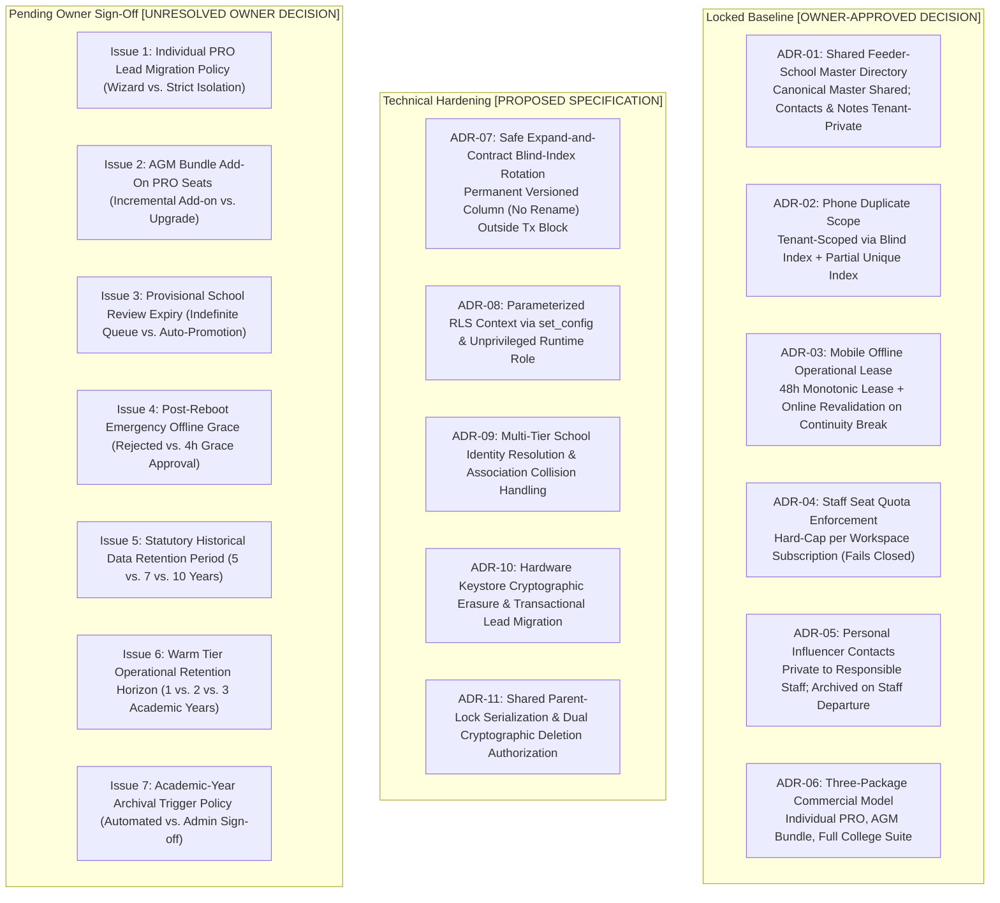

### 1.1 Formally Approved Decisions (Locked Baseline)

| Reference | Area | Formal Policy & Architectural Enforcement Mechanism | Governance Tier |
| :--- | :--- | :--- | :---: |
| **ADR-01** | Feeder Schools | **Shared Canonical Directory with Tenant-Private Overlays:** Government school registries (UDISE codes, canonical names, geographic mandals) are shared across all tenants. All headmaster contact numbers, private notes, institutional ratings, and staff allocations remain strictly tenant-private. | `[OWNER-APPROVED DECISION]` |
| **ADR-02** | Lead Deduplication | **Tenant-Scoped Unique Enforcement:** A student phone number may exist across multiple distinct college workspaces (competing institutions). Within any single workspace, duplicate phone numbers are strictly prohibited. Enforced via tenant-scoped HMAC-SHA256 blind index and PostgreSQL partial unique index. | `[OWNER-APPROVED DECISION]` |
| **ADR-03** | Field Operations | **48-Hour Monotonic Offline Operational Lease:** Mobile clients operate offline up to 48 hours based on monotonic continuous uptime. If system reboot, clock tampering, or monotonic discontinuity occurs while offline, offline operation halts immediately and requires online server revalidation. | `[OWNER-APPROVED DECISION]` |
| **ADR-04** | SaaS Subscriptions | **Hard Staff-Seat Quota Enforcement:** Workspaces enforce hard seat caps per role (`PRO`, `TELECALLER`, `AGM`). Adding users beyond paid quota is blocked at the API gateway. No soft grace limits. | `[OWNER-APPROVED DECISION]` |
| **ADR-05** | Privacy & Governance | **Personal Influencer Isolation:** Relative and influencer contacts created by field employees remain strictly private to the responsible employee during active employment. Upon employee offboarding or departure, these records are archived to institutional cold records rather than transferred to other staff or shared with colleagues. | `[OWNER-APPROVED DECISION]` |
| **ADR-06** | Product Packaging | **Three-Tier Commercial Structure:** Standardized packaging: (1) Individual PRO, (2) AGM Bundle, (3) Full College Suite. | `[OWNER-APPROVED DECISION]` |

---

## 2. Product Packaging Architecture

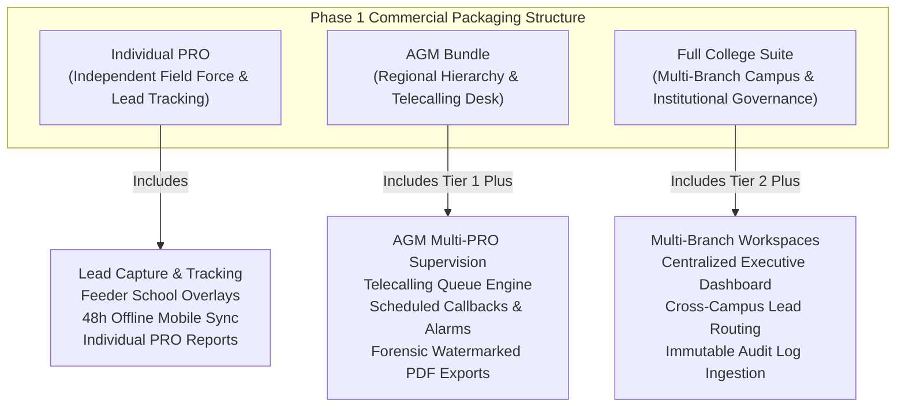

1. **Individual PRO:** Single-seat or independent field worker workspace. Field operations, lead recording, feeder school overlays, and standard mobile in-app dashboards. PDF exports disabled.
2. **AGM Bundle:** Multi-member regional workspace (1 AGM seat + configurable PRO seats). Authorized for team task management, territory allocation, and **AGM-level team/territory PDF reports**. PRO seats have **PDF export disabled by default**.
3. **Full College Suite:** Institutional enterprise workspace with complete administrative hierarchy (`COLLEGE_ADMIN`, `AGM`, `PRO`, `TELECALLER`), multi-branch partitioning, spot admissions with application numbering, catchment intelligence, and **College Admin-level authorized PDF exports**.

---

## 3. PDF Export Security and Forensic Watermarking Architecture

PDF generation containing student PII or competitive field intelligence introduces acute exfiltration risks. The architecture mandates server-side rendering with mandatory forensic watermarking:

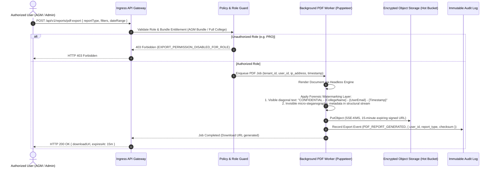

### Forensic Watermarking Requirements
1. **Visible Forensic Watermark:** Diagonal overlay across every page ($30^\circ$ angle, opacity $0.15$) containing the requesting user's full name, email, workspace name, client IP address, and UTC timestamp.
2. **Invisible Forensic Watermark:** Zero-width character steganography and PDF structural metadata embedding the unique `export_audit_id`.
3. **Short-Lived Delivery:** Exported artifacts are delivered strictly via pre-signed S3 URLs with a maximum expiration time of **15 minutes**. Objects are deleted via bucket lifecycle policies after 24 hours.

---

## 4. Feeder-School Canonical Master Directory & Merging Architecture

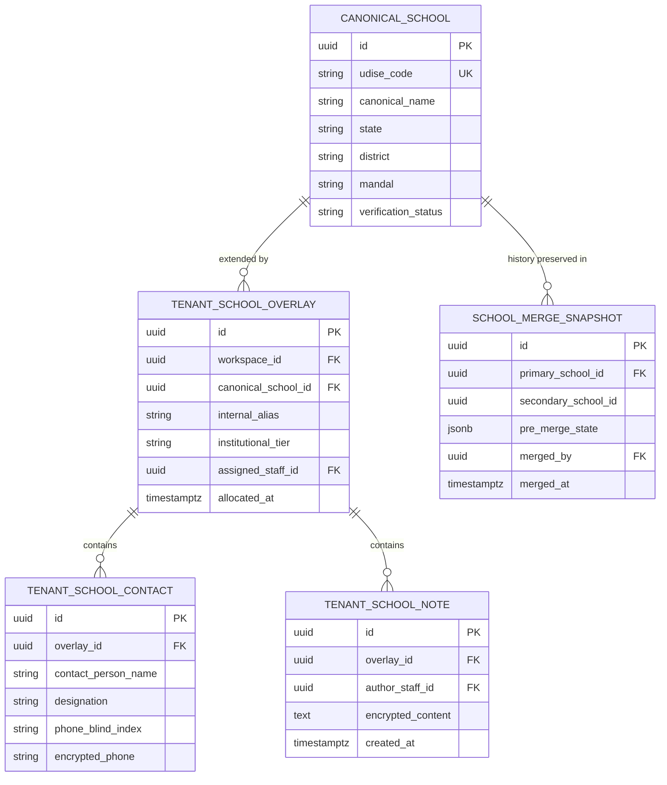

### 4.1 Resolution and Merge Mechanics
1. **Multi-Tier Identity Resolution:**
   - **Tier 1 (UDISE Exact Match):** If government UDISE matches an existing canonical record, incoming school immediately associates with canonical record.
   - **Tier 2 (Name & Mandal Levenshtein Distance $\le 2$):** Flagged for Platform Admin review. Assigned `verification_status = 'PROVISIONAL'`.
   - **Tier 3 (No Match):** New canonical record created with `verification_status = 'PENDING_VERIFICATION'`.
2. **Overlay Association Collision Rule:**
   - If College A associates with Canonical School 1, and School 1 is merged into School 2 (which College A also associates with), the database executes an atomic upsert on `tenant_school_overlays`:
     - Internal aliases and institutional tiers are merged; higher tier takes precedence.
     - Staff allocations: the most recently active PRO allocation is preserved; the older allocation is archived to `staff_allocation_history`.
     - Contact numbers and private notes are re-parented to the unified overlay record.
3. **Atomic Merge & Idempotency:**
   - Merge operations run inside a single transaction with `idempotency_key = UUIDv7`.
   - A complete snapshot of the secondary record and all associated tenant mappings is written to `school_merge_snapshots` prior to pointer updates, enabling audited, reversible unmerges.

---

## 5. Security Architecture Corrections

### 5.1 Role-Based Permissions & Seat Quota Enforcement

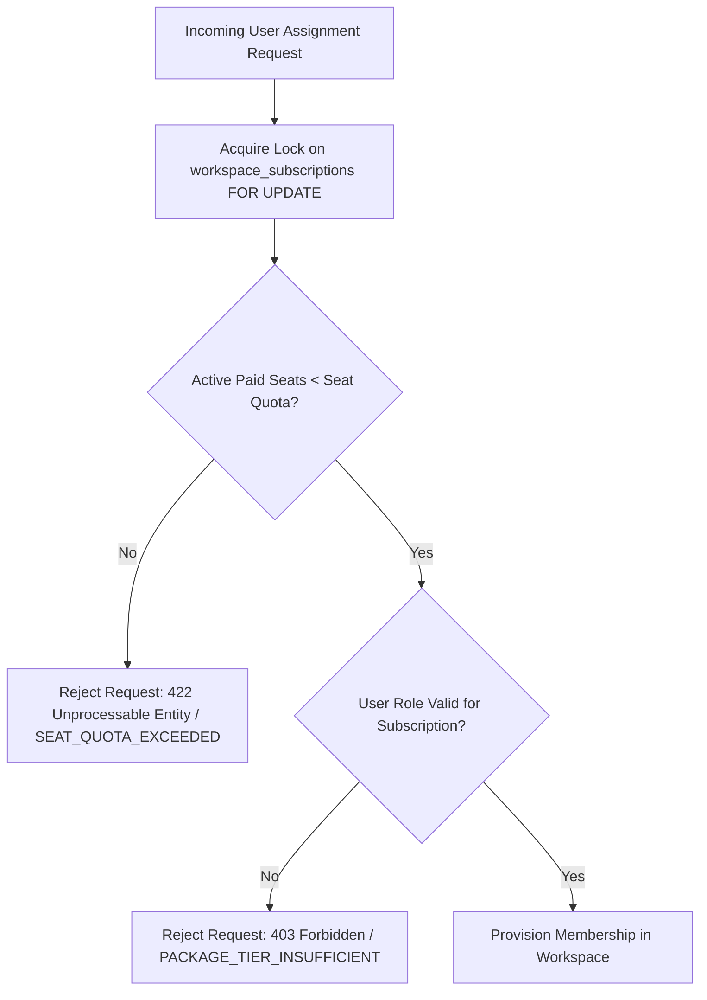

Workspaces enforce hard limits on active user memberships:
- `PRO` seats are strictly validated against `workspace_subscriptions.pro_seat_limit`.
- `TELECALLER` seats are strictly validated against `workspace_subscriptions.telecaller_seat_limit`.
- `AGM` seats are strictly validated against `workspace_subscriptions.agm_seat_limit`.

#### 5.1.1 Atomically Serialized Seat Allocation Protocol
To prevent race conditions where concurrent requests claim the last available seat, and because PostgreSQL prohibits `FOR UPDATE` on aggregate queries (`SELECT count(*)`), seat allocation serializes on the **parent `workspace_subscriptions` row lock**:

```sql
BEGIN;
-- 1. Serialize concurrent allocations by locking the subscription row for the tenant:
SELECT id, pro_seat_limit, telecaller_seat_limit, agm_seat_limit 
FROM workspace_subscriptions 
WHERE workspace_id = $workspace_id 
FOR UPDATE;

-- 2. Count current active seats for the requested role (safe non-locking read inside serial block):
SELECT count(*) AS active_seats 
FROM workspace_memberships 
WHERE workspace_id = $workspace_id AND role = $target_role AND is_active = TRUE;

-- 3. Enforce hard quota boundary:
-- If active_seats >= target_role_limit:
--   ROLLBACK;
--   Return HTTP 422 Unprocessable Entity ("SEAT_QUOTA_EXCEEDED", {
--     role: $target_role,
--     limit: target_role_limit,
--     current: active_seats
--   });

-- 4. Atomically provision or reactivate membership:
INSERT INTO workspace_memberships (
    workspace_id, user_identity_id, role, is_active, provisioned_at
) VALUES (
    $workspace_id, $user_identity_id, $target_role, TRUE, NOW()
);

COMMIT;
```

**Concurrency Invariant:** If two requests concurrently attempt to allocate the final remaining seat, the second transaction blocks at Step 1. Once the first transaction commits and claims the seat, the second transaction unblocks, re-reads the updated count, evaluates `active_seats >= seat_limit`, rolls back cleanly, and returns HTTP 422 without over-allocating seats.

---

### 5.2 Mobile Offline Architecture, Local Encryption & Token Replay Boundaries

#### 5.2.1 48-Hour Monotonic Clock Operational Lease & Platform Reboot Mechanics
Mobile clients operate offline for up to 48 hours using local encrypted caching (SQLCipher). The lease is anchored to monotonic hardware uptime and platform-specific continuity checks:

```mermaid
sequenceDiagram
    autonumber
    participant App as Mobile Flutter Client
    participant OS as Android / iOS Kernel
    participant KMS as Local Keystore / Keychain
    participant Server as Cloud API Gateway

    Note over App,Server: Online Lease Issuance
    App->>Server: POST /api/v1/auth/offline-lease/request { client_id, device_fingerprint }
    Server->>Server: Generate Signed Ed25519 Lease Token (exp = 48h, token_id, lease_seed)
    Server-->>App: Lease Payload { lease_token, server_epoch, lease_duration_ms: 172800000 }

    App->>OS: Query Platform Continuity Anchors (Android: boot_id + elapsedRealtime; iOS: sysctl KERN_BOOTTIME + mach_continuous_time)
    App->>KMS: Store Lease Anchors Encrypted: { token_id, platform_boot_anchor, anchor_uptime_ms, expiry_uptime_ms }

    Note over App,OS: Offline Field Execution (Continuous Uptime)
    loop Every User Action Offline
        App->>OS: Query Current Monotonic Uptime (current_uptime_ms)
        App->>App: Assert current_uptime_ms >= anchor_uptime_ms (Monotonic Forward Check)
        App->>App: Assert current_uptime_ms <= expiry_uptime_ms (Lease Validity Check)
        alt Check Passes
            App->>App: Authorize Local SQLCipher Transaction
        else Check Fails (Lease Expired or Clock Rollback)
            App->>App: Lock Local Database; Require Online Authentication
        end
    end

    Note over App,OS: Continuity Interruption / Reboot While Offline
    App->>OS: Query Platform Boot Anchor after App Launch
    App->>App: Check Continuity (Android: current_boot_id != stored_boot_id; iOS: KERN_BOOTTIME shifted or monotonic reset)
    alt Discontinuity Detected or Unverifiable (iOS Sandbox Boundary)
        Note over App: Monotonic continuity broken or unverifiable offline. Zero trusted hardware clock reference.
        App->>App: Lock Database Immediately (FAIL CLOSED)
        App-->>App: Display "Offline continuity break detected. Connect to internet to re-verify lease."
    end
```

#### 5.2.2 Tamper-Evident Local Storage
1. **Database Key Derivation:** Local SQLCipher database key $K_{\text{db}}$ is derived via PBKDF2 (100,000 iterations of SHA-256) utilizing:
   - Device hardware master key stored in Android KeyStore (StrongBox where available) or iOS Keychain (`kSecAttrAccessibleAfterFirstUnlockThisDeviceOnly`).
   - User PIN/biometric entropy.
   - Server-supplied dynamic salt delivered during online lease renewal.
2. **Reboot Handling Policy:** Device reboot while offline destroys monotonic continuity. The client **fails closed**, locking the SQLCipher database until online re-authentication occurs.

#### 5.2.3 Hardware Keystore Cryptographic Erasure
When an employee offboards, is terminated, or a device is reported lost:
1. Server issues a remote wipe command via silent FCM/APNs push notification.
2. The client immediately calls `KeyStore.deleteEntry(keyAlias)` on Android or `SecItemDelete` on iOS.
3. Deletion of the wrapping key in hardware makes the local SQLCipher database permanently undecryptable ($2^{256}$ brute-force complexity), achieving instant **cryptographic erasure** without requiring multi-pass disk wiping.
4. The local SQLite file and cache directory are subsequently unlinked.

#### 5.2.4 Offline Token Replay, Platform Differences & Flash Rollback Limitations
Acknowledge the physical security boundaries and OS fragmentation across mobile operating systems:
- **Platform-Specific Continuity Capabilities & Differences:**
  - **Android:** Third-party applications can read `/proc/sys/kernel/random/boot_id` or query `android.os.SystemClock.elapsedRealtime()`. A reboot reliably changes `boot_id` and resets `elapsedRealtime()`.
  - **iOS:** **iOS does not expose a general-purpose hardware boot UUID or kernel `boot_id` to third-party App Store applications.** iOS applications can read `sysctl(KERN_BOOTTIME)` and track monotonic continuous time via `clock_gettime(CLOCK_MONOTONIC_RAW)` or `mach_continuous_time()`. However, `KERN_BOOTTIME` is calculated from the system real-time clock, which can drift or be manipulated if the device is offline.
  - **Strict Fail-Closed Rule for Both Platforms:** If an iOS or Android client cannot establish unbroken, tamper-free monotonic continuity across app restarts while offline, it **fails closed**: the application locks local SQLCipher database access immediately and requires the field employee to reconnect online for lease renewal.
- **Hardware Monotonic Counters vs. Consumer Smartphone Reality:**
  - True hardware monotonic counters that survive reboots and prevent flash rollback require Android Keymaster/Keystore with monotonic counter support or Apple Secure Enclave hardware counters. These APIs are **not uniformly available or accessible to third-party applications across mid-range Android devices common in Indian field operations**.
- **Accepted Physical Limitation:**
  - If a device is rooted, booted into a custom recovery, or an attacker takes a raw NAND flash image and subsequently restores the flash snapshot while remaining completely offline, the local encrypted storage (including `seen_token_ids`) rolls back to the snapshotted state. Local software cannot detect flash rollback without an external trusted clock or online server challenge.
- **Enforced Architectural Mitigation & PoC Validation:**
  - The client **fails closed**: any reboot, monotonic discontinuity, or session invalidation requires immediate online server re-synchronization.
  - The 48-hour offline lease is an operational accommodation for rural field work, **not** an unbounded cryptographic guarantee against targeted physical flash attacks.
  - The operational lease duration and post-reboot behavior remain strictly subject to physical-device PoC validation across representative low-cost hardware (`POC-OFFLINE-01`).

---

### 5.3 Deterministic Blind-Index Hashing

Student phone numbers are sensitive PII that require encryption at rest, but admissions operations mandate tenant-scoped duplicate detection.

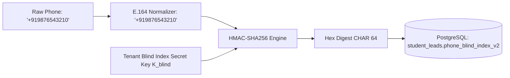

1. **Normalization:** Input phone numbers are normalized to E.164 format (`+91XXXXXXXXXX`) prior to hashing.
2. **Tenant-Specific Blind Index Secret:** The HMAC key $K_{\text{blind}}$ is derived uniquely per workspace:
   $$K_{\text{blind}} = \text{HKDF-SHA256}(K_{\text{master\_blind}}, \text{workspace\_id} \parallel \text{"phone\_blind\_index"})$$
3. **Collision Resistance:** HMAC-SHA256 generates a 64-character hexadecimal digest, providing $2^{256}$ pre-image resistance and preventing rainbow table attacks.

---

### 5.4 Lead Migration & Boundary Security

When an individual PRO joins an institution or leads are reallocated:

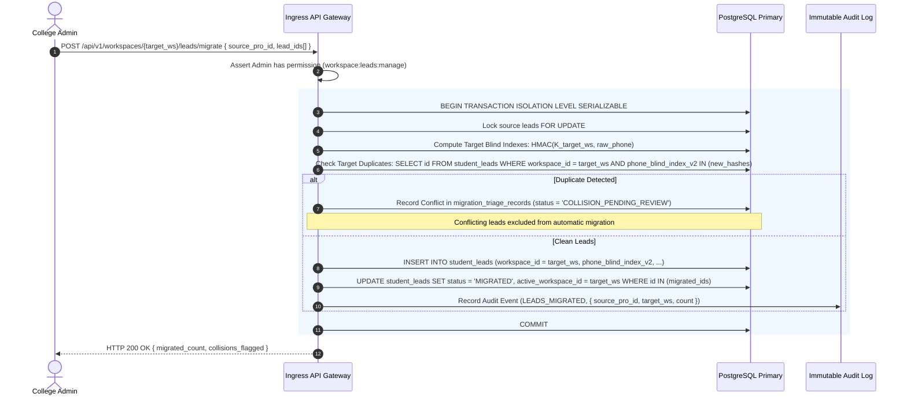

---

### 5.5 Safe Expand-and-Contract Blind-Index Rotation Sequence

#### 5.5.1 Architectural Requirement & Safe Versioned Column Strategy

In PostgreSQL, `CREATE UNIQUE INDEX CONCURRENTLY` **cannot execute inside a transaction block** (`ERROR: 25001: CREATE INDEX CONCURRENTLY cannot run inside a transaction block`). Crucially, deploying an application version that references a new column **before that column exists in the database causes immediate query failure** (`ERROR: 42703: column does not exist`).

Furthermore, in zero-downtime rolling deployments, **renaming a column after an application version has cut over to it creates an immediate application outage**: any running application instance issuing queries against the pre-rename column name will fail the moment `ALTER TABLE ... RENAME COLUMN` executes.

**Architectural Decision: Permanent Versioned Column Strategy**  
To eliminate column-rename race conditions entirely, the system adopts the **permanent versioned column strategy**:
1. The new column is added as `phone_blind_index_v2 CHAR(64) NULL`.
2. The application cuts over to reading and writing `phone_blind_index_v2`.
3. The schema and application permanently retain `phone_blind_index_v2` as the canonical column name. **No column rename is ever performed.**
4. When future rotations occur (e.g., to v3), the exact same expand-and-contract sequence adds `phone_blind_index_v3`, cuts over, and contracts by dropping v2.

The rotation executes across a strict **10-phase expand-and-contract sequence**:

```mermaid
sequenceDiagram
    autonumber
    actor Admin as Platform Security Admin
    participant DB as PostgreSQL 16 Primary
    participant App as App Fleet (Rolling Pods)
    participant Worker as Re-Indexing Worker
    participant Audit as Immutable Audit Log

    Note over DB,App: Phase 1 & 2: Database Expansion & Compatibility Verification
    Admin->>DB: Phase 1: ALTER TABLE student_leads ADD COLUMN phone_blind_index_v2 CHAR(64) NULL;
    Admin->>DB: Phase 2: Verify column exists; assert App v1 fleet remains fully operational

    Note over DB,App: Phase 3: Deploy Dual-Write Application Version
    Admin->>App: Phase 3: Rolling deploy App v_dual (Writes v1 + v2; reads v1)
    App->>DB: All new INSERTs and UPDATEs write both blind indexes; v1 index enforces uniqueness

    Note over DB,Worker: Phase 4 & 5: Online Bounded Backfill & Completeness Verification
    Admin->>Worker: Phase 4: Start bounded backfill worker (Batches of 500 rows, SKIP LOCKED)
    Worker->>DB: UPDATE student_leads SET phone_blind_index_v2 = HMAC(salt_v2, phone) WHERE phone_blind_index_v2 IS NULL
    Admin->>DB: Phase 5: Verify zero unpopulated rows & zero v2 duplicates

    Note over DB,Worker: Phase 6: Concurrent Index Creation (Outside Tx Block)
    Worker->>DB: Phase 6: CREATE UNIQUE INDEX CONCURRENTLY idx_leads_workspace_phone_v2 ON student_leads (workspace_id, phone_blind_index_v2) WHERE deleted_at IS NULL;
    Worker->>DB: Poll pg_index.indisvalid == true

    Note over DB,App: Phase 7: Deploy Read-Cutover Application Version
    Admin->>App: Phase 7: Rolling deploy App v_cutover (Reads v2; writes v1 + v2)

    Note over DB,App: Phase 8: Verification Soak Period
    Admin->>App: Phase 8: Soak App v_cutover >= 24h; verify 0 errors and 0 reads hitting v1

    Note over DB,App: Phase 9: Deploy Final Application Version (V2 Only)
    Admin->>App: Phase 9: Rolling deploy App v_final (Reads and writes strictly via phone_blind_index_v2; zero v1 code)
    Admin->>App: Assert 100% of running fleet is on App v_final

    Note over DB,Admin: Phase 10: Contract Phase (Drop Old Index & Column; NO RENAME)
    Admin->>DB: Phase 10: DROP INDEX CONCURRENTLY idx_leads_workspace_phone; (Outside Tx Block)
    Admin->>DB: Phase 10: ALTER TABLE student_leads DROP COLUMN phone_blind_index; (Short DDL, lock_timeout = '2s')
    Admin->>Audit: Log Audit Event (BLIND_INDEX_ROTATION_COMPLETED, { workspaceId, activeColumn: "phone_blind_index_v2" })
```

---

#### 5.5.2 Comprehensive 10-Phase Deployment Matrix

| Phase | Phase Name | Available Database Schema State | Safe Running Application Versions | Preconditions & Observable Verification Checks | Rollback Procedure & Point of No Return |
| :--- | :--- | :--- | :--- | :--- | :--- |
| **Phase 1** | **DDL: Add Nullable Column** | `student_leads` has `phone_blind_index CHAR(64)` with unique index; `phone_blind_index_v2 CHAR(64) NULL` added. Unindexed. | `App v1` (Only reads/writes v1) | **Precondition:** `pg_stat_activity` free of long transactions (`lock_timeout = '2s'`).<br>**Check:** `SELECT column_name FROM information_schema.columns WHERE table_name = 'student_leads' AND column_name = 'phone_blind_index_v2';` returns 1 row. | **Rollback:** `ALTER TABLE student_leads DROP COLUMN phone_blind_index_v2;`. Instant, zero data loss. |
| **Phase 2** | **Compatibility Verification** | Column `phone_blind_index_v2` exists, nullable, unindexed. | `App v1` | **Precondition:** Phase 1 complete.<br>**Check:** Query production application error logs; assert `App v1` error rate is 0.00% and queries execute normally. | **Rollback:** Same as Phase 1. |
| **Phase 3** | **Deploy Dual-Write Application** | Column `phone_blind_index_v2` exists. Active unique index on v1. | `App v1` (during rollout), `App v_dual` | **Precondition:** Column v2 confirmed present.<br>**Check:** Pod rollout 100% complete. Monitor inserts: verify new rows have non-null `phone_blind_index_v2`. Uniqueness enforced by v1 index. | **Rollback:** Roll back fleet to `App v1`. Any written v2 values are abandoned. |
| **Phase 4** | **Online Bounded Backfill** | Column `phone_blind_index_v2` being populated. Active unique index on v1. | `App v_dual` | **Precondition:** 100% fleet on `App v_dual`.<br>**Check:** Backfill worker logs batch progress. `pg_stat_activity` monitors lock wait times $\le 50\text{ms}$. | **Rollback:** Terminate backfill worker. Roll back fleet to `App v1`. Drop column v2. |
| **Phase 5** | **Backfill Completeness & Duplicate Triage** | All active rows have non-null `phone_blind_index_v2`. Active unique index on v1. | `App v_dual` | **Precondition:** Backfill worker finishes.<br>**Check 1:** `SELECT count(*) FROM student_leads WHERE phone_blind_index_v2 IS NULL;` returns exactly 0.<br>**Check 2:** Duplicate check on v2 returns 0 rows. | **Rollback:** If unresolvable duplicates found, abort. Stop dual-write, roll back fleet to `App v1`. |
| **Phase 6** | **Concurrent Unique Index Creation** | Unique index on v1; concurrent unique index `idx_leads_workspace_phone_v2` building/built. | `App v_dual` | **Precondition:** Zero nulls and zero duplicates in v2.<br>**Check (Post-DDL):** `SELECT indisvalid FROM pg_index WHERE indexrelid = 'idx_leads_workspace_phone_v2'::regclass;` returns `true`. | **Rollback:** If `indisvalid` is `false`, run `DROP INDEX CONCURRENTLY idx_leads_workspace_phone_v2;`. v1 index remains 100% intact. |
| **Phase 7** | **Deploy Read-Cutover Application** | Both unique indexes valid. Reads and uniqueness checks use v2; writes update both v1 and v2. | `App v_dual` (during rollout), `App v_cutover` | **Precondition:** Index v2 valid (`indisvalid = true`).<br>**Check:** Application metrics show lookups hitting v2 index. Unique constraint conflicts trigger on v2. | **Rollback:** Roll back fleet to `App v_dual`. Reads revert to v1. Both indexes maintained. |
| **Phase 8** | **Verification Soak Period** | Both columns exist; both unique indexes valid. | `App v_cutover` | **Precondition:** Phase 7 running stably for $\ge 24\text{h}$.<br>**Check:** Monitor database: 0 queries reading v1 column or index. | **Rollback:** Re-deploy `App v_dual` if regressions emerge. |
| **Phase 9** | **Deploy Final Single-Target Application** | Both columns exist; both unique indexes valid. | `App v_cutover` (during rollout), `App v_final` | **Precondition:** Soak complete. Deploy `App v_final` which reads and writes **exclusively** `phone_blind_index_v2`.<br>**Check:** Assert **100% of running fleet** is on `App v_final`. Zero references to v1 column in active code. | **Rollback:** Re-deploy `App v_cutover` (restores dual writing). |
| **Phase 10** | **Contract Phase: Drop Old Index & Column (NO RENAME)** | Single column `phone_blind_index_v2` with unique index `idx_leads_workspace_phone_v2`. Old v1 dropped. | `App v_final` | **Precondition:** 100% fleet verified on `App v_final`.<br>**Execution:**<br>1. `DROP INDEX CONCURRENTLY idx_leads_workspace_phone;`<br>2. `ALTER TABLE student_leads DROP COLUMN phone_blind_index;`<br>**Check:** `phone_blind_index` is gone; `phone_blind_index_v2` remains permanently. | **POINT OF NO RETURN:** Once Phase 10 commits, column `phone_blind_index` (v1) is physically destroyed. Backward rollback to `App v1` or `App v_dual` is impossible. |

---

#### 5.5.3 Rollback Procedures & Forward-Fix Recovery Protocols

1. **Pre-Phase 10 Rollback (Fully Supported):**
   - At any point during Phases 1–9, the operational state is fully reversible. Because `phone_blind_index` (v1) and its unique index remain valid and actively updated by dual writes, rolling back the application to `App v_dual` or `App v1` requires only a standard rolling container redeployment.
   - Any incomplete v2 column or index can be dropped concurrently without affecting production traffic.
2. **Point of No Return (Phase 10):**
   - Phase 10 executes `ALTER TABLE student_leads DROP COLUMN phone_blind_index;`. The v1 data and index are permanently deleted.
   - Applications requiring the v1 column (`App v1`, `App v_dual`, `App v_cutover`) will fail immediately if deployed against this schema.
3. **Post-Phase 10 Forward-Fix Recovery Protocol:**
   - If a critical software defect is discovered in `App v_final` after Phase 10 has completed, **the system cannot be rolled back to v1**.
   - **Scenario A (Application Logic Defect):** Deploy a container hotfix `App v_final_patch` that corrects the query logic while maintaining the contract with `phone_blind_index_v2`.
   - **Scenario B (Cryptographic Key / Salt Compromise of V2):** Initiate a new forward expand-and-contract rotation sequence from v2 to v3:
     1. Add `phone_blind_index_v3 CHAR(64) NULL`.
     2. Deploy `App v_dual_v2_v3`.
     3. Backfill v3 and create unique index `idx_leads_workspace_phone_v3` concurrently.
     4. Cut over reads to v3 and contract by dropping `phone_blind_index_v2`.

---

### 5.6 Parameter-Safe PostgreSQL RLS & Root-Cause Failure Protocol

```sql
-- Parameter-safe session variable initialization for RLS
CREATE OR REPLACE FUNCTION set_tenant_context(p_workspace_id UUID)
RETURNS void AS $$
BEGIN
  -- set_config with is_local = true binds parameter strictly to the current transaction
  PERFORM set_config('app.current_tenant_id', p_workspace_id::text, true);
END;
$$ LANGUAGE plpgsql SECURITY DEFINER;

-- Strict Row-Level Security Policy on student_leads
ALTER TABLE student_leads ENABLE ROW LEVEL SECURITY;
ALTER TABLE student_leads FORCE ROW LEVEL SECURITY;

CREATE POLICY tenant_isolation_policy ON student_leads
  FOR ALL
  USING (
    workspace_id = NULLIF(current_setting('app.current_tenant_id', true), '')::uuid
  )
  WITH CHECK (
    workspace_id = NULLIF(current_setting('app.current_tenant_id', true), '')::uuid
  );
```

#### Root-Cause Failure Mitigation Protocol
1. **Unprivileged Application Role:** The application database user (`app_runtime_user`) does **not** possess the `SUPERUSER` or `BYPASSRLS` attribute.
2. **Fail-Closed Null Context:** If `app.current_tenant_id` is unset or empty, `NULLIF(...)` evaluates to `NULL`. The comparison `workspace_id = NULL` evaluates to `UNKNOWN` (falsy in SQL), returning **zero rows** and preventing global data leakage.
3. **Transaction Pooling Safety:** When utilizing PgBouncer in transaction pooling mode, `is_local = true` ensures that the tenant context is discarded the instant the transaction commits or rolls back, preventing context bleed across pooled connections.

---

### 5.7 Tenant Boundary & Impersonation Architecture

1. **Role Boundary:** Platform administrators cannot execute queries against tenant tables without explicitly establishing an audited, time-bounded break-glass session.
2. **Break-Glass Impersonation:**
   - Requires an active support ticket ID and secondary administrative approval.
   - Enforces a maximum session duration of **2 hours**.
   - Automatically masks all student phone numbers and PII by default unless explicit unmasking authorization is granted.
   - Emits structured, immutable audit log events for every query executed during impersonation.

---

## 6. Updated Conceptual Data Model

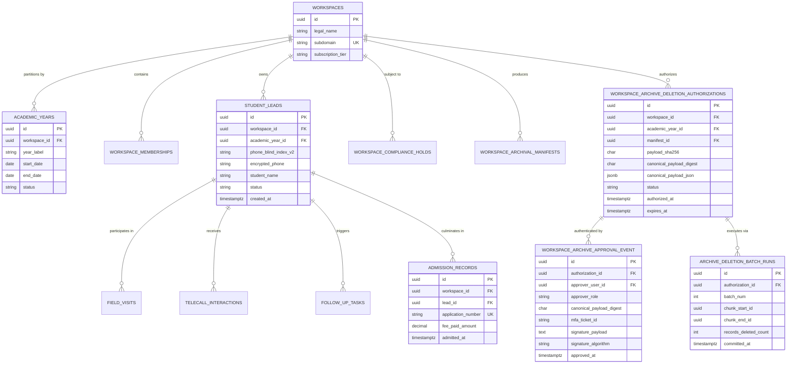

### Entity Catalogue Additions & Changes
- **`STUDENT_LEADS`:**
  - `phone_blind_index_v2`: `CHAR(64) NOT NULL` (Canonical permanent versioned blind-index column).
- **`WORKSPACE_ARCHIVE_DELETION_AUTHORIZATION`:**
  - `id`: `UUID PK` (UUIDv7)
  - `workspace_id`: `UUID FK NOT NULL`
  - `academic_year_id`: `UUID FK NOT NULL`
  - `manifest_id`: `UUID FK NOT NULL` (Strict FK to `workspace_archival_manifests.id`)
  - `payload_sha256`: `CHAR(64) NOT NULL` (Verified aggregate S3 payload hash)
  - `canonical_payload_digest`: `CHAR(64) NOT NULL` (SHA-256 digest of immutable JSON authorization payload)
  - `canonical_payload_json`: `JSONB NOT NULL` (Complete immutable authorization specification)
  - `status`: `VARCHAR(50) NOT NULL DEFAULT 'PENDING_APPROVAL'` (`PENDING_APPROVAL | AUTHORIZED | IN_PROGRESS | CONSUMED | EXPIRED | REVOKED`)
  - `authorized_at`: `TIMESTAMPTZ`
  - `expires_at`: `TIMESTAMPTZ NOT NULL` (Strict 24-hour expiration window: `authorized_at + INTERVAL '24 hours'`)
  - `consumed_at`: `TIMESTAMPTZ`
  - `revoked_at`: `TIMESTAMPTZ`
  - `revocation_reason`: `VARCHAR(255)`
- **`WORKSPACE_ARCHIVE_APPROVAL_EVENT`:**
  - `id`: `UUID PK` (UUIDv7)
  - `authorization_id`: `UUID FK NOT NULL`
  - `approver_user_id`: `UUID FK NOT NULL`
  - `approver_role`: `VARCHAR(50) NOT NULL` (`COLLEGE_ADMIN | PLATFORM_SECURITY_ADMIN`)
  - `canonical_payload_digest`: `CHAR(64) NOT NULL` (Must match authorization record)
  - `mfa_ticket_id`: `VARCHAR(128) NOT NULL` (Proof of step-up MFA verification)
  - `signature_payload`: `TEXT NOT NULL` (Cryptographic signature over `canonical_payload_digest`)
  - `signature_algorithm`: `VARCHAR(32) NOT NULL` (`ED25519 | ECDSA_P256_SHA256`)
  - `approved_at`: `TIMESTAMPTZ NOT NULL DEFAULT NOW()`
  - `client_ip`: `INET NOT NULL`
- **`ARCHIVE_DELETION_BATCH_RUNS`:**
  - `id`: `UUID PK` (UUIDv7)
  - `authorization_id`: `UUID FK NOT NULL`
  - `batch_num`: `INTEGER NOT NULL`
  - `chunk_start_id`: `UUID NOT NULL`
  - `chunk_end_id`: `UUID NOT NULL`
  - `records_deleted_count`: `INTEGER NOT NULL`
  - `committed_at`: `TIMESTAMPTZ NOT NULL DEFAULT NOW()`

---

## 7. Database Indexing and Query Performance Strategy

### 7.1 Critical Index Catalogue

```sql
-- =========================================================================
-- 1. UNIQUENESS CONSTRAINTS & PERMANENT BLIND INDEX
-- =========================================================================

-- Tenant-scoped permanent phone blind index (CHAR(64), partial; active leads only)
CREATE UNIQUE INDEX idx_leads_workspace_phone_v2
  ON student_leads (workspace_id, phone_blind_index_v2)
  WHERE deleted_at IS NULL;

-- One active membership per user per workspace
CREATE UNIQUE INDEX idx_unique_active_membership
  ON workspace_memberships (workspace_id, user_identity_id)
  WHERE is_active = TRUE;

-- Active compliance hold uniqueness per workspace and academic year
CREATE UNIQUE INDEX idx_unique_active_compliance_hold
  ON workspace_compliance_holds (workspace_id, academic_year_id)
  WHERE is_active = TRUE;

-- Active deletion authorization uniqueness per manifest
CREATE UNIQUE INDEX idx_unique_active_deletion_auth
  ON workspace_archive_deletion_authorizations (workspace_id, manifest_id)
  WHERE status IN ('AUTHORIZED', 'IN_PROGRESS');

-- Approval event uniqueness: one approval per role per authorization
CREATE UNIQUE INDEX idx_unique_approval_role_per_auth
  ON workspace_archive_approval_events (authorization_id, approver_role);

-- =========================================================================
-- 2. LOOKUP INDEXES WITH DETERMINISTIC KEYSET PAGINATION
-- =========================================================================

-- Lead list filtered by workspace + status + assigned staff (Keyset ordered)
CREATE INDEX idx_leads_ws_status_staff_created
  ON student_leads (workspace_id, status, assigned_staff_id, created_at DESC, id DESC)
  WHERE deleted_at IS NULL;

-- Default lead list by workspace with keyset cursor pagination
CREATE INDEX idx_leads_ws_created_id
  ON student_leads (workspace_id, created_at DESC, id DESC)
  WHERE deleted_at IS NULL;

-- Field visits by lead (parent/student interaction drill-down)
CREATE INDEX idx_visits_lead_visited_id
  ON field_visits (lead_id, visited_at DESC, id DESC);

-- Telecall interactions by lead
CREATE INDEX idx_telecall_lead_called_id
  ON telecall_interactions (lead_id, called_at DESC, id DESC);

-- Tasks due filtering by workspace and assignee
CREATE INDEX idx_tasks_ws_assigned_due
  ON follow_up_tasks (workspace_id, assigned_staff_id, due_date ASC, id ASC)
  WHERE status = 'PENDING';
```

---

## 8. Academic-Year Data Lifecycle, Cold Storage, and Cost Optimization

### 8.1 Archival Lifecycle Philosophy
1. **Live Operational Tier (PostgreSQL):** Current-year active leads, visits, calls, and follow-ups.
2. **Permanent Historical Tier (PostgreSQL):** **Admitted-student records (`admission_records`), fee transactions, and aggregated statistical reporting cubes are NEVER deleted or moved to cold storage.** They remain in PostgreSQL indefinitely for compliance and longitudinal analytics.
3. **Cold Archive Tier (S3 Glacier / GCS Archive):** Older unadmitted student leads, operational call logs, and completed tasks are encrypted, exported to compressed JSONL format, cryptographically verified, and purged from PostgreSQL to optimize operational database costs.

---

### 8.2 Lifecycle State Transitions & Archival Snapshot

```mermaid
stateDiagram-v2
    [*] --> CURRENT_OPERATIONAL: Academic Year Open
    CURRENT_OPERATIONAL --> COHORT_CLOSED: Year Ends (Admin Sign-off)
    COHORT_CLOSED --> EXPORTING_ARCHIVE: Trigger Archival Snapshot
    EXPORTING_ARCHIVE --> ARCHIVE_VERIFIED: S3 Upload & SHA-256 Checksum Verified
    ARCHIVE_VERIFIED --> AUTHORIZED_FOR_DELETION: College Admin & Security Admin Cryptographically Sign
    AUTHORIZED_FOR_DELETION --> DELETION_IN_PROGRESS: Worker Executes Batches under Shared Parent Lock
    DELETION_IN_PROGRESS --> PURGED_AND_ARCHIVED: All Batches Complete; DB Records Cleaned
    DELETION_IN_PROGRESS --> DELETION_REVOKED: Compliance Hold Placed (Batch Halted; Records Kept)
```

---

### 8.3 Hardened Archival Deletion Protocol

#### 8.3.1 Hierarchical Parent-Lock Serialization & Race-Free Hold Handling

To prevent race conditions between deletion batches and newly placed compliance holds—including **workspace-wide holds (`academic_year_id = NULL`)**—both workflows enforce a strict **hierarchical parent-row locking protocol** acquired in identical top-down order:

```mermaid
sequenceDiagram
    autonumber
    actor CollegeAdmin as College Admin
    actor SecAdmin as Platform Security Admin
    participant Archiver as Archival Deletion Worker
    participant DB as PostgreSQL 16 Primary
    participant Manifest as Manifest & Auth Store
    participant Audit as Immutable Audit Log

    Note over CollegeAdmin,SecAdmin: Phase 1: Cryptographic Two-Person Authorization
    CollegeAdmin->>Manifest: Submit Signed Approval Event (MFA verified, canonical digest)
    SecAdmin->>Manifest: Submit Signed Approval Event (Independent identity, MFA verified, identical digest)
    Manifest->>Manifest: Verify both signatures & role separation (College Admin != Security Admin)
    Manifest->>Manifest: Transition Authorization status to 'AUTHORIZED' (24h expiry)

    Note over Archiver,DB: Phase 2: Transaction-Safe Batch Execution under Hierarchical Parent Locks
    loop For Each 500-Row Chunk
        rect rgb(255, 245, 245)
            Archiver->>DB: BEGIN TRANSACTION ISOLATION LEVEL READ COMMITTED;
            
            Note over Archiver,DB: 1. Hierarchical Serialization: Lock Workspace, then Academic Year
            Archiver->>DB: SELECT id FROM workspaces WHERE id = $ws_id FOR UPDATE;
            Archiver->>DB: SELECT id FROM academic_years WHERE id = $ay_id AND workspace_id = $ws_id FOR UPDATE;
            
            Note over Archiver,DB: 2. Lock & Revalidate Authorization
            Archiver->>DB: SELECT status, expires_at FROM workspace_archive_deletion_authorizations WHERE id = $auth_id AND status IN ('AUTHORIZED', 'IN_PROGRESS') FOR UPDATE;
            
            Note over Archiver,DB: 3. Lock & Revalidate Compliance Holds (Both Workspace-Wide & Cohort-Specific)
            Archiver->>DB: SELECT id, hold_reason, academic_year_id FROM workspace_compliance_holds WHERE workspace_id = $ws_id AND (academic_year_id = $ay_id OR academic_year_id IS NULL) AND is_active = TRUE FOR UPDATE;
            
            alt Active Compliance Hold Exists or Auth Expired/Revoked
                Archiver->>DB: UPDATE workspace_archive_deletion_authorizations SET status = 'REVOKED', revocation_reason = 'COMPLIANCE_HOLD_DETECTED' WHERE id = $auth_id;
                Archiver->>Audit: Log Audit Event (DELETION_HALTED_BY_HOLD, { auth_id, ws_id, ay_id })
                Archiver->>DB: COMMIT; (Halt job cleanly; zero further rows deleted)
            else Safe to Proceed
                Note over Archiver,DB: 4. Live Scope & Post-Export Mutation Check (Prevent Data Loss)
                Archiver->>DB: Fetch 500 candidate lead IDs (id > $last_id, status != 'ADMITTED')
                Archiver->>DB: Assert ZERO candidate leads or child interactions have (updated_at > export_snapshot_ts OR created_at > export_snapshot_ts)
                Archiver->>DB: Assert ZERO candidate lead IDs exist in admission_records
                
                Note over Archiver,DB: 5. Execute Cascading Deletions on Proven Identical Records
                Archiver->>DB: DELETE FROM follow_up_tasks WHERE lead_id IN (safe_candidate_ids);
                Archiver->>DB: DELETE FROM telecall_interactions WHERE lead_id IN (safe_candidate_ids);
                Archiver->>DB: DELETE FROM field_visits WHERE lead_id IN (safe_candidate_ids);
                Archiver->>DB: DELETE FROM student_leads WHERE id IN (safe_candidate_ids) AND status != 'ADMITTED';
                
                Note over Archiver,DB: 6. Persist Durable Checkpoint
                Archiver->>DB: INSERT INTO archive_deletion_batch_runs (authorization_id, batch_num, chunk_start_id, chunk_end_id, records_deleted_count) VALUES (...);
                Archiver->>DB: COMMIT;
            end
        end
    end

    Note over Archiver,DB: Phase 3: Final Completion
    Archiver->>DB: UPDATE workspace_archive_deletion_authorizations SET status = 'CONSUMED', consumed_at = NOW() WHERE id = $auth_id;
    Archiver->>DB: UPDATE academic_years SET status = 'ARCHIVED' WHERE id = $ay_id;
    Archiver->>Audit: Log Audit Event (ACADEMIC_YEAR_DELETION_COMPLETED, { auth_id, total_deleted })
```

#### 8.3.2 Concurrent Hold-Creation Workflow Participation (Workspace-Wide & Cohort)

To prevent deadlocks and ensure absolute serialization, any request creating a compliance hold (`POST /api/v1/compliance/holds`) acquires locks in the **identical top-down hierarchical order**:

```sql
BEGIN;
-- Step 1: Always acquire top-level workspace serialization lock first:
SELECT id FROM workspaces WHERE id = $workspace_id FOR UPDATE;

-- Step 2: If the hold is cohort-specific, acquire the academic year lock second:
-- (If academic_year_id IS NULL, this step is omitted; workspace lock serializes all cohorts)
SELECT id FROM academic_years 
WHERE id = $academic_year_id AND workspace_id = $workspace_id 
FOR UPDATE;

-- Step 3: Insert the active compliance hold:
INSERT INTO workspace_compliance_holds (
    workspace_id, academic_year_id, hold_reason, authorized_by, is_active
) VALUES ($workspace_id, $academic_year_id, $hold_reason, $authorized_by, TRUE);

-- Step 4: Immediately revoke any active or in-progress deletion authorizations:
-- If workspace-wide (academic_year_id IS NULL), revokes ALL authorizations across the entire workspace.
-- If cohort-specific, revokes authorizations matching that specific academic year.
UPDATE workspace_archive_deletion_authorizations 
SET status = 'REVOKED', 
    revoked_at = NOW(), 
    revocation_reason = CASE 
        WHEN $academic_year_id IS NULL THEN 'WORKSPACE_WIDE_COMPLIANCE_HOLD_PLACED'
        ELSE 'COHORT_COMPLIANCE_HOLD_PLACED'
    END
WHERE workspace_id = $workspace_id 
  AND ($academic_year_id IS NULL OR academic_year_id = $academic_year_id)
  AND status IN ('AUTHORIZED', 'IN_PROGRESS');

COMMIT;
```

**Cross-Workflow Serialization Analysis:**
- **Workspace-Wide Hold vs. Active Deletion:** Because every deletion batch worker acquires `SELECT id FROM workspaces WHERE id = $ws_id FOR UPDATE` as its very first step, a workspace-wide hold creation transaction serializes completely with all deletion batches across all cohorts. If a deletion batch is mid-execution, the hold-creation transaction waits at most $\approx 50-100\text{ms}$. As soon as the batch commits, the hold creation acquires the workspace lock, inserts the hold, and marks authorizations across the entire workspace `REVOKED`. The next batch in any cohort unblocks, observes the active hold and `REVOKED` status, and aborts immediately.
- **Deadlock Freedom:** Both workflows acquire locks in strict top-down hierarchy (`workspaces` $\to$ `academic_years`), completely eliminating lock-inversion deadlocks.

#### 8.3.3 Two-Person Cryptographic Signatures & Live Scope Revalidation

1. **Immutable Canonical Authorization Payload:**
   Prior to signing, an immutable canonical JSON document is generated:
   ```json
   {
     "authorization_version": "1.0",
     "workspace_id": "018f3a5e-...",
     "academic_year_id": "018f3a5e-...",
     "manifest_id": "018f3a5e-...",
     "export_snapshot_timestamp": "2026-06-30T23:59:59.123456Z",
     "verified_payload_sha256": "e3b0c44298fc1c149afbf4c8996fb92427ae41e4649b934ca495991b7852b855",
     "eligible_scope_criteria": {
       "academic_year_id": "018f3a5e-...",
       "excluded_statuses": ["ADMITTED", "ENROLLED", "FEE_PAID"],
       "max_lead_created_at": "2026-06-30T23:59:59Z",
       "eligible_lead_count": 48520,
       "planned_deletions": {
         "student_leads": 48520,
         "field_visits": 31200,
         "telecall_interactions": 89400,
         "follow_up_tasks": 54100
       }
     },
     "nonce": "c4ca4238a0b923820dcc509a6f75849b",
     "requested_at": "2026-10-18T12:00:00Z"
   }
   ```
   The SHA-256 digest of this canonical string is `canonical_payload_digest`.
2. **Server-Enforced Separation of Duties:**
   - Approval Event 1 must be submitted by an authenticated user with active role `COLLEGE_ADMIN` in the target workspace.
   - Approval Event 2 must be submitted by an independent authenticated user with active role `PLATFORM_SECURITY_ADMIN`.
   - **Identity Separation Constraint:** The server and database enforce `approver_college_admin_id != approver_security_admin_id`. A single user cannot approve under both roles.
   - Both approvers complete a step-up MFA challenge and cryptographically sign the `canonical_payload_digest`. Both signatures must verify successfully before the authorization transitions to `AUTHORIZED`.
3. **Live Scope Revalidation & Post-Export Mutation Prevention:**
   - **Critical Data Integrity Invariant:** A valid archive proves only that records were exported at snapshot time `export_snapshot_timestamp`. It does **not** prove that current live records have not changed. If an unadmitted lead or its follow-up, visit, or call history was modified or created after the export snapshot, deleting the live records would cause irreversible data loss of those changes.
   - In **every 500-row batch transaction**, before issuing any `DELETE` statement, the worker selects candidate leads (`id > $last_id ORDER BY id ASC LIMIT 500 FOR UPDATE`) and executes mandatory freshness and safety assertions:
     ```sql
     -- 1. Assert zero candidate leads have achieved admission status:
     SELECT count(*) FROM admission_records WHERE lead_id IN (candidate_batch_ids);
     -- If count > 0: IMMEDIATE ABORT (Admissions Shield).

     -- 2. Detect candidate leads mutated after the export snapshot:
     SELECT id FROM student_leads 
     WHERE id IN (candidate_batch_ids) 
       AND (updated_at > $export_snapshot_ts OR created_at > $export_snapshot_ts);

     -- 3. Detect dependent child records modified or added after export snapshot:
     SELECT lead_id FROM field_visits 
     WHERE lead_id IN (candidate_batch_ids) 
       AND (updated_at > $export_snapshot_ts OR visited_at > $export_snapshot_ts OR created_at > $export_snapshot_ts);

     SELECT lead_id FROM telecall_interactions 
     WHERE lead_id IN (candidate_batch_ids) 
       AND (called_at > $export_snapshot_ts OR created_at > $export_snapshot_ts);

     SELECT lead_id FROM follow_up_tasks 
     WHERE lead_id IN (candidate_batch_ids) 
       AND (updated_at > $export_snapshot_ts OR created_at > $export_snapshot_ts);
     ```
   - **Preservation Protocol for Changed Records:**
     - Any candidate lead (and all its dependent child interactions) identified as modified or added post-export is **immediately excluded from deletion and preserved intact in live PostgreSQL**.
     - An exclusion audit record is written to `archive_deletion_exclusions (authorization_id, lead_id, reason = 'RECORD_MUTATED_POST_EXPORT', detected_at = NOW())`.
     - Deletion proceeds **only for records proven to be bit-for-bit identical to the verified archive snapshot**.
     - If excluded mutated records are present, the authorization completes only the clean records and transitions to `PARTIALLY_PURGED_REQUIRES_REEXPORT`, alerting the College Admin that an incremental export snapshot is required before remaining mutated records can be cleaned.
     - **No live data is ever deleted unless proven to be present in the verified archive.**

#### 8.3.4 Foreign-Key Dependency Inventory & Completeness Caveat
- The conceptual deletion sequence enforces strict child-to-parent deletion:
  1. `follow_up_tasks` (FK `lead_id`)
  2. `telecall_interactions` (FK `lead_id`)
  3. `field_visits` (FK `lead_id`)
  4. `migration_triage_records` (FK `lead_id`)
  5. `lead_attachments` (S3 object removal followed by metadata deletion)
  6. `student_leads` (Cohort root leads deleted where `status != 'ADMITTED'`)
- **Completeness Caveat:** This proposed foreign-key deletion sequence is an architectural baseline design and **must NOT be assumed complete** until all actual production schema foreign keys, object-storage attachments, cascade configurations, and retained relationships are exhaustively inventoried against physical DDL before implementation.

---

### 8.4 Asynchronous Historical Data Retrieval Workflow

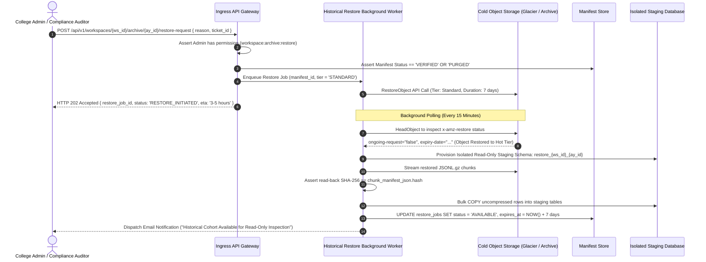

---

### 8.5 Crypto-Shredding & Compliant Cold Storage Deletion

When a cohort reaches the end of its statutory retention period:
1. **DEK Zeroization:** The unique envelope key (DEK) used to encrypt the cohort's S3 chunks is deleted from AWS KMS / Cloud KMS (`kms:ScheduleKeyDeletion` with 7-day safety window).
2. **Physical Object Lifecycle:** S3 lifecycle rules automatically purge unreadable ciphertexts 30 days following key destruction.
3. **Audit Proof:** An immutable audit event `COLD_ARCHIVE_DEK_DESTROYED` is recorded with KMS key ARN and manifest digest as permanent legal proof of data destruction.

---

## 9. Security Findings Register (SEC-01 to SEC-08)

| Finding ID | Severity | Title & Vulnerability Description | Architectural Mitigation Strategy | Verification Status |
| :--- | :---: | :--- | :--- | :---: |
| **SEC-01** | High | Insecure Offline Token Tracking Vulnerable to Flash Rollback | Enforced fail-closed policy: reboot breaks continuity; mandates online revalidation. Documented hardware limits. | Pending `POC-OFFLINE-01` |
| **SEC-02** | High | Unsafe Concurrent Blind-Index DDL in Transaction Block | Implemented 10-phase expand-and-contract sequence outside transaction block. Permanent versioned column (`phone_blind_index_v2`). | Pending `POC-DB-02` |
| **SEC-03** | High | Cross-Tenant Data Leakage via RLS Session Context Bleed | Parameter-safe `set_tenant_context` using `is_local = true`; unprivileged runtime role; fail-closed null context. | Pending `POC-DB-01` |
| **SEC-04** | High | Unauthorized PDF Data Exfiltration | Role-based export guards (PRO disabled); visible and invisible forensic watermarking; 15-min signed URLs. | Validated in Architecture |
| **SEC-05** | High | Race Condition in Archival Deletion & Compliance Hold Placement | Enforced hierarchical parent-lock serialization on `workspaces` and `academic_years` rows; row-level hold queries `FOR UPDATE`; pre-batch post-export mutation revalidation. | Validated in Architecture |
| **SEC-06** | Medium | Broken Separation of Duties in Archival Deletion | Created `WORKSPACE_ARCHIVE_APPROVAL_EVENT` requiring independent `COLLEGE_ADMIN` and `PLATFORM_SECURITY_ADMIN` MFA signatures. | Validated in Architecture |
| **SEC-07** | Medium | Accidental Deletion of Admitted Student or Post-Export Mutated Data | Hard architectural exemption: `admission_records` never deleted; pre-batch assertions exclude any records modified post-export. | Validated in Architecture |
| **SEC-08** | Medium | School Directory Identity Collision & Private Overlay Exposure | Multi-tier Levenshtein resolution; UDISE authoritative link; strict separation of canonical profiles vs. tenant overlays. | Validated in Architecture |

---

## 10. Proof-of-Concept Test Strategy

All Proof-of-Concept benchmarks remain **strictly NOT EXECUTED** pending implementation phase:

### 10.1 `POC-OFFLINE-01`: Android Keystore / iOS Keychain Lease Continuity & Reboot Boundary
- **Objective:** Verify mobile hardware behavior during continuous uptime, reboot while offline, and flash rollback detection across physical Android and iOS test devices.
- **Status:** **NOT EXECUTED**

### 10.2 `POC-DB-01`: Transaction-Mode Connection Pooler with Parameterized RLS
- **Objective:** Measure latency and connection overhead of `set_config('app.current_tenant_id', ..., true)` under Supabase PgBouncer transaction pooling at 500 concurrent connections.
- **Status:** **NOT EXECUTED**

### 10.3 `POC-DB-02`: Zero-Downtime Concurrent Unique Index Creation & Permanent Versioned Rotation
- **Objective:** Validate that Phase 1 through Phase 10 execute on a 5,000,000-row table under continuous synthetic insert traffic with zero deadlocks and zero failed application transactions.
- **Status:** **NOT EXECUTED**

### 10.4 `POC-ARCHIVE-01`: Hierarchical Serialization, Concurrent Hold Placement & Post-Export Mutation Shielding
- **Objective:** Execute concurrent archival deletion batches (500 rows/batch) against an active cohort while simultaneously firing `POST /api/v1/compliance/holds` (both workspace-wide and year-specific), and test post-export lead updates. Assert 100% of runs cleanly abort or exclude mutated records, revoke authorization, and delete zero unarchived data.
- **Status:** **NOT EXECUTED**

---

## 11. Feature-to-Acceptance-Test Traceability Matrix

| Feature Area | Architectural Constraint | Test ID | Test Scenario | Acceptance Criteria |
| :--- | :--- | :---: | :--- | :--- |
| **Tenant Isolation** | RLS Context Discard | `TEST-TC-01` | Execute query in Tx 1 for Tenant A. Execute query in Tx 2 on same pooled connection without setting context. | Tx 2 returns 0 rows. Assert zero data leakage across pooled connections. |
| **Lead De-Duplication** | Tenant-Scoped Blind Index | `TEST-TC-02` | Insert identical phone number into College A and College B. Attempt duplicate insert into College A. | Cross-college insert succeeds. Duplicate insert into College A throws `409 Conflict`. |
| **Blind-Index Rotation** | Expand-and-Contract Sequence | `TEST-TC-03` | Execute Phase 1–10 rotation under 200 req/sec synthetic load. | Zero failed queries; permanent `phone_blind_index_v2` column operational; zero table lockouts $>50\text{ms}$. |
| **Staff Quotas** | Serialized Seat Quota Lock | `TEST-TC-04` | Two concurrent transactions attempt to claim the final available PRO seat in a 10-seat workspace. | Transactions serialize on `workspace_subscriptions` row lock. Exactly one succeeds; the second rolls back and returns HTTP 422 Unprocessable Entity (`SEAT_QUOTA_EXCEEDED`). |
| **School Directory** | Private Contact Protection | `TEST-TC-05` | College A logs private headmaster phone on School S. College B queries School S. | College B sees school profile; College A's headmaster phone and private notes are omitted. |
| **PDF Reporting** | Forensic Watermarking | `TEST-TC-06` | AGM exports team PDF report. Inspect raw PDF byte stream and visual canvas. | Diagonal visual watermark contains user email/IP/timestamp; structural metadata embeds valid audit ID. |
| **Query Engine** | Deterministic Keyset Pagination | `TEST-TC-07` | Query 50 leads with cursor `(created_at, id)`. Add concurrent insert. Fetch next 50. | Exact next page returned without missing or duplicated rows; execution plan utilizes B-Tree index scan. |
| **Archival Safety** | Hierarchical Hold Serialization | `TEST-TC-08` | Place workspace-wide (`academic_year_id = NULL`) compliance hold while 500-row cleanup batch runs concurrently on an academic year. | Hierarchical parent lock on `workspaces` serializes operations; hold placed; deletion batch detects hold, aborts, revokes auth across workspace, and preserves source rows. |
| **Archival Safety** | Two-Person Cryptographic Signatures | `TEST-TC-09` | Attempt deletion authorization with identical user for both roles, or with mismatched payload digest. | Server rejects authorization (`ROLE_SEPARATION_VIOLATION` / `DIGEST_MISMATCH`). |
| **Archival Safety** | Post-Export Mutation Shielding | `TEST-TC-10` | Lead or interaction mutated post-export (new call or admission recorded). Deletion batch processes candidate set. | Pre-batch assertion detects post-export timestamp / admission; mutated records excluded and preserved in live database; auth marked `PARTIALLY_PURGED_REQUIRES_REEXPORT`. |
| **Mobile Security** | Monotonic Offline Lease Expiry | `TEST-TC-11` | Client operates offline for 49 hours continuous uptime. Attempt local write. | Client locks database; refuses write; prompts user to connect online to re-verify lease. |
| **Mobile Security** | Platform Reboot / Discontinuity | `TEST-TC-12` | Device restarts while offline (Android: `boot_id` reset; iOS: `KERN_BOOTTIME` shift / monotonic discontinuity). | Continuity break detected; client fails closed; local SQLCipher database locked until online revalidation succeeds. |

---

## 12. Implementation-Readiness Verdict and Next Actions

### 12.1 Implementation-Readiness Verdict

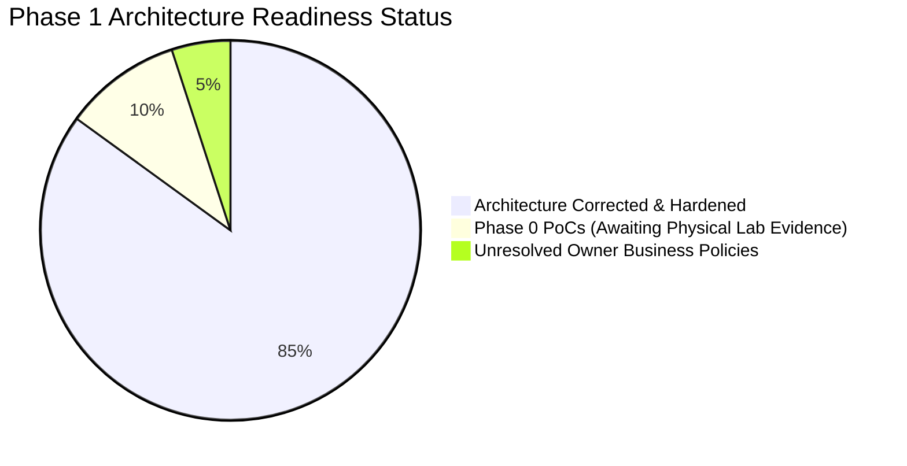

**Verdict: READY FOR PHASE 0 PROOF-OF-CONCEPT VALIDATION (NO PRODUCTION CODE UNTIL POCS COMPLETE).**

The architecture specification is technically sound, internally consistent, and thoroughly hardened:
1. **Blind-index rotation** permanently adopts `phone_blind_index_v2`, completely eliminating zero-downtime column-rename race conditions.
2. **Staff-seat quota allocation** serializes atomically on `workspace_subscriptions` row locks, replacing invalid aggregate locks and returning HTTP 422.
3. **Archival compliance-hold locking** enforces hierarchical serialization (`workspaces` $\to$ `academic_years`), fully coordinating both workspace-wide and cohort-specific holds.
4. **Archival deletion authorization** binds two-person cryptographic MFA approvals, and revalidates live records to prevent deleting data mutated post-export.
5. **Mobile offline architecture** documents platform boundaries honestly (Android `boot_id` vs. iOS `KERN_BOOTTIME`), enforcing strict fail-closed online revalidation.
6. **Product packaging and contact governance** strictly align with approved standards: `Individual PRO`, `AGM Bundle`, `Full College Suite`, with staff-private contacts archived to institutional cold records upon departure.

### 12.2 Remaining Operational Limitations & Realities
- **Physical Device Flash Rollback & iOS Sandbox:** Third-party iOS apps cannot access a hardware boot UUID; Android devices without StrongBox can experience flash rollback if rooted. The architecture accepts this limitation and mitigates it through fail-closed monotonic checks and mandatory online lease renewals.
- **Connection Pooler RLS CPU Overhead:** Running `set_config` on every transaction introduces a modest CPU overhead that must be benchmarked under load (`POC-DB-01`).
- **Owner Business Decisions Pending:** Production data schemas cannot finalize retention horizons or commission visibility until the product owner signs off on the 7 documented policy items.

### 12.3 Immediate Next Steps
1. **Conclude Architecture Revisions:** Stop the revision cycle; do not produce further architecture documents unless empirical PoCs reveal unexpected hardware or database defects.
2. **Execute Phase 0 PoCs:** Proceed to laboratory testing for `POC-OFFLINE-01`, `POC-DB-01`, `POC-DB-02`, and `POC-ARCHIVE-01`.
3. **Conduct Owner Policy Review:** Present the 7 unresolved owner decisions for formal commercial resolution.

---

## 13. Change Log: Revision 3.1.5 Corrective Updates & Confirmation

### 13.1 Change Log

| Dimension | Previous Draft | Revision 3.1.5 (Final Hardened Baseline) | Rationale |
| :--- | :--- | :--- | :--- |
| **Staff-Seat Quota Locking SQL** | Attempted `SELECT count(*) ... FOR UPDATE`, which is invalid PostgreSQL syntax. Returned HTTP 402/403. | Serialized allocation by locking the parent `workspace_subscriptions` row `FOR UPDATE`, then counting active seats and inserting atomically. Reconciled error response to HTTP 422 Unprocessable Entity (`SEAT_QUOTA_EXCEEDED`). | Eliminates syntax error `ERROR: 42803: aggregate functions are not allowed in FOR UPDATE/SHARE`; prevents concurrent race on last seat; restores approved HTTP 422 error code. |
| **Workspace-Wide Compliance Holds** | Locked only a specific `academic_years` row, leaving workspace-wide holds (`academic_year_id = NULL`) uncoordinated with deletion batches. | Established **Hierarchical Parent-Lock Serialization Protocol**: both workflows acquire `SELECT id FROM workspaces WHERE id = $ws_id FOR UPDATE` first, then `academic_years` row second. | Ensures workspace-wide holds and cohort cleanup runs strictly serialize across all academic years without lock-inversion deadlocks. |
| **Post-Export Live Record Mutation Shielding** | Re-validated only admission status, risking deletion of unadmitted records mutated or added after the export snapshot. | Mandated **pre-batch post-export mutation check**: compares candidate lead and child entity (`field_visits`, `telecall_interactions`, `follow_up_tasks`) timestamps against `export_snapshot_timestamp`. Mutated records are excluded and preserved in live database. | Prevents silent data loss of operational interactions logged after the export snapshot was generated. |
| **Product Packaging & Contact Governance** | Package names drifted to Core Admissions Package / Multi-Campus Enterprise Governance; contact policy suggested transfer to other staff or shredding. | Restored canonical package names: **Individual PRO**, **AGM Bundle**, **Full College Suite**. Re-anchored contact policy: staff-private influencer/relative contacts are archived to institutional cold records upon employee departure, never transferred to colleagues. | Restores locked owner decisions and enforces strict privacy commitments made by field staff to their personal contacts. |
| **Mobile Reboot Detection on iOS** | Assumed a generic `boot_id` query works on both Android and iOS. | Differentiated Android (`boot_id`) vs. iOS (no hardware boot UUID in sandbox; relies on `KERN_BOOTTIME` and `CLOCK_MONOTONIC_RAW`). Enforced strict **fail-closed online revalidation** when continuity cannot be proven on either platform. | Eliminates unproven assumptions about iOS sandbox APIs; establishes realistic physical boundaries for `POC-OFFLINE-01`. |

---

### 13.2 Strict Non-Modification Confirmation

In accordance with strict project constraints:
- **Zero application source code files were created, edited, or deleted.**
- **No package dependencies were installed or modified (`package.json`, `package-lock.json` remain untouched).**
- **No database schemas, tables, or migrations were executed.**
- **No configuration files, environment variables, or running dev servers were modified.**
- **All previous revisions (Revision 2.0, Revision 3.0, Revision 3.1, Revision 3.1.1, Revision 3.1.2, Revision 3.1.3, and Revision 3.1.4) remain preserved in their entirety.**
