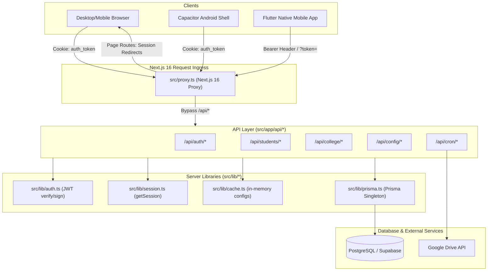

# Architecture and Data-Flow Assessment

**Target System:** Intermediate College Admissions & Field Operations SaaS  
**Audit Standard:** Code-path tracing from client triggers through network boundary, proxy routing, API handlers, Prisma queries, and database persistence.

---

## 1. System Request Lifecycle & Ingress

### Ingress & Boundary Rules
1. **Next.js 16 Proxy (`src/proxy.ts`):** Replaces legacy `middleware.ts`. Intercepts page requests. If unauthenticated, redirects to `/login`. Bypasses public pages (`/`, `/terms-and-conditions`, `/pamphlet`, `/brochure`, `/scannn`).
2. **API Route Bypass:** Line 14 of `src/proxy.ts` explicitly bypasses all `/api/*` paths (`if (request.nextUrl.pathname.startsWith('/api')) return NextResponse.next();`).
3. **Implication:** The network boundary does NOT enforce authentication on API routes. Every API route handler must independently authenticate, verify roles, and isolate tenants.

---

## 2. Tracing the 10 Critical Workflows

### Workflow 1: Login and Session Validation
1. **Client Action:** User enters `employeeId` and `password` on `/login` (`src/app/login/page.tsx`).
2. **Network Request:** `POST /api/auth/login` (`src/app/api/auth/login/route.ts`).
3. **Database Query:** `prisma.user.findUnique({ where: { employeeId } })`.
4. **Verification:** `bcrypt.compare(password, user.password)`. Checks `user.isActive !== false`.
5. **Token Generation:** `signToken({ id, employeeId, name, role, collegeId })` with 30-day expiration (`src/lib/auth.ts:6-8`).
6. **Session Storage:** Set in HTTP-only cookie `auth_token` (`path: '/', sameSite: 'lax', maxAge: 30 days`).
7. **Client Redirection:** Based on role:
   - `ADMIN` ➔ `/admin`
   - `COLLEGE` ➔ `/college/dashboard`
   - `AGM` ➔ `/agm`
   - `TELECALLER` ➔ `/telecaller`
   - `EMPLOYEE` ➔ `/employee/village-visits`

---

### Workflow 2: College Resolution and Tenant Context
1. **Resolution Mechanism:** The tenant (`collegeId`) is NOT resolved via subdomain (e.g., `collegea.prodayreport.com`). It is resolved from:
   - The logged-in user's JWT payload (`payload.collegeId`).
   - Lookups against `prisma.user.findUnique({ where: { employeeId } }).collegeId`.
2. **Query Scoping:**
   - In `src/app/api/college/dashboard/stats/route.ts:28-87`, queries filter by `collegeId`.
   - In `src/app/api/students/route.ts:123-151`, users with role `COLLEGE` filter by `collegeId` and team staff IDs.
3. **Failure Mode:** For roles `TELECALLER`, `EMPLOYEE`, and `STUDENT`, `collegeId` is not consistently checked. For example, if a telecaller's `assignedEmployees` array is empty, the route falls back to returning all students without filtering by `collegeId` (`src/app/api/students/route.ts:122`).

---

### Workflow 3: Student Creation, Viewing, and Updating
1. **Creation:**
   - **Form:** `src/app/employee/add/page.tsx`.
   - **API:** `POST /api/students` (`src/app/api/students/route.ts:6-79`).
   - **Phone Normalization:** Strips non-digits via `normalizePhoneNumber()` (`src/lib/phone.ts`).
   - **Duplicate Check:** `prisma.student.findFirst({ where: { phone: cleanPhone } })` (Note: Checked globally, not scoped by tenant).
   - **Persistence:** `prisma.student.create(...)` with creator's `employeeId` and `collegeId`.
2. **Viewing:**
   - **API:** `GET /api/students/[id]` (`src/app/api/students/[id]/route.ts:124-150`).
   - **Vulnerability:** Checks only if `token` exists. Does NOT check whether the requesting user owns the student or belongs to the same college (IDOR).
3. **Updating:**
   - **API:** `PUT /api/students/[id]` (`src/app/api/students/[id]/route.ts:6-122`).
   - **Authorization:** Allows `ADMIN`, `TELECALLER`, and `COLLEGE`. Field `EMPLOYEE` can only edit their own students (`currentStudent.employeeId === payload.employeeId`).

---

### Workflow 4: Student Search and Village-Wise Filtering
1. **Interface:** `src/app/employee/village-visits/page.tsx`.
2. **Data Fetching:** Client fetches `GET /api/students` with query params `?limit=1000`.
3. **Client-Side Derivation:** Client uses `useMemo` over the student list to extract unique Mandals and Villages.
4. **Filtering Tabs:**
   - `ALL`: Total students in selected village.
   - `PENDING`: Not visited today.
   - `MET`: Visited today (`visitDate` matches current day).
   - `NEVER MET`: `visitNumber === null` or `0`.
5. **Architectural Limitation:** For large datasets, fetching up to 1,000 student records into browser state consumes memory and causes stutter on low-end Android devices.

---

### Workflow 5: PRO Visit Recording and Doorstep Tracking
1. **Trigger:** PRO clicks "Record Visit" in `src/app/employee/village-visits/page.tsx`.
2. **API:** `POST /api/students/[id]/visits` (`src/app/api/students/[id]/visits/route.ts:32-196`).
3. **Authorization Check:**
   - `ADMIN`, `TELECALLER`, `COLLEGE` permitted globally.
   - Field `EMPLOYEE` restricted to their own students (`student.employeeId === payload.employeeId`).
4. **Database Transaction (`prisma.$transaction`):**
   - Check if visit already exists for `studentId` on the given date (start of day to end of day).
   - If exists: `prisma.visit.update(...)`.
   - If new: `prisma.visit.create(...)` and increment `student.visitNumber`.
   - Update `student.doorstepCompleted = true`, `student.leadStatus`, `student.remarks`, and `nextFollowUpDate`.

---

### Workflow 6: Telecaller Follow-Up and Outcome Updates
1. **Interface:** `src/app/telecaller/students/page.tsx`.
2. **Data Fetching:** `GET /api/students`. Filters to assigned field employees (`assignedEmployees`).
3. **Star Leads Filter:** Filters for `group in ['MPC', 'BiPC']`, `ableToBearFee === 'Yes'`, and prime campus locations.
4. **Follow-Up Logging:**
   - Telecaller calls student via `tel:` or `wa.me` shortcut.
   - Submits `PUT /api/students/[id]` with `remarks`, `leadStatus`, and `nextFollowUpDate`.
   - Server sets `telecallerUpdateAt = new Date()` and updates `telecallerUpdateDetails`.
5. **PRO Synchronization:** PRO receives an unread update badge on `/employee/telecaller-updates` (`src/app/employee/telecaller-updates/page.tsx`).

---

### Workflow 7: Management Reporting & Dashboard Aggregation
1. **Trigger:** College administrator opens `/college/dashboard` (`src/app/college/dashboard/page.tsx`).
2. **API:** `GET /api/college/dashboard/stats` (`src/app/api/college/dashboard/stats/route.ts`).
3. **Execution Pattern:**
   - Fetches all `ConfigValue` where `type: 'SCHOOL'` and `collegeId = currentCollege.id`.
   - Fetches all `User` team members in college.
   - Executes unpaginated `prisma.student.findMany` for all students belonging to the college.
   - Executes unpaginated `prisma.visit.findMany` for all visits matching those student IDs.
   - Runs in-memory JavaScript loops to compute school collection rates, staff league tables, 14-day trends, and telecaller counts.
4. **Architectural Bottleneck:** As a college's student count scales from 500 to 5,000+, this synchronous unpaginated query can exhaust V8 memory and block server threads.

---

### Workflow 8: User Creation, Role Assignment, and Revocation
1. **Platform Admin Context:**
   - Managed via `/admin/users` (`src/app/admin/users/page.tsx`).
   - Uses `POST /api/users` and `PUT /api/users` (`src/app/api/users/route.ts`).
   - Has bug where `collegeId` is ignored during creation, assigning users to no college.
2. **College Admin Context:**
   - Managed via `/college/team` (`src/app/college/team/page.tsx`).
   - Uses `POST /api/college/team` (`src/app/api/college/team/route.ts`).
   - Checks college quotas (`maxAgms`, `maxTelecallers`, `maxEmployees`).
   - Enforces business rule: 1 feeder school assigned to strictly 1 field employee within the college.
3. **Revocation:**
   - `PATCH /api/users` sets `isActive: false`.
   - Deletion via `DELETE /api/users` fails if foreign keys exist in `Student` or `Visit` tables due to default Prisma restrict rules.

---

### Workflow 9: File Upload and Media Handling
1. **Branded Cards:** Rendered client-side via HTML5 `<canvas>` in `src/app/employee/village-visits/page.tsx:129-300`. Images are NOT uploaded to server storage; they are converted to data URLs and shared directly via Web Share or `@capacitor/share`.
2. **Study Materials & Videos:**
   - Stored in `Book` and `Video` models (`prisma/schema.prisma:219-238`).
   - Stores external Google Drive links (`pdfUrl`) and YouTube links (`youtubeUrl`).
   - The platform does not host binary media files; it delegates storage to Google Drive and YouTube.

---

### Workflow 10: Logout and Session Invalidation
1. **Web Client:** Calls `POST /api/auth/logout` (`src/app/api/auth/logout/route.ts`). Clears `auth_token` and `student_token` cookies.
2. **Mobile Client:** Calls `ApiService.logout()` (`mobile_app/lib/services/api_service.dart:88-97`). Clears `SharedPreferences`.
3. **Security Deficit:** Stateless JWTs are used. The server does NOT maintain a token revocation list or database session table. Any intercepted or client-stored token remains valid until its 30-day (or 10-year client-forged) expiration.

---

## 3. Structural Code Smells & Architectural Bottlenecks

1. **Oversized Files:**
   - `src/components/MemorySecrets.tsx`: 76,786 bytes (monolithic client component).
   - `src/app/agm/reports/staff/page.tsx`: 1,100 lines (45,536 bytes).
   - `src/app/college/dashboard/stats/route.ts`: 503 lines with massive synchronous data processing.
   - `mobile_app/lib/services/api_service.dart`: 1,256 lines (45,575 bytes).
2. **Duplicated Business Logic:**
   - Normalization of phone numbers is duplicated across `src/lib/phone.ts`, `src/app/api/students/route.ts`, and `mobile_app/lib/services/api_service.dart`.
   - Staff progress calculations are duplicated in `src/app/api/college/dashboard/stats/route.ts` and `src/app/api/agm/dashboard/stats/route.ts`.
3. **Syntax Error / Compilation Breakage:**
   - `src/app/api/students/route.ts:172` contains an extra closing brace `}` that closes the `try` block prematurely, causing `tsc --noEmit` to fail with 3 TypeScript errors.
