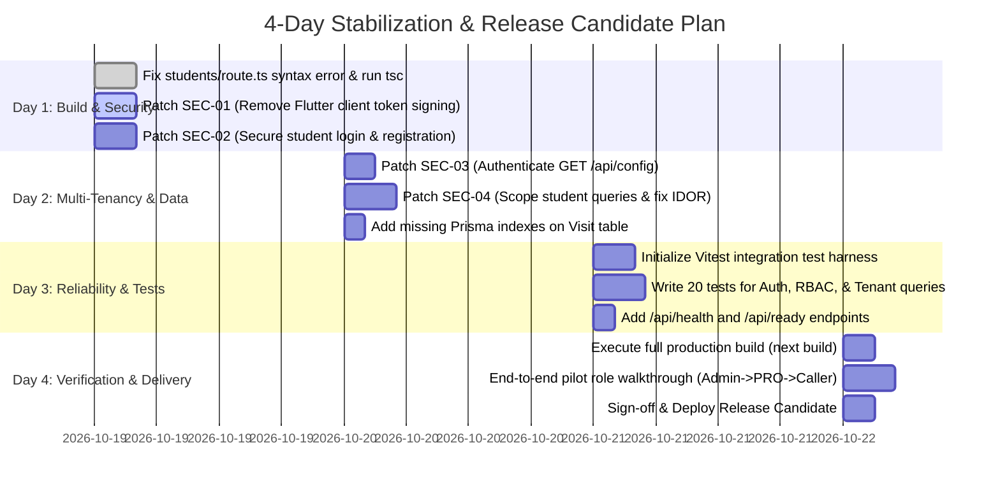

# Four-Day Delivery Feasibility and Remediation Roadmap

**Target System:** Intermediate College Admissions & Field Operations SaaS  
**Objective:** Deliver a secure, compilable, multi-tenant-isolated release candidate suitable for pilot intermediate college onboarding within 4 working days.

---

## 1. Feasibility Verdict

### Is a 4-Day Usable Release Candidate Realistic?
**YES, UNDER OPTION B (Selective Refactoring).**  
Because more than 80% of user workflows (UI screens, forms, PDF generation, Telugu assessment scoring, and visit tracking) are already built and functional, a four-day sprint does not need to build new features. Instead, it can focus entirely on **repairing compilation, closing security loopholes, and enforcing tenant isolation**.

A full rewrite (Option D) is completely unfeasible in 4 days.

---

## 2. Scope Boundaries: In-Scope vs Excluded Scope

### In-Scope (Must Complete for Release Candidate)
1. **Compilation Repair:** Correct the syntax error in `src/app/api/students/route.ts` so `tsc --noEmit` and `next build` pass cleanly.
2. **Critical Security Patching:**
   - Eliminate hardcoded fallback JWT secret.
   - Remove client-side token signing in Flutter (`generateFallbackToken()`).
   - Secure `GET /api/config` with authentication and tenant filtering.
   - Patch student pre-registration account takeover loophole.
3. **Multi-Tenant Boundary Enforcement:**
   - Scope all student queries by `collegeId`.
   - Prevent cross-tenant student deletion and viewing via IDOR on `/api/students/[id]`.
   - Restrict telecallers with unassigned staff to zero records instead of global access.
4. **Database Performance & Indexes:**
   - Add indexes on `Visit(studentId)` and `Visit(visitDate)`.
5. **Baseline Automated Sanity Tests:**
   - Set up Vitest with 15–20 integration tests verifying authentication, tenant boundaries, and student creation.

### Excluded Scope (Post-Launch Phase 2 Backlog)
1. Full refactor of the 1,100-line staff report page (`/agm/reports/staff/page.tsx`).
2. Offline mutation queue with background IndexedDB sync for web clients.
3. Razorpay payment gateway integration for college tuition fee collection.
4. Unattended automated WhatsApp Cloud Business API broadcast bot.
5. Retirement and full consolidation of dual mobile apps (Capacitor vs Flutter).

---

## 3. Day-by-Day Implementation Roadmap

### Detailed Schedule

#### Day 1: Build Stability & Authentication Hardening
- **Task 1.1:** Resolve the unbalanced closing brace in `src/app/api/students/route.ts:172`. Run `npx tsc --noEmit` to verify 0 compiler errors.
- **Task 1.2:** Remove `generateFallbackToken()` from `mobile_app/lib/services/api_service.dart`. Enforce that mobile clients only store server-issued JWTs.
- **Task 1.3:** Enforce strict presence of `JWT_SECRET` in environment variables. Throw an immediate fatal exception if missing.
- **Task 1.4:** Remove the default password (`123456`) loophole in `src/app/api/student/auth/login/route.ts`. Require setting a password via an authorized employee or an SMS OTP workflow.

#### Day 2: Multi-Tenancy & Data Privacy Isolation
- **Task 2.1:** Secure `GET /api/config` in `src/app/api/config/route.ts` with `getAuthToken()`. Redact Headmaster personal contact info unless requested by authorized college staff.
- **Task 2.2:** Update `src/app/api/students/route.ts` so that telecallers with empty `assignedEmployees` receive an empty set rather than global student records.
- **Task 2.3:** Add tenant ownership checks to `GET /api/students/[id]`, `PUT /api/students/[id]`, and `DELETE /api/students/[id]`.
- **Task 2.4:** Add indexes on `Visit(studentId)` and `Visit(visitDate)` in `prisma/schema.prisma` and run non-destructive schema update.

#### Day 3: Automated Testing & Health Monitoring
- **Task 3.1:** Install `vitest` and configure test environment.
- **Task 3.2:** Author automated integration tests covering:
  - User login & JWT issuance.
  - Role-based route enforcement.
  - Tenant data isolation between College A and College B.
  - Student creation and visit incrementation.
- **Task 3.3:** Implement `/api/health` and `/api/ready` route handlers returning database connection status.

#### Day 4: Production Build, Walkthrough, and Release Sign-Off
- **Task 4.1:** Execute full production build: `npm run build`. Confirm zero build errors.
- **Task 4.2:** Perform an end-to-end staging walkthrough across all 5 roles using synthetic data:
  1. Admin creates College tenant and College Admin.
  2. College Admin creates Field PRO and Telecaller.
  3. Field PRO enters student, records visit, and shares WhatsApp card.
  4. Telecaller filters Star Leads, updates follow-up notes.
  5. Student takes 5-module career guidance test and views bilingual report.
- **Task 4.3:** Package Release Candidate (RC-1) and tag release in Git.

---

## 4. Dependencies & Assumptions

1. **Prerequisite:** Developer access to Supabase PostgreSQL test database.
2. **Constraint:** No new third-party paid subscriptions (e.g., Twilio / SMS Gateway) introduced during the 4-day sprint; OTP verification can be simulated or gated by verified employee assistance for the pilot.
3. **Commitment:** Zero scope creep; requests for ERP features (timetables, fee ledgers) must be strictly deferred to Phase 2.
