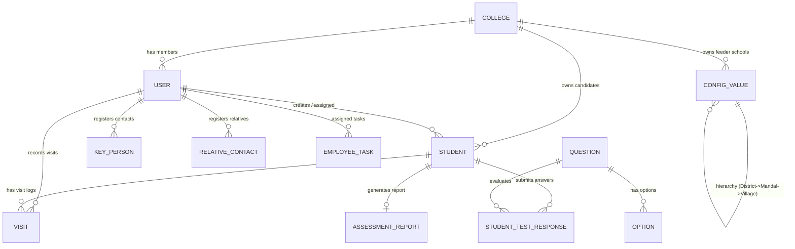

# Scalability and Database Integrity Audit

**Target System:** Intermediate College Admissions & Field Operations SaaS  
**Assessment Standard:** Static analysis of Prisma schema definitions, indexing strategies, relationship cardinalities, transaction boundaries, query execution plans, and multi-tenant scaling tiers.

---

## 1. Database Schema and Entity-Relationship Architecture



### Relational Integrity Findings

| Model | Primary Key | Foreign Keys & Relations | Indexes | Assessment & Integrity Risks |
| :--- | :--- | :--- | :--- | :--- |
| **`College`** | `id` (cuid) | None | Unique: `code` | Root tenant entity. Controls role quotas (`maxAgms`, `maxTelecallers`, `maxEmployees`). |
| **`User`** | `id` (cuid) | `collegeId ➔ College.id` (SetNull) | Unique: `employeeId` | Core staff entity. If deleted, child students/visits throw foreign key error due to default Restrict behavior. |
| **`Student`** | `id` (cuid) | `employeeId ➔ User.employeeId`<br>`collegeId ➔ College.id`<br>`joinedCollegeId ➔ User.employeeId` | Indexed: `schoolName`, `mandal`, `collegeId`, `employeeId`, `village`, `district`, `leadStatus` | **Integrity Flaw:** `joinedCollegeId` references `User.employeeId` rather than `College.id`. Missing unique constraint on `(collegeId, phone)`. |
| **`Visit`** | `id` (cuid) | `studentId ➔ Student.id` (Cascade)<br>`addedById ➔ User.employeeId` | None (Missing indexes on `studentId`, `visitDate`) | Lacks direct `collegeId`. Deleting a student cascades and deletes all visits. |
| **`KeyPerson`** | `id` (cuid) | `employeeId ➔ User.employeeId` | Indexed: `employeeId`, `mandal`, `schoolName` | **Integrity Flaw:** Lacks `collegeId`. If employee leaves, key persons cannot be transferred cleanly to another staff member. |
| **`RelativeContact`** | `id` (cuid) | `employeeId ➔ User.employeeId` (Cascade) | Indexed: `employeeId`, `village`, `mandal` | Lacks `collegeId`. Deleting employee cascades and deletes all mapped relatives. |
| **`EmployeeTask`** | `id` (cuid) | `employeeId ➔ User.employeeId` (Cascade) | Indexed: `employeeId`, `status`, `endDate` | Lacks `collegeId`. Cross-tenant assignment risk. |
| **`ConfigValue`** | `id` (cuid) | `parentId ➔ ConfigValue.id`<br>`collegeId ➔ College.id` (Cascade) | Indexed: `type`, `parentId`, `collegeId` | Self-referential location hierarchy. Stores feeder school grades and strengths. |
| **`AssessmentReport`** | `id` (cuid) | `studentId ➔ Student.id` (Cascade) | Unique: `studentId` | 1-to-1 psychometric assessment report. Stores 0–10 modular scores and Telugu guidance. |

---

## 2. Query Efficiency & Bottlenecks

### 1. Unbounded In-Memory Aggregations
- **File:** `src/app/api/college/dashboard/stats/route.ts:82-124`
- **Pattern:**
  ```ts
  const students = await prisma.student.findMany({ where: { OR: [{ collegeId }, { employeeId: { in: teamEmployeeIds } }] } });
  const visits = await prisma.visit.findMany({ where: { studentId: { in: studentIds } } });
  ```
- **Analysis:** This query loads every student and every visit record for the entire college into Node.js heap memory, followed by 100+ lines of in-memory `.filter()`, `.map()`, and `.reduce()` operations to calculate daily trends and staff league tables.
- **Risk:** At 5,000+ students and 15,000+ visits per college, this single endpoint will take 5–15 seconds to execute, consuming 150MB+ of V8 RAM and blocking the Node.js event loop.

### 2. Missing Database Indexes
1. `Visit.studentId`: Queried heavily in `where: { studentId: { in: studentIds } }` and `/api/students/[id]/visits`. Currently causes sequential scans on the `Visit` table.
2. `Visit.visitDate`: Filtered in range checks (`startOfDay` to `endOfDay`). Missing index degrades date-range reports.
3. `User.collegeId`: Used to fetch all staff belonging to a college. Missing index causes table scans on `User`.

### 3. In-Memory Config Cache Concurrency
- **File:** `src/lib/cache.ts:3-29`
- **Pattern:** Uses a module-level global variable `let cachedConfigs: any[] | null = null;`.
- **Limitation:** In serverless environments (e.g., Vercel) or multi-instance containers (e.g., Kubernetes), this in-memory variable is local to each Node process. Cache invalidation on one worker does not invalidate cache on another worker, causing data drift until the 5-minute TTL expires.

---

## 3. Scaling Scenarios Assessment

### Scenario 1: A Handful of Colleges (1–5 Colleges, ~10,000 Total Students)
- **Status:** **CAPABLE TODAY (with build fix)**
- **Behavior:** PostgreSQL database with Supabase pooled connections easily handles this volume. In-memory aggregations execute within 300–600ms.
- **Immediate Requirement:** Fix syntax error in `route.ts`; add missing indexes on `Visit`.

### Scenario 2: Dozens of Colleges (10–50 Colleges, ~100,000 Total Students)
- **Status:** **DEGRADATION EXPECTED**
- **Bottlenecks:**
  - `GET /api/college/dashboard/stats` will experience high latency (3–8s).
  - Supavisor connection pool exhaustion during peak morning admissions hours (9 AM – 11 AM) if database connections are not tuned.
  - Automated backup `/api/cron/backup` will begin to time out or exceed memory limits during `JSON.stringify()`.
- **Required Architectural Changes:**
  - Convert dashboard calculations from in-memory JavaScript loops to PostgreSQL SQL aggregations (`GROUP BY`, `COUNT`, `SUM`).
  - Introduce Redis for shared caching of master dictionaries.
  - Switch backup from JSON memory dump to native `pg_dump` streaming.

### Scenario 3: Hundreds of Colleges (100–500 Colleges, ~1,000,000+ Total Students)
- **Status:** **UNSUPPORTED ON CURRENT ARCHITECTURE**
- **Bottlenecks:**
  - Global `Student.findFirst` phone checks will lock or cause table scans.
  - Absence of database-level Row Level Security (RLS) increases probability of tenant context leak.
  - High disk I/O on unpartitioned `Visit` and `Student` tables.
- **Required Architectural Changes:**
  - Implement PostgreSQL Row-Level Security (RLS) with tenant connection session context (`SET LOCAL app.current_tenant = ...`).
  - Add database table partitioning on `Visit` by `visitDate` (yearly/quarterly).
  - Offload analytics and reporting queries to a read replica or OLAP store (ClickHouse / BigQuery).

### Scenario 4: Thousands of Colleges (1,000+ Colleges, Enterprise SaaS Tier)
- **Status:** **REQUIRES MULTI-TENANT ARCHITECTURAL REDESIGN**
- **Required Architecture:**
  - Schema-per-tenant or isolated database clusters.
  - Dedicated background job workers (BullMQ / Redis) for telecaller batch imports and notifications.
  - Dedicated event bus for admissions and visit audit logging.
