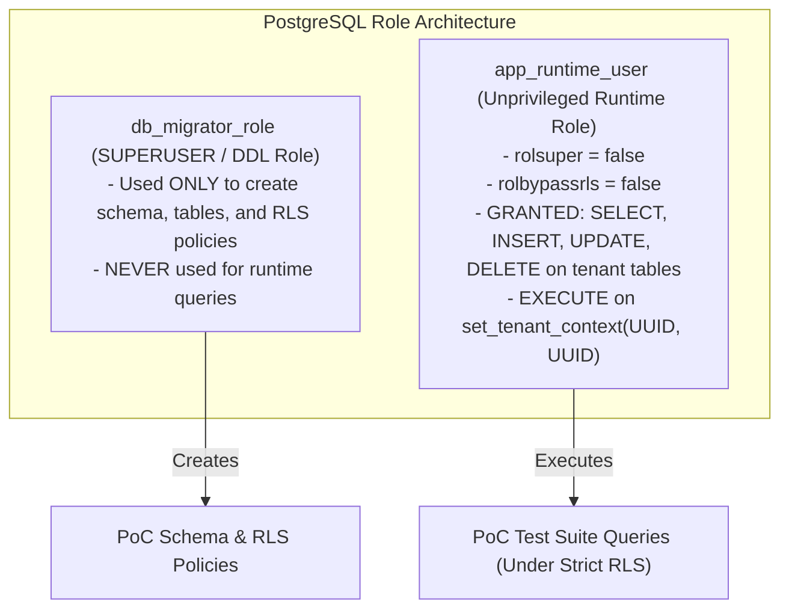

# POC-DB-01: PostgreSQL Data Access & Tenant Isolation Validation Plan

**Document Status:** PROPOSED PLAN — STRICTLY NOT EXECUTED  
**System:** Multi-Tenant College Admissions SaaS Architecture  
**Target Specification:** [ARCHITECTURE_REVISION_3_1_5.md](file:///x:/Prasad%20projact%20works/PRO%20day%20report/docs/ARCHITECTURE_REVISION_3_1_5.md) (Sections 5.1, 5.5, 5.6, 9.2, 10.2, and 11)  
**Execution Boundary:** Non-executed specification plan. Zero database connections, migrations, or application code implemented.

---

## 1. Objectives and Scope

The objective of `POC-DB-01` is to empirically validate the core PostgreSQL data access, Row-Level Security (RLS) enforcement, tenant isolation, and concurrency control invariants specified in Architecture Revision 3.1.5 prior to implementing any production application handlers.

### Core Architecture Invariants to Validate
1. **Tenant Isolation:** A database session scoped to Tenant A can never read, modify, or delete records belonging to Tenant B.
2. **Fail-Closed Null Context:** If a query executes without explicitly setting `app.current_tenant_id`, the RLS policy must evaluate to `UNKNOWN` (falsy) and return **zero rows**, preventing global data exposure.
3. **Transaction Pooling Context Discard:** Setting tenant context with `is_local = true` (`set_tenant_context`) must automatically discard session state when the transaction ends, preventing context leakage across pooled connections (e.g. PgBouncer in transaction mode).
4. **Atomic Rollback & Write Integrity:** Multi-table operations aborted mid-transaction must leave zero partial writes or orphaned records.
5. **Tenant-Scoped Unique Constraints:** Phone numbers must be unique within a tenant workspace (via `phone_blind_index_v2` partial unique index), while cleanly permitting identical phone numbers across different tenants.
6. **Staff-Seat Quota Atomic Serialization:** Concurrently claiming the final seat in a workspace subscription must serialize on the parent row lock, permitting exactly one worker and failing the second with a quota conflict.
7. **Unprivileged Runtime Role:** The runtime application role must not possess `SUPERUSER` or `BYPASSRLS` privileges, and tables must enforce `FORCE ROW LEVEL SECURITY`.
8. **Hardened Tenant Context Trust Boundary:** Setting tenant context requires dual parameters `(p_user_id, p_workspace_id)` with active membership verification against `workspace_memberships` and in-transaction context immutability.

---

## 2. Threat Model & Failure Modes

| ID | Threat / Defect Scenario | Architectural Defense Mechanism | PoC Validation Test |
| :--- | :--- | :--- | :---: |
| **TM-1** | **Cross-Tenant Data Leakage via Pooled Connection** | `set_config('app.current_tenant_id', ..., true)` with `is_local = true` discards context on transaction commit/rollback. | Test 3 |
| **TM-2** | **Fail-Open on Missing Tenant Context** | `workspace_id = NULLIF(current_setting('app.current_tenant_id', true), '')::uuid` evaluates to `NULL`, returning 0 rows. | Test 2 |
| **TM-3** | **RLS Bypass via Privilege Escalation** | Application role (`app_runtime_user`) created without `SUPERUSER` or `BYPASSRLS`. Table set with `FORCE ROW LEVEL SECURITY`. | Test 7 |
| **TM-4** | **Cross-Tenant Unique Index Collision** | Index `idx_leads_workspace_phone_v2` is composite on `(workspace_id, phone_blind_index_v2)` where `deleted_at IS NULL`. | Test 5 |
| **TM-5** | **Partial Multi-Table Mutation Corruption** | Multi-table inserts wrapped in explicit atomic transaction blocks (`BEGIN ... COMMIT`). | Test 4 |
| **TM-6** | **Seat Over-Allocation Race Condition** | Provisioning queries parent `workspace_subscriptions ... FOR UPDATE` before counting active memberships. | Test 6 |
| **TM-7** | **Unauthorized Tenant Context Forgery & Mid-Tx Hijacking** | Dual-parameter `set_tenant_context(p_user_id, p_workspace_id)` validates active membership in `workspace_memberships` and rejects mid-transaction switching. | Test 9 |

---

## 3. Test Roles and Security Isolation



### Safety Rules for Test Execution:
- **No Production Infrastructure:** Must run on a dedicated disposable database (`shop_db` or `poc_db_01_disposable`).
- **Loopback Enforcement:** Strictly restricted to `127.0.0.1`, `localhost`, or `::1`.
- **Synthetic Data Only:** All names, phone numbers, user IDs, and workspace IDs are synthetically generated. Zero PII.
- **Fail-Closed Configuration:** If `app_runtime_user` has `BYPASSRLS` or if host is non-loopback, the test runner halts immediately.

---

## 4. Test Suite Specification (9 Core Test Scenarios)

### TEST 1: Tenant Read & Write Boundary Isolation
- **Objective:** Verify that a query executed under Tenant A (`W1`) context cannot read or modify Tenant B (`W2`) records.
- **Role:** `app_runtime_user`.
- **Sequence:**
  1. `BEGIN; SELECT set_tenant_context('USER_W1_ADMIN', 'W1');`
  2. `SELECT count(*) FROM student_leads;` $\to$ **Assert: exactly 50 rows**.
  3. `SELECT count(*) FROM student_leads WHERE workspace_id = 'W2';` $\to$ **Assert: 0 rows** (invisible under RLS).
  4. `UPDATE student_leads SET student_name = 'EXPLOIT' WHERE workspace_id = 'W2';` $\to$ **Assert: 0 rows affected**.
  5. `COMMIT;`
- **Pass Criteria:** `W1` sees only `W1` records; `W2` records remain completely unmodified and invisible.

---

### TEST 2: Fail-Closed Null Context Protection
- **Objective:** Verify that an unauthenticated or un-scoped query (missing tenant context) returns 0 rows and rejects inserts.
- **Role:** `app_runtime_user`.
- **Sequence:**
  1. `BEGIN;` (Do NOT execute `set_tenant_context`).
  2. `SELECT count(*) FROM student_leads;` $\to$ **Assert: 0 rows**.
  3. `INSERT INTO student_leads (id, workspace_id, student_name, phone_blind_index_v2, encrypted_phone) VALUES (...);`
  4. **Assert:** PostgreSQL rejects insert with RLS policy violation (`new row violates row-level security policy for table "student_leads"`).
  5. `ROLLBACK;`
- **Pass Criteria:** Missing context fails closed for both reads and writes.

---

### TEST 3: Connection Pooler Context Discard (`is_local = true`)
- **Objective:** Verify that when transactions share a single pooled physical connection, the tenant context does not bleed into subsequent transactions.
- **Setup:** Single interactive `psql` connection.
- **Sequence:**
  1. *Transaction 1:* `BEGIN; SELECT set_tenant_context('USER_W1_ADMIN', 'W1'); SELECT count(*) FROM student_leads; COMMIT;` $\to$ **Assert: 50 rows**.
  2. *Transaction 2 (same connection):* `BEGIN; SELECT count(*) FROM student_leads; COMMIT;` (Without setting context).
- **Pass Criteria:** Transaction 2 returns **0 rows**. Proves `is_local = true` automatically discards `app.current_tenant_id` upon `COMMIT` without session bleed.

---

### TEST 4: Atomic Multi-Table Rollback on Operational Failure
- **Objective:** Verify that an operational error during multi-table writes cleanly rolls back all modifications without partial writes.
- **Sequence:**
  1. `BEGIN; SELECT set_tenant_context('USER_W1_ADMIN', 'W1');`
  2. Insert lead `L_test`.
  3. Insert child interaction `F_test`.
  4. Execute invalid query: `SELECT 1/0;` (Division by zero forces transaction abort).
  5. Execute `ROLLBACK;`.
  6. Inspect database: `SELECT count(*) FROM student_leads WHERE id = 'L_test';` and `SELECT count(*) FROM field_visits WHERE id = 'F_test';`.
- **Pass Criteria:** Both counts are **0**. Zero partial writes persisted.

---

### TEST 5: Tenant-Scoped Phone Blind-Index Uniqueness (`phone_blind_index_v2`)
- **Objective:** Verify that duplicate phone numbers are permitted across distinct tenants, prohibited within the same tenant, and reusable after soft deletion.
- **Setup:** Synthetic phone number `+919876543210` with HMAC-SHA256 blind index `H_phone`.
- **Sequence:**
  1. Insert into Tenant A (`W1`) using `USER_W1_ADMIN`: **Assert: Success**.
  2. Insert into Tenant B (`W2`) using `USER_W2_STAFF`: **Assert: Success** (Cross-tenant co-existence verified).
  3. Attempt duplicate insert into Tenant A (`W1`): **Assert: Rejection with unique constraint violation** (`idx_leads_workspace_phone_v2`).
  4. Soft-delete original lead in Tenant A (`UPDATE student_leads SET deleted_at = NOW() WHERE ...`).
  5. Re-insert identical phone into Tenant A (`W1`): **Assert: Success** (Partial unique index allows reuse after soft delete).
- **Pass Criteria:** Unique constraint enforces intra-tenant uniqueness without cross-tenant collision.

---

### TEST 6: Staff-Seat Quota Atomic Serialization (Parent Row Lock)
- **Objective:** Verify that concurrent seat provisioning requests serialize on the parent `workspace_subscriptions` row lock and reject over-allocation.
- **Setup:** Workspace `W1` subscription configured with hard cap of 10 seats; currently 9 seats occupied.
- **Sequence:**
  1. Worker 1 and Worker 2 concurrently attempt to claim seat #10.
  2. Both transactions execute:
     ```sql
     BEGIN;
     SELECT id, total_allocated_seats FROM workspace_subscriptions WHERE workspace_id = 'W1' FOR UPDATE;
     SELECT count(*) FROM workspace_memberships WHERE workspace_id = 'W1' AND is_active = TRUE;
     ```
  3. Worker 1 acquires lock, observes count = 9, inserts seat #10, and commits.
  4. Worker 2 unblocks, re-reads active count = 10, detects `count >= total_allocated_seats`, issues `ROLLBACK`, and raises simulated `SEAT_QUOTA_EXCEEDED` (HTTP 422).
- **Pass Criteria:** Exactly one seat is added. Active count is 10. Worker 2 cleanly aborts with quota error.

---

### TEST 7: Unprivileged Runtime Role Attribute Enforcement
- **Objective:** Verify that `app_runtime_user` cannot bypass RLS, and that tables mandate `FORCE ROW LEVEL SECURITY`.
- **Sequence:**
  1. Query `pg_roles` for `app_runtime_user`:
     **Assert:** `rolsuper = FALSE`, `rolbypassrls = FALSE`.
  2. Query `pg_class` for `student_leads`:
     **Assert:** `relrowsecurity = TRUE`, `relforcerowsecurity = TRUE`.
- **Pass Criteria:** Engine-level guarantees prevent role from bypassing RLS policies.

---

### TEST 8: Connection Pooler RLS Latency Overhead Benchmark
- **Objective:** Measure latency overhead introduced by `set_tenant_context` across 200 cycles.
- **Sequence:**
  1. Execute 200 baseline transactions: `BEGIN; SELECT 1; COMMIT;`. Measure round-trip latency.
  2. Execute 200 context-injected transactions: `BEGIN; SELECT set_tenant_context('USER_W1_ADMIN', 'W1'); SELECT 1; COMMIT;`. Measure round-trip latency.
  3. Compute $\Delta \text{latency} = \text{p95}_{\text{injected}} - \text{p95}_{\text{baseline}}$.
- **Pass Criteria:** $\Delta \text{latency} < 2.0\text{ ms}$ at p95.

---

### TEST 9: Unauthorized Cross-Tenant Context Switching & Forgery Rejection
- **Objective:** Verify that an established transaction cannot be hijacked to switch workspaces mid-transaction, that unauthorized users are rejected from establishing foreign tenant contexts, and that deactivated users cannot establish context.
- **Role:** `app_runtime_user`.
- **Sequence:**
  1. *Legitimate Establishment:* Connect as `app_runtime_user`. Execute `BEGIN; SELECT set_tenant_context('USER_W1_ADMIN', 'W1');`. Read leads $\to$ **Assert: exactly 50 rows visible**.
  2. *In-Transaction Hijacking Attempt:* Within the same open transaction, attempt to switch to Tenant B: `SELECT set_tenant_context('USER_W2_STAFF', 'W2');`.
     **Assert: Rejection** with `AUTHORIZATION_FAILURE: Cannot switch tenant context within an active transaction` (SQL error code `42501`).
     Execute `ROLLBACK;`.
  3. *Unauthorized Membership Attempt:* In a fresh transaction, user `USER_W1_ADMIN` (who belongs only to `W1`) attempts to establish context for Tenant B (`W2`): `SELECT set_tenant_context('USER_W1_ADMIN', 'W2');`.
     **Assert: Rejection** with `AUTHORIZATION_FAILURE: Invalid tenant context or unauthorized user` (SQL error code `42501`).
  4. *Deactivated User Attempt:* In a fresh transaction, deactivated user `USER_INACTIVE_W1` attempts to establish context for `W1`: `SELECT set_tenant_context('USER_INACTIVE_W1', 'W1');`.
     **Assert: Rejection** with `AUTHORIZATION_FAILURE: Invalid tenant context or unauthorized user` (SQL error code `42501`).
     Execute `ROLLBACK;`.
  5. *Data Boundary Audit:* Following rejected attempts, verify unscoped queries return **0 rows** and cross-tenant mutations affect **0 rows**.
  6. *Legitimate Alternative Establishment:* User `USER_W2_STAFF` legitimately establishes Tenant B context: `BEGIN; SELECT set_tenant_context('USER_W2_STAFF', 'W2');`. Read leads $\to$ **Assert: exactly 50 rows visible**. `COMMIT;`.
- **Pass Criteria:** Mid-transaction switches rejected; unauthorized users rejected; deactivated users rejected; foreign tenant data remains completely inaccessible.

---

## 5. Identity-Authentication Trust Assumption & Remaining Security Gaps

### Trust Assumption Boundary
The dual-parameter function `set_tenant_context(p_user_id UUID, p_workspace_id UUID)` guarantees that:
1. Context cannot be switched mid-transaction once established.
2. A user who belongs only to Workspace A cannot be used to establish context for Workspace B.
3. Deactivated users cannot establish context.

### Remaining Architectural Gap (Unverified at Database Boundary)
* `app_runtime_user` is a shared database connection pool user (e.g. PgBouncer pool client).
* The PostgreSQL database engine does not natively authenticate the HTTP end-user identity; it receives `p_user_id` as a query parameter from the application server.
* **Threat:** If an attacker achieves arbitrary SQL execution as `app_runtime_user` (e.g., via advanced SQL injection) AND knows or discovers the UUID of an active member of Workspace B (`USER_W2_STAFF`), the database function will validate that `USER_W2_STAFF` belongs to `W2` and grant access.
* **Required Architectural Solution for Production (Post-PoC):**
  To achieve true zero-trust isolation where `app_runtime_user` cannot forge another user's identity even under raw SQL execution:
  - **Option 1 (Cryptographic Context Tokens):** Application server signs a context token with an HMAC key unknown to `app_runtime_user` (`HMAC-SHA256(user_id || workspace_id || exp, server_secret)`), and the database verifies the HMAC signature using `pgcrypto`.
  - **Option 2 (Database-Managed Session Tokens):** Database maintains a transient `user_sessions` table with high-entropy bearer hashes; `set_tenant_context` accepts the session token hash rather than a raw UUID.

---

## 6. Artifacts and Directory Layout

All `POC-DB-01` files reside strictly within `poc-db-01/`:

```
poc-db-01/
├── .env.poc                               # Safe placeholder configuration template (disposable confirmed = NO)
├── schema.sql                             # Namespaced schema poc_db_01, tables, hardened set_tenant_context, RLS
├── seed.sql                               # Deterministic synthetic tenants, leads, memberships, subscriptions
├── test_runner.js                         # Multi-session automated concurrency runner (Tests 1–9)
├── POC_DB_01_PLAN.md                      # This architectural validation plan
├── POC_DB_01_IMPLEMENTATION_REPORT.md     # Implementation and static audit report
└── POC_DB_01_RESULTS.json                 # Post-execution results (awaiting operator authorization)
```

---

## 7. Approval Gate & Non-Execution Declaration

* **Status:** **NOT EXECUTED.**
* **Execution Constraint:** Zero database connections, schema migrations, or test executions will occur until explicit user approval is granted.
* **Production Integrity:** This plan does not modify, reference, or connect to any production database, Supabase instance, or application endpoint.
